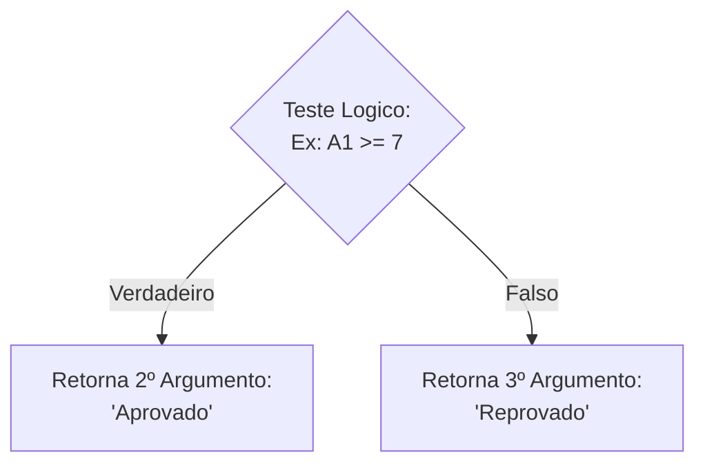
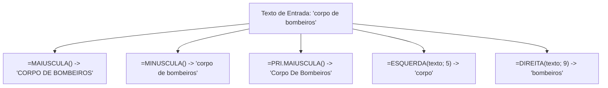
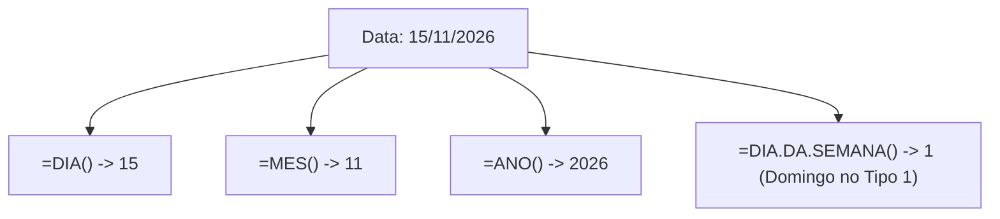
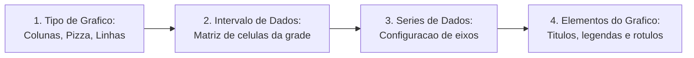
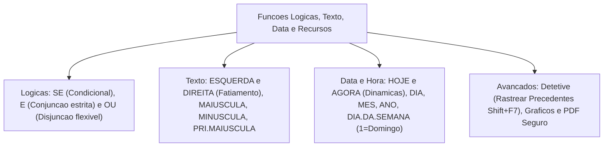

O processamento avançado de dados no LibreOffice Calc vai muito além das quatro operações aritméticas. Em ambientes de gestão operacional policial e de bombeiros militares, relatórios exigem testes de aptidão condicional. Exigem também limpeza e padronização de cadastros textuais. Demandam ainda cronometria exata de escalas de serviço e auditoria gráfica de fórmulas.

Neste capítulo conclusivo do volume, estudaremos as funções lógicas SE, E e OU. Veremos o tratamento de textos com ESQUERDA, DIREITA, MINÚSCULA, MAIÚSCULA e PRI.MAIÚSCULA. Em seguida, analisaremos a aritmética de datas e horas com DIA, MÊS, ANO, HOJE, AGORA e DIA.DA.SEMANA. Por fim, exploraremos recursos avançados como a ferramenta Detetive, gráficos e exportação documental.

> [!objetivos]
> - Dominar a estrutura condicional da função SE simples e encadeada em conjunto com E e OU.
> - Aplicar as funções de manipulação de cadeias de texto e ajuste de maiúsculas e minúsculas.
> - Compreender o sistema de contagem serial de data e hora e suas funções de extração cronológica.
> - Conhecer os métodos de auditoria de dependências com a ferramenta Detetive.
> - Identificar as etapas de criação de gráficos e os formatos de exportação segura do Calc.

---

## Funções Lógicas: SE, E e OU

As funções lógicas avaliam testes relacionais para decidir qual caminho de cálculo ou mensagem deve ser retornado na célula:

### Função SE (Condicional Simples e Aninhada)
A função `=SE(teste_lógico; valor_se_verdadeiro; [valor_se_falso])` possui estrutura tripartite:
1. `teste_lógico`: expressão comparativa que resulta em `VERDADEIRO` ou `FALSO` (como `A1 >= 7`, `B2 = "Apto"` ou `C3 <> 0`).
2. `valor_se_verdadeiro`: valor ou fórmula devolvido caso o teste seja verdadeiro.
3. `[valor_se_falso]`: valor retornado caso o teste resulte em falso. Se for omitido, o Calc exibe a palavra `FALSO`.

Exemplo prático: em uma planilha de avaliação física, a fórmula `=SE(B2>=50; "Aprovado"; "Reprovado")` confere se o militar atingiu a nota mínima. Quando existem mais de dois desfechos possíveis, aninham-se novas funções SE no terceiro argumento: `=SE(B2>=70; "Excelente"; SE(B2>=50; "Regular"; "Reprovado"))`.

### Funções E e OU (Operadores Booleanos de Apoio)
As funções `E` e `OU` combinam múltiplas condições dentro do teste lógico da função SE:
- **Função E**: `=E(condição1; condição2; ...)`. Retorna `VERDADEIRO` apenas se **todas as condições forem verdadeiras**. Se uma única condição for falsa, o retorno será `FALSO`.
- **Função OU**: `=OU(condição1; condição2; ...)`. Retorna `VERDADEIRO` se **pelo menos uma das condições for satisfeita**. Ela só resulta em `FALSO` quando todas as condições forem falsas.

> [!exemplo]
> **Ponto de Atenção das Páginas 50 e 51 (OU e SE combinados)**: considere a fórmula `=SE(OU(A1="Oficial"; B1>=10); 500; 100)`. Se a célula A1 contiver "Soldado", mas a célula B1 registrar o tempo de serviço 12, a função `OU` retornará `VERDADEIRO` (pois a segunda condição foi cumprida). Consequentemente, a função `SE` retornará o valor 500.

---

## Funções de Texto: ESQUERDA, DIREITA, CONCATENAR e Ajuste de Caixa

A manipulação de cadeias de caracteres viabiliza a higienização de nomes, matrículas e prefixos de viaturas:

### Funções ESQUERDA e DIREITA (Extração de Caracteres)
Essas funções fatiam partes de um texto com base na quantidade de caracteres desejada:
- **Função ESQUERDA**: `=ESQUERDA(texto; [quantidade])`. Extrai os primeiros caracteres da esquerda para a direita. Se a quantidade for omitida, o Calc extrai apenas o primeiro caractere. Exemplo: `=ESQUERDA("PERNAMBUCO"; 3)` retorna `"PER"`.
- **Função DIREITA**: `=DIREITA(texto; [quantidade])`. Extrai os últimos caracteres posicionados na ponta direita do texto. Exemplo: `=DIREITA("RECIFE"; 4)` resulta em `"CIFE"`.

### Padronização de Caixa: MAIÚSCULA, MINÚSCULA e PRI.MAIÚSCULA
O Calc oferece funções para regularizar nomes digitados fora do padrão institucional:
- **MAIÚSCULA**: `=MAIÚSCULA(texto)`. Converte todas as letras alfabéticas para caixa alta (`=MAIÚSCULA("bombeiro")` vira `"BOMBEIRO"`).
- **MINÚSCULA**: `=MINÚSCULA(texto)`. Converte todas as letras para caixa baixa (`=MINÚSCULA("POLÍCIA")` vira `"polícia"`).
- **PRI.MAIÚSCULA**: `=PRI.MAIÚSCULA(texto)`. Converte em maiúscula apenas a primeira letra de cada palavra, mantendo as demais em minúsculas (`=PRI.MAIÚSCULA("corpo de bombeiros")` resulta em `"Corpo De Bombeiros"`).

> [!bizu]
> **Ponto de Atenção das Páginas 52 a 54 (Ajuste Textual)**: a função `PRI.MAIÚSCULA` atua sobre cada palavra separada por espaços ou pontuações. Em nomes compostos, preposições como "de" ou "da" também recebem a letra inicial maiúscula. Essa característica é frequentemente explorada em questões de prova.

---

## Funções de Data e Hora: HOJE, AGORA, DIA, MÊS, ANO e DIA.DA.SEMANA

No LibreOffice Calc, as datas são armazenadas internamente como números inteiros sequenciais. O dia número 1 equivale a 30 de dezembro de 1899 na configuração padrão do sistema:
- O número 2 equivale a 31 de dezembro de 1899. O número 3 equivale a 01 de janeiro de 1900.
- Somar o número 1 a uma data avança a contagem em exatamente um dia corrido (`=A1 + 1`).
- As horas, minutos e segundos são registrados como frações decimais de um dia de 24 horas. Doze horas equivalem a `0,5` dia. Seis horas equivalem a `0,25` dia.

### Funções Dinâmicas: HOJE e AGORA
- **Função HOJE**: `=HOJE()`. Retorna a data atual do sistema operacional, formatada como dia, mês e ano. Ela não aceita argumentos. Recalcula automaticamente sempre que a planilha for aberta ou recalculada.
- **Função AGORA**: `=AGORA()`. Retorna a data e o horário correntes do relógio do sistema, combinando data e fração de hora.

### Funções de Decomposição: DIA, MÊS e ANO
Permitem extrair os componentes isolados de uma data válida:
- **Função DIA**: `=DIA(data)`. Retorna o dia do mês como um número inteiro de 1 a 31. Exemplo: para a data 15/11/2026, a fórmula `=DIA("15/11/2026")` retorna o número 15.
- **Função MÊS**: `=MÊS(data)`. Devolve o mês do ano como um número de 1 a 12 (`=MÊS("15/11/2026")` retorna 11).
- **Função ANO**: `=ANO(data)`. Retorna o ano com quatro dígitos inteiros (`=ANO("15/11/2026")` devolve 2026).

### Função DIA.DA.SEMANA
A função `=DIA.DA.SEMANA(data; [tipo])` converte uma data em um número que representa o dia da semana:
- No padrão brasileiro tradicional (tipo 1 ou omitido): **1 = Domingo**, **2 = Segunda-feira**, **3 = Terça-feira**, ..., **7 = Sábado**.
- No tipo 2: 1 = Segunda-feira até 7 = Domingo.
- No tipo 3: 0 = Segunda-feira até 6 = Domingo.

> [!pegadinha]
> **Ponto de Atenção das Páginas 55 a 57 (DIA.DA.SEMANA e Função DIA)**:
> 1. No padrão do Calc, o primeiro dia da semana é o **Domingo**, representado pelo número **1**. A Segunda-feira é o número 2, e o Sábado é o número 7.
> 2. Se a data informada na função `DIA()` for inválida ou estiver em formato de texto não reconhecido, o Calc exibirá o erro `#VALOR!`.

---

## Conceitos Avançados: Detetive, Gráficos e Exportação

O LibreOffice Calc disponibiliza ferramentas visuais avançadas para auditoria analítica e apresentação de dados:

### Ferramenta Detetive e Navegação por Atalhos
Localizada no menu **Ferramentas -> Detetive**, essa ferramenta desenha setas gráficas e traços com círculo ou bola na ponta para inspecionar relações entre células:
- **Rastrear Precedentes (`Shift+F7`)**: traça uma seta apontando para a célula ativa a partir das coordenadas que alimentam sua fórmula. O traço conecta as células que fornecem dados diretos.
- **Rastrear Dependentes (`Shift+F5`)**: exibe uma seta partindo da célula ativa em direção a todas as outras células que referenciam seu resultado na planilha.
- **Rastrear Erros**: localiza a célula original causadora de erro na cadeia de cálculo, desenhando uma seta vermelha com uma pequena bola ou círculo no ponto de falha.
- **Remover Rastreadoras**: reverte a exibição visual e apaga todas as setas desenhadas na tela.

Na movimentação rápida pela planilha, o cursor move-se com eficiência por meio de atalhos de teclado consagrados:
- A tecla **Home** move o cursor diretamente para a primeira coluna da linha ativa (coluna A).
- O atalho `Ctrl+Home` move o cursor para a célula inicial `A1`, enquanto `Ctrl+End` salta para a última célula com conteúdo na matriz.
- As teclas **Page Up** e **Page Down** deslocam a visualização uma tela inteira para cima ou para baixo.
- Em caixas de diálogo e no campo de fórmulas, pressionar `Esc` cancela a edição e reverte o valor para o estado anterior sem salvar modificações indevidas.

### Assistente de Gráficos
Gráficos transformam linhas numéricas em recursos visuais elucidativos para o comando. A caixa de diálogo do assistente é estruturada em 4 etapas sequenciais:
1. **Tipo de Gráfico**: escolha da geometria visual (Colunas, Barras, Pizza, Linhas, Dispersão XY, Área).
2. **Intervalo de Dados**: seleção da matriz com rótulos de linhas e colunas.
3. **Séries de Dados**: ajuste de dados em eixos primários e secundários em cada campo de série.
4. **Elementos do Gráfico**: inclusão de título, subtítulo, legendas e eixos X e Y.

### Exportação Segura em PDF
O Calc integra conversor direto para o formato PDF no menu *Arquivo -> Exportar como -> Exportar como PDF*. A caixa de diálogo desse módulo permite configurar compactação sem perdas, criptografia com senha de abertura e restrição contra impressão ou cópia de texto desautorizada.

> [!bizu]
> **Auditoria com o Detetive**: o Detetive não altera os valores nem as fórmulas das células. As setas são elementos gráficos puramente informativos e não aparecem na impressão em papel nem nos arquivos exportados em PDF.

---

## Exercícios Práticos e Questões Comentadas

### Questão 1 (Prova anterior)
No LibreOffice Calc, a célula A1 contém o valor 10 e a célula B1 contém o texto "Bombeiro". Ao avaliar na célula C1 a fórmula `=SE(E(A1>=10; B1="Policial"); 50; SE(OU(A1<5; B1="Bombeiro"); 100; 200))`, o resultado exibido será:
A) 50
B) 100
C) 200
D) FALSO
E) `#VALOR!`

**Gabarito: B**

**Comentário detalhado:**
Avaliando a fórmula por etapas:
1. Primeiro teste lógico: `E(A1>=10; B1="Policial")`. A1 é 10 (verdadeiro), mas B1 é "Bombeiro" e não "Policial" (falso). A função `E` retorna `FALSO`.
2. O fluxo segue para o valor se falso, que é um novo `SE`: `SE(OU(A1<5; B1="Bombeiro"); 100; 200)`.
3. Teste do segundo SE: `OU(A1<5; B1="Bombeiro")`. A1<5 é falso, mas B1="Bombeiro" é verdadeiro. A função `OU` retorna `VERDADEIRO`.
4. Como o teste foi verdadeiro, a função retorna o valor 100.
Portanto, a alternativa correta é a B.

---

### Questão 2 (Prova anterior)
Assinale a alternativa que indica a função do LibreOffice Calc utilizada para converter a primeira letra de cada palavra em maiúscula, mantendo as demais em minúsculas:
A) `=MAIÚSCULA()`
B) `=PRIMEIRA()`
C) `=PRI.MAIÚSCULA()`
D) `=CAPITALIZAR()`
E) `=INICIAL.MAIÚSCULA()`

**Gabarito: C**

**Comentário detalhado:**
A função oficial do Calc para colocar em maiúscula a letra inicial de cada palavra é `=PRI.MAIÚSCULA()`. A função `MAIÚSCULA` converte todas as letras, enquanto os demais nomes não existem no programa. A opção correta é a C.

---

### Questão 3 (Inédita)
No LibreOffice Calc, a data de 08/11/2026 cai em um domingo. Ao aplicar a fórmula `=DIA.DA.SEMANA("08/11/2026")` sem especificar o segundo argumento, o número inteiro retornado será:
A) 1
B) 2
C) 7
D) 0
E) 8

**Gabarito: A**

**Comentário detalhado:**
Na configuração padrão da função `DIA.DA.SEMANA` (tipo 1 ou omitido), os dias são numerados de 1 (Domingo) a 7 (Sábado). Sendo 08/11/2026 um domingo, o resultado devolvido é exatamente 1. A alternativa correta é a A.

---

## Mapa do Capítulo

---

### Para fixar

- **Função SE**: avalia teste lógico e bifurca o retorno entre valor se verdadeiro e se falso.
- **Função E**: exige que todas as proposições sejam verdadeiras para retornar VERDADEIRO.
- **Função OU**: requer apenas uma condição verdadeira para aprovar o teste.
- **Funções ESQUERDA e DIREITA**: extraem caracteres a contar da ponta esquerda ou direita do texto.
- **Função PRI.MAIÚSCULA**: torna maiúscula a primeira letra de cada palavra de um texto.
- **Contagem serial de datas**: cada dia equivale a um número inteiro; horas são frações decimais.
- **Funções HOJE e AGORA**: HOJE devolve a data corrente; AGORA traz a data e o horário com minutos e segundos.
- **Função DIA.DA.SEMANA**: no modo padrão, representa o Domingo como 1 e o Sábado como 7.
- **Ferramenta Detetive**: desenha setas de precedentes e dependentes para auditar o fluxo de fórmulas.
- **Exportação em PDF**: permite gerar relatórios protegidos contra modificação diretamente pelo menu Arquivo.
