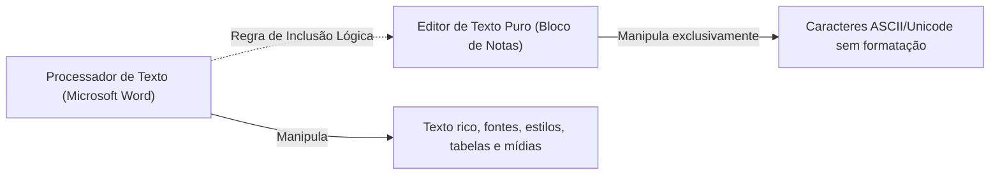
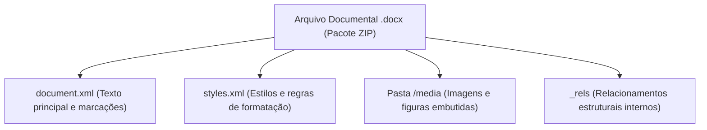
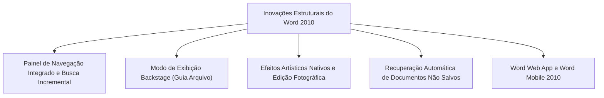
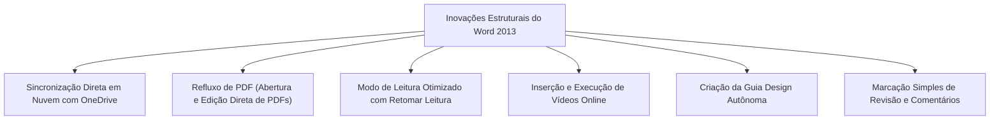
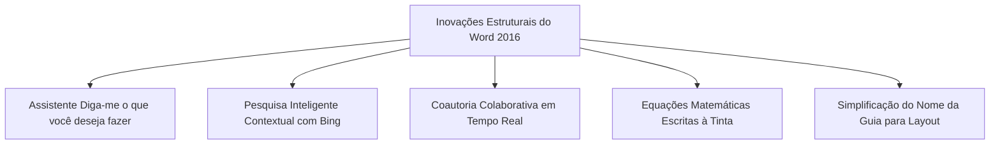
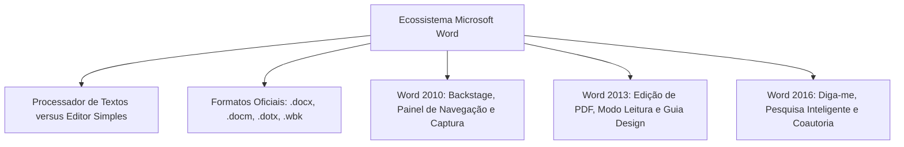

O Microsoft Word é o processador de textos mais difundido no setor público e nas corporações privadas. Integrante fundamental da suíte Microsoft Office e do serviço de assinatura em nuvem Microsoft 365, o aplicativo é cobrado com grande constância em concursos.

Neste capítulo, você conhecerá os alicerces teóricos da ferramenta. Analisaremos a fronteira técnica entre editores e processadores de texto, o formato aberto Open XML e o salto evolutivo das versões 2010, 2013 e 2016. Cada detalhe foi estruturado com foco nas exigências práticas do seu edital.

> [!objetivos]
> - Compreender a distinção conceitual e funcional entre editor simples e processador de textos.
> - Dominar os padrões de extensões de arquivo do Word (`.docx`, `.docm`, `.dotx`, `.dotm` e `.wbk`).
> - Identificar as inovações introduzidas no Word 2010 (Backstage, Painel de Navegação e edição visual).
> - Analisar os recursos incorporados no Word 2013 (Refluxo de PDF, Modo Leitura e Guia Design).
> - Reconhecer as novidades do Word 2016 (Diga-me, Pesquisa Inteligente e coautoria em tempo real).

## Conceitos Básicos de Processamento de Texto

A preparação para certames exige clareza sobre os tipos de softwares de escrita. A banca examinadora costuma explorar a diferença fundamental entre **editor de texto** e **processador de texto**.

Um editor de texto simples manipula apenas texto puro. O Bloco de Notas do Windows é o exemplo mais conhecido. Ele grava sequências de caracteres sem qualquer estilo visual agregado. Não existem variações de fontes por palavra, cores, tamanhos personalizados ou alinhamentos complexos de parágrafos. Não é viável incluir imagens, tabelas ou quebras de seção. Esse software destina-se principalmente a rascunhos rápidos, scripts e códigos-fonte.

Em contrapartida, o processador de texto oferece ambiente integral de editoração eletrônica. O Microsoft Word é o líder absoluto dessa categoria. O programa permite formatar caracteres com precisão tipográfica e estilizar parágrafos. O usuário insere tabelas, gráficos estatísticos, fotos, formas geométricas e elementos SmartArt. Além disso, gerencia cabeçalhos, rodapés, paginação automática, sumários e mala direta.

> [!pegadinha]
> **Pegadinha da Regra de Inclusão Conceitual**: Todo processador de textos funciona também como editor de texto. Afinal, ele digita, apaga e altera caracteres alfanuméricos. Todavia, **nenhum editor elementar se equipara a um processador documental completo**. Em provas, chamar o Word de editor de textos é aceitável em sentido amplo. Entretanto, ele não atua como editor de tabelas nem como editor gráfico vetorial.

| Dimensão Funcional | Editor de Texto Simples (Bloco de Notas) | Processador de Texto Avançado (Microsoft Word) |
|---|---|---|
| Formatação Tipográfica | Inexistente no arquivo; tipografia uniforme na tela | Total: fontes, tamanhos, cores, sobrescrito e subscrito |
| Estrutura de Parágrafo | Quebra de linha básica; ausência de recuos | Recuos especiais, espaçamento entrelinhas e hifenização |
| Elementos Gráficos | Não aceita tabelas, imagens ou diagramas | Suporte completo a fotos, tabelas, formas e gráficos |
| Paginação e Seções | Fluxo contínuo sem limites físicos de página | Quebras de página, quebras de seção, margens e rodapés |
| Formato de Gravação Nativo | Texto puro (`.txt`) sem marcações de formatação | Padrão compactado em XML (`.docx`) e modelos (`.dotx`) |
| Recursos Colaborativos | Totalmente ausentes | Controle de alterações, comentários e trabalho na nuvem |

## Contexto Histórico e Padrões de Arquivos

O Microsoft Word foi criado por Richard Brodie e Charles Simonyi. Sua primeira versão surgiu em 1983 para os sistemas operacionais MS-DOS e Xenix. O grande salto ocorreu com o lançamento da interface gráfica no Windows. Desde então, o programa consolidou sua liderança de mercado. Passou dos antigos menus suspensos para a moderna Faixa de Opções. Hoje, integra o modelo contínuo de assinatura do Microsoft 365.

A transição de formatos no Office 2007 representa um ponto histórico vital. Até o Word 2003, o aplicativo empregava a extensão binária fechada `.doc`. A partir da versão 2007, a Microsoft estabeleceu o padrão **Office Open XML (OOXML)**. Essa especificação tornou-se norma internacional aberta sob o código ISO/IEC 29500.

O arquivo com extensão `.docx` é estruturado como um pacote compactado no formato ZIP. Dentro desse pacote coexistem arquivos XML estruturados e diretórios de mídia. Essa organização reduz expressivamente o tamanho dos documentos no disco. Além disso, confere grande robustez contra a corrupção acidental de dados.

> [!bizu]
> **Extensões Fundamentais do Word em Concursos**:
> - `.docx`: Documento de texto convencional sem código de macro executável.
> - `.docm`: Documento de texto habilitado para conter macros em linguagem VBA.
> - `.dotx`: Modelo de documento estruturado sem macros.
> - `.dotm`: Modelo de documento estruturado contendo macros programadas.
> - `.wbk`: Arquivo de cópia de segurança automática (*Word Backup*).
> - `.pdf`: Formato de layout fixo suportado para exportação e edição direta.

## Novidades Estruturais do Microsoft Word 2010

O lançamento do Word 2010 estabeleceu profundas transformações operacionais. O software otimizou a navegação interna e a gestão global de arquivos. Ao mesmo tempo, incorporou capacidades gráficas antes restritas a softwares de design.

### Painel de Navegação e Busca Incremental

O Word 2010 apresentou o inovador **Painel de Navegação**. Ele é ativado pelo atalho `Ctrl+L` ou pelo grupo Edição da Guia Página Inicial. O painel unificou recursos de busca e organização em uma barra lateral fixa. Sua interface organiza o trabalho em três guias complementares:

1. **Navegar pelos Títulos**: Exibe a árvore hierárquica dos títulos formatados com estilos estruturais. O usuário pode recolher tópicos, reordenar seções inteiras arrastando blocos e rebaixar ou promover níveis com extrema facilidade. No gerenciamento de documentos longos, essa ferramenta agiliza o fluxo de produção. Se o arquivo tiver múltiplos tópicos aninhados em diferentes graus hierárquicos, o redator consegue reestruturar o conteúdo facilmente arrastando os títulos diretamente no painel.
2. **Navegar pelas Páginas**: Mostra miniaturas sequenciais de todas as páginas do arquivo. Isso permite rápida inspeção visual e saltos imediatos pelo texto.
3. **Resultados de Pesquisa**: Executa varreduras incrementais enquanto as palavras são digitadas. O painel lista fragmentos contextuais de cada ocorrência encontrada.

### Mobilidade e Versão Web no Word 2010

A experiência de trabalho descentralizado ganhou impulso com a introdução do **Word Web App** e do aplicativo móvel voltado para smartphones da época:

- **Word Mobile para Windows Phone**: Integrado ao Office Mobile, o aplicativo permitiu consultar e revisar textos a partir de anexos de mensagens e diretórios corporativos. O profissional podia ler relatórios e aplicar correções mesmo em deslocamento operacional.
- **Word Web App**: Permitiu abrir e editar arquivos diretamente pelo navegador de internet. Assim, o operador edite textos com ferramentas essenciais sem depender da instalação do pacote local completo no computador.
- **Estrutura de Tópicos Remota**: Usuários em trânsito podiam pular rapidamente entre seções e comentários utilizando a navegação por cabeçalhos.

### Modo Backstage e a Guia Arquivo

No Word 2007, a Microsoft havia testado o Botão Office circular. No Word 2010, essa solução deu lugar definitivo à **Guia Arquivo**. Ao ser clicada, essa guia não abre uma fita de botões. Ela transporta o operador para o **Modo de Exibição Backstage**.

O Backstage ocupa a tela inteira do aplicativo. Sua proposta é gerenciar o documento como entidade integral. Nele estão reunidas as funções de salvar, exportar, imprimir, inspecionar propriedades, definir senhas de proteção e ajustar as opções gerais do sistema.

> [!atencao]
> **Impossibilidade de Personalizar a Guia Arquivo**: A Faixa de Opções do Word é totalmente configurável. O usuário pode criar novas guias, reorganizar botões e renomear grupos. Todavia, **a Guia Arquivo não pode ser personalizada, movida ou ocultada**. Essa restrição técnica é sistematicamente explorada pelas bancas em pegadinhas de concurso.

### Recursos Tipográficos OpenType e Controles de Formulário

O Word 2010 ampliou o tratamento tipográfico incorporando vantagens das fontes **OpenType**:

- **Ligaduras Tipográficas**: Junção estética de letras contíguas como `fi` e `fl`. O recurso elimina choques visuais entre hastes adjacentes.
- **Conjuntos Estilísticos**: Formatos alternativos elegantes desenhados para determinadas famílias tipográficas.
- **Formas Numéricas**: Opções de números com alinhamento tabular ou desenhos em estilo antigo.
- **Controle de Caixa de Seleção**: Inserção de caixas interativas de checagem direta no corpo do documento. Isso viabiliza listas de verificação dinâmicas em formulários administrativos.
- **Texto Alternativo em Tabelas**: Inclusão de títulos e descrições acessíveis para leitura por pessoas com deficiência visual. Esse recurso garante compatibilidade com leitores de tela em documentos oficiais.

### Edição de Imagens, SmartArt e Captura de Tela

O tratamento visual avançou consideravelmente na versão 2010:

- **Efeitos Artísticos Nativos**: Mais de vinte filtros gráficos aplicáveis diretamente às imagens inseridas. Os efeitos simulam fotocópias, esboços a lápis, esponja de aquarela e técnicas visuais refinadas (*arts* e filtros digitais) sem exigir programas externos.
- **Novos Modelos de SmartArt**: Inclusão de novos layouts visuais combinando fotos e legendas descritivas. O usuário pode converter fotos convencionais diretamente em diagramas conceituais.
- **Coleção de Mídias e Clip-Art**: Acesso a elementos da biblioteca de imagens e coleções de clip para enriquecer relatórios.
- **Remoção de Plano de Fundo**: Recurso automático que detecta contornos e exclui o fundo indesejado de fotos.
- **Ajustes Fotográficos**: Regulagem intuitiva de saturação cromática, temperatura de cor, nitidez, brilho e contraste.
- **Ferramenta de Captura de Tela**: Inserção rápida de recortes de tela ou janelas abertas diretamente no texto.
- **Visualização Dinâmica de Colagem (*Live Preview*)**: Ao passar o ponteiro do mouse sobre os ícones de colagem, o Word exibe o resultado antes da confirmação do clique.

### AutoRecuperação e Cópia de Segurança

Para proteger o trabalho contra imprevistos, o Word 2010 aprimorou a **AutoRecuperação**:

- O programa salva versões automáticas temporárias em intervalo ajustável (o padrão é de dez minutos).
- **Recuperação de Arquivos Não Salvos**: Viabiliza o resgate do último rascunho automático se o operador fechar o aplicativo sem salvar.
- Cópia permanente de proteção documental assume a terminação `.wbk`.
- **Minitradutor**: Janela flutuante que traduz palavras selecionadas e permite ouvir a pronúncia sem demandar pacotes pesados de idioma.

| Versão | Eixo Principal | Estrutura e Navegação | Tratamento Gráfico | Manipulação Documental |
|---|---|---|---|---|
| **Word 2010** | Consolidação do Backstage | Painel de Navegação lateral com títulos e miniaturas | Remoção de fundo, efeitos artísticos e captura de tela | Resgate de arquivos não salvos e extensão `.wbk` |
| **Word 2013** | Conexão em Nuvem e Telas Touch | Expansão de tópicos e marcador Retomar Leitura | Vídeo online e guias dinâmicas de alinhamento visual | Edição nativa de PDFs e Guia Design autônoma |
| **Word 2016** | Colaboração em Tempo Real | Caixa Diga-me e Pesquisa Inteligente via Bing | Equações à tinta desenhadas à mão livre | Trabalho simultâneo online e guia Layout simplificada |

## Novidades Estruturais do Microsoft Word 2013

O Word 2013 priorizou a mobilidade, a navegação em telas sensíveis ao toque e a integração nativa com o OneDrive e SharePoint.

### Refluxo de PDF (*PDF Reflow*)

A possibilidade de **abrir e editar arquivos PDF diretamente no Word** foi a grande novidade do Word 2013.

Nas versões anteriores, o programa apenas exportava documentos em formato PDF. A partir da edição 2013, o Word realiza a conversão reversa. Ao abrir um arquivo `.pdf`, o sistema converte elementos estáticos em texto fluido editável. Tabelas, listas e parágrafos tornam-se completamente alteráveis.

> [!atencao]
> **Fidelidade Visual na Conversão de PDFs**: A velocidade e a precisão do Refluxo de PDF dependem da complexidade visual do arquivo original. Documentos resultantes de escaneamento sem camada OCR comportam-se como imagens. Além disso, diagramações muito truncadas podem apresentar pequenos deslocamentos na conversão.

### Modo de Leitura e Recursos de Continuidade

O Word 2013 substituiu a antiga visualização de tela inteira pelo moderno **Modo de Leitura**. Essa interface oculta as barras de formatação e dispõe o conteúdo em colunas fluidas na tela:

- **Zoom de Objetos**: Um duplo clique sobre fotos, gráficos ou tabelas amplia o elemento até ocupar integralmente a área do monitor. Um novo toque retorna ao fluxo do texto.
- **Retomar Leitura**: Ao reabrir um arquivo, uma notificação discreta surge no canto da tela. O recurso pergunta se o usuário deseja retornar ao parágrafo exato onde havia parado.
- **Recolhimento Estrutural de Tópicos**: Pequenos triângulos posicionados junto aos cabeçalhos permitem ocultar ou expandir blocos inteiros de parágrafos subordinados.

### Mídia Online e Autonomia da Guia Design

- **Vídeo Online**: O Word 2013 passou a incorporar vídeos hospedados em plataformas web. O vídeo pode ser reproduzido diretamente no interior da página do documento.
- **Guias Dinâmicas de Alinhamento**: Linhas verdes temporárias orientam o posicionamento de imagens e formas geométricas em relação às margens e textos.
- **Autonomia da Guia Design**: Até a versão 2010, comandos de temas e marcas d'água ficavam distribuídos de modo disperso. O Word 2013 reuniu esses parâmetros visuais na exclusiva **Guia Design**.

### Gestão Moderna de Revisões

- **Marcação Simples**: Exibição simplificada de controle de alterações. Em vez de poluir o texto com múltiplos balões, o Word sinaliza as alterações com uma sutil linha vertical na margem.
- **Respostas Encadeadas a Comentários**: Os comentários passaram a funcionar como debates estruturados. É possível responder pontualmente e marcar um item como **concluído**, mantendo o histórico intacto.

## Novidades Estruturais do Microsoft Word 2016

O Word 2016 aprofundou recursos de assistência inteligente, integração contextual com a web e edição simultânea em rede corporativa. Ao contrário de versões que alteraram radicalmente o visual do software, a edição de 2016 trouxe pouquíssimas alterações estéticas na barra de menus, concentrando suas inovações na produtividade operacional.

### O Recurso "Diga-me o que você deseja fazer"

Posicionada ao término das guias na Faixa de Opções, a caixa **Diga-me** auxilia a busca de ferramentas. Basta digitar um verbo ou termo comum como "criar tabela" para que o comando correspondente seja acionado de imediato. Isso poupa tempo na navegação entre dezenas de botões.

### Pesquisa Inteligente (*Smart Lookup*)

Com a **Pesquisa Inteligente**, o usuário seleciona uma expressão no texto e aciona o comando pelo menu contextual. O sistema utiliza o mecanismo Microsoft Bing para abrir um painel lateral integrado. A ferramenta traz verbetes, definições conceituais e imagens sem demandar a abertura de um navegador de internet.

### Coautoria em Tempo Real e Histórico de Versões

O Word 2016 viabilizou a genuína **coautoria simultânea**:

- Quando o arquivo está hospedado no OneDrive ou SharePoint, vários usuários editam o documento ao mesmo tempo.
- Pequenos cursores identificados com cores e nomes indicam onde cada colega está escrevendo.
- O recurso **Histórico de Versões** permite auditar, inspecionar e resgatar versões anteriores com segurança.

### Equações à Tinta e Nomenclatura das Guias

- **Equações à Tinta**: No grupo Símbolos da Guia Inserir, a ferramenta de Equação à Tinta permite que o usuário desenhe qualquer equação matemática complexa à mão livre com caneta ou mouse. O Word interpreta a caligrafia e converte os traços em fórmulas digitais padronizadas.
- **Mudança de Nome da Guia**: Do Word 2007 ao 2013, a barra dimensional chamava-se **Layout da Página**. No Word 2016, sua designação oficial foi simplificada para **Layout**.

### Síntese Comparativa das Edições em Provas

Para consolidar a fixação das novidades, as bancas costumam inverter propositadamente os recursos de cada versão. É comum apresentarem uma ferramenta criada em 2010 como se pertencesse a 2016, ou atribuírem a edição de PDF ao Word 2010.

| Situação Cobrada em Prova | Versão Correta | Fundamentação Teórica |
|---|---|---|
| Abertura e edição direta de arquivos no formato PDF | **Word 2013** | Recurso de Refluxo de PDF (*PDF Reflow*) |
| Criação da Guia Design como aba independente na Ribbon | **Word 2013** | Reuniu temas, cores e marcas d'água em guia própria |
| Introdução do Painel de Navegação lateral com títulos | **Word 2010** | Substituiu a janela clássica de busca por painel integrado |
| Conversão de desenhos livres em equações matemáticas | **Word 2016** | Ferramenta Equação à Tinta no grupo Símbolos |
| Assistente de busca de comandos em linguagem natural | **Word 2016** | Recurso Diga-me o que você deseja fazer |
| Redução do nome da guia Layout da Página para Layout | **Word 2016** | Simplificação da nomenclatura na Faixa de Opções |

> [!exemplo]
> **Evolução no Word 2019 e Microsoft 365**:
> As versões recentes acrescentaram recursos adicionais de ponta. Entre eles destacam-se a inserção nativa de modelos tridimensionais (3D), ícones vetoriais escaláveis no formato SVG, tradução instantânea com Microsoft Tradutor, ferramentas avançadas de acessibilidade e o recurso de Ditado por voz com inteligência artificial.

## Mapa do capítulo

### Para fixar

- O Word é um processador de textos completo; todo processador edita texto, mas um editor simples (Bloco de Notas) não é processador documental.
- O formato `.docx` baseia-se no padrão internacional aberto Office Open XML (ISO/IEC 29500), funcionando como pacote ZIP compactado com arquivos XML e diretórios de mídia.
- Arquivos `.docm` suportam macros em linguagem VBA, enquanto modelos pré-formatados utilizam as extensões `.dotx` (sem macros) e `.dotm` (com macros).
- Cópias automáticas de segurança geradas pelo Word assumem a extensão `.wbk`.
- O Word 2010 implementou o Modo Backstage na Guia Arquivo, o Painel de Navegação lateral com títulos e miniaturas, e filtros de edição gráfica em imagens.
- A Guia Arquivo da Ribbon **não pode ser personalizada**, movida ou ocultada pelo usuário da mesma forma que as demais guias.
- O Word 2013 estabeleceu a abertura e edição de arquivos PDF (Refluxo de PDF), o Modo de Leitura com Retomar Leitura, vídeos online e a Guia Design autônoma.
- O Word 2016 trouxe a caixa de assistência Diga-me o que você deseja fazer, a Pesquisa Inteligente via Bing, equações desenhadas à tinta e coautoria simultânea em tempo real.
- A guia anteriormente chamada Layout da Página passou a se chamar oficialmente **Layout** a partir do Word 2016.
