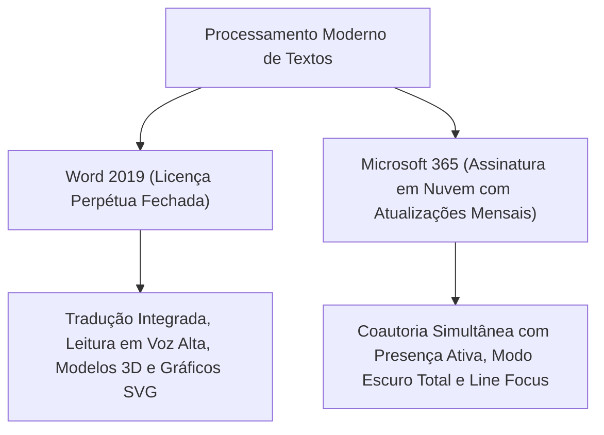
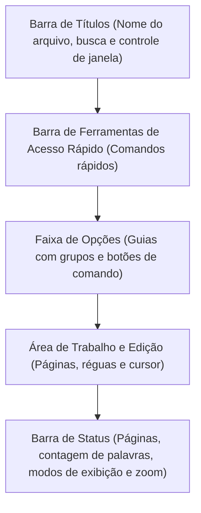
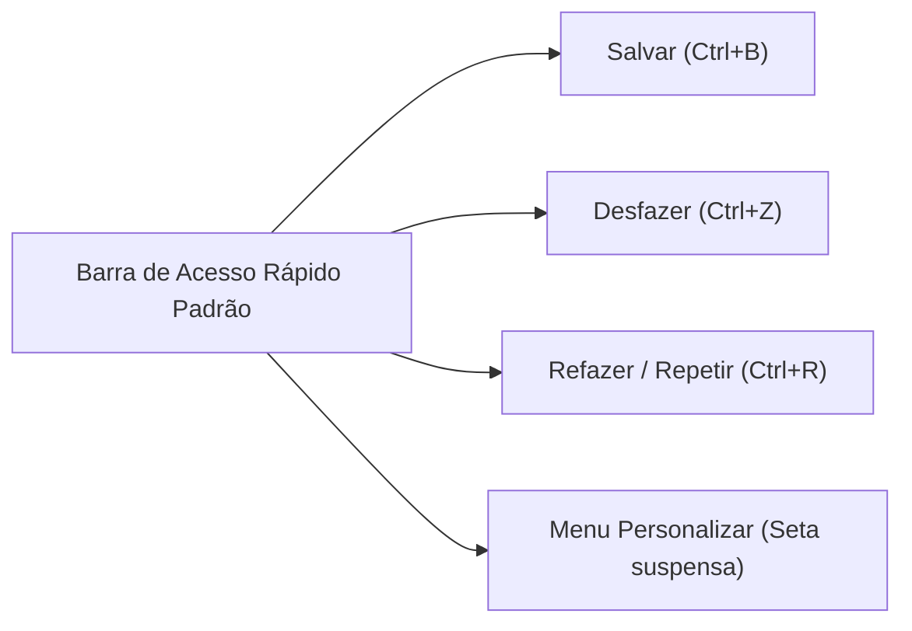
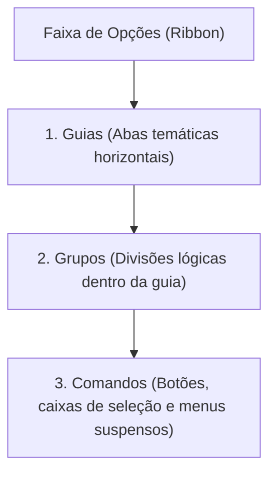
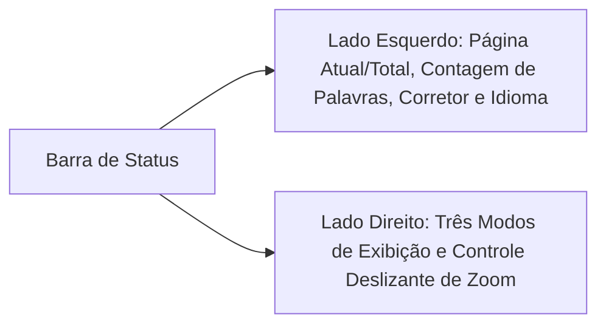
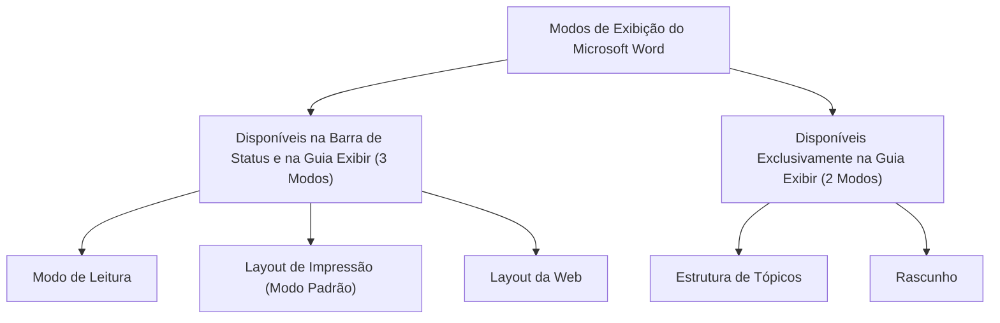
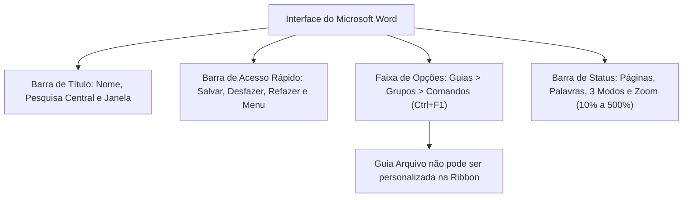

A compreensão minuciosa da interface gráfica do Microsoft Word constitui requisito indispensável em concursos. As bancas examinadoras cobram com rigor a identificação topográfica dos componentes de tela, a hierarquia funcional de ferramentas e os recursos exclusivos do modelo de assinatura Microsoft 365.

Neste capítulo, você dominará a anatomia completa do aplicativo. Exploraremos a Barra de Título, a Barra de Ferramentas de Acesso Rápido, a Faixa de Opções e a Barra de Status. Veremos ainda como operam os modos de exibição de documentos e as regras estritas que regem a personalização do ambiente de trabalho.

> [!objetivos]
> - Reconhecer as novidades do Word 2019 e a dinâmica contínua do Microsoft 365.
> - Dominar a disposição estrutural da Barra de Título e da Barra de Ferramentas de Acesso Rápido.
> - Compreender a hierarquia da Faixa de Opções (Guias > Grupos > Comandos) e seus atalhos (`Ctrl+F1`).
> - Identificar as limitações técnicas na personalização da Guia Arquivo.
> - Diferenciar os cinco modos oficiais de exibição do Word e suas presenças na Barra de Status.

## Novidades do Word 2019 e Ecossistema Microsoft 365

A evolução recente do processador de textos da Microsoft combina o modelo de versões perpétuas (como o Office 2019 e 2021, referenciadas em ementas pelo tópico de novidades e por vezes truncadas como ovidades Word 201) com a plataforma de assinatura contínua denominada Microsoft 365.

No Word 2019, a Microsoft implementou melhorias práticas de edição e acessibilidade:

- **Tradução Nativa**: Integração com a ferramenta Microsoft Translator na Guia Revisão. O sistema traduz palavras, períodos ou o documento inteiro de forma instantânea.
- **Ferramentas de Aprendizagem e Leitura**: Ajuste visual de espaçamento textual, largura de coluna e leitura em voz alta com realce sincronizado de palavras.
- **Caneta Digital e Tinta**: Conjunto avançado de canetas para desenhar, grifar, converter escrita manual em texto tipográfico e solucionar expressões matemáticas.
- **Suporte a Sintaxe Matemática LaTeX**: Criação de equações no editor de equações utilizando codificação LaTeX textual padronizada.
- **Ícones Vetoriais e Modelos 3D**: Inserção de ilustrações vetoriais escaláveis no formato SVG e de objetos tridimensionais com rotação completa em 360 graus.
- **Movimentação de Páginas Lado a Lado**: Alternância de rolagem vertical tradicional para visualização horizontal de páginas contíguas, assemelhando-se à leitura de um livro impresso.

Por sua vez, o **Microsoft 365** (anteriormente designado Office 365 e renomeado em 2020) representa uma plataforma corporativa em nuvem. A contratação ocorre por plano de assinatura periódica. O pacote unifica Word, Excel, PowerPoint, Outlook, Teams e armazenamento no OneDrive.

A grande diferenciação operacional do Microsoft 365 reside no ciclo de atualização. Enquanto as edições tradicionais recebiam pacotes de novidades a cada três anos, o Microsoft 365 recebe atualizações funcionais mensais de modo automático.

> [!bizu]
> **Recursos Distintivos do Microsoft 365 em Prova**:
> - **Salvamento Automático (*AutoSave*)**: Botão alternador ativo quando o documento reside no OneDrive ou SharePoint, gravando alterações em tempo real.
> - **Modo Escuro Completo**: Escurece não apenas as barras e guias de ferramentas, mas também o fundo da folha virtual de escrita.
> - **Foco na Linha (*Line Focus*)**: Recurso de leitura imersiva que isola uma, três ou cinco linhas por vez na tela, atenuando distrações.
> - **Verificador de Acessibilidade Contínuo**: Emite alertas em tempo real na Barra de Status quando identifica barreiras visuais para pessoas com deficiência.

## Anatomia da Interface Gráfica do Word

Ao iniciar um documento em branco ou selecionar um modelo estruturado (`.dotx`), o usuário se depara com a interface visual do programa (mencionada em sumários técnicos pela expressão interface ou nterface gráfica). A tela é organizada verticalmente em faixas horizontais bem delimitadas.

### Barra de Títulos

Posicionada no topo absoluto da janela do aplicativo, a Barra de Títulos desempenha funções administrativas e informativas essenciais:

1. **Identificação Documental**: Exibe o nome do arquivo atualmente em edição (por exemplo, "Documento1" em arquivos novos) seguido pelo nome do aplicativo ("Word").
2. **Caixa de Pesquisa Universal da Microsoft**: Campo centralizado onde o usuário busca termos textuais, localiza ferramentas do software e consulta tópicos de ajuda online.
3. **Identificação do Usuário e Compartilhamento**: Mostra o perfil conectado à conta corporativa ou pessoal e o botão Compartilhar.
4. **Botões de Controle da Janela**: Agrupa no canto superior direito os botões Minimizar, Restaurar/Maximizar e Fechar.

> [!esquema]
> **Operações com o Mouse na Barra de Títulos**:
> - Um **clique duplo** sobre a área livre da Barra de Títulos alterna entre maximizar a janela e restaurá-la ao tamanho anterior.
> - Clicar e **arrastar** a Barra de Títulos desloca a janela inteira pela tela do computador.

## Barra de Ferramentas de Acesso Rápido

Localizada habitualmente acima da Faixa de Opções, no canto superior esquerdo da tela (embora possa ser movida para baixo dela), a **Barra de Ferramentas de Acesso Rápido** reúne utilitários de alta frequência operacional.

Por configuração de fábrica, a Barra de Acesso Rápido traz exatamente quatro itens:

1. **Salvar**: Grava o progresso do arquivo (atalho `Ctrl+B` em português).
2. **Desfazer**: Reverte a última ação executada (atalho `Ctrl+Z`).
3. **Refazer / Repetir**: Reexecuta a ação recém-desfeita ou repete o comando prévio (atalho `Ctrl+R`).
4. **Personalizar Barra de Ferramentas de Acesso Rápido**: Ícone em formato de seta apontada para baixo que abre o menu suspensa de personalização.

> [!pegadinha]
> **Comandos Padrão da Barra de Acesso Rápido**: A banca frequentemente tenta induzir o aluno ao erro afirmando que os comandos *Abrir*, *Novo*, *Imprimir* ou *Salvar Como* constam por padrão na Barra de Acesso Rápido. **Isso é incorreto**. Por padrão, apenas constam **Salvar, Desfazer, Refazer e o menu Personalizar**. Todos os demais comandos podem ser adicionados pelo usuário, mas não vêm ativados de fábrica.

A personalização permite adicionar botões como Impressão Rápida, Visualizar Impressão, Novo, Abrir, Ortografia e Gramática ou qualquer outro comando do Word por meio da caixa de diálogo Mais Comandos.

## Arquitetura da Faixa de Opções (Ribbon)

A Faixa de Opções, introduzida para substituir os antigos menus suspensos das versões legadas do Office, organiza os comandos de maneira visual, modular e contextual.

A hierarquia da Faixa de Opções respeita rigorosamente três níveis concatenados:

- **Guias (Abas)**: Nível superior que categoriza grandes áreas de atividade do usuário (ex.: Página Inicial, Inserir, Layout, Referências, Revisão).
- **Grupos**: Subdivisões lógicas visíveis dentro de cada guia, delimitadas por linhas verticais sutis (ex.: dentro da guia Página Inicial existem os grupos Área de Transferência, Fonte, Parágrafo, Estilos e Edição).
- **Botões e Ferramentas de Comando**: Elementos operacionais executáveis situados no interior de cada grupo (ex.: Negrito, Itálico, Alinhamento Centralizado, Pincel de Formatação).

> [!atencao]
> **Atenção à Ordem Hierárquica em Provas**: Questões de informática costumam tentar inverter a relação estrutural, afirmando que "as guias ficam organizadas dentro de grupos". Lembre-se sempre: **as guias contêm os grupos, e os grupos reúnem os botões de comando**.

### Tipos de Guias e Atalhos de Visualização

A Faixa de Opções opera com três categorias funcionais de guias:

1. **Guias Fixas Padrão**: Sempre visíveis durante a edição regular do texto. Incluem Arquivo, Página Inicial, Inserir, Design, Layout, Referências, Correspondências, Revisão, Exibir e Ajuda.
2. **Guias Contextuais (Ferramentas)**: Surgem na barra apenas quando determinados objetos especializados estão selecionados pelo usuário. Ao clicar em uma tabela, surgem as guias **Design da Tabela** e **Layout**. Ao selecionar uma foto ou forma, surge a guia **Formato da Imagem** ou **Formato de Forma**. Ao retirar o cursor do objeto, essas guias desaparecem imediatamente.
3. **Guias Personalizadas**: Abas criadas diretamente pelo usuário por meio do painel de opções, contendo conjuntos exclusivos de comandos.

O atalho de teclado fundamental para a Faixa de Opções é `Ctrl+F1`:
- Pressionar **`Ctrl+F1`** recolhe ou expande a Faixa de Opções. Quando recolhida, apenas os nomes das guias permanecem visíveis, ampliando a área útil de digitação do documento.

### Regras de Personalização da Faixa de Opções

O usuário possui ampla liberdade para customizar o ambiente de trabalho no Word, mas existem barreiras técnicas intransponíveis que são cobradas com grande frequência:

| Ação de Personalização | É Possível Fazer? | Detalhes e Restrições Técnicas |
|---|---|---|
| Criar novas Guias e novos Grupos | **Sim** | O usuário pode atribuir nomes personalizados e adicionar botões |
| Ocultar guias padrão da Ribbon | **Sim** | É viável desmarcar a exibição de guias como Inserir, Revisão, etc. |
| Reorganizar a ordem das guias | **Sim** | Pode-se mover guias para a direita ou esquerda |
| Importar e exportar personalizações | **Sim** | Configurações podem ser gravadas em arquivos de perfil |
| Alterar tamanho de ícones ou da barra | **Não** | O dimensionamento depende exclusivamente da resolução do monitor |
| Personalizar a **Guia Arquivo** | **Não** | Não admite reposicionamento, ocultação ou edição de grupos |

> [!pegadinha]
> **Impossibilidade de Customizar a Guia Arquivo**: Conforme já salientado na evolução histórica, a Guia Arquivo aciona o modo Backstage e não se comporta como as guias normais da Ribbon. Em provas, assertivas que afirmam ser possível reorganizar, ocultar ou renomear a Guia Arquivo devem ser prontamente julgadas como **falsas**.

## Barra de Status e Modos de Exibição

A **Barra de Status** estende-se horizontalmente ao longo da borda inferior da janela do Word. Seu objetivo é apresentar dados operacionais imediatos e fornecer atalhos de visualização sem interferir no texto.

### Lado Esquerdo da Barra de Status

No canto inferior esquerdo encontram-se indicadores contextuais informativos:

- **Indicador de Página**: Informa a página onde está o cursor e o número total de páginas (ex.: "Página 3 de 15"). Clicar nesse botão abre o Painel de Navegação na guia Páginas ou a caixa de diálogo Localizar e Substituir na aba Ir Para.
- **Contagem de Palavras**: Exibe a quantidade total de palavras digitadas. Ao clicar sobre esse indicador, o Word abre a caixa estatística completa informando total de páginas, palavras, caracteres sem espaço, caracteres com espaço, parágrafos e linhas.
- **Ícone de Verificação Ortográfica**: Representado por um pequeno livro aberto. Mostra uma marca de seleção verde quando o texto não possui pendências ou um sinal vermelho quando existem desvios gramaticais ou ortográficos detectados.
- **Idioma de Edição**: Identifica o idioma atribuído ao trecho textual onde o ponto de inserção está posicionado (ex.: "Português (Brasil)"). Clicar nele permite selecionar outro idioma para verificação corretiva.

### Modos Oficiais de Exibição do Word

O Microsoft Word disponibiliza **cinco modos de exibição** de documentos. Contudo, existe uma distinção crucial entre os modos disponíveis na Guia Exibir e aqueles com atalhos diretos na Barra de Status.

1. **Layout de Impressão**: É o modo padrão do Word. Apresenta o documento na tela com exata correspondência visual com o papel impresso (*WYSIWYG*). Exibe margens brancas, cabeçalhos, rodapés, numeração de páginas, colunas e objetos flutuantes.
2. **Modo de Leitura**: Otimiza a exibição para telas digitais e dispositivos táteis. Oculta quase todas as ferramentas da Ribbon e distribui o texto em colunas dinâmicas horizontais.
3. **Layout da Web**: Exibe o arquivo como se fosse uma página de internet em formato HTML. O texto se estende continuamente pela largura total da janela, sem quebras de página fixas ou margens laterais de impressão.
4. **Estrutura de Tópicos**: Exclusivo da Guia Exibir. Apresenta o documento estruturado por níveis hierárquicos de títulos. Permite recolher capítulos e reorganizar blocos de conteúdo com rapidez analítica.
5. **Rascunho**: Exclusivo da Guia Exibir. Remove cabeçalhos, rodapés, bordas e imagens de fundo, deixando apenas o texto corrido. Destina-se à digitação e edição ágil em computadores modestos.

> [!pegadinha]
> **Armadilha dos Modos na Barra de Status**: A banca costuma afirmar que todos os cinco modos de exibição possuem botões dedicados na Barra de Status. **Isso é incorreto**. Na Barra de Status encontram-se unicamente **três modos**: Modo de Leitura, Layout de Impressão e Layout da Web. Além disso, as orientações de página "Retrato" e "Paisagem" são formatações dimensionais de layout, e não modos de exibição.

### Controle Deslizante de Zoom

No extremo inferior direito da Barra de Status repousa o controle de **Zoom**. Ele é composto por:

- Um botão de diminuir zoom (sinal de subtração `-`).
- Uma barra deslizante central.
- Um botão de aumentar zoom (sinal de adição `+`).
- Uma porcentagem numérica de ampliação atual (ex.: `100%`).

O valor de zoom varia de **10%** (limite mínimo) até **500%** (limite máximo de ampliação no Word). Clicar no valor percentual abre a caixa de diálogo de Zoom para ajuste numérico exato. Também é possível alterar o zoom girando a roda de rolagem do mouse (*scroll*) enquanto se mantém pressionada a tecla **`Ctrl`**.

> [!exemplo]
> **Personalização da Barra de Status**:
> Clicar com o **botão direito do mouse** em qualquer área livre da Barra de Status abre o menu contextual de personalização. Nele, o usuário pode ligar ou desligar elementos adicionais. É possível habilitar a exibição da linha e coluna ativas, o status do teclado numérico (*Num Lock*), o indicador de maiúsculas (*Caps Lock*), o status de gravação de macros e o botão de controle de alterações.

## Mapa do capítulo

### Para fixar

- O Word 2019 trouxe tradução integrada na Guia Revisão, leitura em voz alta, equações em sintaxe LaTeX, modelos 3D, gráficos SVG e visualização Lado a Lado.
- O Microsoft 365 é contratado sob modelo de assinatura em nuvem e recebe atualizações mensais automáticas.
- A Barra de Títulos traz o nome do arquivo, a caixa de pesquisa central e os controles de janela; duplo clique alterna entre maximizar e restaurar.
- A Barra de Ferramentas de Acesso Rápido possui por padrão apenas quatro itens: Salvar (`Ctrl+B`), Desfazer (`Ctrl+Z`), Refazer (`Ctrl+R`) e o menu Personalizar.
- A hierarquia da Ribbon obedece à ordem: Guias agrupam Grupos, e Grupos agrupam Botões de Comando.
- O atalho `Ctrl+F1` recolhe ou expande a Faixa de Opções.
- A Guia Arquivo aciona o Backstage e **não pode ser personalizada**, movida ou ocultada da mesma forma que as demais guias.
- O Word possui cinco modos de exibição: Layout de Impressão, Modo de Leitura, Layout da Web, Estrutura de Tópicos e Rascunho.
- Na Barra de Status figuram apenas três modos de exibição: Modo de Leitura, Layout de Impressão e Layout da Web.
- O controle de Zoom do Word admite graduações entre 10% (mínimo) e 500% (máximo).
