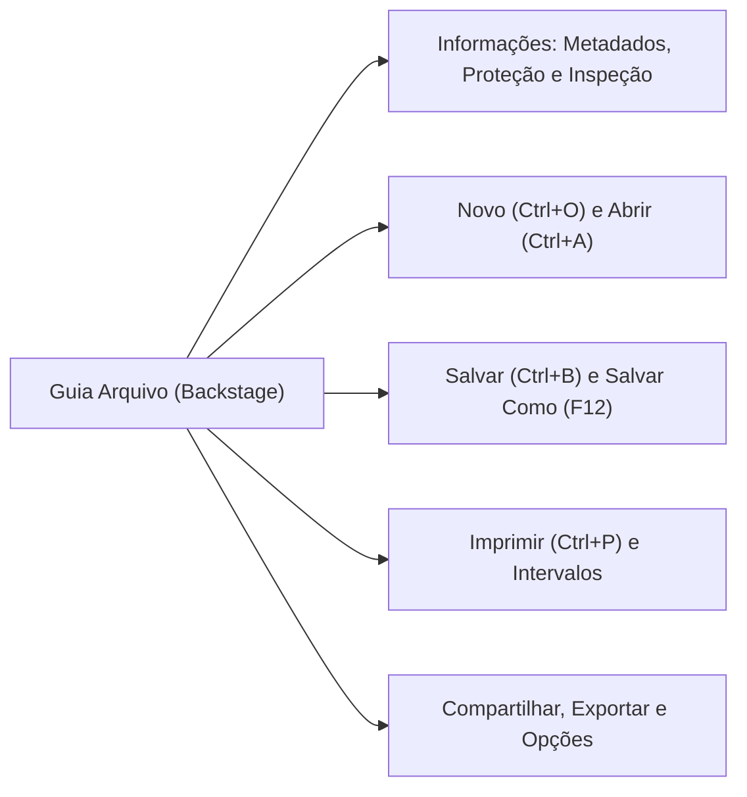
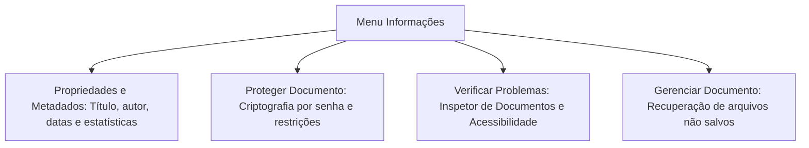
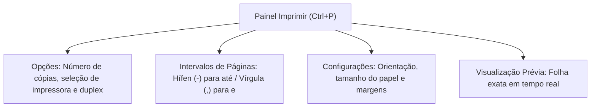
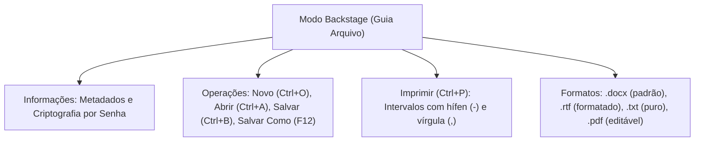

A Guia Arquivo ocupa uma posição singular na arquitetura do Microsoft Word. Ao contrário das demais guias da Faixa de Opções, que aplicam formatações ao texto visível, ela transporta o usuário para o Modo Backstage. Trata-se de uma interface em tela cheia dedicada à gestão integral do arquivo digital.

Neste capítulo, você examinará as operações executadas no Backstage. Analisaremos o gerenciamento de metadados, as opções de proteção documental e remoção de senhas, os comandos essenciais de abertura e gravação com seus respectivos atalhos e a lógica de sintaxe empregada no diálogo de impressão.

> [!objetivos]
> - Compreender a finalidade e a dinâmica operacional do Modo Backstage na Guia Arquivo.
> - Dominar a gestão de metadados, propriedades de arquivo e o uso do Inspetor de Documentos.
> - Conhecer as modalidades de proteção de arquivo e o procedimento oficial de remoção de senha.
> - Fixar os atalhos essenciais em língua portuguesa (`Ctrl+O`, `Ctrl+A`, `Ctrl+B`, `Ctrl+P` e `F12`).
> - Aplicar a sintaxe correta de intervalos em configurações de impressão personalizada.

## A Guia Arquivo e a Interface Backstage

A Guia Arquivo situa-se no canto superior esquerdo da interface gráfica do Word. Sua seleção substitui a visão da folha de trabalho por um painel gerencial em tela cheia denominado Modo Backstage. Essa interface foi concebida para concentrar as ações de nível de arquivo em um local intuitivo e unificado.

Diferente das abas tradicionais da Ribbon que aplicam estilos a palavras e parágrafos, a Guia Arquivo reúne ferramentas para gerenciar a entidade documental completa. Ali o operador salva versões, define permissões de segurança, imprime relatórios, compartilha links na nuvem e ajusta as preferências globais do aplicativo. Trata-se de uma central de comando para administrar o documento antes de sua publicação ou arquivamento permanente.

A distinção teórica fundamental cobrada em provas reside na separação de papéis: as guias tradicionais atuam **no** conteúdo textual (letras, parágrafos e imagens), ao passo que a Guia Arquivo atua **com** o arquivo como unidade de armazenamento no sistema operacional.

> [!bizu]
> **Como Sair do Modo Backstage**:
> Para retornar à área de trabalho e continuar a edição do texto, o usuário pode clicar na seta de retorno para a esquerda localizada no topo superior do painel ou simplesmente pressionar a tecla **`Esc`** no teclado.

## Informações, Metadados e Proteção de Documentos

Ao acessar o menu **Informações**, o usuário visualiza o painel de propriedades do documento. Ali estão consolidados os **metadados**, definidos na ciência da computação como "dados estruturados sobre dados".

Os metadados incluem autor principal, autores secundários, data de criação, data da última alteração, tamanho físico do arquivo no disco, quantidade de palavras, parágrafos e tempo total de edição. Essas informações também podem ser consultadas nas propriedades do arquivo pelo Windows Explorer. Caso um estudante copie um artigo de faculdade produzido originalmente por outra pessoa, os metadados frequentemente revelam o verdadeiro autor do texto. Por meio do comando **Propriedades Avançadas**, caso o usuário queira, o redator pode editar ou adicionar informações documentais complementares.

> [!pegadinha]
> **Metadados que Não Podem Ser Excluídos**: O Inspetor de Documentos permite localizar e expurgar dados pessoais, comentários ocultos e propriedades personalizadas antes do envio do arquivo a terceiros, por razões de segurança da informação. Contudo, **a Data de Criação e o Tamanho do arquivo não podem ser apagados pelo usuário**. Afinal, são atributos físicos controlados diretamente pelo sistema de arquivos do sistema operacional.

### Mecanismos de Proteção de Documentos

No menu Informações repousa o botão **Proteger Documento**, que oferece camadas graduais de segurança:

1. **Criptografar com Senha**: Bloqueia a abertura do arquivo com criptografia de alto nível. O documento só é lido mediante digitação da senha exata.
2. **Restringir Edição**: Permite que terceiros abram o arquivo normalmente, mas impede alterações no texto, liberando apenas comentários ou o registro de alterações.
3. **Restringir Acesso**: Gerencia direitos digitais corporativos via serviço Information Rights Management (IRM).
4. **Marcar como Final**: Desencoraja edições casuais tornando o arquivo somente leitura, alertando o leitor de que aquela versão é a definitiva.

> [!atencao]
> **Como Retirar a Senha de um Documento Protegido**:
> Essa questão surge com frequência nas provas. Para remover a senha de um documento criptografado, o procedimento correto é: abrir o arquivo com a senha atual, acessar **Arquivo > Informações > Proteger Documento > Criptografar com Senha**, apagar todos os caracteres da caixa de senha (deixando-a em branco), clicar em **OK** e **salvar o documento novamente** (`Ctrl+B`). Não se exige intervenção de administrador de rede nem conversão de formatos.

## Comandos Operacionais: Novo, Abrir, Salvar e Salvar Como

Os comandos elementares de gestão de arquivos possuem atalhos específicos no Microsoft Word configurado em idioma português brasileiro.

| Comando no Backstage | Atalho Oficial (PT-BR) | Finalidade Operacional Principal |
|---|---|---|
| **Novo** | `Ctrl + O` | Cria documento em branco ou baseado em modelo estruturado (`.dotx`) |
| **Abrir** | `Ctrl + A` | Abre arquivos locais, em rede ou na nuvem corporativa OneDrive |
| **Salvar** | `Ctrl + B` | Grava alterações recentes no mesmo arquivo e local em uso |
| **Salvar Como** | `F12` | Grava o documento com novo nome, em outro diretório ou novo formato |
| **Imprimir** | `Ctrl + P` | Abre o painel integrado de configuração de impressão e visualização |
| **Fechar** | `Ctrl + W` | Fecha a janela do documento ativo sem encerrar o Microsoft Word |

> [!pegadinha]
> **Atalhos Traduzidos para o Português**: No Word em português brasileiro, o atalho de salvar é **`Ctrl + B`** (de *backup* ou gravação rápida), e **não** `Ctrl + S`. A combinação `Ctrl + S` no Word aplica o efeito tipográfico **Sublinhado** ao texto selecionado. Além disso, `Ctrl + O` cria um **Novo** documento, enquanto `Ctrl + A` executa a ação de **Abrir**.

### Compatibilidade de Formatos e Arquivos de Intercâmbio

Ao acionar **Abrir** ou **Salvar Como**, o usuário pode selecionar diversos tipos de arquivos suportados:

- **`.docx`**: Padrão moderno nativo baseado no padrão Office Open XML sem código de macros.
- **`.docm`**: Documento com suporte a macros e rotinas automatizadas em VBA.
- **`.dotx` / `.dotm`**: Modelos institucionais de documentos para reutilização de padrões visuais.
- **`.pdf`**: Formato universal portátil. Desde o Word 2013, o Word tanto gera quanto abre e edita documentos PDF por meio do recurso de refluxo textual.
- **`.rtf` (*Rich Text Format*)**: Padrão universal de texto formatado. Mantém fontes, cores e tabelas, sendo plenamente legível em diferentes softwares e sistemas operacionais.
- **`.txt`**: Texto puro sem qualquer formatação visual.
- **`.xps`**: Formato de layout fixo concorrente da Microsoft. O Word pode exportar em XPS, mas **não edita arquivos XPS nativamente**.

> [!bizu]
> **Intercâmbio de Texto Formatado**: Se uma questão de concurso exigir o formato ideal para transferir texto com formatação (negrito, tabelas e fontes) entre processadores distintos (ex.: Word, LibreOffice Writer ou suítes como BrOffice) sem perda estrutural, a resposta correta é o formato **RTF**. Se a transferência for de dados brutos sem formatos, utiliza-se o formato **TXT**. Vale registrar que os arquivos `.docx`, `.odt` e `.pdf` podem ser amplamente abertos e editados no Word, ao passo que documentos no padrão XPS são apenas visualizados. Além disso, se o usuário clicou no comando Fechar sem salvar, o sistema exibirá o alerta de confirmação.

## Painel de Impressão e Sintaxe de Intervalos de Páginas

Acionado pelo atalho **`Ctrl + P`** ou pela Guia Arquivo, o painel **Imprimir** unifica as opções de envio para a impressora e a visualização prévia da folha (*Preview*).

Na seção de páginas personalizadas, o operador digita os intervalos desejados empregando dois operadores sintáticos padronizados:

- **Hífen (`-`)**: Significa intervalo sequencial contínuo (**"até"**). Por exemplo, `3-7` indica a impressão de todas as páginas da terceira até a sétima (páginas 3, 4, 5, 6 e 7).
- **Vírgula (`,`) ou Ponto e Vírgula (`;`)**: Significa adição pontual de páginas (**"e"**). Por exemplo, `2, 5, 9` comanda a impressão isolada das páginas dois, cinco e nove.

> [!exemplo]
> **Exemplo Prático de Sintaxe em Concursos**:
> Para imprimir as páginas 1 a 4, a página 8 e as páginas 11 a 15 de um boletim militar, a sintaxe formal correta a ser digitada na caixa Páginas é: **`1-4, 8, 11-15`** (ou `1-4; 8; 11-15`). A combinação encadeia intervalos contínuos com pontos isolados de forma simultânea.

## Recursos Adicionais: Compartilhar, Exportar e Opções

Na faixa inferior da Guia Arquivo encontram-se comandos administrativos complementares:

- **Compartilhar**: Envia links de colaboração para usuários com permissão no OneDrive ou anexa o arquivo automaticamente a uma mensagem de correio eletrônico do Outlook.
- **Exportar**: Centraliza a criação de documentos em layout fixo nos formatos **PDF** ou **XPS**, além de permitir a troca rápida do tipo de arquivo sem acessar a caixa completa de diálogo Salvar Como.
- **Transformar** (Microsoft 365): Converte o documento de texto em uma página web responsiva interativa hospedada no serviço **Microsoft Sway**. O recurso possui a capacidade de adaptar dinamicamente o layout visual para telas de diferentes tamanhos em tablets e smartphones.
- **Conta**: Exibe os dados do usuário logado, serviços conectados (nuvem OneDrive corporativa) e informações de versão do Office.
- **Opções**: Abre a central completa de opções disponibilizada pela Microsoft para configurar parâmetros de AutoRecuperação, personalização da Ribbon, dicionários e privacidade.

## Mapa do capítulo

### Para fixar

- A Guia Arquivo aciona o Modo Backstage em tela cheia para executar ações com o arquivo documental, e não diretamente no texto.
- Metadados são dados estruturados sobre o arquivo; o Inspetor de Documentos remove dados pessoais, mas Data de Criação e Tamanho físico não podem ser apagados.
- Criptografar com Senha localiza-se em Arquivo > Informações > Proteger Documento. Para remover a senha, basta abrir o arquivo, limpar a caixa de senha e salvar novamente.
- No Word em português, os atalhos são: Novo (`Ctrl+O`), Abrir (`Ctrl+A`), Salvar (`Ctrl+B`), Salvar Como (`F12`) e Imprimir (`Ctrl+P`).
- O atalho `Ctrl+S` no Word em português aplica Sublinhado ao texto selecionado, e não salvar.
- O formato nativo padrão é `.docx` (sem macros); arquivos habilitados para macros usam `.docm`, e modelos estruturados usam `.dotx` ou `.dotm`.
- O formato RTF preserva textos e formatações com alta compatibilidade entre sistemas operacionais; o formato TXT retém unicamente caracteres puros.
- O Word abre e edita arquivos PDF nativamente por refluxo de texto, mas não admite edição direta de arquivos XPS.
- Na impressão personalizada, o hífen (`-`) delimita intervalos sequenciais ("até") e a vírgula (`,`) delimita páginas isoladas ("e").
