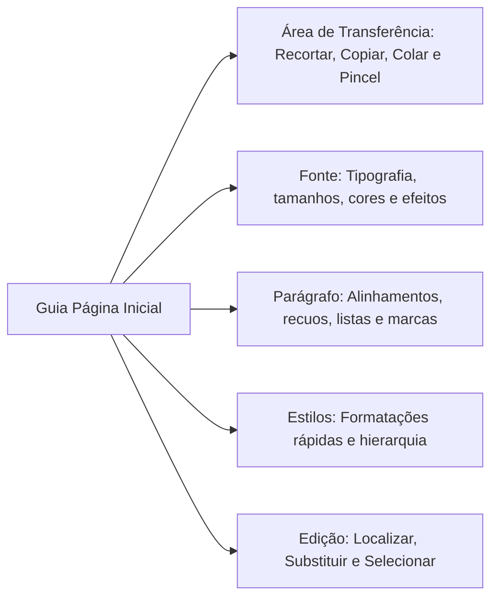
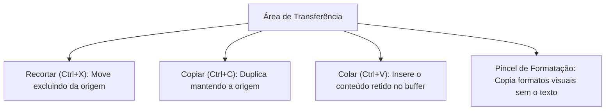
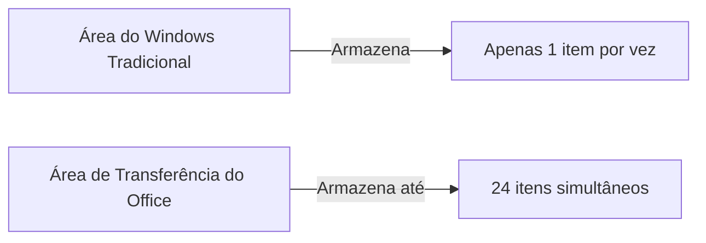
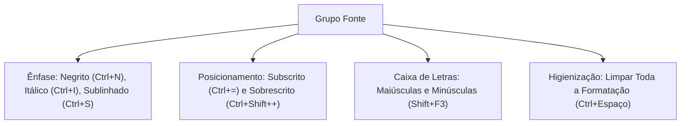
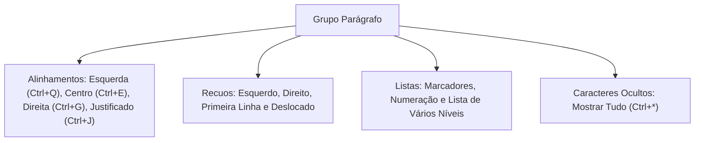
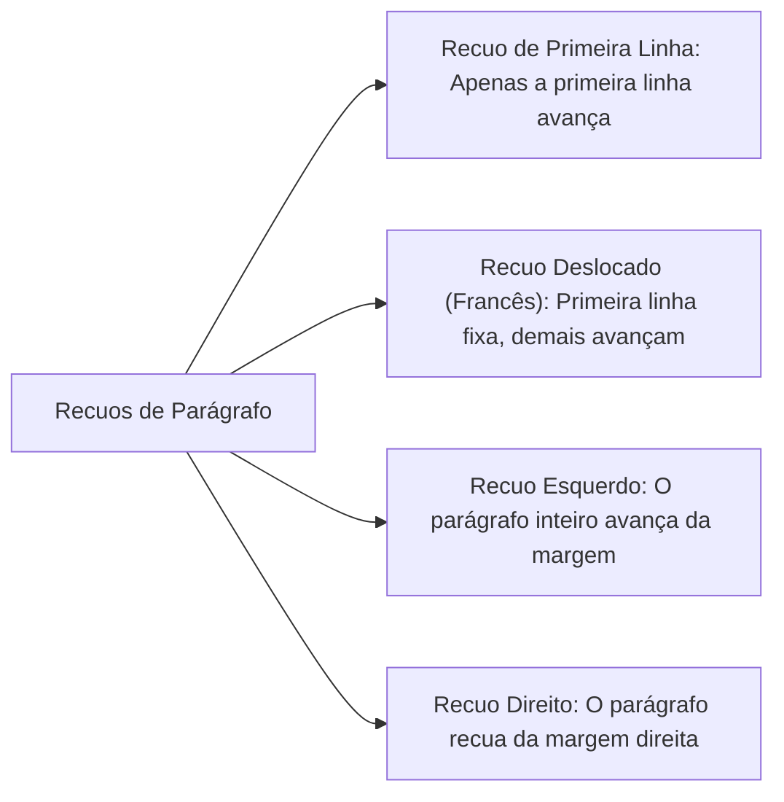
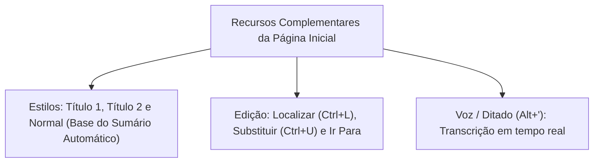
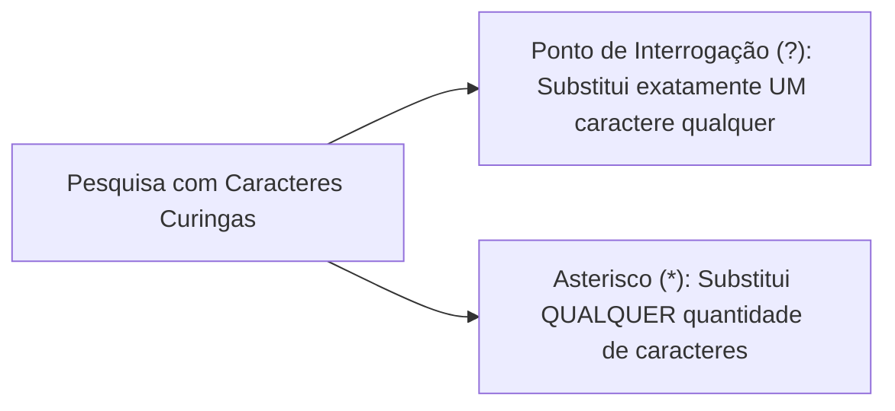
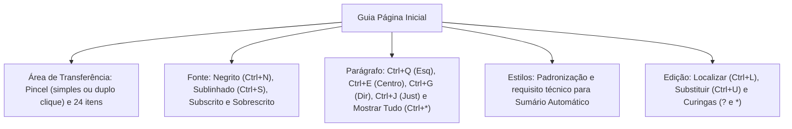

A Guia Página Inicial representa o núcleo operacional cotidiano do Microsoft Word. Nela estão concentrados os recursos de formatação tipográfica, estruturação de parágrafos, galeria de estilos corporativos, ferramentas de área de transferência e comandos de pesquisa e substituição textual. Em concursos públicos, esta guia figura entre as mais cobradas.

Neste capítulo, você analisará cada um dos cinco grupos primários da Guia Página Inicial. Examinaremos as sutilezas da Área de Transferência do Office com suporte a até 24 itens, os atalhos de teclado no padrão de língua portuguesa para alinhamento e fontes, o impacto da marcação de estilos para a automação documental e a sintaxe de caracteres curingas na busca refinada.

> [!objetivos]
> - Dominar os comandos e atalhos do grupo Área de Transferência, incluindo o Pincel de Formatação e a capacidade de 24 itens.
> - Conhecer as ferramentas de tipografia do grupo Fonte (Negrito, Itálico, Sublinhado, Subscrito, Sobrescrito e Limpar Formatação).
> - Compreender os quatro alinhamentos de parágrafo (`Ctrl+Q`, `Ctrl+E`, `Ctrl+G` e `Ctrl+J`) e o comando Mostrar Tudo (`Ctrl+*`).
> - Analisar a importância estrutural do grupo Estilos para a geração de sumários automáticos.
> - Explorar os recursos de Localizar (`Ctrl+L`), Substituir (`Ctrl+U`) e o comando Ir Para com uso de curingas.

## Visão Geral da Guia Página Inicial

A Guia Página Inicial é exibida como a primeira aba funcional após a Guia Arquivo na Faixa de Opções. Por concentrar as ações mais recorrentes do usuário durante a redação documental, ela é aberta automaticamente pelo Word ao iniciar um novo arquivo em branco. Sua organização horizontal divide-se em grupos temáticos lógicos que conduzem o fluxo de trabalho desde a manipulação de fragmentos copiados até o refinamento tipográfico e estrutural.

Cada grupo reúne ferramentas visíveis dispostas em botões com ícones ilustrativos. Além dos comandos diretos acessíveis na Ribbon, os grupos Área de Transferência, Fonte e Parágrafo possuem no canto inferior direito um pequeno ícone denominado **Iniciador de Caixa de Diálogo**. Ao ser acionado, esse botão abre uma janela de configuração aprofundada contendo parâmetros minuciosos que não couberam na barra superior, como espaçamentos exatos em pontos e efeitos tipográficos adicionais.

O usuário também pode acessar qualquer comando da Guia Página Inicial sem utilizar o mouse. Ao pressionar a tecla `Alt`, o Word projeta pequenas letras de atalho sobre a Faixa de Opções. A letra `C` seleciona a Guia Página Inicial, liberando atalhos sequenciais para acionar cada ferramenta diretamente pelo teclado físico.

## Grupo Área de Transferência

O grupo Área de Transferência gerencia a movimentação temporária de dados textuais e gráficos utilizando a memória RAM do computador.

### Comandos Tradicionais e o Pincel de Formatação

Os comandos básicos operam segundo padrões universais:

- **Recortar (`Ctrl + X`)**: Transfere o elemento selecionado para o buffer da área de transferência, removendo-o de seu posicionamento original na página.
- **Copiar (`Ctrl + C`)**: Cria uma duplicata exata do conteúdo selecionado na área de transferência, mantendo o original intacto.
- **Colar (`Ctrl + V`)**: Insere o conteúdo retido na área de transferência no ponto exato onde o cursor de inserção está posicionado.

O **Pincel de Formatação** é uma das ferramentas mais recorrentes em questões de concurso. Ele copia exclusivamente os atributos visuais de um trecho (família de fonte, tamanho, cor, negrito, espaçamento entre linhas e bordas) e os aplica sobre outro texto, sem alterar os caracteres de destino.

> [!bizu]
> **Dinâmica Operacional do Pincel de Formatação**:
> - **Clique Simples**: Seleciona o texto de origem e clica uma única vez no botão do Pincel. A formatação é aplicada ao novo trecho e a ferramenta se **desativa automaticamente**.
> - **Duplo Clique**: Dá dois cliques consecutivos no botão do Pincel. A ferramenta fica **fixada ativa**, permitindo aplicar a mesma formatação em dezenas de palavras ou parágrafos distintos em sequência. Para desativá-la, basta pressionar **`Esc`** ou clicar novamente no ícone.
> - **Atalhos pelo Teclado**: É possível copiar apenas a formatação pressionando **`Ctrl + Shift + C`** e aplicá-la ao destino com **`Ctrl + Shift + V`**.

### Área de Transferência do Office versus Área de Transferência do Windows

Existe uma distinção técnica fundamental entre a área de transferência básica do sistema operacional e o painel integrado da suíte Office.

A área de transferência tradicional do Windows retém um único elemento copiado por vez. Ao copiar um novo texto, o anterior é sobrescrito e perdido. Em contrapartida, a **Área de Transferência do Office** (acionada pelo iniciador de caixa de diálogo do grupo) armazena simultaneamente até **24 itens** (textos, tabelas e imagens copiados no Word, Excel ou PowerPoint). O usuário pode colar itens individuais clicando sobre eles ou acionar o botão **Colar Tudo**.

> [!pegadinha]
> **Capacidade da Área do Office**: A banca explora frequentemente o número de itens retidos pela Área de Transferência do Office. Lembre-se: são exatamente **24 itens**. Não confunda com valores arbitrários como 10, 12, 15 ou 50.

### Opções de Colagem Especial

Ao colar um objeto ou fragmento, o Word disponibiliza opções inteligentes através do menu suspenso ou da tecla flutuante `Ctrl`:

| Opção de Colagem | Comportamento no Documento de Destino |
|---|---|
| **Manter Formatação Original** | Preserva exatamente a fonte, cores e tabelas do documento de origem |
| **Mesclar Formatação** | Ajusta a tipografia básica ao parágrafo de destino, mantendo ênfases (negrito) |
| **Usar Estilos de Destino** | Converte os estilos copiados nos estilos já vigentes no documento ativo |
| **Manter Somente Texto** | Remove totalmente tabelas, fotos e fontes, inserindo caracteres limpos |
| **Colar Vínculo** | Estabelece ligação dinâmica; alterações na origem atualizam o destino |

## Grupo Fonte

O grupo Fonte reúne comandos voltados à estilização de caracteres, corpos tipográficos e efeitos visuais.

### Controles Tipográficos e Efeitos de Ênfase

- **Fonte (`Ctrl + Shift + F`)**: Seleciona a família tipográfica (ex.: Calibri, Arial, Times New Roman).
- **Tamanho da Fonte (`Ctrl + Shift + P`)**: Ajusta a pontuação dimensional do caractere. Os atalhos **`Ctrl + Shift + >`** e **`Ctrl + Shift + <`** aumentam e diminuem o corpo da fonte progressivamente.
- **Negrito (`Ctrl + N`)**: Aplica traço espesso aos caracteres.
- **Itálico (`Ctrl + I`)**: Inclina a tipografia para a direita, indicado para expressões estrangeiras e termos em latim.
- **Sublinhado (`Ctrl + S`)**: Insere uma linha contínua sob o texto. Por meio da seta adjacente, o usuário pode escolher sublinhado duplo, tracejado, pontilhado ou ondulado, além de personalizar a cor do sublinhado.
- **Tachado**: Traça uma linha horizontal reta no meio do texto, muito empregado em minutas jurídicas para assinalar trechos revogados ou propostos para exclusão.

> [!pegadinha]
> **Sublinhado versus Salvar em Português**: Em softwares anglo-saxões, `Ctrl+S` significa Salvar (*Save*). Contudo, no Microsoft Word em português brasileiro, **`Ctrl + S` aplica Sublinhado**, enquanto a gravação documental ocorre pelo atalho **`Ctrl + B`**. Essa armadilha derruba milhares de candidatos desatentos.

### Subscrito e Sobrescrito

A diferenciação entre caracteres deslocados verticalmente é tema de cobrança constante:

- **Subscrito (`Ctrl + =`)**: Posiciona os caracteres ligeiramente abaixo da linha de base do texto e reduz seu tamanho visual. Aplica-se tipicamente a fórmulas químicas, como em H₂O e CO₂.
- **Sobrescrito (`Ctrl + Shift + +`)**: Posiciona os caracteres acima da linha de base normal do texto. Emprega-se habitualmente em expoentes matemáticos (como x² ou 10⁵) e indicadores ordinais.

> [!atencao]
> **Atalho do Sobrescrito**: Note que para acionar o sinal de adição `+` no teclado alfanumérico convencional é necessário pressionar a tecla `Shift`. Por essa razão, a combinação formal do sobrescrito é **`Ctrl + Shift + +`**.

### Maiúsculas, Minúsculas e Limpar Formatação

- **Maiúsculas e Minúsculas (`Shift + F3`)**: Alterna ciclicamente o trecho selecionado entre três estados:
  1. *Primeira letra de cada frase em maiúscula* (sentença normal).
  2. *Todas as letras em minúsculas*.
  3. *TODAS AS LETRAS EM MAIÚSCULAS*.
- **Limpar Toda a Formatação (`Ctrl + Espaço`)**: Remove instantaneamente todos os estilos diretos aplicados manualmente (negrito, itálico, cores de texto, sublinhado e fontes customizadas), devolvendo o texto ao padrão base do estilo Normal.

> [!pegadinha]
> **O que o Limpar Formatação Não Remove**: O comando Limpar Toda a Formatação elimina negrito, itálico, fontes e tamanhos manuais. Todavia, ele **não remove a Cor do Realce do Texto** (marca-texto colorido). O realce do texto comporta-se como uma caneta física destacadora e exige o comando Sem Cores na paleta de realce para ser suprimido.

## Grupo Parágrafo

O grupo Parágrafo disciplina a geometria espacial do texto na página, controlando alinhamentos horizontais, espaçamentos, recuos, tabulações e símbolos invisíveis.

### Alinhamentos Horizontais de Parágrafo

O Word oferece quatro alinhamentos básicos de parágrafo, cada qual com seu atalho consagrado:

| Alinhamento | Atalho (PT-BR) | Descrição Técnica e Aplicação Prática |
|---|---|---|
| **Alinhar à Esquerda** | `Ctrl + Q` | Alinha o texto na margem esquerda, deixando a borda direita irregular. Padrão do Word |
| **Centralizar** | `Ctrl + E` | Centraliza as linhas equidistantes das margens laterais. Usado em títulos e capas |
| **Alinhar à Direita** | `Ctrl + G` | Alinha o texto na margem direita, deixando a borda esquerda irregular. Usado em assinaturas |
| **Justificar** | `Ctrl + J` | Distribui o texto de ponta a ponta uniformemente entre as margens esquerda e direita |

> [!bizu]
> **Mnemônico dos Atalhos de Alinhamento**:
> - `Ctrl + Q`: Es**q**uerda (consoante distintiva `Q`).
> - `Ctrl + E`: C**e**ntralizar (segunda letra da palavra).
> - `Ctrl + G`: Direita (para lembrar: alinhar à direita dá uma *Guinada* à direita).
> - `Ctrl + J`: **J**ustificar (letra inicial `J`).

### Espaçamento entre Linhas e Recuos de Parágrafo

O espaçamento entrelinhas define a distância vertical que separa uma linha de texto da linha subsequente dentro do mesmo parágrafo. Os valores mais usuais são:
- Espaçamento Simples (`1,0`).
- Espaçamento de `1,15` linhas (padrão das versões recentes do Word).
- Espaçamento de `1,5` linhas (exigência formal de normas acadêmicas como a ABNT).
- Espaçamento Duplo (`2,0`).

Além disso, o Word permite definir espaçamentos verticais específicos **Antes** e **Depois** de cada bloco de parágrafo, eliminando a necessidade de pressionar a tecla `Enter` repetidas vezes para criar vácuos visuais.

Na régua horizontal superior do Word residem os marcadores visuais de recuo:
1. **Triângulo Superior**: Controla o **Recuo da Primeira Linha**, deslocando unicamente o início do parágrafo para a direita.
2. **Triângulo Inferior**: Controla o **Recuo Deslocado** (ou suspensa/francesa), no qual a primeira linha permanece na margem e todas as linhas seguintes são empurradas para a direita.
3. **Retângulo Inferior**: Controla o **Recuo Esquerdo** global, deslocando o bloco de texto por inteiro.
4. **Triângulo da Margem Direita**: Controla o **Recuo Direito**, afastando o limite final das frases em relação à margem física da folha.

### O Comando Mostrar Tudo (`Ctrl + *`)

Representado pelo símbolo tipográfico de pilcrow (**¶**), o comando **Mostrar Tudo** exibe na tela os caracteres não imprimíveis. Esses caracteres não saem no papel na impressão física, mas são cruciais para auditar a estrutura do documento:

- **Pontos flutuantes médios (`·`)**: Indicam espaços em branco gerados pela barra de espaço.
- **Símbolo ¶**: Sinaliza o ponto exato onde a tecla `Enter` foi pressionada, encerrando um parágrafo.
- **Símbolo de seta horizontal**: Indica um salto provocado pela tecla `Tab` (tabulação).
- **Símbolo de seta curva angular**: Indica uma quebra de linha manual forçada gerada pelo atalho `Shift + Enter` (quebra a linha sem abrir novo parágrafo).
- **Marcadores de Quebra de Página e Quebra de Seção**: Mostram linhas pontilhadas explícitas no corpo da página indicando rupturas dimensionais.

> [!atencao]
> **Mostrar Tudo Não Altera a Impressão**: O comando Mostrar Tudo é exclusivamente um recurso visual de edição na tela. Ativá-lo não adiciona marcas à folha impressa nem interfere nas margens reais configuradas.

## Grupos Estilos, Edição e Voz

Os grupos situados na porção direita da Guia Página Inicial congregam recursos de automação, padronização visual, busca e transcrição inteligente.

### O Grupo Estilos e a Automação Estrutural

O grupo Estilos fornece uma galeria de conjuntos pré-formatados de fontes, tamanhos, cores e espaçamentos (ex.: *Normal*, *Título 1*, *Título 2*, *Subtítulo*, *Citação*). 

Mais do que aplicar beleza estética rápida, os estilos desempenham um papel técnico determinante:
- A aplicação dos estilos de cabeçalho (*Título 1*, *Título 2*, etc.) estabelece a árvore hierárquica do arquivo.
- Essa estrutura alimenta diretamente o **Painel de Navegação**.
- A marcação prévia de estilos estruturados é **requisito técnico obrigatório para que o Word consiga gerar automaticamente um Sumário Analítico** na Guia Referências.

> [!pegadinha]
> **Como Gerar Sumário Automático**: Bancas costumam perguntar qual procedimento viabiliza a criação imediata de um sumário com paginação precisa. A resposta sempre envolve a aplicação prévia dos **Estilos estruturais de Título** aos cabeçalhos do documento.

### O Grupo Edição: Localizar, Substituir e Ir Para

O grupo Edição disponibiliza ferramentas cirúrgicas para manipulação de grandes volumes de texto:

- **Localizar (`Ctrl + L`)**: Abre o Painel de Navegação lateral na guia Resultados, permitindo buscar palavras ou expressões em tempo real de forma incremental.
- **Substituir (`Ctrl + U`)**: Abre a caixa de diálogo Localizar e Substituir. Permite substituir ocorrências individuais ou acionar o botão **Substituir Tudo** para trocar todas as correspondências do arquivo de uma só vez.
- **Guia Ir Para**: Integrada à mesma caixa de diálogo, permite saltar instantaneamente para estruturas como páginas, seções, linhas, indicadores, comentários ou notas de rodapé. Note que a guia Ir Para **não admite saltos diretos para Estilos**.

Ao marcar a opção **Usar Caracteres Curingas** nas opções avançadas de localização:
- O ponto de interrogação (**`?`**) substitui precisamente um caractere alfanumérico isolado. Por exemplo, a busca por `b?la` localiza termos como *bala*, *bola* e *bula*.
- O asterisco (**`*`**) substitui qualquer cadeia de caracteres de qualquer extensão. Por exemplo, a busca por `com*dor` localiza tanto *computador* quanto *comunicador*.

### O Grupo Voz: Recurso Ditar

Presente nas versões contemporâneas do Word (como o Microsoft 365 e o Word 2019 atualizado), o comando **Ditar** (acionado pelo atalho **`Alt + '`**) permite transformar fala em texto escrito em tempo real. Apoiada em motores de inteligência artificial na nuvem, a ferramenta reconhece comandos de pontuação oral (como "ponto final", "vírgula" e "nova linha") com elevado índice de acurácia.

## Mapa do capítulo

### Para fixar

- O Pincel de Formatação copia formatos sem levar o texto: clique simples aplica uma vez; duplo clique fixa a ferramenta para múltiplos usos consecutivos até que se pressione `Esc`.
- A Área de Transferência do Office retém simultaneamente até 24 itens copiados ou recortados em qualquer programa da suíte.
- No Word em português, `Ctrl+S` aplica Sublinhado; a ação de salvar o arquivo ocorre pelo atalho `Ctrl+B`.
- Subscrito (`Ctrl+=`) posiciona o texto abaixo da linha base (H₂O); Sobrescrito (`Ctrl+Shift++`) posiciona o texto acima da linha base (x²).
- O atalho `Shift+F3` alterna maiúsculas e minúsculas; `Ctrl+Espaço` limpa formatações diretas, mas não retira a cor do realce de texto.
- Os atalhos de alinhamento são: `Ctrl+Q` (Esquerda), `Ctrl+E` (Centralizar), `Ctrl+G` (Direita) e `Ctrl+J` (Justificado).
- O comando Mostrar Tudo (`Ctrl+*`) exibe caracteres não imprimíveis na tela (espaços, parágrafos ¶ e quebras), sem impactar a folha impressa.
- A aplicação dos estilos de Título é requisito mandatório para a geração de sumários automáticos no documento.
- No diálogo de Substituir (`Ctrl+U`), o caractere curinga `?` representa um único caractere arbitrário, enquanto `*` representa qualquer sequência de caracteres.
