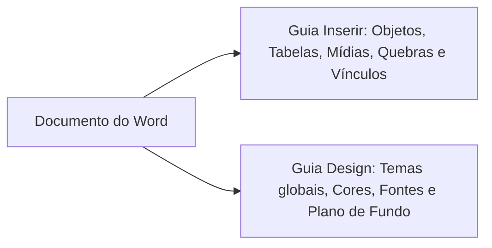
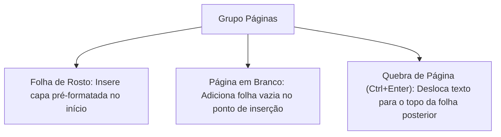
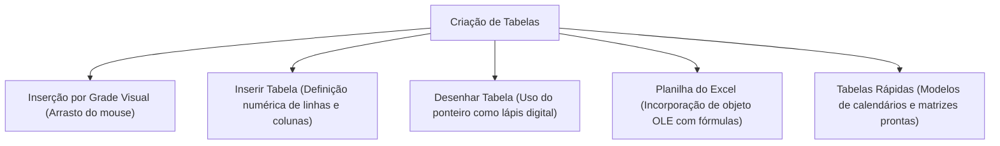
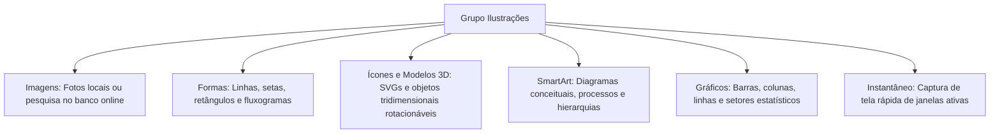
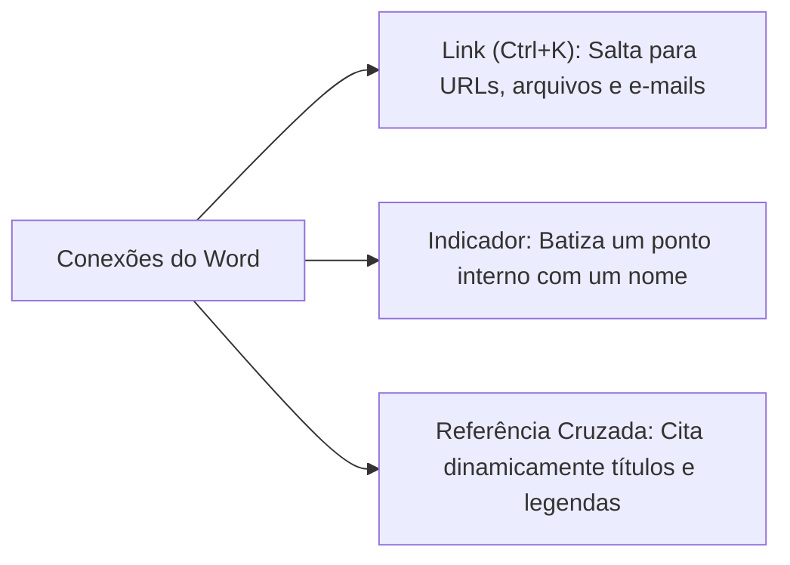
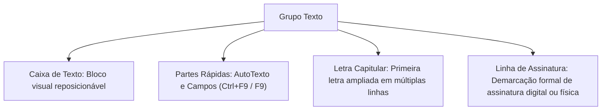
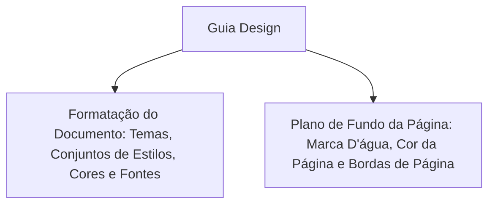
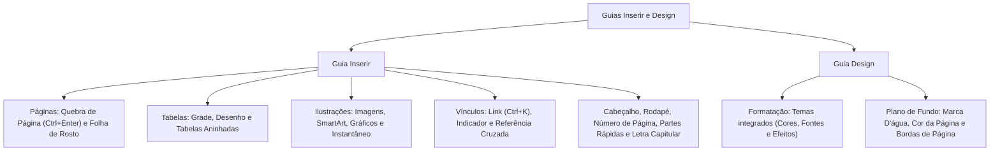

A produção de documentos técnicos, relatórios policiais e manuais operacionais no Corpo de Bombeiros Militar e na Polícia Militar de Pernambuco exige recursos que transcendem a digitação linear de caracteres. O redator precisa incorporar tabelas estatísticas, organogramas hierárquicos, figuras periciais, hiperlinks dinâmicos e marcas de segurança institucional.

Neste capítulo, você examinará as ferramentas das guias Inserir e Design. Analisaremos a criação de quebras de página com `Ctrl+Enter`, a estruturação de tabelas, o gerenciamento de imagens e capturas de tela com a ferramenta Instantâneo, os vínculos hipertextuais (`Ctrl+K`), as Partes Rápidas e campos automatizados, além da aplicação global de Temas e marcas d'água na Guia Design.

> [!objetivos]
> - Identificar as ferramentas do grupo Páginas, dominando o atalho de Quebra de Página (`Ctrl+Enter`).
> - Compreender os mecanismos de criação de tabelas simples e aninhadas no grupo Tabelas.
> - Conhecer os elementos visuais do grupo Ilustrações (Imagens, Formas, SmartArt, Gráficos e Instantâneo).
> - Diferenciar a finalidade de Links (`Ctrl+K`), Indicadores e Referências Cruzadas.
> - Compreender a aplicação de Temas, Marcas D'água, Cor da Página e Bordas na Guia Design.

## Visão Geral das Guias Inserir e Design

Enquanto a Guia Página Inicial cuida da formatação rotineira de caracteres e parágrafos, as guias Inserir e Design expandem a dimensão física e a identidade visual do arquivo. A arquitetura modular do Microsoft Word separa nitidamente a entrada de novos objetos da estilização conceitual do leiaute.

A **Guia Inserir** acrescenta novos elementos concretos ao corpo do texto. Nela o operador encontra comandos para incluir tabelas de dados, ilustrações vetoriais, fotografias periciais, quebras estruturais de fluxo, cabeçalhos padronizados e equações matemáticas. Cada botão dessa guia introduz um componente visual ou funcional inexistente no documento original.

Por outro lado, a **Guia Design** não adiciona objetos isolados. Sua função primordial é aplicar padronização estética corporativa abrangente a elementos já existentes. Ela unifica paletas de cores, conjuntos tipográficos de fontes e elementos de plano de fundo de segurança em todas as folhas.

## Guia Inserir: Estruturação de Páginas e Quebras

O primeiro grupo da Guia Inserir é o grupo **Páginas**. Ele disciplina a transição e a abertura de novos espaços de escrita no documento:

- **Folha de Rosto**: Insere uma capa institucional diagramada no início absoluto do arquivo. O comando funciona independentemente do local onde o ponto de inserção esteja situado. A ferramenta disponibiliza campos estruturados para inclusão de título, subtítulo, autor, data e resumo.
- **Página em Branco**: Introduz uma nova página inteiramente desocupada no local exato onde o ponto de inserção está posicionado. Todo o texto posterior é empurrado para a frente.
- **Quebra de Página (`Ctrl + Enter`)**: Interrompe o fluxo da página atual no local exato do ponto de inserção. O texto subsequente é transportado de imediato para a primeira linha da folha subsequente.

> [!pegadinha]
> **Quebra de Página versus Pressionar Enter Repetidas Vezes**: Candidatos desatentos costumam pressionar a tecla `Enter` dezenas de vezes para iniciar uma nova folha. Essa prática desorganiza o documento se o usuário adicionar parágrafos antes desse ponto. O procedimento técnico correto exigido em concursos é a inserção de uma **Quebra de Página** por meio do atalho **`Ctrl + Enter`**.

> [!bizu]
> **Quebra de Página versus Quebra de Seção**: A Quebra de Página (Guia Inserir) apenas transporta o texto para a folha subsequente. Ela preserva todas as configurações de margens, orientação e cabeçalhos. Já a Quebra de Seção (Guia Layout) divide o arquivo em blocos administrativos autônomos. Com ela, o redator pode configurar margens e orientações distintas.

## Grupo Tabelas: Organização Matricial de Informações

As tabelas no Microsoft Word são constituídas por uma malha quadriculada de **linhas horizontais** e **colunas verticais**. A interseção entre uma linha e uma coluna forma uma **célula**.

O Word oferece extrema flexibilidade na manipulação matricial:
- É viável converter um bloco de texto separado por vírgulas ou tabulações diretamente em uma tabela por meio do comando **Converter Texto em Tabela**.
- Da mesma forma, uma tabela existente pode ser transformada em texto corrido com o comando **Converter em Texto**.
- **Tabelas Aninhadas**: O usuário pode criar uma tabela completa dentro de uma única célula de outra tabela já existente. Esse recurso é útil para diagramações de formulários complexos.

> [!atencao]
> **Surgimento das Guias de Contexto ao Clicar em Tabelas**: Quando o usuário clica no interior de uma célula de tabela, a Faixa de Opções exibe imediatamente duas guias contextuais exclusivas: **Design da Tabela** e **Layout**. A primeira aplica estilos visuais, sombreamento e bordas. A segunda insere ou exclui linhas e colunas, mescla células, ajusta alinhamentos e define fórmulas de soma. Ao clicar fora da tabela, essas abas contextuais desaparecem da tela.

## Grupo Ilustrações: Recursos Gráficos e Captura de Tela

O grupo Ilustrações enriquece o aspecto visual do relatório. Ele confere clareza expositiva a dados complexos:

- **Imagens**: Permite importar fotos armazenadas no computador local, em bibliotecas corporativas ou em pesquisas web integradas.
- **Formas**: Insere elementos geométricos vetoriais como círculos, retângulos, estrelas, balões de diálogo e conectores.
- **Ícones e Modelos 3D**: Gráficos vetoriais modernos escaláveis que não perdem resolução e objetos tridimensionais com rotação completa em 360 graus.
- **SmartArt**: Conjunto de diagramas estruturados para expressar ideias graficamente. Inclui listas ilustradas, fluxos de processos sequenciais, ciclos de vida contínuos e organogramas hierárquicos.
- **Gráficos**: Gera gráficos estatísticos convencionais (barras, colunas, setores circulares, linhas, dispersão e radar) alimentados por uma pequena planilha integrada.
- **Instantâneo**: Ferramenta prática que captura instantaneamente imagens de outras janelas ativas abertas no computador. Ela também permite selecionar um **Recorte de Tela** personalizado, colando a figura capturada diretamente na página.

> [!bizu]
> **Vantagem do Instantâneo em Provas**: O comando Instantâneo do grupo Ilustrações elimina a necessidade de usar teclas como `Print Screen` ou ferramentas acessórias do sistema operacional. Ele realiza a captura e a inserção da imagem diretamente no corpo do documento em uma única operação.

## Conexões e Vínculos: Links, Indicadores e Referências Cruzadas

O Word estabelece três categorias funcionais de conexões navegáveis dentro e fora do documento:

| Recurso | Atalho Oficial | Conceito e Finalidade | Comportamento Prático no Texto |
|---|---|---|---|
| **Link (Hiperlink)** | `Ctrl + K` | Ponto de salto navegável externo ou interno | Direciona o leitor para páginas da internet (URL), arquivos locais, e-mails ou títulos do próprio arquivo |
| **Indicador** | Sem atalho direto | Ancoragem de um ponto específico no texto | Atribui um rótulo identificador a uma coordenada interna para permitir saltos rápidos e referências |
| **Referência Cruzada** | Sem atalho direto | Menção dinâmica a elementos catalogados | Aponta para números de página, notas de rodapé, tabelas numeradas ou títulos, atualizando-se sozinha |

> [!pegadinha]
> **Atalho do Link em Português**: O atalho para inserir um Link no Word em português é **`Ctrl + K`**. As bancas tentam confundir os candidatos propondo atalhos inexistentes como `Ctrl + L` (que serve para Localizar) ou `Ctrl + H`. Guarde com segurança a combinação `Ctrl + K`.

> [!esquema]
> **Como Operar Links no Documento**:
> Para seguir um link dentro do corpo do Word durante a edição normal, o usuário não clica diretamente nele apenas com o mouse. A regra padrão exige manter pressionada a tecla **`Ctrl`** enquanto clica com o botão esquerdo do mouse sobre o texto vinculado (**`Ctrl + Clique`**).

## Grupos Comentários, Cabeçalho e Rodapé, Texto e Símbolos

### Grupo Comentários (`Alt + Ctrl + A`)

Permite a inclusão de notas marginais e anotações explicativas vinculadas a termos selecionados. Os comentários viabilizam discussões colaborativas e auditorias sem alterar uma única letra do texto original.

### Grupo Cabeçalho e Rodapé

Gerencia as áreas de repetição sistemática situadas nas margens superior e inferior das páginas do arquivo:

- **Cabeçalho**: Área reservada no topo da folha para títulos institucionais, brasões de armas e identificação de órgãos.
- **Rodapé**: Área na base da folha para numeração de páginas, avisos de confidencialidade e dados de contato.
- **Número de Página**: Insere contadores numéricos automáticos. Eles podem ser posicionados no Início da Página (cabeçalho), no Fim da Página (rodapé), nas Margens da Página ou na Posição Atual.
- **Opções Estruturais**: O Word permite configurar **Primeira Página Diferente** (para deixar a capa sem cabeçalho) e **Páginas Pares e Ímpares Diferentes** (para diagramação estilo livro frente e verso).

> [!atencao]
> **Desvinculação de Cabeçalhos entre Seções**: Por padrão, todas as páginas do documento compartilham o mesmo cabeçalho. Para que um capítulo posterior exiba um cabeçalho diferente do anterior, é mandatório inserir uma **Quebra de Seção** e desativar o botão **Vincular ao Anterior** na barra de ferramentas de cabeçalho.

### Grupo Texto: Caixas de Texto, Partes Rápidas e Letra Capitular

- **Caixa de Texto**: Caixa retangular flutuante que abriga textos posicionáveis livremente na página. O bloco independe do fluxo ordinário dos parágrafos.
- **Partes Rápidas**: Galeria de blocos de construção reutilizáveis, contemplando:
  - *AutoTexto*: Trechos textuais frequentes armazenados para rápida inserção.
  - *Propriedades do Documento*: Campos vinculados aos metadados (Autor, Título, Assunto).
  - *Campos*: Elementos dinâmicos inseridos entre chaves com o atalho **`Ctrl + F9`** (ex.: `{ PAGE }` para número da página, `{ DATE }` para data atual) e atualizados pelo atalho **`F9`**.
- **WordArt**: Efeito gráfico estilizado que transforma caracteres comuns em ilustrações tipográficas com texturas, contornos e relevos.
- **Letra Capitular**: Recurso editorial clássico que projeta a letra inicial de um parágrafo em tamanho ampliado. Ela ocupa a altura vertical de várias linhas de texto subsequentes (estilo capitular clássico ou na margem).

> [!exemplo]
> **Aplicação Prática da Letra Capitular**:
> Em matérias jornalísticas e livros literários, a primeira letra do primeiro capítulo é frequentemente ampliada para ocupar três linhas de altura, conferindo requinte gráfico. Esse comando localiza-se na Guia Inserir, no grupo Texto.

### Grupo Símbolos: Equação e Caracteres Especiais

- **Equação**: Editor estruturado para formulação de expressões matemáticas e científicas avançadas como frações, matrizes e radicais.
- **Símbolo**: Permite inserir caracteres gráficos ausentes no teclado convencional. Inclui o símbolo de copyright (©), marca registrada (®), letras gregas e caracteres tipográficos especiais.

## Guia Design: Formatação do Documento e Plano de Fundo

Introduzida no Word 2013 como guia independente, a **Guia Design** reúne as ferramentas de identidade estética global do documento.

### O Conceito de Temas

Um **Tema** no Microsoft Word consiste em um pacote harmonizado de configurações visuais composto por três pilares integrados:
1. Uma paleta coordenada de **Cores**.
2. Um conjunto emparelhado de **Fontes** (uma fonte para os títulos e outra para o corpo do texto).
3. Uma coleção coordenada de **Efeitos** gráficos para formas e ilustrações.

Ao selecionar um novo Tema na galeria, o Word atualiza instantaneamente a aparência de todos os estilos estruturais, tabelas e gráficos do documento. Isso assegura coerência visual sem necessidade de formatação manual elemento por elemento.

> [!bizu]
> **Compatibilidade de Temas no Office**: Os temas do Word são universais e padronizados para toda a suíte. Um tema criado ou selecionado no Word pode ser aplicado com exata fidelidade visual a apresentações do PowerPoint e pastas de trabalho do Excel.

### Grupo Plano de Fundo da Página

O grupo Plano de Fundo da Página atua na superfície geral de todas as folhas do documento:

- **Marca D'água**: Insere um texto semitransparente (denominado "texto fantasma", como *CONFIDENCIAL*, *CÓPIA*, *URGENTE* ou *RASCUNHO*) ou uma imagem desbotada posicionada em segundo plano, atrás do conteúdo textual. Serve para atestar a segurança e a autenticidade documental.
- **Cor da Página**: Aplica uma coloração de fundo uniforme, degradê, textura ou padrão visual a todas as páginas do arquivo. Destina-se prioritariamente à visualização em tela, pois os drivers de impressão convencionais ignoram a cor de fundo para economizar tinta.
- **Bordas de Página**: Cria molduras ornamentais ao redor de toda a página, admitindo linhas contínuas, tracejadas, duplas ou ilustrações artísticas decorativas.

> [!pegadinha]
> **Localização da Marca D'água em Versões Antigas versus Modernas**: Nas versões legadas do Word (2007 e 2010), a ferramenta Marca D'água localizava-se na guia Layout da Página. A partir do **Word 2013**, os comandos de Marca D'água, Cor da Página e Bordas de Página pertencem oficialmente à **Guia Design**. Esta transição cronológica é alvo constante de pegadinhas das bancas.

## Mapa do capítulo

### Para fixar

- O atalho `Ctrl + Enter` insere uma Quebra de Página imediata no ponto onde está o ponto de inserção.
- O comando Instantâneo (grupo Ilustrações) captura janelas ativas abertas no sistema e as insere como figuras no texto.
- O atalho para inserir um Link no Word em português é `Ctrl + K`; para acessar o link na tela durante a edição, usa-se `Ctrl + Clique`.
- O Indicador nomeia uma localização interna específica; a Referência Cruzada remete dinamicamente a elementos catalogados como cabeçalhos e tabelas.
- A Letra Capitular projeta a letra inicial do parágrafo em dimensões ampliadas cobrindo múltiplas linhas subsequentes.
- Partes Rápidas congregam blocos de construção, AutoTexto e campos dinâmicos inseridos por `Ctrl + F9` e atualizados por `F9`.
- Um Tema unifica paletas de cores, combinações tipográficas de fontes e efeitos visuais em todo o documento.
- Os comandos Marca D'água, Cor da Página e Bordas de Página pertencem à Guia Design a partir do Word 2013.
- Tabelas aninhadas consistem em uma tabela completa construída no interior de uma célula de outra tabela.
- Ao clicar em uma tabela, surgem as guias contextuais Design da Tabela e Layout.
