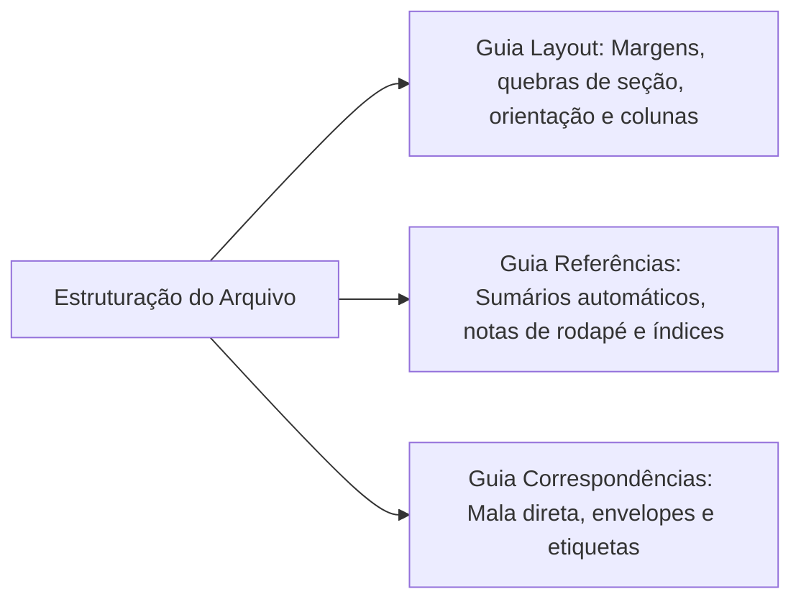
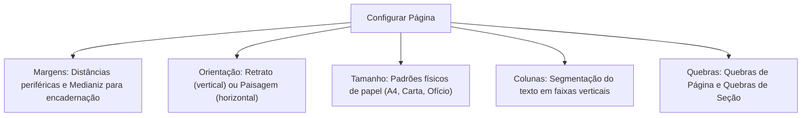
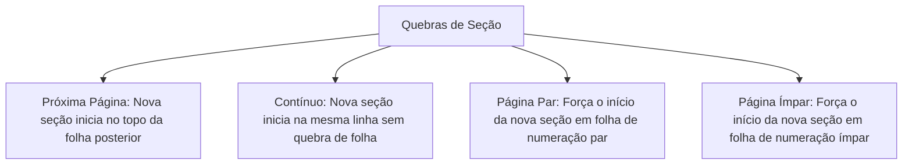
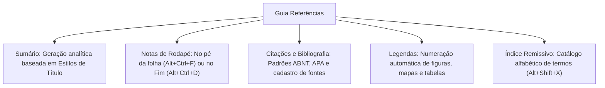
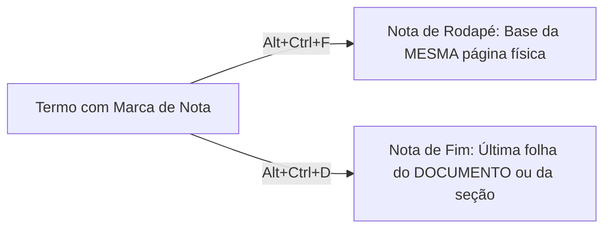
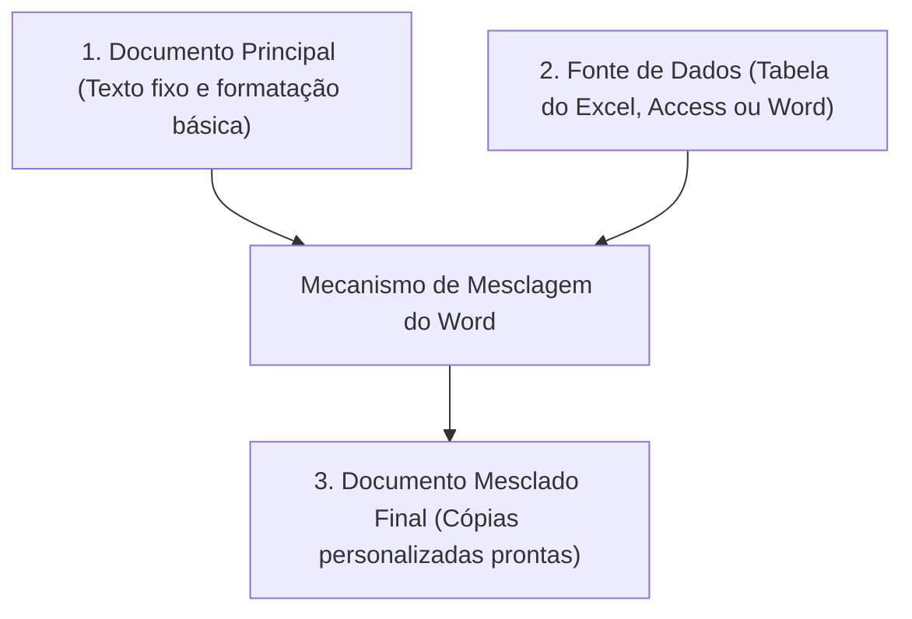
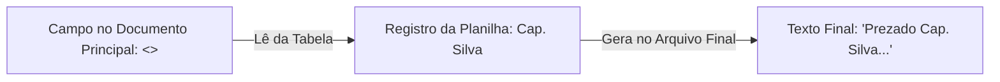
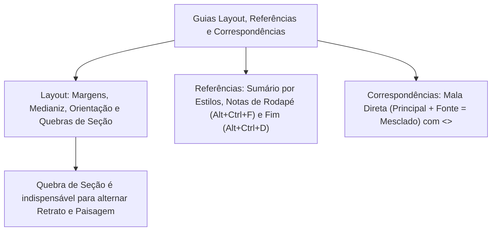

A confecção de documentos institucionais de alto padrão exige controle dimensional minucioso, padronização técnica de referências bibliográficas e automação na expedição de comunicações oficiais. No Corpo de Bombeiros Militar e na Polícia Militar de Pernambuco, a redação de boletins, planos de operações e portarias requer o domínio simultâneo das guias Layout, Referências e Correspondências.

Neste capítulo, você aprofundará o estudo da geometria das páginas no Word. Analisaremos as quebras de seção como ferramenta essencial para alternar orientações e cabeçalhos, a geração automática de sumários analíticos, a distinção entre notas de rodapé (`Alt+Ctrl+F`) e notas de fim (`Alt+Ctrl+D`), além de dissecar o mecanismo da Mala Direta com sua estrutura tripartite e campos dinâmicos de mesclagem.

> [!objetivos]
> - Dominar a configuração geométrica da página (margens, medianiz, orientação, tamanho e colunas).
> - Compreender os quatro tipos de Quebras de Seção e suas aplicações em cabeçalhos desvinculados.
> - Conhecer os requisitos estruturais para a criação de Sumários Automáticos na Guia Referências.
> - Diferenciar a inserção e o posicionamento de Notas de Rodapé e Notas de Fim.
> - Dominar o fluxo operacional e a arquitetura tripartite da Mala Direta na Guia Correspondências.

## Visão Geral das Guias Estruturais Avançadas

Após a digitação inicial e a inclusão de ilustrações básicas, o documento ingressa na fase decisiva de estruturação espacial, validação metodológica de fontes e automação de comunicações massificadas. Essa etapa de refinamento editorial é regida por três guias centrais da Faixa de Opções: a Guia Layout, a Guia Referências e a Guia Correspondências.

A **Guia Layout** atua sobre os parâmetros físicos e dimensionais das folhas de trabalho. Nela são estipuladas as distâncias das margens, a orientação espacial do papel e as quebras de seção necessárias para isolar capítulos. A **Guia Referências** confere respaldo técnico e normativo a relatórios e monografias, automatizando a criação de sumários analíticos, notas explicativas e citações bibliográficas. Por fim, a **Guia Correspondências** dinamiza a expedição em escala de notificações, certidões e ofícios nominais através da Mala Direta.

Cada uma dessas guias responde por um estágio do ciclo de vida documental. A compreensão integrada de seus comandos assegura produtividade corporativa e permite ao candidato solucionar com segurança as questões mais complexas formuladas pelas bancas de concurso.

## Guia Layout: Geometria da Página e Parágrafos

A Guia Layout (intitulada *Layout da Página* nas versões anteriores ao Word 2016) disciplina a relação entre o texto e as bordas físicas do papel.

### Margens e o Conceito de Medianiz

As **Margens** demarcam o espaço em branco ao redor dos quatro limites externos do texto: margem superior, margem inferior, margem esquerda e margem direita. O usuário pode selecionar padrões pré-configurados (como Normal, Estreita, Moderada e Larga) ou definir distâncias métricas personalizadas.

Um elemento técnico frequentemente cobrado em certames públicos é a **Medianiz** (*Gutter*):
- Trata-se de um espaço adicional reservado na margem interna ou na margem superior do documento.
- Sua finalidade exclusiva é permitir a encadernação, perfuração ou colagem de brochuras sem que a lombada encubra as primeiras letras das frases impressas.

> [!bizu]
> **Margens Espelhadas**: Ao diagramar publicações frente e verso no padrão livro, o usuário seleciona a opção Margens Espelhadas. Nesse modelo, as margens esquerda e direita são substituídas pelos conceitos dinâmicos de **Margem Interna** e **Margem Externa**, garantindo que as páginas pares e ímpares apresentem recuos harmônicos.

### Orientação, Tamanho e Colunas

- **Orientação**: Permite alternar a visualização da folha entre **Retrato** (disposição vertical padrão, em que a altura supera a largura) e **Paisagem** (disposição horizontal, em que a largura supera a altura).
- **Tamanho**: Define o padrão físico da folha. No Brasil e nas corporações públicas, o padrão consagrado é o formato **A4** (medindo precisamente 21 cm de largura por 29,7 cm de altura). Outros formatos admitidos incluem Carta (*Letter*), Ofício (*Legal*) e A5.
- **Colunas**: Distribui o fluxo do texto em duas, três ou mais colunas paralelas. O usuário pode personalizar a largura individual de cada coluna e ativar uma **Linha entre Colunas** para separação visual nítida.

> [!pegadinha]
> **Quebra de Coluna versus Quebra de Página**: Se um parágrafo está dividido em colunas e o redator deseja enviar o restante da frase imediatamente para o topo da coluna ao lado, o comando correto é a **Quebra de Coluna** (atalho `Ctrl + Shift + Enter`), e **não** uma Quebra de Página comum.

### Quebras de Página versus Quebras de Seção

O entendimento das modalidades de quebra constitui um dos temas de maior peso nos concursos. O Word categoriza as quebras em dois grandes grupos estruturais:

| Categoria da Quebra | Modalidade Oficial | Comportamento Técnico no Documento |
|---|---|---|
| **Quebras de Página** | Página Comum | Transporta o texto seguinte para a folha subsequente |
| **Quebras de Página** | Quebra de Coluna | Transporta o texto posterior para o topo da próxima coluna |
| **Quebras de Página** | Ajuste de Texto | Isola o texto em torno de figuras em páginas da internet |
| **Quebras de Seção** | **Próxima Página** | Cria nova seção dimensional a partir da folha subsequente |
| **Quebras de Seção** | **Contínuo** | Cria nova seção dimensional na mesma página física atual |
| **Quebras de Seção** | **Página Par** | Cria nova seção iniciando na folha subsequente de numeração par |
| **Quebras de Seção** | **Página Ímpar** | Cria nova seção iniciando na folha subsequente de numeração ímpar |

> [!pegadinha]
> **Aplicações Obrigatórias de Quebras de Seção**:
> Para alternar entre orientação **Retrato** e **Paisagem** dentro do mesmo arquivo, ou para configurar **cabeçalhos e rodapés totalmente independentes** entre capítulos, a inserção de uma **Quebra de Seção** é tecnicamente indispensável. Uma simples Quebra de Página comum não permite alterar a orientação ou desvincular cabeçalhos de forma isolada.

> [!atencao]
> **Quebra de Seção Contínua em Textos com Colunas**:
> Quando um artigo científico traz o título e o resumo ocupando a largura total da folha e, logo abaixo, o corpo do texto é dividido em duas colunas, utiliza-se a **Quebra de Seção Contínua**. Ela permite que uma única página física abrigue seções com configurações dimensionais totalmente divergentes.

### Quebra de Texto em Torno de Imagens e Hifenização

No grupo Organizar da Guia Layout, o usuário calibra o comportamento geométrico de ilustrações e fotos em relação ao fluxo dos parágrafos:

- **Alinhado com o Texto**: A imagem é tratada como um grande caractere alfanumérico na linha corrente.
- **Quadrado**: O texto contorna a imagem formando uma moldura retangular perfeita ao seu redor.
- **Justo**: O texto acompanha rigorosamente as sinuosidades e contornos recortados da figura.
- **Atrás do Texto**: A imagem repousa sob as letras, operando como elemento de plano de fundo.
- **Em Frente ao Texto**: A imagem sobrepõe-se às palavras, ocultando o texto que estiver sob ela.

> [!esquema]
> **Comando Hifenização**:
> Localizado no grupo Configurar Página, o comando **Hifenização** realiza a partição silábica automática das palavras no final das linhas. Ele evita que parágrafos justificados fiquem com espaços excessivamente abertos entre as palavras, proporcionando um bloco visual equilibrado.

## Guia Referências: Sumários, Notas de Rodapé e Citações

A Guia Referências congrega utilitários técnicos para conferir rigor metodológico e rastreabilidade a teses, relatórios de sindicância e monografias militares.

### O Mecanismo do Sumário Automático

O **Sumário Analítico** lista os títulos dos capítulos e subtítulos acompanhados de seus respectivos números de página. No Word, o sumário não é digitado de forma estática manual.

A geração automática exige que o autor aplique previamente os **Estilos de Título** da Guia Página Inicial (*Título 1*, *Título 2*, *Título 3*) aos cabeçalhos do documento. O Word lê a hierarquia desses estilos e constrói o sumário instantaneamente.

Ao alterar a ordem dos capítulos ou adicionar parágrafos, o usuário clica com o botão direito sobre o sumário ou aciona o comando **Atualizar Sumário**, escolhendo entre:
1. *Atualizar apenas os números de página* (operação rápida quando os títulos não sofreram alteração).
2. *Atualizar o índice inteiro* (reconstrói toda a estrutura hierárquica, incluindo novos tópicos criados).

### Notas de Rodapé versus Notas de Fim

A inserção de notas explicativas ou de créditos bibliográficos obedece a regras de posicionamento espacial bem definidas:

| Modalidade | Atalho de Teclado Oficial | Posicionamento Físico no Arquivo | Numeração Padrão |
|---|---|---|---|
| **Nota de Rodapé** | `Alt + Ctrl + F` | Alocada na base inferior da mesma página física onde o termo foi citado | Algarismos arábicos (1, 2, 3...) |
| **Nota de Fim** | `Alt + Ctrl + D` | Agrupada cumulativamente no final do documento ou no encerramento da seção | Algarismos romanos minúsculos (i, ii, iii...) |

> [!bizu]
> **Mnemônico dos Atalhos de Notas**:
> - `Alt + Ctrl + F`: O `F` remete a ***F**ootnote* (termo em inglês para nota de rodapé).
> - `Alt + Ctrl + D`: O `D` remete ao final do ***D**ocumento* (nota de fim).

### Citações, Bibliografia e Índice Remissivo

- **Citações e Bibliografia**: O Word permite cadastrar livros, artigos de periódicos, relatórios e páginas web na ferramenta Gerenciar Fontes Bibliográficas. O sistema formata automaticamente as citações no corpo do texto segundo regras de associações técnicas consagradas, como **ABNT**, **APA**, **Chicago** ou **Vancouver**. O autor preenche campos padronizados com autor, título da obra, ano de publicação, cidade e editora. O aplicativo insere a chamada no texto e compila a bibliografia completa ao final com um único clique.
- **Legendas**: O comando Inserir Legenda posiciona rótulos numerados sob ilustrações e tabelas (ex.: "Figura 1: Viatura Auto Bomba Tanque"). Essas legendas viabilizam a criação automatizada de listas de figuras e tabelas dinâmicas.
- **Índice Remissivo**: Lista alfabética de termos técnicos posicionada ao término do trabalho. O redator seleciona cada palavra-chave no texto e pressiona o atalho **`Alt + Shift + X`** (*Marcar Entrada*). Em seguida, aciona o comando Inserir Índice para construir o catálogo com os números das páginas em que cada vocábulo aparece.

> [!exemplo]
> **Formatação Automática de Citações segundo a ABNT**:
> Ao selecionar o estilo ABNT no grupo Citações e Bibliografia, o Word insere automaticamente a chamada em letras maiúsculas entre parênteses acompanhada do ano, como em `(ALMEIDA, 2023)`. Ao final do relatório, o comando Bibliografia gera a lista ordenada alfabeticamente conforme os padrões normativos nacionais.

> [!esquema]
> **Diferença entre Sumário e Índice Remissivo**:
> - O **Sumário** fica no início do trabalho e apresenta a ordem cronológica sequencial dos capítulos e seções com suas páginas.
> - O **Índice Remissivo** fica no encerramento da obra e relaciona termos e conceitos em ordem puramente alfabética.

## Guia Correspondências: Automação por Mala Direta

A Guia Correspondências foi concebida para simplificar a criação massificada de comunicações personalizadas. Por meio da **Mala Direta**, o usuário redige um modelo padrão de documento e o mescla dinamicamente com uma base de dados externa contendo centenas ou milhares de destinatários.

### A Estrutura Tripartite da Mala Direta

O funcionamento da Mala Direta apoia-se em três pilares interdependentes:

1. **Documento Principal**: É o arquivo de texto base. Contém o cabeçalho, a diagramação institucional, o timbre corporativo e o texto padronizado que não varia entre as pessoas notificadas.
2. **Fonte de Dados (Lista de Destinatários)**: É a base de dados estruturada em linhas (registros) e colunas (campos). Pode ser originada de uma planilha do Excel, de uma tabela do Access, de uma lista de contatos do Outlook ou de uma tabela criada no próprio Word.
3. **Documento Mesclado**: É o resultado final do processamento. O Word substitui os códigos variáveis pelos dados concretos de cada indivíduo, gerando uma versão personalizada para cada registro da base de dados.

### Campos de Mesclagem e Marcadores Visuais

No Documento Principal, os dados variáveis são inseridos através de **Campos de Mesclagem**. Esses campos são representados visualmente entre delimitadores tipográficos angulares duplos:

> `<<Nome>>`, `<<Endereço>>`, `<<Posto_Graduação>>`, `<<Matrícula>>`

Durante a edição, o redator lê o modelo estruturado:
"Convocamos o militar `<<Nome>>`, matrícula nº `<<Matrícula>>`, a comparecer ao quartel..."
Ao executar a mesclagem, o Word produz folhas individuais contendo os nomes e matrículas exatos de cada militar catalogado na planilha de origem.

> [!pegadinha]
> **Sintaxe dos Delimitadores de Mala Direta**: Em questões de concurso, as bancas apresentam delimitadores incorretos como colchetes duplos `[[Nome]]`, chaves `{{Nome}}` ou parênteses `((Nome))`. Os delimitadores visuais oficiais adotados pelo Microsoft Word para campos de mesclagem na tela são exclusivamente os colchetes angulares duplos **`<<`** e **`>>`**.

### Etapas Operacionais da Mala Direta

O fluxo sistemático na Guia Correspondências desdobra-se nos seguintes passos:

1. **Iniciar Mala Direta**: Escolhe o formato de saída (Cartas, Mensagens de Email, Envelopes, Etiquetas ou Diretório).
2. **Selecionar Destinatários**: Conecta o arquivo à fonte de registros externa (Digitar uma Nova Lista, Usar uma Lista Existente ou Escolher dos Contatos do Outlook).
3. **Editar Lista de Destinatários**: Abre o painel para filtrar registros específicos, ordenar por ordem alfabética ou desmarcar destinatários indesejados.
4. **Gravar e Inserir Campos**: Posiciona os campos dinâmicos no corpo da carta (Bloco de Endereço, Linha de Saudação e Inserir Campo de Mesclagem). O sistema admite inclusive **Regras Condicionais** lógicas do tipo *Se... Então... Senão*, permitindo variar o tratamento (por exemplo, "Prezado Senhor" para homens e "Prezada Senhora" para mulheres).
5. **Visualizar Resultados**: Permite folhear os registros individuais por botões de navegação numerados na Ribbon, conferindo se os dados se encaixam harmoniosamente na folha antes da impressão física. O comando *Verificar Erros* (`Alt + Shift + K`) audita falhas antes da geração definitiva.
6. **Concluir e Mesclar**: Botão final que encerra a operação. Permite gerar um novo arquivo documental com todas as páginas mescladas (*Editar Documentos Individuais*), enviar o lote diretamente para a impressora ou disparar mensagens de correio eletrônico personalizadas via Outlook.

> [!exemplo]
> **Exemplo de Aplicação Prática de Mala Direta nas Corporações**:
> Na convocação de 500 candidatos aprovados em concurso militar, o setor de recursos humanos elabora uma única folha de ofício contendo os campos `<<Nome_Candidato>>`, `<<Cargo>>` e `<<Data_Apresentacao>>`. Ao conectar o arquivo à planilha do Excel e acionar Concluir e Mesclar, o Word gera automaticamente as 500 cartas nominais individualizadas em poucos segundos.

> [!atencao]
> **Criação de Envelopes e Etiquetas**: No primeiro grupo da Guia Correspondências (*Criar*), o usuário dispõe de botões para imprimir envelopes postais com remetente e destinatário demarcados, bem como cartelas padronizadas de etiquetas adesivas de endereçamento.

## Mapa do capítulo

### Para fixar

- A Medianiz adiciona espaço suplementar na margem interna ou superior para viabilizar encadernação sem ocultar texto.
- As Quebras de Seção dividem-se em: Próxima Página, Contínuo, Página Par e Página Ímpar.
- A inserção de Quebras de Seção é requisito mandatório para utilizar orientações de página (retrato/paisagem) diferentes ou desvincular cabeçalhos no mesmo arquivo.
- O Sumário Automático da Guia Referências baseia-se na aplicação prévia dos Estilos de Título aos cabeçalhos.
- O atalho `Alt + Ctrl + F` insere Nota de Rodapé na base da mesma página; o atalho `Alt + Ctrl + D` insere Nota de Fim no término do documento.
- O Índice Remissivo relaciona termos em ordem alfabética ao final do trabalho, utilizando entradas marcadas com `Alt + Shift + X`.
- A Mala Direta estrutura-se na conjugação de um Documento Principal com uma Fonte de Dados para gerar o Documento Mesclado.
- Os campos dinâmicos de mesclagem na tela do Word aparecem demarcados pelos delimitadores angulares duplos `<<` e `>>`.
- O encerramento definitivo da mala direta ocorre pelo acionamento do comando Concluir e Mesclar.
