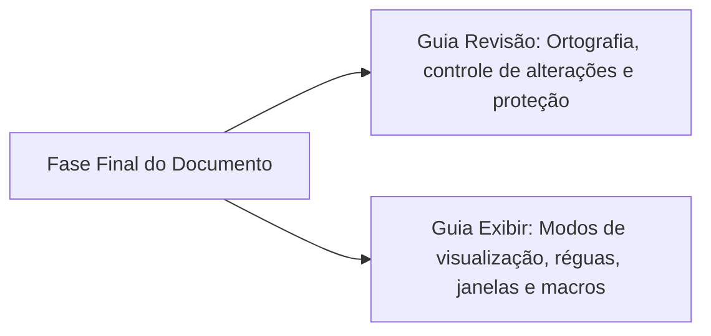
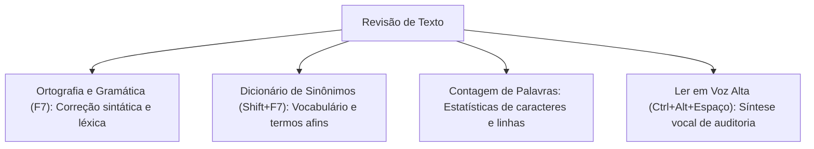
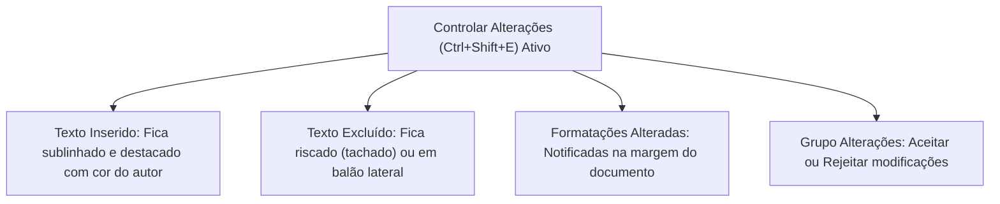
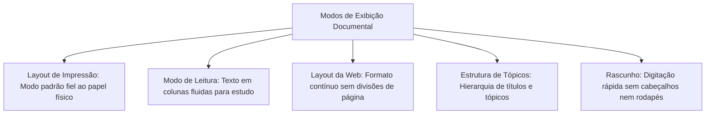
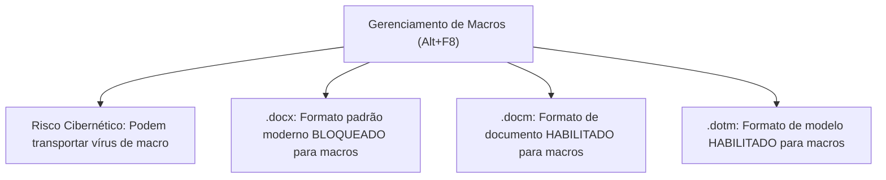
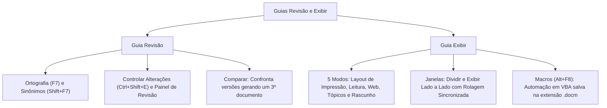

A confecção de peças formais em sindicâncias, inquéritos policiais militares e relatórios de inteligência exige rigor terminológico, controle de auditoria sobre intervenções de múltiplos revisores e conforto ergonômico na visualização documental. No Microsoft Word, essas prerrogativas são geridas pelas guias Revisão e Exibir.

Neste capítulo, você dominará os mecanismos de correção ortográfica (`F7`), o dicionário de sinônimos (`Shift+F7`), o controle de alterações (`Ctrl+Shift+E`), o recurso de comparação de minutas que gera um terceiro arquivo documental e as modalidades de restrição de edição. Em seguida, exploraremos os modos de visualização de tela, o gerenciamento de múltiplas janelas e a automação de rotinas repetitivas por macros em código VBA (`Alt+F8`).

> [!objetivos]
> - Dominar os comandos de verificação textual e atalhos da Guia Revisão (`F7` e `Shift+F7`).
> - Compreender a dinâmica operacional do recurso Controlar Alterações (`Ctrl+Shift+E`) e suas marcações.
> - Conhecer o funcionamento do comando Comparar, que consolida discrepâncias em um terceiro documento.
> - Diferenciar os cinco modos de exibição documental da Guia Exibir e a utilidade da ferramenta Dividir.
> - Compreender o papel das macros (`Alt+F8`) e as extensões de segurança que contêm código VBA (`.docm`).

## Visão Geral das Guias Revisão e Exibir

As guias Revisão e Exibir atuam na fase conclusiva da produção textual, assegurando a exatidão técnica e o refinamento ergonômico do arquivo. No ambiente corporativo contemporâneo do Microsoft 365, o processador de textos Word transformou a auditoria de minutas em um processo dinâmico, colaborativo e conectado à nuvem.

A **Guia Revisão** examina a correção gramatical, o histórico de modificações, o registro de comentários e os direitos de acesso por senha. Ela reúne recursos para validar a autoria e monitorar intervenções de múltiplos colaboradores em tempo real. Por sua vez, a **Guia Exibir** comanda a representação visual do ambiente de trabalho na tela. Ela ajusta modos de leitura, réguas milimétricas, divisão de janelas e automações por macros.

O domínio dessas duas abas é frequentemente cobrado em concursos, pois todo servidor precisa revisar documentos antes de sua publicação oficial.

## Guia Revisão: Ortografia, Idioma e Acessibilidade

O grupo **Revisão de Texto** fornece instrumentos essenciais para a higienização culta da linguagem:

- **Ortografia e Gramática (`F7`)**: Realiza uma varredura completa no arquivo em busca de desvios léxicos e sintáticos. 
  - Ondulações vermelhas sob uma palavra indicam possíveis erros de grafia ou termos ausentes no dicionário do sistema.
  - Ondulações azuis sinalizam incorreções gramaticais, inadequações de concordância verbal/nominal ou inconsistências de pontuação.
- **Dicionário de Sinônimos (`Shift + F7`)**: Abre painel lateral sugerindo vocábulos equivalentes para enriquecer o texto e evitar repetições cansativas.
- **Contagem de Palavras**: Exibe janela estatística com número de páginas, palavras, caracteres sem espaços, caracteres com espaços, parágrafos e linhas.
- **Ler em Voz Alta (`Ctrl + Alt + Espaço`)**: Aciona síntese de voz artificial para que o usuário escute o texto enquanto cada vocábulo é iluminado visualmente na tela.
- **Verificar Acessibilidade**: Localizado no grupo Acessibilidade, inspeciona o documento em busca de obstáculos para leitores de tela empregados por deficientes visuais (como falta de texto alternativo em imagens ou tabelas com cabeçalhos mal definidos).

> [!pegadinha]
> **Atalhos de Revisão Textual**: As bancas costumam inverter as teclas funcionais de revisão. Lembre-se: **`F7`** aciona a verificação de **Ortografia e Gramática**, ao passo que **`Shift + F7`** abre o **Dicionário de Sinônimos**.

## Trabalho Colaborativo: Controle de Alterações, Comparação e Proteção

Em repartições militares e delegacias, minutas de portarias e relatórios periciais transitam por sucessivas instâncias hierárquicas. O Word oferece recursos avançados para auditar cada modificação inserida no texto.

### O Recurso Controlar Alterações (`Ctrl + Shift + E`)

Ao ativar o botão **Controlar Alterações** (atalho **`Ctrl + Shift + E`**), o Word passa a registrar de forma ostensiva todas as intervenções executadas no arquivo:

- Novas palavras digitadas aparecem sublinhadas com cores individualizadas para cada usuário.
- Trechos apagados recebem o efeito tipográfico tachado ou são transferidos para balões laterais na margem.
- Modificações de layout (como aplicação de negrito ou troca de fontes) são descritas em notas marginais.

O usuário pode calibrar como as alterações são visualizadas na tela através do menu **Exibir para Revisão**:
1. *Marcação Simples*: Oculta os detalhes complexos, mantendo uma sutil linha vertical vermelha na margem esquerda para indicar parágrafos alterados.
2. *Todas as Marcações*: Apresenta todas as inserções, exclusões e balões com detalhes visuais integrais.
3. *Sem Marcação*: Projeta o documento como ele ficaria caso todas as alterações fossem aceitas, sem mostrar marcas de revisão.
4. *Original*: Exibe a versão pura do arquivo antes de qualquer intervenção realizada.

Para encerrar o ciclo de revisão, o operador utiliza os botões do grupo Alterações: **Aceitar** (incorpora a alteração em definitivo) ou **Rejeitar** (reverte a intervenção para o texto anterior).

No ecossistema em nuvem do Microsoft 365, o processador de textos Word expandiu a dinâmica colaborativa. Os comentários tornaram-se tópicos de discussão interativos. O revisor pode marcar outros membros da equipe utilizando o caractere arroba (`@Nome`), disparando notificações automáticas por e-mail com links diretos para a linha do documento. Além disso, as tarefas podem ser formalmente atribuídas e resolvidas, mantendo a trilha de auditoria arquivada.

> [!bizu]
> **Painel de Revisão**: O comando Painel de Revisão abre uma janela lateral (vertical ou horizontal) contendo a listagem analítica e cronológica de todas as alterações pendentes, permitindo navegar diretamente de uma alteração para outra.

### Comparar Documentos e Combinar Versões

O comando **Comparar** (grupo Comparar) é uma das ferramentas mais sofisticadas da Guia Revisão:
- Ele é utilizado quando duas pessoas editaram cópias separadas do mesmo documento sem ativar previamente o Controle de Alterações.
- O Word solicita o arquivo original e o arquivo alterado.
- Em seguida, o sistema confronta as duas minutas linha por linha e **gera automaticamente um terceiro documento**. Esse novo arquivo sintetiza e expõe de forma explícita todas as diferenças encontradas entre as versões.

> [!pegadinha]
> **Resultado do Comando Comparar**: Questões de prova frequentemente afirmam que o comando Comparar sobrescreve o arquivo original ou altera o arquivo revisado. **Isso é falso**. O comando Comparar preserva intactos os dois arquivos de entrada e projeta as discrepâncias em um **terceiro documento independente**.

### Restringir Edição

No grupo Proteger reside a ferramenta **Restringir Edição**:
- Permite travar o documento por meio de uma senha administrativa.
- O autor pode autorizar apenas a inserção de comentários, liberar unicamente o preenchimento de campos de formulário estruturados ou obrigar que qualquer intervenção seja obrigatoriamente gravada sob o Controle de Alterações.
- Usuários sem a senha ficam impedidos de alterar parágrafos ou desconfigurar os estilos institucionais.

## Guia Exibir: Modos de Tela, Linhas de Grade e Janelas

A Guia Exibir regula como as páginas são projetadas na tela do computador, oferecendo ferramentas ergonômicas para leitura, conferência e diagramação.

### Os Cinco Modos de Exibição

1. **Layout de Impressão**: Apresenta a folha com precisão geométrica exata (*WYSIWYG*). Mostra cabeçalhos, rodapés, margens brancas, colunas e objetos gráficos. É o modo padrão do aplicativo.
2. **Modo de Leitura**: Suprime as barras de comando superiores e adapta o texto em colunas horizontais limpas para facilitar a leitura prolongada em computadores e tablets.
3. **Layout da Web**: Renderiza o documento como se fosse uma página da internet. O texto se estende continuamente pela largura da janela, sem quebras físicas de papel.
4. **Estrutura de Tópicos**: Apresenta os parágrafos organizados em níveis hierárquicos recuados. Permite expandir, recolher ou reordenar capítulos inteiros arrastando tópicos.
5. **Rascunho**: Modo simplificado voltado para digitação ágil. Oculta cabeçalhos, rodapés, margens e ilustrações complexas.

### Grupo Mostrar: Régua, Linhas de Grade e Painel de Navegação

- **Régua**: Liga ou desliga a exibição das réguas horizontal (topo) e vertical (esquerda), permitindo manipular recuos, margens e paradas de tabulação.
- **Linhas de Grade**: Projeta uma malha milimetrada quadriculada sobre a folha, auxiliando o alinhamento de formas e ilustrações. As linhas de grade **nunca saem na impressão**.
- **Painel de Navegação**: Abre a barra lateral para pesquisa incremental de termos e navegação pela árvore de títulos.

> [!atencao]
> **As Linhas de Grade Não São Impressas**: A exibição de linhas de grade na Guia Exibir funciona estritamente como guia visual na tela. O comando não imprime reticulados no papel e não deve ser confundido com as bordas reais de uma tabela.

### Grupo Janela: O Recurso Dividir e Comparação Lado a Lado

O grupo Janela gerencia a manipulação de instâncias e visões de tela:

- **Nova Janela**: Abre uma segunda janela com o mesmo documento aberto, permitindo visualizar o início e o fim do arquivo simultaneamente em monitores diferentes.
- **Dividir**: Segmenta a janela atual em dois painéis horizontais independentes. O redator pode consultar tabelas na parte superior enquanto continua redigindo no painel inferior da mesma folha.
- **Exibir Lado a Lado**: Organiza duas janelas contíguas na tela e ativa a **Rolagem Sincronizada**, permitindo descer pelas páginas de dois relatórios ao mesmo tempo para comparação visual.

> [!esquema]
> **Utilidade Prática da Ferramenta Dividir**:
> Para consultar a introdução de um relatório longo de 80 páginas enquanto escreve as conclusões no mesmo monitor sem perder a posição, o usuário clica em **Exibir > Dividir**. Para retornar à visualização única, basta acionar **Remover Divisão**.

## Automação de Tarefas com Macros (`Alt + F8`)

No extremo direito da Guia Exibir situa-se o grupo **Macros**. Uma **Macro** é uma sequência automatizada de instruções e comandos gravada para executar tarefas repetitivas com o clique de um único botão ou o acionamento de um atalho de teclado:

- As macros do Microsoft Word são programadas na linguagem **VBA** (*Visual Basic for Applications*).
- O atalho oficial para exibir e gerenciar macros é **`Alt + F8`**.
- O editor completo de código VBA é acionado pelo atalho **`Alt + F11`**.

> [!pegadinha]
> **Formatos de Arquivo e Segurança contra Vírus de Macro**:
> Como rotinas em código VBA podem executar comandos destrutivos no sistema operacional, a Microsoft segregou os formatos de arquivo desde a versão 2007. Documentos com extensão **`.docx`** são imunes à gravação de macros. Para salvar um arquivo contendo macros executáveis no Word, o usuário deve obrigatoriamente selecionar o formato de documento habilitado para macro do Word, cuja terminação oficial é **`.docm`** (ou **`.dotm`** para modelos).

## Mapa do capítulo

### Para fixar

- O atalho `F7` aciona a verificação de Ortografia e Gramática; o atalho `Shift + F7` abre o Dicionário de Sinônimos.
- O recurso Controlar Alterações (`Ctrl + Shift + E`) demarca inserções com sublinhado colorido e exclusões com traço tachado.
- O comando Comparar confronta duas minutas e projeta as discrepâncias em um terceiro documento independente.
- A ferramenta Restringir Edição permite travar o arquivo com senha, autorizando apenas comentários ou preenchimento de formulários.
- Os cinco modos de exibição são: Layout de Impressão, Modo de Leitura, Layout da Web, Estrutura de Tópicos e Rascunho.
- O comando Dividir (Guia Exibir) segmenta a janela em dois painéis horizontais para conferência simultânea de trechos distantes.
- As Linhas de Grade servem de guia visual na tela para posicionamento de objetos e nunca saem na folha impressa.
- Macros automatizam procedimentos rotineiros em código VBA e são gerenciadas pelo atalho `Alt + F8`.
- Arquivos contendo macros executáveis exigem obrigatoriamente a extensão `.docm` (ou `.dotm` para modelos).
