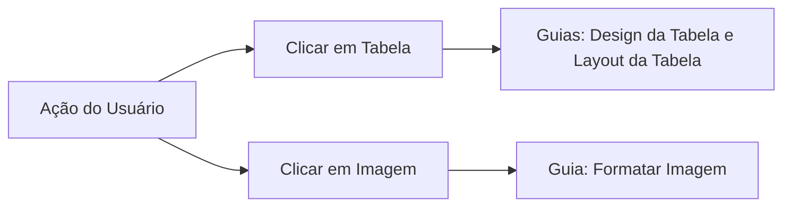
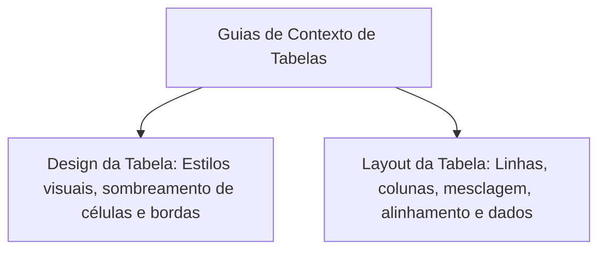
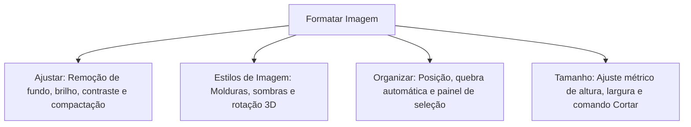
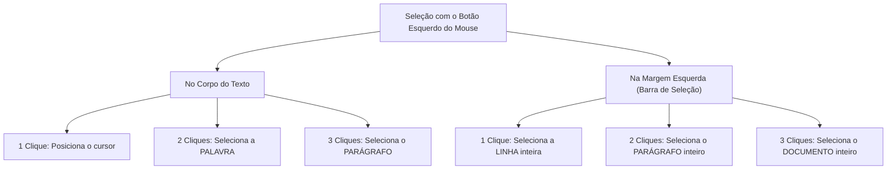
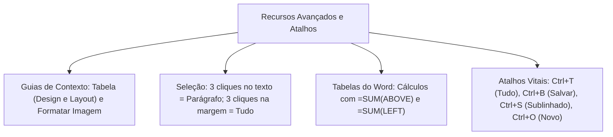

O domínio avançado do Microsoft Word exige a compreensão precisa das ferramentas contextuais que surgem sob demanda. Também demanda o domínio de cálculos em matrizes, técnicas mecânicas de seleção por mouse e memorização segura de atalhos operacionais. Nos concursos, esses detalhes práticos separam os candidatos medianos daqueles que gabaritam informática.

Neste capítulo, você consolidará o estudo dos conceitos avançados do programa (designados em ementas tradicionais pela seção de conceitos avançados e grafados em certas apostilas como ONCEITOS VANÇADOS). Exploraremos as guias contextuais de Tabelas e Imagens, o comportamento dos cliques na margem de seleção e o inventário completo dos atalhos mais cobrados nos concursos.

> [!objetivos]
> - Compreender a atuação das guias contextuais de Tabela (Design da Tabela e Layout da Tabela).
> - Analisar as ferramentas de edição da guia contextual Formatar Imagem.
> - Dominar a lógica de seleção textual por múltiplos cliques do mouse e teclas direcionais.
> - Conhecer as funções especiais de cálculo aritmético dentro de tabelas do Word.
> - Fixar o inventário dos principais atalhos de teclado no padrão de língua portuguesa.

## Visão Geral das Guias de Contexto e Recursos Avançados

O Microsoft Word implementa uma interface dinâmica orientada a contexto. Em vez de sobrecarregar a Faixa de Opções com centenas de ferramentas raramente utilizadas, o aplicativo projeta abas exclusivas temporárias quando o usuário seleciona determinados objetos gráficos ou estruturais.

No ecossistema corporativo do Microsoft 365, o processador de textos Word refinou essa dinâmica contextual. A Ribbon ajusta seus grupos inteligentes conforme o dispositivo utilizado, seja um computador desktop tradicional ou um tablet com tela sensível ao toque. Quando o usuário clica sobre uma tabela, surgem de imediato as guias Design da Tabela e Layout da Tabela. De modo similar, ao selecionar uma fotografia pericial ou imagem ilustrativa, a aba Formatar Imagem torna-se acessível na barra superior.

Ao retirar o ponto de inserção do elemento estruturado ou clicar em uma linha livre do texto, essas abas flutuantes desaparecem da tela. Esse arranjo limpa a área de trabalho e mantém em evidência apenas os comandos pertinentes à tarefa em execução.

## Guias Contextuais de Tabela: Design da Tabela e Layout

Ao selecionar ou posicionar o ponto de inserção em uma célula de tabela, o Word habilita duas abas simultâneas na extremidade direita da barra superior: **Design da Tabela** e **Layout da Tabela**.

### Guia de Contexto de Tabelas: Design da Tabela

A Guia Design da Tabela comanda o acabamento visual e estético da matriz. Ela reúne recursos para transformar tabelas brutas em relatórios elegantes:

- **Opções de Estilo de Tabela**: Caixas de seleção para ativar ou desativar formatações específicas. Inclui *Linha de Cabeçalho*, *Linha de Totais*, *Linhas em Tiras* (linhas zebradas alternadas para facilitar a leitura), *Primeira Coluna* e *Última Coluna*.
- **Estilos de Tabela**: Galeria de padrões prontos. Combina cores corporativas, linhas duplas e contrastes visuais.
- **Sombreamento**: Aplica colorações personalizadas de fundo a células isoladas, linhas inteiras ou colunas completas.
- **Bordas**: Permite definir estilo da linha, espessura em pontos e cor da caneta. Aciona também o *Pincel de Borda* para desenhar contornos seletivos com o mouse.

### Guia de Contexto de Tabelas: Layout da Tabela

A Guia Layout da Tabela regula a anatomia dimensional da grade e a manipulação dos dados contidos nas células:

| Grupo Funcional | Principais Ferramentas | Ação Prática no Documento |
|---|---|---|
| **Linhas e Colunas** | *Inserir Acima / Abaixo / Esquerda / Direita* | Adiciona novas linhas horizontais ou colunas verticais à grade |
| **Linhas e Colunas** | *Excluir* | Remove células, linhas selecionadas, colunas ou a tabela inteira |
| **Mesclar** | *Mesclar Células* | Unifica duas ou mais células adjacentes em um único compartimento |
| **Mesclar** | *Dividir Células* | Fraciona uma célula em múltiplas linhas ou colunas |
| **Mesclar** | *Dividir Tabela* | Separa a grade horizontalmente em duas tabelas independentes |
| **Tamanho da Célula** | *Distribuir Linhas / Colunas* | Uniformiza a altura das linhas e a largura das colunas |
| **Tamanho da Célula** | *AutoAjuste* | Ajusta a grade ao conteúdo das palavras ou à largura da janela |
| **Alinhamento** | Nove Posições Espaciais | Alinha o texto combinando topo, meio e base com esquerda, centro e direita |
| **Alinhamento** | *Direção do Texto* | Gira a orientação da escrita na célula em 90° ou 270° |
| **Dados** | *Repetir Linhas de Cabeçalho* | Replica o cabeçalho no topo de todas as folhas quando a tabela quebra |
| **Dados** | *Classificar* | Ordena registros alfabeticamente ou numericamente |
| **Dados** | *Fórmula* | Executa cálculos aritméticos básicos nas células da tabela |

> [!pegadinha]
> **Repetir Linhas de Cabeçalho em Tabelas Extensas**:
> Em relatórios com tabelas que ocupam várias páginas consecutivas, o candidato não deve redigir o cabeçalho manualmente no topo de cada nova folha. O procedimento oficial do Word consiste em selecionar a primeira linha da tabela e ativar o comando **Repetir Linhas de Cabeçalho** na Guia Layout da Tabela. O programa replica os títulos automaticamente em todas as páginas subsequentes.

> [!bizu]
> **Fórmulas Aritméticas em Tabelas do Word**:
> Embora o Excel seja a ferramenta padrão para cálculos, o Word aceita fórmulas nas células de tabelas através do botão **Fórmula** (Guia Layout da Tabela). A sintaxe padrão utiliza funções em inglês com argumentos de posição relativa:
> - `=SUM(ABOVE)`: Soma todas as células numéricas situadas na coluna acima.
> - `=SUM(LEFT)`: Soma todas as células numéricas situadas na linha à esquerda.
> - `=AVERAGE(ABOVE)`: Calcula a média aritmética dos valores superiores.
> - `=COUNT(LEFT)`: Conta a quantidade de registros numéricos à esquerda.

## Guia de Contexto de Imagens: Formatar Imagem

Ao clicar sobre uma imagem ou foto inserida no texto, o aplicativo projeta a guia contextual **Formatar Imagem** (ou *Formato de Imagem*), reunindo comandos para tratamento gráfico:

- **Remover Plano de Fundo**: Isola a figura principal e descarta o fundo indesejado da foto de modo automatizado.
- **Correções e Cor**: Ajusta a nitidez fotográfica e calibra saturação, temperatura cromática, brilho e contraste.
- **Efeitos Artísticos**: Aplica filtros digitais que simulam texturas de aquarela, fotocópia, esboços a lápis e desenhos em giz.
- **Compactar Imagens**: Reduz o tamanho físico do documento compactando as fotos embutidas para resoluções adequadas a e-mail, tela ou impressão.
- **Redefinir Imagem**: Cancela todas as modificações visuais aplicadas, restaurando as dimensões e cores originais da fotografia.
- **Quebra de Texto Automática**: Comanda a interação espacial entre a foto e o fluxo dos parágrafos (Alinhado com o Texto, Quadrado, Justo, Atrás do Texto ou Em Frente ao Texto).
- **Cortar**: Elimina porções externas desnecessárias da foto sem alterar a resolução do trecho remanescente.

## Teclas Especiais e Técnicas de Seleção de Texto

O domínio da mecânica operacional do teclado e do mouse permite ao redator ganhar velocidade e precisão.

### Funções das Teclas Especiais de Controle

- **`Tab`**: Avança o cursor para a próxima parada de tabulação (padrão de `1,25 cm`). Desloca o ponto de inserção para a próxima célula em tabelas. Pressionar `Shift + Tab` em uma tabela retrocede para a célula anterior.
- **`Insert`**: Alterna entre o modo de inserção regular e o modo sobrescrever. No modo sobrescrever, os caracteres novos substituem as letras que estiverem à frente.
- **`Backspace` versus `Delete`**:
  - `Backspace`: Apaga o caractere situado imediatamente à esquerda do ponto de inserção. Pressionar `Ctrl + Backspace` apaga a palavra inteira à esquerda.
  - `Delete`: Apaga o caractere situado imediatamente à direita do ponto de inserção. Pressionar `Ctrl + Delete` apaga a palavra inteira à direita.
- **`Home` versus `End`**:
  - `Home`: Move o cursor diretamente para o início da linha atual. Pressionar `Ctrl + Home` salta para o início absoluto do documento.
  - `End`: Move o cursor diretamente para o término da linha atual. Pressionar `Ctrl + End` salta para o encerramento absoluto do documento.

### Mecânica de Seleção por Cliques do Mouse

O número de cliques executados com o botão esquerdo do mouse produz efeitos distintos dependendo da área onde o ponteiro está localizado:

> [!pegadinha]
> **Três Cliques no Texto versus Três Cliques na Margem**:
> Essa é uma clássica pegadinha das bancas:
> - Três cliques consecutivos dentro do texto selecionam o **parágrafo** corrente.
> - Três cliques consecutivos na **margem esquerda** em branco (área de seleção) selecionam o **documento inteiro** (equivalente ao atalho `Ctrl + T`).

## Inventário Consolidado de Atalhos de Teclado (PT-BR)

Para a revisão final de véspera, apresentamos o quadro consolidado com os atalhos de teclado mais cobrados em certames públicos:

| Ação Operacional no Word | Atalho de Teclado (Padrão PT-BR) | Categoria Funcional |
|---|---|---|
| Novo Documento em Branco | **`Ctrl + O`** | Gerenciamento de Arquivo |
| Abrir Documento Existente | **`Ctrl + A`** | Gerenciamento de Arquivo |
| Salvar Documento Ativo | **`Ctrl + B`** | Gerenciamento de Arquivo |
| Salvar Como | **`F12`** | Gerenciamento de Arquivo |
| Imprimir Documento | **`Ctrl + P`** | Gerenciamento de Arquivo |
| Fechar Janela Ativa | **`Ctrl + W`** | Gerenciamento de Arquivo |
| Selecionar Todo o Documento | **`Ctrl + T`** | Seleção de Conteúdo |
| Recortar Seleção | **`Ctrl + X`** | Área de Transferência |
| Copiar Seleção | **`Ctrl + C`** | Área de Transferência |
| Colar Conteúdo do Buffer | **`Ctrl + V`** | Área de Transferência |
| Desfazer Ação Anterior | **`Ctrl + Z`** | Histórico de Ações |
| Refazer ou Repetir Ação | **`Ctrl + R`** ou **`Ctrl + Y`** | Histórico de Ações |
| Alinhar à Esquerda | **`Ctrl + Q`** | Formatação de Parágrafo |
| Centralizar Texto | **`Ctrl + E`** | Formatação de Parágrafo |
| Alinhar à Direita | **`Ctrl + G`** | Formatação de Parágrafo |
| Justificar Texto | **`Ctrl + J`** | Formatação de Parágrafo |
| Negrito | **`Ctrl + N`** | Formatação de Fonte |
| Itálico | **`Ctrl + I`** | Formatação de Fonte |
| Sublinhado | **`Ctrl + S`** | Formatação de Fonte |
| Subscrito (H₂O) | **`Ctrl + =`** | Formatação de Fonte |
| Sobrescrito (x²) | **`Ctrl + Shift + +`** | Formatação de Fonte |
| Limpar Toda a Formatação | **`Ctrl + Espaço`** | Formatação de Fonte |
| Alternar Maiúsculas/Minúsculas | **`Shift + F3`** | Tipografia Cíclica |
| Localizar Texto | **`Ctrl + L`** | Edição e Pesquisa |
| Substituir Texto | **`Ctrl + U`** | Edição e Pesquisa |
| Inserir Link | **`Ctrl + K`** | Vínculos Hipertextuais |
| Inserir Quebra de Página | **`Ctrl + Enter`** | Estrutura de Página |
| Ortografia e Gramática | **`F7`** | Revisão Textual |
| Dicionário de Sinônimos | **`Shift + F7`** | Revisão Textual |
| Inserir Nota de Rodapé | **`Alt + Ctrl + F`** | Referências |
| Inserir Nota de Fim | **`Alt + Ctrl + D`** | Referências |
| Recolher/Expandir Faixa de Opções | **`Ctrl + F1`** | Interface Ribbon |
| Exibir Painel de Macros | **`Alt + F8`** | Automação VBA |

> [!bizu]
> **Quatro Atalhos Fatais em Prova**:
> 1. `Ctrl + T`: Seleciona **Tudo** no Word em português (no Windows Explorer é `Ctrl + A`).
> 2. `Ctrl + B`: Salva o documento (**B**ackup).
> 3. `Ctrl + S`: Aplica **Sublinhado** (e não salvar).
> 4. `Ctrl + O`: Cria um documento nov**o** (e não abrir).

## Mapa do capítulo

### Para fixar

- As guias contextuais Design da Tabela e Layout da Tabela surgem unicamente quando o ponto de inserção está dentro de uma tabela.
- O comando Repetir Linhas de Cabeçalho (Layout da Tabela) replica os títulos automaticamente em tabelas que ultrapassam uma página.
- O Word admite fórmulas matemáticas simples em células de tabelas com argumentos direcionais como `=SUM(ABOVE)` e `=AVERAGE(LEFT)`.
- A guia Formatar Imagem oferece recursos de remoção de plano de fundo, efeitos artísticos, compactação e quebra de texto automática.
- Dois cliques sobre uma palavra a selecionam; três cliques dentro do texto selecionam o parágrafo inteiro.
- Um clique na margem esquerda seleciona a linha; dois cliques na margem selecionam o parágrafo; três cliques na margem selecionam o documento inteiro.
- No Word em português, `Ctrl + T` seleciona todo o texto, `Ctrl + B` salva o arquivo e `Ctrl + O` abre um novo documento em branco.
- Os atalhos de alinhamento são `Ctrl + Q` (esquerda), `Ctrl + E` (centro), `Ctrl + G` (direita) e `Ctrl + J` (justificado).
- O atalho `Shift + F3` alterna ciclicamente entre maiúsculas, minúsculas e primeira letra maiúscula.
- As macros em código VBA são gerenciadas pelo atalho `Alt + F8` e salvas no formato seguro `.docm`.
