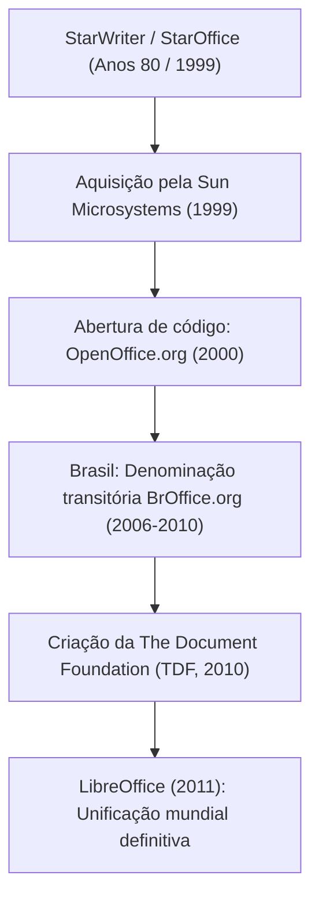
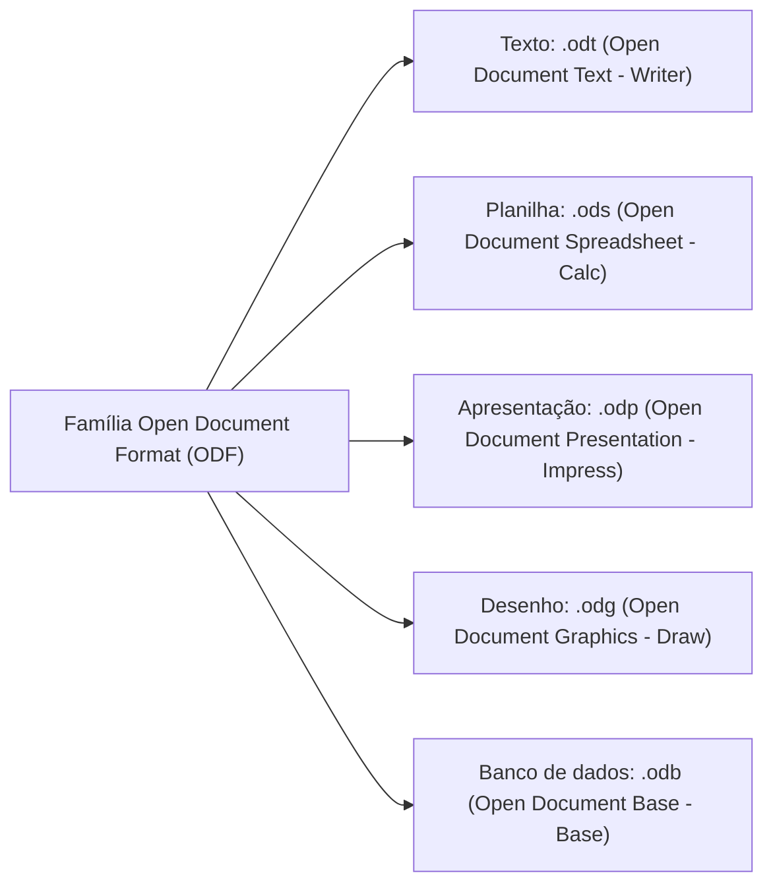
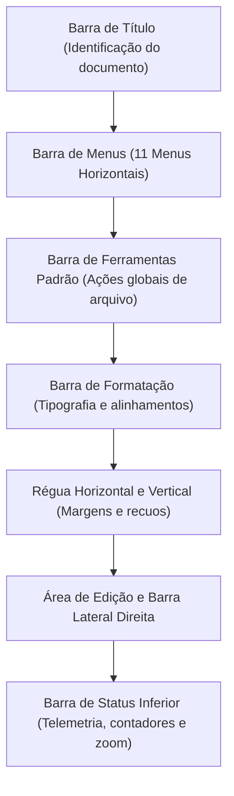
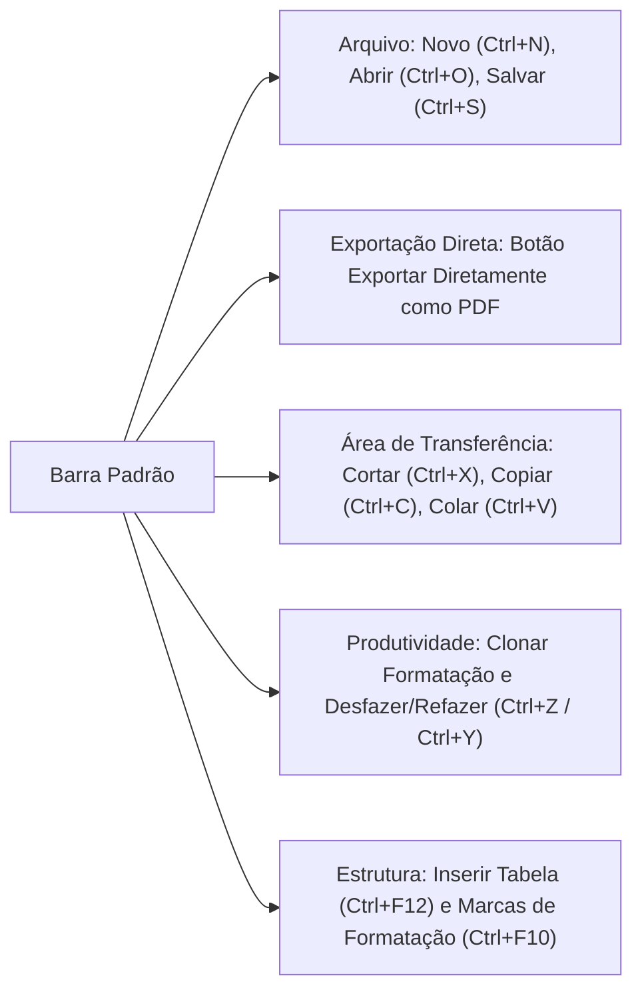
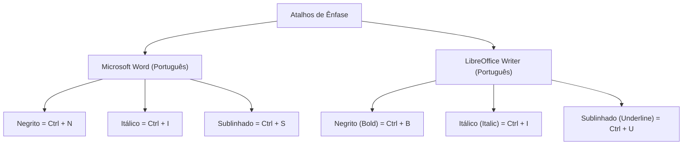
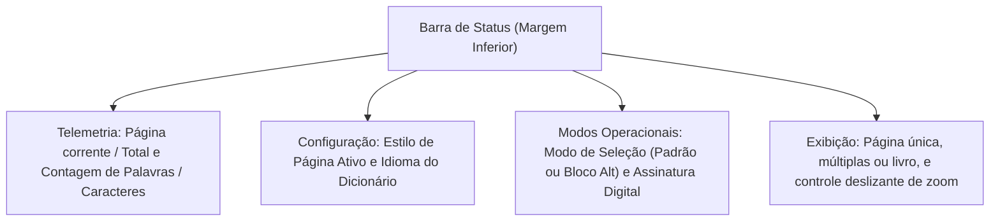
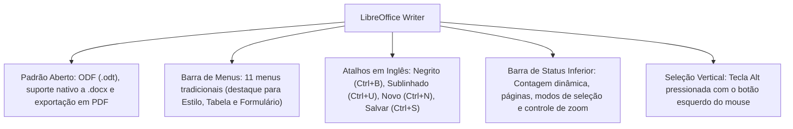

O LibreOffice Writer é o processador de textos multiplataforma e de código aberto integrante da suíte de escritório da The Document Foundation. No serviço público militar brasileiro, o Writer atende aos padrões de interoperabilidade e uso de formatos abertos da arquitetura e-PING (Padrões de Interoperabilidade de Governo Eletrônico). No âmbito do Corpo de Bombeiros Militar e da Polícia Militar de Pernambuco, seu emprego garante autonomia tecnológica, redução de custos com licenças proprietárias e segurança na gestão de documentos oficiais.

Nas provas de concurso, o conhecimento do LibreOffice Writer exige atenção meticulosa aos detalhes estruturais. A banca costuma explorar a distinção entre menus clássicos e a interface Ribbon do Microsoft Word, a localização de comandos nos menus, a telemetria fornecida pela Barra de Status e as teclas de atalho fundamentais. Neste capítulo, examinaremos a evolução histórica do software, os conceitos de formatos abertos ODF, os componentes da interface visual, as funções da Barra Padrão e de Formatação e os controles da Barra de Status.

> [!objetivos]
> - Compreender a trajetória histórica do Writer desde o StarOffice e OpenOffice até o LibreOffice da The Document Foundation.
> - Caracterizar o padrão aberto Open Document Format (ODF), suas extensões e a interoperabilidade com formatos legados.
> - Dominar a organização da interface gráfica: Barra de Título, Barra de Menus horizontais e acoplamento de barras.
> - Identificar as ferramentas das Barras Padrão e de Formatação, incluindo atalhos característicos da suíte.
> - Analisar as informações e controles operacionais integrados à Barra de Status inferior.

## Conceitos Básicos e contexto histórico do LibreOffice Writer

A história do LibreOffice Writer remonta à década de 1980, com o surgimento do StarWriter na Alemanha, desenvolvido por Marco Boerries e comercializado pela StarDivision. O pacote evoluiu para o StarOffice, suíte de escritório integrada. Em 1999, a Sun Microsystems adquiriu a StarDivision. No ano 2000, a Sun abriu o código-fonte do produto, inaugurando o projeto comunitário OpenOffice.org sob licença de software livre.

No território brasileiro, o projeto OpenOffice.org deparou-se com uma barreira jurídica singular. A marca "Open Office" já havia sido previamente registrada no Instituto Nacional da Propriedade Industrial (INPI) por uma empresa privada de soluções contábeis. Para contornar o litígio marcário sem paralisar o avanço do software no país, a comunidade nacional criou em 2006 a denominação oficial BrOffice.org.

Em 2010, a corporação Oracle comprou a Sun Microsystems. Diante de incertezas quanto ao futuro da governança comunitária aberta, os colaboradores mundiais fundaram uma entidade independente sem fins lucrativos na Alemanha: a The Document Foundation (TDF). A fundação realizou uma bifurcação (fork) do projeto, batizando a suíte como LibreOffice. Em 2011, a comunidade brasileira dissolveu a associação BrOffice e unificou a distribuição nacional sob o nome global LibreOffice.

| Marco histórico | Ano | Entidade responsável | Fato de destaque para concursos |
| :--- | :--- | :--- | :--- |
| Criação do StarOffice | Anos 1980 | StarDivision (Marco Boerries) | Origem do código-fonte do processador textual |
| Abertura do código | 2000 | Sun Microsystems | Lançamento do projeto livre OpenOffice.org |
| Criação do BrOffice | 2006 | Comunidade Brasileira | Adaptação por registro prévio da marca no INPI |
| Fundação da TDF | 2010 | The Document Foundation | Criação do LibreOffice como projeto independente |
| Unificação no Brasil | 2011 | Comunidade Brasileira / TDF | Extinção formal do BrOffice e adoção do LibreOffice |

> [!bizu]
> BrOffice é fato histórico: Nas provas, alternativas que tratam o BrOffice como aplicativo em distribuição ativa estão incorretas. O software oficial cobrado em editais modernos é unicamente o LibreOffice (família 7 e superiores).

## O padrão aberto Open Document Format e visão geral da suíte

O LibreOffice Writer é distribuído sob a licença livre GNU Lesser General Public License (LGPLv3+), garantindo quatro liberdades: executar para qualquer fim, estudar o código, redistribuir cópias e modificar o software. Trata-se de um aplicativo multiplataforma disponível para Windows, Linux e macOS.

A base técnica da suíte é o padrão Open Document Format for Office Applications (ODF), mantido pela OASIS e padronizado internacionalmente pela norma ISO/IEC 26300. Um arquivo ODF é um pacote comprimido em formato ZIP contendo arquivos de marcação XML, imagens e folhas de estilo organizadas.

O formato nativo padrão do Writer é o `.odt` (Open Document Text). Além dele, o Writer apresenta ampla interoperabilidade:
- Documentos do Microsoft Word: leitura e gravação em `.doc` (Word 97-2003) e `.docx` (Word 2007 a Microsoft 365).
- Modelos de documento: modelos ODF em `.ott` e modelos do Word em `.dot` ou `.dotx`.
- Formatos de intercâmbio: Rich Text Format (`.rtf`), texto puro (`.txt`) e páginas web (`.html`).
- Distribuição universal: exportação direta para PDF (inclusive perfis PDF/A para preservação arquivística) e publicações digitais EPUB.

| Extensão | Natureza do formato | Aplicativo | Observação para concursos |
| :--- | :--- | :--- | :--- |
| `.odt` | Texto aberto (ODF) | LibreOffice Writer | Padrão nativo do processador de textos |
| `.ott` | Modelo de texto aberto | LibreOffice Writer | Modelo para padronização de ofícios |
| `.ods` | Planilha aberta (ODF) | LibreOffice Calc | Planilhas eletrônicas da suíte |
| `.odp` | Apresentação aberta | LibreOffice Impress | Slides e palestras multimídia |
| `.docx` | Formato proprietário XML | Microsoft Word | Aberto, editado e salvo nativamente |
| `.pdf` | Documento portátil ISO | Universal | Exportável via botão direto da barra padrão |

> [!atencao]
> Compatibilidade bidirecional com o Word: O Writer abre, edita e salva arquivos em `.docx` e `.doc` sem exigir conversores pagos adicionais. Afirmar o contrário em provas é incorreto.

## A interface visual clássica e a Barra de Menus

Enquanto as versões modernas do Microsoft Word utilizam a faixa de opções Ribbon, o LibreOffice Writer mantém como padrão a interface clássica baseada em menus horizontais suspensos e barras modulares acopláveis.

Na borda superior da janela situa-se a Barra de Título, que exibe o nome do documento aberto e a identificação do aplicativo. Arquivos novos recebem o nome provisório `Sem título 1` (acrescendo `Sem título 2`, `Sem título 3` conforme novos arquivos são abertos).

A Barra de Menus do LibreOffice 7 Writer é formada por exatamente 11 menus horizontais:

| Menu | Finalidade principal | Exemplos de comandos representativos |
| :--- | :--- | :--- |
| **Arquivo** | Gestão documental e gravação física | Novo, Abrir, Salvar, Salvar Como, Exportar como PDF, Imprimir |
| **Editar** | Fluxo de edição e área de transferência | Desfazer, Refazer, Colar Especial, Localizar e Substituir |
| **Exibir** | Visualização na tela e painéis | Marcas de Formatação, Barra Lateral, Navegador, Réguas, Zoom |
| **Inserir** | Inclusão de objetos e quebras | Quebra de Página, Imagem, Tabela, Seção, Hiperlink, Nota de Rodapé |
| **Formatar** | Atributos visuais diretos no conteúdo | Texto (Negrito/Itálico), Parágrafo, Limpar Formatação Direta |
| **Estilo** | Gestão de estilos padronizados | Aplicar Estilo, Gerenciar Estilos, Novo Estilo da Seleção |
| **Tabela** | Matrizes tabulares e cálculos | Inserir Tabela, Linhas, Colunas, Mesclar Células, Fórmula (F2) |
| **Formulário** | Controles interativos de preenchimento | Caixa de Texto, Botão de Opção, Caixa de Seleção, Modo de Projeto |
| **Ferramentas** | Utilidades de suporte e linguística | Ortografia, Idioma, Contagem de Palavras, Mala Direta, Opções |
| **Janela** | Gerenciamento de janelas abertas | Nova Janela, Fechar Janela, alternância entre documentos |
| **Ajuda** | Documentação e suporte institucional | Guia do Usuário, O que é isto?, Sobre o LibreOffice |

> [!bizu]
> Menus autônomos no Writer: O Writer dispõe dos menus fixos **Estilo**, **Tabela** e **Formulário** na barra principal. No Word, essas funcionalidades estão dispersas em guias contextuais móveis ou dentro da guia Inserir.

## A Barra de Ferramentas Padrão e suas operações

A Barra de Ferramentas Padrão reúne atalhos para ações operacionais frequentes. Ela fica acoplada abaixo da Barra de Menus, mas pode ser desacoplada arrastando seu delimitador pontilhado para o centro da tela, tornando-se uma janela flutuante móvel.

Principais comandos da Barra Padrão:
1. *Exportar diretamente como PDF:* Gera de imediato um arquivo PDF aplicando os parâmetros padrão da suíte, sem abrir a janela de diálogo detalhada.
2. *Imprimir (Ctrl + P):* Aciona o envio do documento ao dispositivo de impressão ou abre a caixa de diálogo de impressoras.
3. *Clonar Formatação:* Representado por um pincel ou conta-gotas. Copia estilos de um texto selecionado para aplicá-los em outro trecho. Com clique duplo, a ferramenta permanece ativa para múltiplas marcações até o acionamento da tecla Esc.
4. *Inserir Tabela (Ctrl + F12):* Abre uma grade rápida para definir linhas e colunas ou aciona o assistente de tabelas.
5. *Marcas de Formatação (Ctrl + F10):* Revela ou esconde caracteres não imprimíveis (espaços, quebras e tabulações).

| Ação na Barra Padrão | Atalho padrão | Ícone visual | Efeito no documento |
| :--- | :--- | :--- | :--- |
| Novo Documento | Ctrl + N | Folha em branco | Cria novo arquivo de texto vazio |
| Abrir Documento | Ctrl + O | Pasta aberta | Abre o navegador para carregar arquivo |
| Salvar Documento | Ctrl + S | Disquete azul | Grava as alterações no disco |
| Exportar como PDF | Sem atalho | Folha com símbolo PDF | Exporta em PDF instantaneamente |
| Imprimir | Ctrl + P | Impressora física | Abre o diálogo de impressão |
| Clonar Formatação | Sem atalho | Pincel de pintura | Copia características visuais de um texto |
| Desfazer Ação | Ctrl + Z | Seta curva para a esquerda | Reverte a última operação realizada |
| Refazer Ação | Ctrl + Y | Seta curva para a direita | Reaplica a ação desfeita anteriormente |
| Inserir Tabela | Ctrl + F12 | Grade quadriculada | Cria nova matriz tabular na posição ativa |

## A Barra de Ferramentas de Formatação e os atalhos de ênfase

A Barra de Ferramentas de Formatação fica posicionada abaixo da Barra Padrão, concentrando comandos para tipografia, realces e alinhamento do parágrafo ativo.

Em concursos, as teclas de atalho de ênfase constituem ponto crucial. No Word em português, os atalhos derivam da língua portuguesa (Ctrl + N para Negrito e Ctrl + S para Sublinhado). No LibreOffice Writer em português, os atalhos preservam a matriz da língua inglesa:
- **Negrito (Bold):** atalho **Ctrl + B**.
- **Itálico (Italic):** atalho **Ctrl + I**.
- **Sublinhado (Underline):** atalho **Ctrl + U**.

Recursos adicionais da Barra de Formatação:
1. *Estilos rápidos:* Aplica Estilo Padrão, Título 1 (Ctrl + 1), Título 2 (Ctrl + 2), Título 3 (Ctrl + 3) e Corpo de Texto (Ctrl + 0).
2. *Alinhamentos de Parágrafo:*
   - Alinhar à Esquerda: **Ctrl + L** (Left).
   - Centralizar: **Ctrl + E**.
   - Alinhar à Direita: **Ctrl + R** (Right).
   - Justificar: **Ctrl + J** (Justify).
3. *Listas com Marcadores e Numeração:* Marcadores não ordenados (Shift + F12) e listas numeradas (F12).
4. *Limpar Formatação Direta:* Atalho **Ctrl + M**. Remove ajustes manuais e restaura o estilo original do trecho.

| Comando | Atalho no Writer | Atalho no Word | Efeito |
| :--- | :--- | :--- | :--- |
| Negrito | **Ctrl + B** | Ctrl + N | Engrossa o traço dos caracteres |
| Itálico | **Ctrl + I** | Ctrl + I | Inclina as letras para a direita |
| Sublinhado | **Ctrl + U** | Ctrl + S | Aplica traço contínuo sob as letras |
| Alinhar à Esquerda | **Ctrl + L** | Ctrl + Q | Ajusta o parágrafo à margem esquerda |
| Centralizar | **Ctrl + E** | Ctrl + E | Distribui o texto no centro do parágrafo |
| Alinhar à Direita | **Ctrl + R** | Ctrl + G | Encosta o texto na margem direita |
| Justificar | **Ctrl + J** | Ctrl + J | Distribui o texto uniformemente entre margens |
| Limpar Formatação | **Ctrl + M** | Ctrl + Espaço | Remove formatações diretas mantendo o estilo |

> [!pegadinha]
> Distinção entre Ctrl + N e Ctrl + S: No LibreOffice Writer, `Ctrl + N` cria um Novo documento (New) e `Ctrl + S` Salva o documento (Save). Para aplicar negrito, deve-se pressionar `Ctrl + B` (Bold).

## A Barra de Status e seus indicadores operacionais

A Barra de Status situa-se na margem inferior da janela do LibreOffice Writer. Ela exibe telemetria contínua sobre a sessão e possibilita ajustes imediatos por meio de cliques diretos.

Painéis da Barra de Status da esquerda para a direita:
1. *Número da Página:* Mostra a página corrente e o total de páginas (exemplo: `Página 2 de 8`). Um clique duplo sobre a área abre a caixa de diálogo do Navegador para saltos rápidos no texto.
2. *Contador de Palavras e Caracteres:* Indica a quantidade de termos e caracteres presentes no arquivo ou na seleção destacada (exemplo: `450 palavras, 2.800 caracteres`). Um clique duplo abre a janela de estatísticas completas.
3. *Estilo de Página:* Exibe o estilo aplicado à página ativa (como `Estilo Padrão` ou `Paisagem`). O clique com botão direito permite selecionar outros modelos estruturais.
4. *Idioma:* Indica o idioma do corretor aplicado à palavra na posição ativa (exemplo: `Português (Brasil)`).
5. *Modo de Inserção:* Alterna entre inserção de texto (`INSER`) e sobrescrita (`SOBRE`), também controlável pela tecla Insert do teclado.
6. *Modo de Seleção:* Alterna entre Seleção Padrão, Estendida, Adicionada e em Bloco. A Seleção em Bloco marca colunas retangulares verticais e pode ser acionada mantendo a tecla **Alt** pressionada durante o arrasto do mouse.
7. *Assinatura Digital:* Exibe ícone de certificado digital quando o arquivo possui assinatura ICP-Brasil válida.
8. *Modos de Visualização:* Três botões para alternar entre Página Única, Múltiplas Páginas e Modo Livro (páginas pares à esquerda e ímpares à direita).
9. *Controle de Zoom:* Barra deslizante percentual de aproximação visual. Um clique duplo sobre o valor percentual abre o diálogo de opções de zoom para selecionar 100% ou Largura da Página.

| Campo na Barra de Status | Informação fornecida | Efeito do clique duplo |
| :--- | :--- | :--- |
| Página | Posição e total de folhas | Abre o Navegador / Ir para Página |
| Contagem | Palavras e caracteres em tempo real | Abre a janela Estatísticas do Documento |
| Estilo de Página | Estilo de página do parágrafo ativo | Abre o diálogo de Estilo de Página |
| Idioma | Dicionário ativo na palavra | Permite alterar idioma do documento |
| Modo de Seleção | Padrão, Estendida, Bloco (Alt) | Alterna modos de marcação de texto |
| Assinatura | Presença de certificado de autenticidade | Exibe detalhes da assinatura digital |
| Modos de Exibição | Página única, múltiplas ou livro | Altera disposição das folhas na tela |
| Controle de Zoom | Barra percentual de aproximação | Abre diálogo com opções predefinidas |

> [!bizu]
> Seleção em bloco com tecla Alt: Para selecionar colunas verticais de caracteres sem marcar a linha inteira, o usuário deve manter a tecla **Alt** pressionada enquanto clica e arrasta o ponteiro com o botão esquerdo do mouse. Esse recurso é tema recorrente nas provas.

## Resolução guiada de problema

Vejamos a aplicação desses conceitos em uma questão no padrão das bancas.

> [!resolvido]
> **Questão contextualizada:** Um militar estadual responsável pela confecção de boletins administrativos utiliza o processador de textos LibreOffice Writer 7. A respeito dos recursos, atalhos e características do aplicativo, avalie as proposições a seguir:
>
> I. O LibreOffice Writer utiliza nativamente o formato ODF com a extensão padrão `.odt`, sendo plenamente capaz de abrir e gravar documentos nas extensões `.doc` e `.docx` do Microsoft Word.
> II. Para aplicar o recurso de formatação em Negrito sobre um trecho selecionado, mantendo a configuração padrão em português, o usuário deve utilizar o atalho de teclado `Ctrl + B`.
> III. A seleção de um bloco retangular de texto em sentido vertical pode ser efetuada mantendo-se a tecla `Alt` pressionada enquanto se seleciona o trecho com o botão esquerdo do mouse.
> IV. A Barra de Status localiza-se na margem superior da tela, acima da Barra de Menus, e tem como função exclusiva a exibição do nome do arquivo ativo na sessão.
>
> Estão corretas as afirmativas:
> A) I e IV, apenas.
> B) II e III, apenas.
> C) I, II e III, apenas.
> D) II, III e IV, apenas.
> E) I, II, III e IV.
>
> **Resolução passo a passo:**
> 1. *Análise da proposição I:* Correta. O padrão nativo do Writer é o ODF (`.odt`), preservando compatibilidade de leitura e gravação com formatos da Microsoft (`.doc` e `.docx`).
> 2. *Análise da proposição II:* Correta. No Writer em português, os atalhos de ênfase seguem o padrão em inglês: Negrito é `Ctrl + B` (Bold), Itálico é `Ctrl + I` e Sublinhado é `Ctrl + U`.
> 3. *Análise da proposição III:* Correta. A seleção em bloco vertical é executada mantendo a tecla `Alt` pressionada enquanto se arrasta o mouse sobre a área de texto.
> 4. *Análise da proposição IV:* Incorreta. A Barra de Status localiza-se na borda inferior do programa e exibe número de páginas, palavras, caracteres, idiomas e zoom. A barra superior que exibe o nome do arquivo é a Barra de Título.
>
> Conclusão: As proposições I, II e III são verdadeiras.
> Resposta correta: Alternativa C.

## Mapa do capítulo

Examinamos os conceitos estruturais do LibreOffice Writer, sua trajetória desde a StarDivision até a governança comunitária da The Document Foundation, os fundamentos do padrão ODF e o detalhamento ergonômico de suas barras funcionais.

### Para fixar
- O LibreOffice Writer é mantido pela The Document Foundation (TDF) sob a licença livre LGPLv3+.
- A extensão nativa de gravação de texto é `.odt` (Open Document Text), pertencente à família ODF (norma ISO 26300).
- O software possui total interoperabilidade com arquivos do Word, abrindo e salvando em `.docx` e `.doc`.
- O botão Exportar Diretamente como PDF na Barra Padrão gera PDFs imediatos sem abrir caixas de configuração.
- A Barra de Menus possui 11 menus: Arquivo, Editar, Exibir, Inserir, Formatar, Estilo, Tabela, Formulário, Ferramentas, Janela e Ajuda.
- No Writer em português, Negrito é `Ctrl + B`, Itálico é `Ctrl + I` e Sublinhado é `Ctrl + U`.
- O atalho `Ctrl + N` cria um Novo documento e `Ctrl + S` Salva o documento atual.
- A ferramenta Clonar Formatação copia atributos visuais e suporta aplicação contínua com clique duplo.
- A Barra de Status na borda inferior monitora páginas, contagem de palavras e caracteres, idioma, estilo e zoom.
- A seleção retangular em bloco é acionada mantendo a tecla `Alt` pressionada durante o arrasto do mouse.
