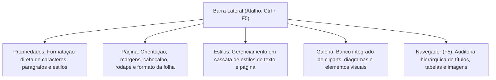
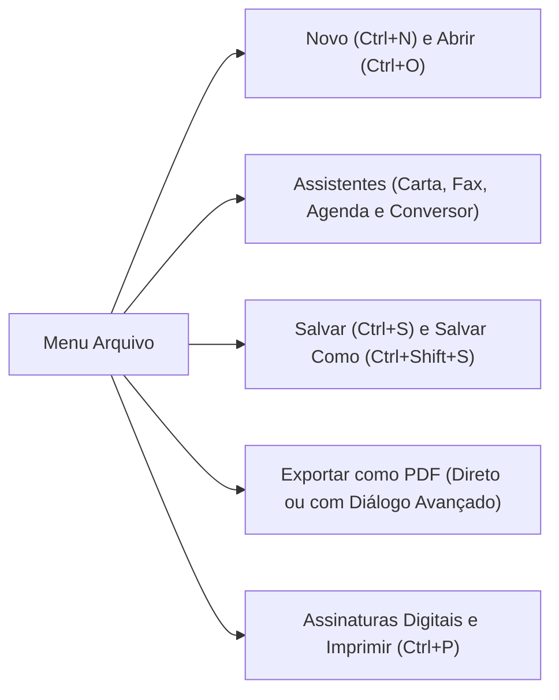
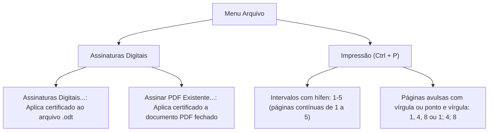
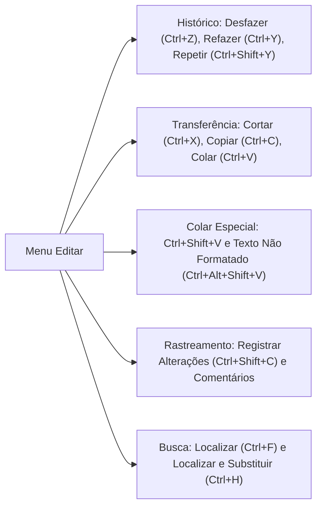
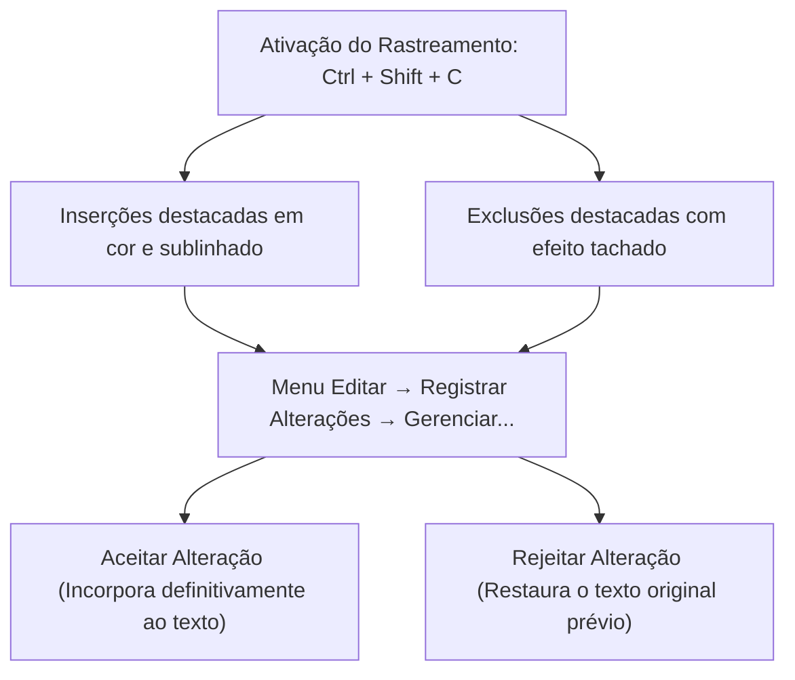
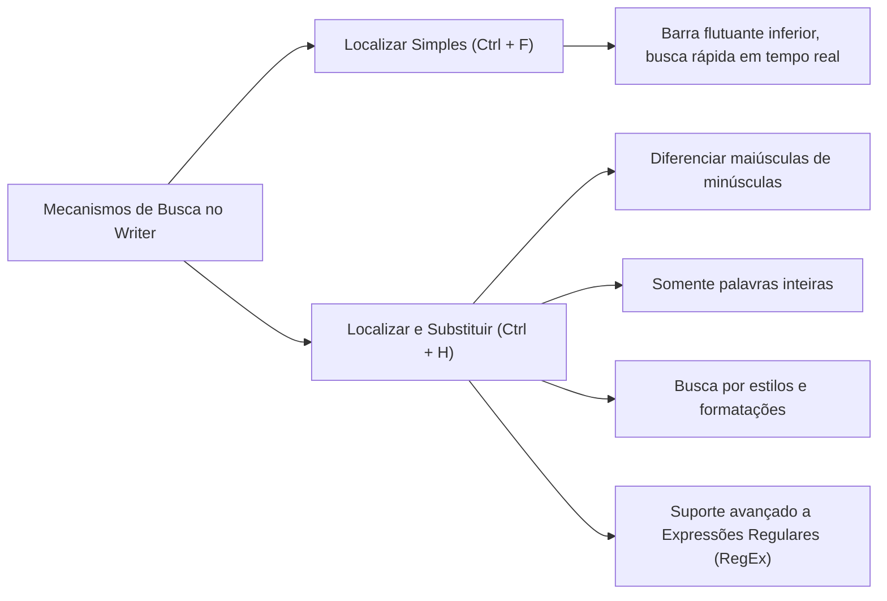
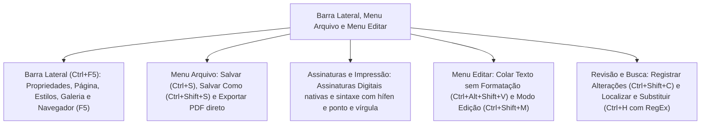

A produtividade operacional no LibreOffice Writer fundamenta-se no domínio integrado de suas estruturas laterais e dos dois primeiros menus horizontais da aplicação: o Menu Arquivo e o Menu Editar. No cotidiano administrativo dos corpos de bombeiros e das polícias militares, o gerenciamento seguro de documentos, a exportação em formatos de arquivamento perene e a edição colaborativa com controle de versões são rotinas críticas para a validade de boletins e relatórios periciais.

Para as bancas, esses módulos representam fontes inesgotáveis de questões técnicas. A banca exige com regularidade o conhecimento das abas funcionais da Barra Lateral, a localização exata de comandos de salvamento e exportação, a sintaxe de impressão de páginas, as nuances do Colar Especial e a parametrização de buscas avançadas por expressões regulares no comando Localizar e Substituir. Neste capítulo, exploraremos detalhadamente a arquitetura da Barra Lateral, as rotinas completas do Menu Arquivo e os recursos de manipulação textual do Menu Editar.

> [!objetivos]
> - Compreender a organização da Barra Lateral e as funções de seus painéis integrados.
> - Dominar as opções de criação, abertura, salvamento e exportação em PDF pelo Menu Arquivo.
> - Compreender o funcionamento das assinaturas digitais nativas e a sintaxe de impressão por intervalos.
> - Analisar os comandos de manipulação do Menu Editar, com foco na área de transferência e no Colar Especial.
> - Aplicar o rastreamento de alterações e os recursos de busca avançada com expressões regulares no Localizar e Substituir.

## A Barra Lateral e seus painéis integrados

A Barra Lateral constitui uma das inovações ergonômicas mais relevantes da interface moderna do LibreOffice Writer. Localizada no flanco direito da área de trabalho, ela funciona como uma central multifuncional retrátil que congrega ferramentas contextuais de formatação, gestão de layout, navegação estrutural e bancos de elementos gráficos, reduzindo a necessidade de abrir caixas de diálogo modais suspensas.

A Barra Lateral pode ser exibida ou ocultada pelo comando `Exibir → Barra lateral` ou por meio da tecla de atalho **Ctrl + F5**. Em sua margem externa vertical, localiza-se a barra de guias, que permite alternar entre cinco decks ou painéis principais:
1. *Painel Propriedades:* Exibe controles contextuais dinâmicos que se adaptam ao objeto selecionado no momento. Se o operador estiver editando texto, o painel exibe opções de fonte, tamanho, espaçamento entre linhas e alinhamentos; se uma imagem ou forma estiver selecionada, disponibiliza ferramentas de alinhamento gráfico, disposição e transparência.
2. *Painel Página:* Reúne comandos imediatos para alteração da orientação física da folha (Retrato ou Paisagem), tamanho do papel (A4, Carta, Ofício), largura das margens, configuração de colunas e inserção rápida de numeração de páginas.
3. *Painel Estilos:* Permite visualizar, criar e aplicar os estilos estruturados do documento (Estilos de Parágrafo, Caractere, Quadro, Página e Lista).
4. *Painel Galeria:* Apresenta uma biblioteca integrada de mídias, sons, ícones, flechas e diagramas vetoriais organizados em temas, que podem ser arrastados diretamente para o corpo do texto.
5. *Painel Navegador:* Ferramenta de auditoria que cataloga todos os elementos inseridos no documento de forma hierárquica (títulos, tabelas, quadros, figuras, hiperlinks e marcas de texto). Também pode ser acionado como janela flutuante independente pela tecla **F5**.

| Painel da Barra Lateral | Atalho associado | Finalidade operacional principal |
| :--- | :--- | :--- |
| **Propriedades** | Sem atalho direto | Formatação dinâmica de texto, parágrafos e objetos gráficos |
| **Página** | Sem atalho direto | Ajuste imediato de margens, orientação e cabeçalhos |
| **Estilos** | F11 | Gestão estrutural de estilos tipográficos e de página |
| **Galeria** | Sem atalho direto | Inserção rápida de cliparts e vetores temáticos |
| **Navegador** | F5 | Inspeção estrutural e saltos hierárquicos entre seções |

> [!bizu]
> Atalho da Barra Lateral versus Navegador: Memorize com clareza a distinção cobrada pela banca: **Ctrl + F5** abre e fecha a **Barra Lateral** inteira; a tecla funcional **F5** isolada abre o **Navegador**, seja como aba na Barra Lateral ou como janela flutuante.

> [!exemplo]
> Em relatórios volumosos de perícia de incêndio, o oficial pode utilizar o Navegador (F5) para arrastar títulos inteiros para cima ou para baixo, reorganizando a estrutura dos capítulos sem precisar recortar e colar blocos manuais de texto.

## O Menu Arquivo: ciclo de vida do documento e exportação

O Menu Arquivo congrega as rotinas voltadas à gestão global do arquivo como unidade de armazenamento. É o primeiro menu da barra superior clássica e responde pelas operações de criação, abertura, gravação em disco, exportação em múltiplos formatos e impressão física.

Principais comandos do Menu Arquivo:
1. *Novo (Ctrl + N):* Cria um novo documento de texto em branco. O submenu desdobra-se para criar planilhas do Calc, apresentações do Impress, desenhos do Draw ou carregar Modelos predefinidos pelo atalho **Ctrl + Shift + N**.
2. *Abrir (Ctrl + O):* Aciona o navegador do sistema operacional para carregar documentos locais. O Writer disponibiliza ainda o comando *Abrir Arquivo Remoto*, que conecta a suíte a servidores corporativos via protocolos WebDAV, FTP, SSH ou serviços de nuvem.
3. *Assistentes:* Ferramenta que orienta a produção estruturada de cartas oficiais, faxes, agendas de reuniões e o conversor de documentos em lote (que converte pastas inteiras de formatos proprietários para o padrão ODF).
4. *Salvar (Ctrl + S) e Salvar Como (Ctrl + Shift + S):* Salvar grava as alterações sobre o arquivo corrente; Salvar Como permite duplicar o arquivo com novo nome, em outro diretório ou com extensões diferentes (`.docx`, `.odt`, `.rtf`). O menu oferece também os comandos *Salvar uma Cópia* e *Salvar Tudo* (que grava todos os documentos abertos na sessão).
5. *Fechar (Ctrl + W):* Encerra o documento ativo sem fechar o programa LibreOffice.

| Comando no Menu Arquivo | Tecla de atalho padrão | Efeito prático |
| :--- | :--- | :--- |
| **Novo** | Ctrl + N | Abre novo documento de texto sem título |
| **Gerenciar Modelos** | Ctrl + Shift + N | Abre a janela para carregar e editar modelos |
| **Abrir** | Ctrl + O | Abre arquivo existente no armazenamento local |
| **Salvar** | Ctrl + S | Grava as alterações no arquivo atual |
| **Salvar Como** | Ctrl + Shift + S | Grava o documento sob novo nome ou formato |
| **Salvar Tudo** | Sem atalho direto | Grava todos os arquivos abertos na aplicação |
| **Fechar** | Ctrl + W | Fecha o documento em exibição na janela ativa |
| **Sair do LibreOffice** | Ctrl + Q | Encerra a suíte e todas as suas janelas |

> [!atencao]
> A armadilha do Salvar Como no Word e no Writer: No Microsoft Word, o atalho clássico de Salvar Como é a tecla funcional `F12`. No LibreOffice Writer, Salvar Como é acionado pela combinação **Ctrl + Shift + S** (a tecla F12 no Writer insere uma lista numerada). Essa diferença é cobrada com alta frequência pela banca.

> [!atencao]
> Exportação nativa para PDF: No Writer, a exportação pode ocorrer de duas formas:
> 1. Pelo botão da Barra Padrão *Exportar Diretamente como PDF*, gerando o arquivo sem perguntas intermediárias.
> 2. Pelo menu `Arquivo → Exportar como → Exportar como PDF`, que abre uma caixa de diálogo avançada contendo ajustes de compressão de imagens, definição do padrão de arquivamento **PDF/A** (ISO 19005), proteção por senha e inclusão de assinaturas digitais.

## Assinaturas digitais e a sintaxe de impressão

O LibreOffice Writer possui integração nativa com sistemas de certificação digital baseados em chave pública (padrão ICP-Brasil), dispensando a instalação de extensões de terceiros para conferir autenticidade jurídica aos documentos administrativos.

O comando situa-se no caminho `Arquivo → Assinaturas Digitais → Assinaturas Digitais...`. Ele permite aplicar uma assinatura criptográfica sobre o arquivo `.odt` em edição. Se o documento for posteriormente modificado sem autorização, a assinatura torna-se automaticamente inválida, alertando o usuário sobre a quebra de integridade. O Writer oferece também o comando *Assinar PDF Existente...*, que abre um arquivo PDF em modo de visualização segura no LibreOffice Draw para aposição de selo criptográfico.

A rotina de impressão física é ativada pelo atalho **Ctrl + P** ou pelo caminho `Arquivo → Imprimir`. O comando *Visualizar Impressão* (**Ctrl + Shift + O**) exibe o layout exato da folha física antes da saída mecânica.

Na caixa de diálogo de Impressão, o campo **Páginas** obedece a regras de sintaxe padronizadas que costumam derrubar candidatos despreparados:
- Para imprimir páginas isoladas e intercaladas, utilizam-se a vírgula (`,`) ou o ponto e vírgula (`;`).
- Para imprimir faixas ou intervalos contínuos de páginas, utiliza-se o hífen (`-`).
- Pode-se combinar as duas sintaxes na mesma linha de instrução.

| Expressão digitada no campo Páginas | Páginas efetivamente enviadas à impressora |
| :--- | :--- |
| `1, 3, 5` ou `1; 3; 5` | Imprime exclusivamente as páginas 1, 3 e 5 avulsas |
| `4-9` | Imprime a faixa contínua das páginas 4, 5, 6, 7, 8 e 9 |
| `1; 3; 6-10; 15` | Imprime as páginas 1 e 3, a faixa contínua de 6 a 10, e a página 15 |
| `-5` | Imprime desde o início do documento até a página 5 inclusive |
| `8-` | Imprime a partir da página 8 até a última folha do documento |

> [!pegadinha]
> Ponto e vírgula na impressão do Writer: Diferentemente do Word, que aceita estritamente a vírgula para páginas avulsas, o LibreOffice Writer aceita tanto a **vírgula** quanto o **ponto e vírgula** como separadores válidos de páginas individuais. Afirmar que o ponto e vírgula gera erro de sintaxe no Writer é uma pegadinha clássica da banca.

> [!bizu]
> Visualizar Impressão com Ctrl + Shift + O: No Word, a pré-visualização é acionada por `Ctrl + F2`. No LibreOffice Writer, a combinação oficial para abrir a Visualização de Impressão é **Ctrl + Shift + O**.

## O Menu Editar: histórico, manipulação e Colar Especial

O Menu Editar concentra comandos voltados ao manuseio interno do conteúdo documental, controle de histórico de alterações, manipulação da área de transferência e parametrização do modo de edição.

Principais comandos do Menu Editar:
1. *Desfazer (Ctrl + Z) e Refazer (Ctrl + Y):* Navegam pelo histórico de digitação e formatação da sessão corrente. O comando *Repetir* (**Ctrl + Shift + Y**) replica a última ação executada em nova posição do texto.
2. *Área de Transferência:* Cortar (**Ctrl + X**), Copiar (**Ctrl + C**) e Colar (**Ctrl + V**).
3. *Colar Especial:* Abre opções para determinar a natureza exata do conteúdo colado:
   - *Diálogo de Colar Especial:* acionado pelo atalho **Ctrl + Shift + V**, permitindo escolher entre texto HTML, formato RTF, bitmap ou vínculo DDE dinâmico.
   - *Colar como Texto Não Formatado:* acionado pelo atalho **Ctrl + Alt + Shift + V**. Limpa todas as fontes, tabelas, cores e hiperlinks originais, inserindo exclusivamente o texto puro com as características do estilo ativo.
4. *Selecionar Tudo (Ctrl + A):* Marca a totalidade do conteúdo do documento.
5. *Modo de Edição (Ctrl + Shift + M):* Alterna o documento entre o modo de edição normal e o modo de somente leitura (protegendo o arquivo contra digitação acidental).

| Comando no Menu Editar | Atalho de teclado padrão | Ação operacional |
| :--- | :--- | :--- |
| **Desfazer** | Ctrl + Z | Anula a ação anterior na ordem inversa |
| **Refazer** | Ctrl + Y | Restaura a ação anulada pelo Desfazer |
| **Repetir** | Ctrl + Shift + Y | Reaplica a última formatação executada |
| **Cortar** | Ctrl + X | Remove o trecho selecionado para a memória |
| **Copiar** | Ctrl + C | Duplica a seleção na área de transferência |
| **Colar** | Ctrl + V | Insere o conteúdo da memória na posição ativa |
| **Colar Especial...** | Ctrl + Shift + V | Exibe opções de formatos de colagem |
| **Colar Texto sem Formatação** | Ctrl + Alt + Shift + V | Insere o texto puro sem atributos estéticos |
| **Selecionar Tudo** | Ctrl + A | Seleciona todo o conteúdo do documento |
| **Modo de Edição** | Ctrl + Shift + M | Alterna entre leitura protegida e edição livre |

> [!bizu]
> Atalho de quatro teclas para texto puro: A combinação **Ctrl + Alt + Shift + V** é uma das mais cobradas em provas de nível superior. Ela garante a colagem direta de texto limpo, eliminando formatações indesejadas copiadas de páginas da internet ou planilhas.

> [!atencao]
> Selecionar Tudo é Ctrl + A: No Microsoft Word em português, selecionar tudo é `Ctrl + T` (Tudo). No LibreOffice Writer, o atalho segue a língua inglesa: **Ctrl + A** (All). Pressionar `Ctrl + T` no Writer não seleciona o texto.

## Rastreamento de alterações e comentários

O LibreOffice Writer disponibiliza uma robusta suíte de auditoria e revisão colaborativa alocada no Menu Editar, sob o submenu **Registrar Alterações**. Esse recurso permite que múltiplos militares revisem minutas de portarias e relatórios operacionais, gravando todas as inclusões, exclusões e formatações para posterior deliberação do oficial comandante.

Recursos do mecanismo de rastreamento:
- *Gravar Alterações (Ctrl + Shift + C):* Inicia o monitoramento de modificações. O texto inserido aparece sublinhado em cor específica atribuída ao usuário; o texto excluído não desaparece de imediato, sendo apresentado com traço tachado central.
- *Mostrar Alterações:* Permite ocultar visualmente as marcas de revisão na tela sem desativar a gravação de auditoria em segundo plano.
- *Gerenciar Alterações:* Abre um painel de auditoria que lista cronologicamente cada modificação, autor, data e horário, disponibilizando os botões *Aceitar*, *Rejeitar*, *Aceitar Tudo* e *Rejeitar Tudo*.
- *Inserir Anotação (Ctrl + Alt + C):* Insere um balão de comentário na margem direita da página associado ao trecho selecionado, sem modificar a numeração nem o conteúdo textual do arquivo.

| Recurso de revisão | Atalho de teclado | Localização no menu | Finalidade |
| :--- | :--- | :--- | :--- |
| **Gravar Alterações** | Ctrl + Shift + C | `Editar → Registrar Alterações` | Inicia o registro visual de modificações |
| **Gerenciar Alterações** | Sem atalho | `Editar → Registrar Alterações` | Painel para aceitar ou rejeitar edições |
| **Inserir Anotação** | Ctrl + Alt + C | `Inserir → Anotação` / `Editar` | Adiciona comentário contextual na margem |
| **Proteger Rastreamento** | Sem atalho | `Editar → Registrar Alterações` | Exige senha para desligar a auditoria |

> [!pegadinha]
> Anotação versus Nota de Rodapé: Não confunda **Anotação** com **Nota de Rodapé**. Anotação (**Ctrl + Alt + C**) é um comentário lateral de revisão que não sai na impressão padrão de documentos oficiais. Nota de rodapé é uma referência bibliográfica impressa na base da folha.

## Localizar e Substituir com expressões regulares

O mecanismo de busca do LibreOffice Writer divide-se em duas ferramentas complementares de alta potência: a barra simples de Localizar e o diálogo avançado de Localizar e Substituir.

1. *Barra Localizar (Ctrl + F):* Abre uma barra compacta na margem inferior da tela. Permite digitar termos e saltar pelas ocorrências no texto com as setas Próximo e Anterior, destacando visualmente os resultados encontrados.
2. *Diálogo Localizar e Substituir (Ctrl + H):* Abre uma janela suspensa com recursos avançados de varredura textual:
   - *Substituir e Substituir Todos:* Permite trocar termos pontuais ou executar a substituição em massa por todo o documento.
   - *Diferenciar maiúsculas de minúsculas (Case Sensitive):* Obriga a busca a diferenciar "bombeiro" de "Bombeiro".
   - *Apenas palavras inteiras:* Evita que a busca por "mar" capture a palavra "martelo".
   - *Expressões Regulares:* Habilita a interpretação de caracteres curinga especiais de busca padronizada (RegEx).

No Writer, a sintaxe de expressões regulares é amplamente padronizada:
- O acento circunflexo `^` representa o início de um parágrafo.
- O símbolo de cifrão representa o final de um parágrafo.
- O ponto `.` representa qualquer caractere individual.
- A barra invertida seguida de t `\t` localiza uma tabulação.
- O asterisco `*` indica zero ou mais repetições do caractere anterior.

| Parâmetro de busca | Finalidade prática no diálogo Ctrl + H | Exemplo de sintaxe |
| :--- | :--- | :--- |
| **Diferenciar maiúsculas/minúsculas** | Restringe a correspondência estrita de caixa alta/baixa | Busca "PMPE" e ignora "pmpe" |
| **Apenas palavras inteiras** | Ignora palavras que contêm o termo como fragmento | Busca "soldado" e ignora "soldados" |
| **Expressões regulares: circunflexo** | Localiza padrões situados no começo de parágrafos | Início de linha localiza parágrafos iniciados por termo |
| **Expressões regulares: cifrão** | Localiza padrões situados no final de parágrafos | Ponto final e cifrão localizam fins de parágrafo |
| **Expressões regulares: tabulação** | Localiza marcas de tabulação física no texto | Substitui tabulações por espaços simples |

> [!bizu]
> Atalhos de busca no Writer: No Word, Localizar é `Ctrl + L` e Substituir é `Ctrl + U`. No LibreOffice Writer, Localizar é **Ctrl + F** (Find) e Localizar e Substituir é **Ctrl + H**. No Writer, `Ctrl + L` alinha o parágrafo à esquerda e `Ctrl + U` aplica sublinhado.

> [!exemplo]
> Para localizar todos os parágrafos que estão completamente vazios em uma ata militar para eliminá-los, basta abrir o diálogo Localizar e Substituir (Ctrl + H), marcar a opção "Expressões regulares", digitar o símbolo circunflexo seguido de cifrão no campo Localizar e deixar o campo Substituir vazio, clicando em "Substituir todos".

## Resolução guiada de problema

Acompanhe a aplicação dos conceitos em uma questão de nível superior no padrão das bancas.

> [!resolvido]
> **Questão contextualizada:** Durante a edição de um boletim interno corporativo no LibreOffice Writer 7, um sargento da Polícia Militar necessita aplicar formatações estruturais e imprimir páginas específicas do relatório. Com base nos comandos e atalhos do aplicativo, analise as afirmativas a seguir:
>
> I. A Barra Lateral pode ser exibida ou ocultada por meio da combinação de teclas de atalho `Ctrl + F5`.
> II. Para colar um trecho previamente copiado da área de transferência removendo integralmente todas as suas formatações visuais originais, o usuário pode utilizar o atalho `Ctrl + Alt + Shift + V`.
> III. Na caixa de diálogo de impressão acionada por `Ctrl + P`, a digitação da instrução `2; 4-6; 9` no campo Páginas ordenará a impressão das páginas 2 e 9 avulsas e da faixa contínua compreendida entre as páginas 4 e 6.
> IV. O comando Salvar Como no LibreOffice Writer é acionado prioritariamente pela tecla funcional `F12`.
>
> Estão corretas as afirmativas:
> A) I e IV, apenas.
> B) II e III, apenas.
> C) I, II e III, apenas.
> D) II, III e IV, apenas.
> E) I, II, III e IV.
>
> **Resolução passo a passo:**
> 1. *Análise da afirmativa I:* Correta. O atalho de teclado padrão para exibir ou recolher a Barra Lateral no Writer é `Ctrl + F5`.
> 2. *Análise da afirmativa II:* Correta. O atalho `Ctrl + Alt + Shift + V` corresponde ao comando Colar como Texto Não Formatado, inserindo apenas o conteúdo puro.
> 3. *Análise da afirmativa III:* Correta. No Writer, intervalos contínuos usam hífen (`4-6`) e páginas avulsas aceitam ponto e vírgula (`2;` e `; 9`).
> 4. *Análise da afirmativa IV:* Incorreta. O atalho para Salvar Como no LibreOffice Writer é `Ctrl + Shift + S`. A tecla `F12` no Writer insere lista numerada (o atalho F12 para Salvar Como pertence ao Microsoft Word).
>
> Conclusão: As afirmativas I, II e III estão corretas.
> Resposta: Alternativa C.

## Mapa do capítulo

Examinamos a operação articulada da Barra Lateral, o ciclo de vida documental gerido pelo Menu Arquivo e as utilidades de edição e revisão presentes no Menu Editar.

### Para fixar
- A Barra Lateral é exibida ou ocultada pelo atalho `Ctrl + F5` e abriga 5 painéis principais.
- O Navegador pode ser aberto na Barra Lateral ou em janela própria pela tecla `F5`.
- No Menu Arquivo, Novo é `Ctrl + N`, Abrir é `Ctrl + O` e Modelos é `Ctrl + Shift + N`.
- Salvar Como é acionado por `Ctrl + Shift + S`; o atalho `F12` no Writer insere lista numerada.
- O botão Exportar Diretamente como PDF gera arquivos sem abrir a caixa de parâmetros avançados.
- Assinaturas Digitais localizam-se em `Arquivo → Assinaturas Digitais` para arquivos `.odt` e PDFs.
- Na impressão (`Ctrl + P`), páginas avulsas separam-se por vírgula ou ponto e vírgula; intervalos usam hífen.
- Colar Especial é `Ctrl + Shift + V`; Colar como Texto Não Formatado é `Ctrl + Alt + Shift + V`.
- Selecionar Tudo é `Ctrl + A`; no Microsoft Word em português utiliza-se `Ctrl + T`.
- Localizar é `Ctrl + F` e Localizar e Substituir é `Ctrl + H`, com suporte a Expressões Regulares de texto.
