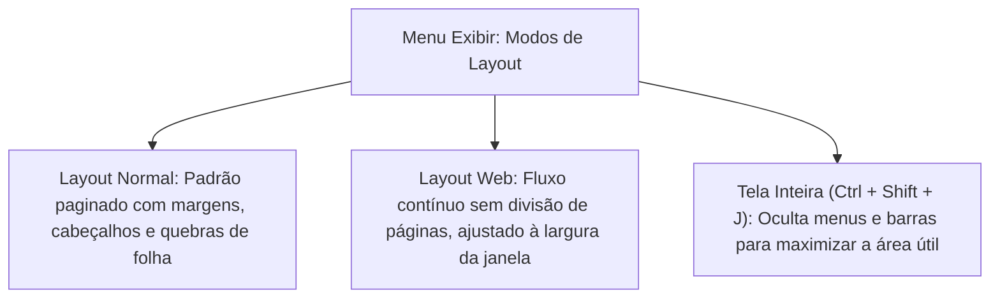
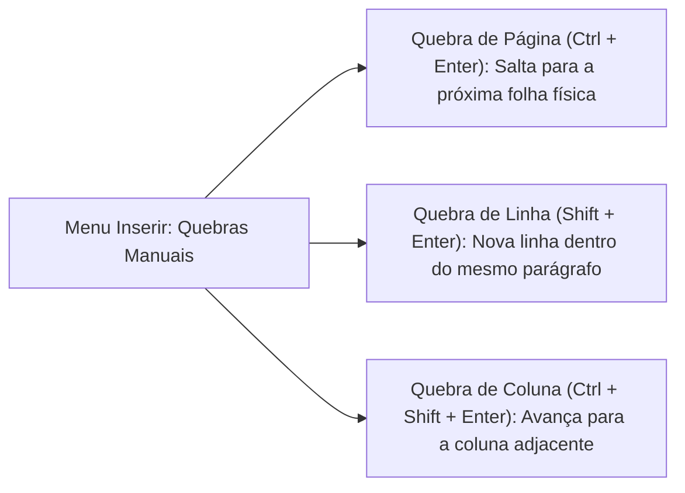
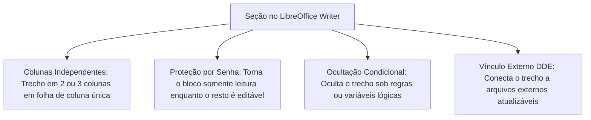
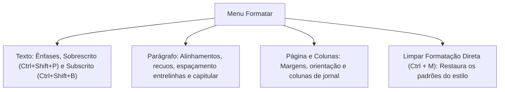
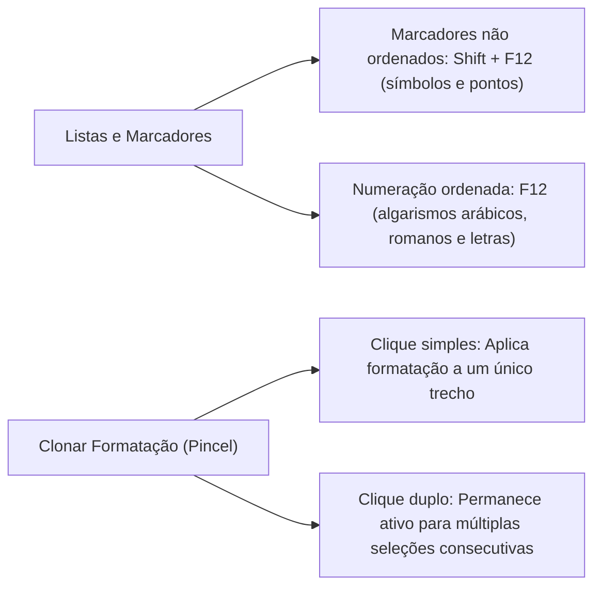
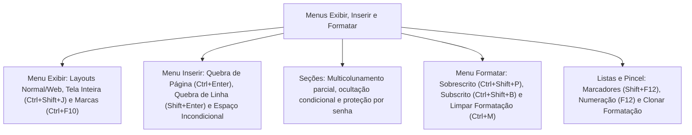

A elaboração avançada de documentos administrativos, boletins internos e laudos periciais no LibreOffice Writer exige o domínio articulado de três menus centrais: o Menu Exibir, o Menu Inserir e o Menu Formatar. Esses módulos concentram os recursos visuais de interface, os elementos estruturais de composição textual e as regras tipográficas que garantem a padronização estética dos documentos oficiais das corporações militares, como a Polícia Militar e o Corpo de Bombeiros Militar de Pernambuco.

Nas provas de informática, as cobranças sobre esses três menus destacam-se pela precisão técnica exigida. Os examinadores cobram recorrentemente a distinção entre os modos de exibição Normal e Web, a visualização de caracteres não imprimíveis, a aplicação das diferentes modalidades de quebras manuais, o conceito operacional de seções protegidas e as opções de formatação de parágrafos, marcadores e colunas. Neste capítulo, estudaremos as opções visuais do Menu Exibir, os objetos e divisores do Menu Inserir e os mecanismos de estilização direta do Menu Formatar.

> [!objetivos]
> - Diferenciar os modos de layout (Normal, Web e Tela Inteira) e aplicar o controle de marcas de formatação pelo Menu Exibir.
> - Compreender os tipos de quebras manuais (página, linha e coluna) e caracteres incondicionais no Menu Inserir.
> - Caracterizar a criação de seções independentes, com foco em divisão de colunas e proteção por senha.
> - Dominar a formatação tipográfica e de parágrafos, incluindo entrelinhas, recuos e capitulares no Menu Formatar.
> - Compreender a aplicação de listas ordenadas e não ordenadas e a ferramenta Clonar Formatação.

## O Menu Exibir: layouts, marcas ocultas e controles visuais

O Menu Exibir comanda como a área de trabalho, as guias auxiliares e o próprio documento são apresentados visualmente na tela do computador. Ele não altera a estrutura física do texto nem modifica as propriedades do arquivo gravado em disco, atuando exclusivamente sobre a camada de visualização do operador.

Os modos de exibição fundamentais disponíveis no Menu Exibir são:
1. *Layout Normal:* É o modo padrão do Writer. Apresenta o documento com paginação rigorosa, exibindo as margens superior, inferior e laterais, cabeçalhos, rodapés e as separações físicas entre as páginas exatamente como serão impressas no papel físico.
2. *Layout Web:* Remove a paginação em folhas separadas e apresenta o texto em fluxo contínuo e sem quebras visuais, comportando-se como uma página de navegador de internet que se adapta dinamicamente à largura da janela.
3. *Tela Inteira (Ctrl + Shift + J):* Oculta todas as barras de ferramentas, réguas e a própria barra de menus, deixando visível unicamente o texto e uma pequena barra flutuante com o botão para retornar ao modo padrão.

Entre as ferramentas de inspeção visual do Menu Exibir, destaca-se o comando **Marcas de Formatação**, acionado pela combinação de teclas **Ctrl + F10**. Ao ser ativado, o Writer exibe caracteres especiais não imprimíveis que auxiliam na diagramação técnica: o caractere pilcrow (¶) marca o encerramento de parágrafos; pontos médios indicam espaços simples entre palavras; setas horizontais apontam tabulações; e linhas horizontais azuis demarcam quebras manuais de página.

| Comando no Menu Exibir | Atalho de teclado | Função prática |
| :--- | :--- | :--- |
| **Layout Normal** | Sem atalho | Exibe o documento paginado para impressão física |
| **Layout Web** | Sem atalho | Exibe o texto em fluxo contínuo sem quebras de folha |
| **Tela Inteira** | Ctrl + Shift + J | Maximiza a área de edição ocultando menus e barras |
| **Marcas de Formatação** | Ctrl + F10 | Revela ou oculta caracteres não imprimíveis na tela |
| **Limites do Texto** | Sem atalho | Linhas pontilhadas indicando as margens úteis da folha |
| **Réguas** | Ctrl + Shift + R | Exibe ou oculta as réguas horizontal e vertical |
| **Navegador** | F5 | Abre o painel de auditoria estrutural de objetos |
| **Galeria** | Sem atalho | Abre o repositório de cliparts e elementos gráficos |
| **Barra Lateral** | Ctrl + F5 | Abre ou recolhe a barra lateral direita de ferramentas |
| **Zoom** | Sem atalho | Abre caixa para definir percentual e largura da página |

O recurso da Galeria (disponível em `Exibir → Galeria`) constitui o repositório integrado de mídias e ilustrações da suíte. A Galeria agrupa imagens vetoriais, diagramas, setas, símbolos de trânsito, elementos de rede e arquivos de áudio organizados por temas institucionais. O militar pode arrastar qualquer objeto gráfico da Galeria diretamente para a área de edição para ilustrar laudos periciais e relatórios de ocorrência.

> [!bizu]
> Marcas de formatação não saem na impressão: O comando Marcas de Formatação (**Ctrl + F10**) serve exclusivamente para orientação visual durante a digitação. Nenhum dos símbolos especiais exibidos (como ¶ ou pontos médios) é transferido para a impressão em papel ou para arquivos PDF exportados.

> [!atencao]
> Atalho de alternância das réguas: O atalho para exibir ou ocultar as réguas horizontal e vertical no LibreOffice Writer é **Ctrl + Shift + R**. No Microsoft Word, o controle de réguas localiza-se na guia Exibir, sem um atalho universal dessa natureza.

## O Menu Inserir: quebras manuais, caracteres especiais e marcas

O Menu Inserir permite incorporar ao fluxo do documento novos elementos de conteúdo, divisores estruturais e objetos gráficos externos. Dentre seus recursos mais avaliados em concursos públicos, destacam-se os diferentes tipos de quebras manuais e as marcas tipográficas incondicionais.

Modalidades de quebras manuais:
1. *Quebra de Página (Ctrl + Enter):* Interrompe imediatamente a página corrente no ponto em que o texto está sendo digitado e transfere o ponto de inserção e todo o conteúdo subsequente para o início da próxima página física.
2. *Quebra de Linha (Shift + Enter):* Força a quebra para a linha imediatamente inferior sem encerrar o parágrafo em edição. Essa quebra preserva a numeração da lista, o alinhamento justificado e as propriedades de recuo do parágrafo ativo.
3. *Quebra de Coluna (Ctrl + Shift + Enter):* Em páginas ou seções configuradas em múltiplas colunas, encerra o preenchimento da coluna atual e move o texto para o topo da coluna subsequente.

Marcas de formatação especiais de alta relevância:
- *Espaço Incondicional (Ctrl + Shift + Espaço):* Insere um caractere de espaço especial que impede que duas palavras adjacentes sejam separadas no final da linha. É utilizado para manter unidos valores monetários e numerais com suas unidades de medida (como "R$ 500,00" ou "10 km").
- *Hífen Incondicional (Ctrl + Shift + Hífen):* Garante que palavras compostas com hífen não sejam partidas ao atingirem a margem direita da página.
- *Hífen Opcional (Ctrl + Hífen):* Marca um ponto invisível de partição silábica que somente se manifesta visualmente caso a palavra atinja a margem extrema e precise ser quebrada.

| Elemento de Inserção | Tecla de atalho padrão | Efeito gerado no documento |
| :--- | :--- | :--- |
| **Quebra de Página** | Ctrl + Enter | Cria nova folha e desloca o conteúdo para ela |
| **Quebra de Linha** | Shift + Enter | Salta para a linha de baixo no mesmo parágrafo |
| **Quebra de Coluna** | Ctrl + Shift + Enter | Move o fluxo para o topo da coluna adjacente |
| **Espaço Incondicional** | Ctrl + Shift + Espaço | Impede separação de palavras na quebra de linha |
| **Hífen Incondicional** | Ctrl + Shift + Hífen | Mantém expressões hifenizadas unidas na margem |
| **Hífen Opcional** | Ctrl + Hífen | Ponto invisível de corte ativado apenas no fim da linha |
| **Hiperlink** | Ctrl + K | Insere endereço web ou marcador navegável |
| **Anotação** | Ctrl + Alt + C | Adiciona comentário de revisão na margem lateral |

> [!pegadinha]
> Quebra de linha versus Quebra de parágrafo: Pressionar simplesmente a tecla `Enter` cria um novo parágrafo autônomo, herdando espaçamentos de parágrafo e avançando contadores de listas. Pressionar **Shift + Enter** insere uma quebra de linha suave, permanecendo estritamente dentro do mesmo parágrafo.

> [!exemplo]
> Na redação de uma portaria do Corpo de Bombeiros, ao digitar "Art. 15", o militar pode inserir um Espaço Incondicional (**Ctrl + Shift + Espaço**) entre a abreviação "Art." e o numeral "15". Isso impede que a palavra "Art." fique isolada no fim da linha e o número salte para o início da linha seguinte.

## A criação e aplicação de Seções no Writer

No LibreOffice Writer, o conceito de **Seção** (`Menu Inserir → Seção...`) desempenha um papel fundamental e ligeiramente distinto das seções do Microsoft Word. No Word, uma quebra de seção divide o documento inteiro a partir daquele ponto; no Writer, uma seção é um bloco delimitado de texto inserido dentro do documento que adquire propriedades exclusivas e independentes da página onde reside.

Propriedades fundamentais de uma Seção no Writer:
1. *Multicolunamento em parte da página:* Permite aplicar duas ou três colunas a um único parágrafo ou trecho central do documento, enquanto o restante da folha permanece com o layout clássico de coluna única, sem necessidade de quebrar a página física.
2. *Proteção contra edição e gravação:* Uma seção pode ser configurada como somente leitura e protegida por uma senha específica. Isso permite que um documento oficial tenha áreas abertas para preenchimento de dados enquanto suas cláusulas contratuais ou cabeçalhos permanecem bloqueados contra edição.
3. *Ocultação condicional:* O operador pode ocultar a seção inteira visualmente e na impressão com base em uma condição lógica predefinida.
4. *Vínculo com arquivos externos:* Permite importar conteúdo de outro arquivo `.odt` ou via DDE (Dynamic Data Exchange). Sempre que o arquivo de origem for alterado, o trecho vinculado na seção atualiza-se de forma automatizada.

| Parâmetro de Seção | Possibilidade no Writer | Benefício administrativo |
| :--- | :--- | :--- |
| **Colunas Locais** | Sim, sem alterar a página | Permite artigos com resumos e colunas jornalísticas |
| **Proteção por Senha** | Sim, com chave criptográfica | Impede adulteração de laudos periciais e termos legais |
| **Ocultar Seção** | Sim, com ou sem condição | Oculta dados sensíveis em versões públicas de documentos |
| **Vínculo Externo** | Sim, via arquivo ou DDE | Compartilha cabeçalhos institucionais padronizados |

> [!bizu]
> Seção versus Estilo de Página: Para alterar a orientação da folha inteira (de Retrato para Paisagem) ou mudar o cabeçalho de uma folha inteira, altera-se o **Estilo de Página** com quebra manual. Para dividir apenas um trecho da folha em três colunas ou proteger um parágrafo com senha, utiliza-se uma **Seção**.

## O Menu Formatar: texto, parágrafos e capitulares

O Menu Formatar é o repositório de comandos dedicados à estética direta dos caracteres, parágrafos, molduras, páginas e colunas. Diferentemente dos estilos automatizados, as opções do Menu Formatar aplicam a chamada formatação manual direta.

Comandos essenciais do submenu Formatar Texto:
- *Sobrescrito (Ctrl + Shift + P):* Eleva o caractere selecionado acima da linha de base e reduz sua dimensão proporcional (usado em expoentes matemáticos como m² ou km³).
- *Subscrito (Ctrl + Shift + B):* Rebaixa o caractere abaixo da linha de base (usado em fórmulas químicas como H₂O ou CO₂).
- *Alternar Caixa:* Modifica a capitalização do texto entre MAIÚSCULAS, minúsculas, Tipo frase e Alternar caixa, acionável pelo atalho **Shift + F3**.

No diálogo **Parágrafo**, o usuário parametriza:
1. *Recuos:* Distância do parágrafo antes do texto (margem esquerda), depois do texto (margem direita) e na primeira linha (recuo positivo tradicional de parágrafo ou recuo negativo deslocado).
2. *Espaçamento:* Espaço antes e depois do bloco de texto (afastamento vertical entre parágrafos consecutivos).
3. *Espaçamento entre linhas:* Controla o entrelinhas (Simples, 1,5 linha, Duplo, Proporcional ou Pelo menos).
4. *Capitular:* Recurso clássico de tipografia que amplia destacadamente a primeira letra do parágrafo, fazendo com que ela ocupe a altura de duas, três ou mais linhas verticais.

| Recurso de Formatação | Atalho de teclado | Localização no menu | Efeito |
| :--- | :--- | :--- | :--- |
| **Sobrescrito** | Ctrl + Shift + P | `Formatar → Texto` | Eleva a fonte acima da linha de base |
| **Subscrito** | Ctrl + Shift + B | `Formatar → Texto` | Rebaixa a fonte abaixo da linha de base |
| **Alternar Caixa** | Shift + F3 | `Formatar → Texto` | Alterna maiúsculas e minúsculas |
| **Limpar Formatação** | Ctrl + M | `Formatar → Limpar Formatação` | Remove formatações diretas |
| **Capitular** | Sem atalho direto | `Formatar → Parágrafo → Capitulares` | Destaca a letra inicial em várias linhas |

> [!pegadinha]
> Atalhos de Sobrescrito e Subscrito: No LibreOffice Writer, Sobrescrito é **Ctrl + Shift + P** (Power) e Subscrito é **Ctrl + Shift + B** (Base). No Word em português, Sobrescrito é `Ctrl + Shift + +` e Subscrito é `Ctrl + =`. Guarde os mnemônicos do Writer: P para poder/expoente e B para base.

> [!bizu]
> Limpar formatação com Ctrl + M: O atalho **Ctrl + M** limpa instantaneamente todas as formatações manuais diretas aplicadas a um parágrafo (fontes, cores, destaques), fazendo o texto retornar à formatação padrão do Estilo ativo. Trata-se de uma questão predileta das bancas.

## Marcadores, numerações e a ferramenta Clonar Formatação

A elaboração de listas ordenadas e tópicos não ordenados é controlada pelo diálogo `Formatar → Marcadores e Numerações`, bem como pelos atalhos funcionais do teclado.

Diferenciação operacional das listas:
1. *Listas com Marcadores (Shift + F12):* Insere símbolos visuais gráficos (círculos, losangos, quadrados, setas) no início de cada linha, sem implicar relação de precedência ou hierarquia numérica entre os itens.
2. *Listas Numeradas (F12):* Atribui identificadores sequenciais automáticos (números arábicos, numerais romanos ou letras do alfabeto). Se um item intermediário for inserido ou removido, o Writer recalcula e atualiza a numeração de toda a lista de forma dinâmica.
3. *Hierarquia e Subníveis:* A tecla `Tab` rebaixa o item ativo para um subnível hierárquico inferior; a combinação `Shift + Tab` eleva o item para o nível hierárquico superior. O menu de contexto permite selecionar o comando *Reiniciar Numeração* para reiniciar a contagem no valor 1.

A ferramenta **Clonar Formatação** (representada pelo ícone de pincel na Barra Padrão e também alocada no Menu Formatar) permite copiar atributos estéticos de um texto selecionado e transferi-los para outros trechos:
- Um clique simples no botão do pincel permite aplicar a formatação uma única vez sobre o destino, desativando a ferramenta logo em seguida.
- Um clique duplo no botão do pincel mantém a ferramenta ativada em modo contínuo, permitindo pintar e formatar múltiplos trechos espalhados pelo documento até que o operador pressione a tecla Esc ou clique novamente sobre o ícone.

| Recurso de lista | Tecla de atalho | Comportamento no texto |
| :--- | :--- | :--- |
| **Ativar/Desativar Marcadores** | Shift + F12 | Insere marcadores não ordenados no parágrafo |
| **Ativar/Desativar Numeração** | F12 | Insere numeração sequencial automática |
| **Rebaixar Nível de Lista** | Tab | Desloca o item para o subnível à direita |
| **Elevar Nível de Lista** | Shift + Tab | Retorna o item para o nível principal à esquerda |
| **Clonar Formatação** | Sem atalho | Copia e aplica atributos estéticos com pincel |

> [!bizu]
> Duplo clique no pincel de formatação: Quando a banca perguntar como aplicar a mesma formatação a vários trechos distintos sem precisar reacionar a ferramenta repetidamente, a resposta é: dar um **duplo clique** sobre o botão Clonar Formatação.

> [!exemplo]
> Ao organizar um procedimento operacional padrão (POP) de resgate em altura, o bombeiro militar pode estruturar os passos utilizando a lista numerada (**F12**). Se uma etapa preparatória precisar ser inserida entre os passos 2 e 3, a lista renumerará automaticamente os passos seguintes para 4 e 5.

## Resolução guiada de problema

Vejamos a aplicação prática das matérias deste capítulo em uma questão típica de concurso.

> [!resolvido]
> **Questão contextualizada:** Durante a edição de um relatório técnico de vistoria contra incêndio e pânico no LibreOffice Writer 7, o oficial bombeiro encarregado precisa ajustar a formatação tipográfica e organizar elementos estruturais do documento. A respeito dos comandos e atalhos dos menus Exibir, Inserir e Formatar, analise as afirmativas a seguir:
>
> I. A combinação de teclas `Ctrl + F10` exibe ou oculta as marcas de formatação não imprimíveis, tais como caracteres de parágrafo, tabulações e quebras manuais de página.
> II. Para forçar a inserção de uma quebra de página manual, posicionando o texto subsequente no início da página subsequente, o usuário deve utilizar o atalho `Ctrl + Enter`.
> III. O atalho `Ctrl + M` tem a função de apagar integralmente o parágrafo selecionado do corpo do documento.
> IV. O recurso de Seção permite que um trecho selecionado do texto possua um número de colunas diferente do restante da folha e possa ser protegido contra edição mediante uso de senha.
>
> Estão corretas as afirmativas:
> A) I e III, apenas.
> B) II e III, apenas.
> C) I, II e IV, apenas.
> D) II, III e IV, apenas.
> E) I, II, III e IV.
>
> **Resolução passo a passo:**
> 1. *Análise da afirmativa I:* Correta. No LibreOffice Writer, `Ctrl + F10` é o atalho oficial para ativar ou desativar as Marcas de Formatação na tela de trabalho.
> 2. *Análise da afirmativa II:* Correta. A Quebra de Página manual é realizada rigorosamente pelo comando Inserir Quebra de Página através do atalho `Ctrl + Enter`.
> 3. *Análise da afirmativa III:* Incorreta. O atalho `Ctrl + M` corresponde ao comando Limpar Formatação Direta, removendo ajustes manuais de fonte e cor para restaurar o estilo padrão, e não apaga o texto.
> 4. *Análise da afirmativa IV:* Correta. Uma Seção no Writer é um bloco isolado que suporta multicolunamento parcial e controle de proteção por senha criptográfica.
>
> Conclusão: As afirmativas I, II e IV estão perfeitamente corretas.
> Resposta correta: Alternativa C.

## Mapa do capítulo

Examinamos a gestão de layouts e marcas pelo Menu Exibir, as quebras e seções do Menu Inserir e a estilização tipográfica e de listas no Menu Formatar.

### Para fixar
- O Menu Exibir comanda layouts: Normal (paginado para impressão), Web (fluxo contínuo) e Tela Inteira (`Ctrl + Shift + J`).
- O atalho `Ctrl + F10` exibe marcas de formatação (caracteres invisíveis como ¶, tabulações e espaços).
- Quebra de Página é `Ctrl + Enter`; Quebra de Linha é `Shift + Enter`; Quebra de Coluna é `Ctrl + Shift + Enter`.
- O Espaço Incondicional (`Ctrl + Shift + Espaço`) impede a separação de termos no final da linha.
- Uma Seção no Writer permite aplicar colunas parciais e proteger parágrafos específicos com senha.
- Sobrescrito é acionado por `Ctrl + Shift + P` e Subscrito por `Ctrl + Shift + B`.
- O atalho `Ctrl + M` limpa formatações diretas manuais, restaurando o estilo padrão do parágrafo.
- O recurso Capitular amplia a primeira letra do parágrafo ocupando a altura de várias linhas.
- Listas com marcadores usam `Shift + F12`; listas numeradas utilizam a tecla `F12`.
- A ferramenta Clonar Formatação aceita clique duplo para aplicar estilos repetidas vezes até teclar Esc.
