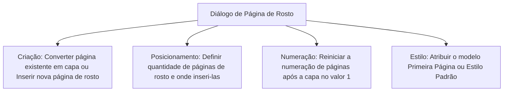
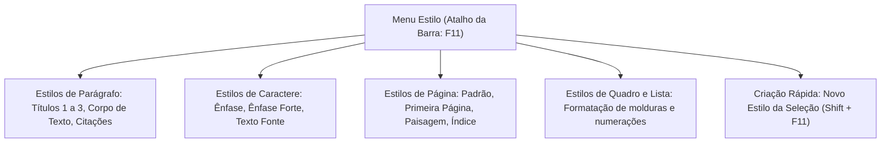
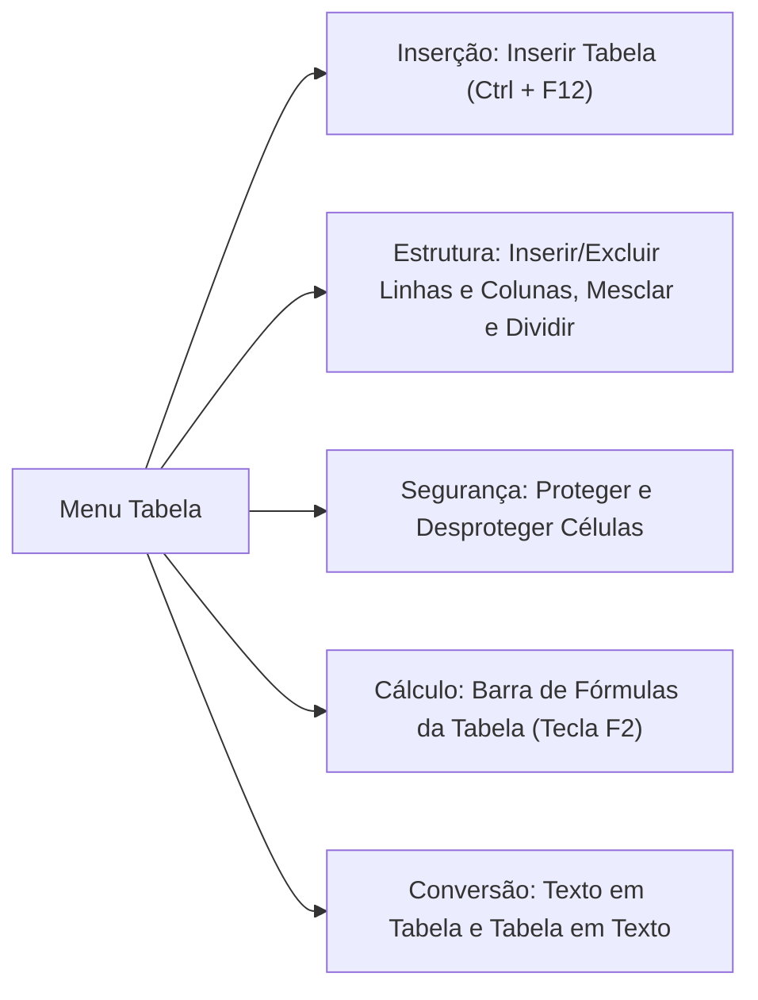
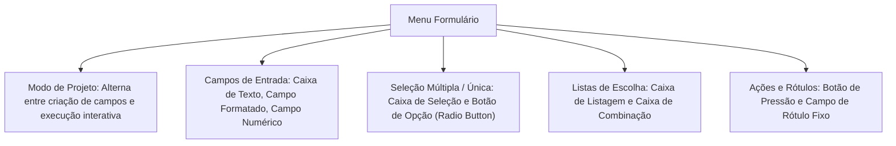
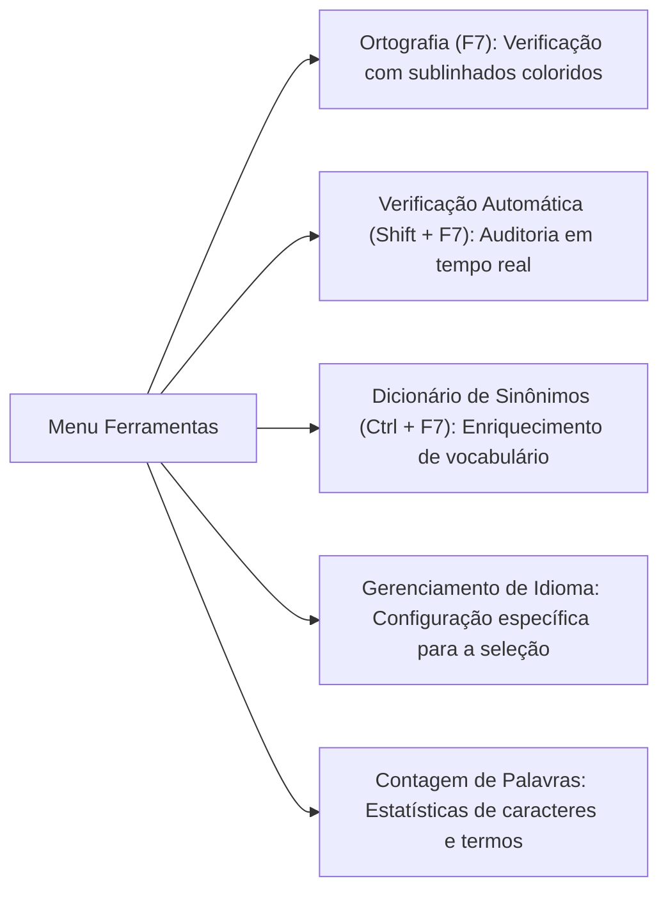
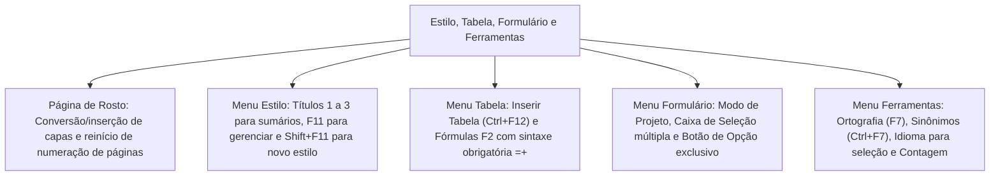

A estruturação avançada de documentos no LibreOffice Writer apoia-se em quatro menus essenciais: Estilo, Tabela, Formulário e Ferramentas. Nas corporações militares, como a PMPE e o CBMPE, os estilos padronizam portarias e manuais. As tabelas organizam inventários de materiais e efetivo. Os formulários padronizam a coleta de dados em vistorias. Por fim, os recursos linguísticos asseguram o rigor formal dos laudos periciais.

Nas provas, esses quatro menus destacam-se pela precisão conceitual. A banca cobra a hierarquia de estilos, a sintaxe de fórmulas em tabelas com sinais angulares, os controles interativos de formulários e a localização de ferramentas ortográficas. Neste capítulo, estudaremos a Página de Rosto, o Menu Estilo, o Menu Tabela, o Menu Formulário e os utilitários do Menu Ferramentas.

> [!objetivos]
> - Configurar a Página de Rosto, controlando a numeração e a estética pré-textual do documento.
> - Compreender a aplicação, atualização e criação de estilos estruturados pelo Menu Estilo.
> - Operar o Menu Tabela, dominando a inserção, edição e a sintaxe obrigatória de fórmulas matemáticas com a tecla F2.
> - Caracterizar os controles de entrada de dados e modos de edição do Menu Formulário.
> - Utilizar os utilitários linguísticos do Menu Ferramentas: ortografia, sinônimos, múltiplos idiomas e contagem estatística.

## A Página de Rosto e a estruturação pré-textual

Em trabalhos acadêmicos, relatórios de auditoria e laudos periciais formais, a capa ou página de abertura requer tratamento de layout diferenciado em relação ao corpo textual. No LibreOffice Writer, essa configuração é realizada de modo assistido por meio do comando `Formatar → Página de Rosto...`.

O diálogo da Página de Rosto oferece um conjunto robusto de parâmetros para diagramação:
1. *Conversão ou Inserção:* Permite converter a página inicial existente em uma página de rosto formal ou inserir uma ou mais páginas novas em branco no início do documento ou antes de um ponto determinado.
2. *Controle de Páginas:* O operador pode estipular a quantidade exata de páginas que constituirão o bloco de abertura (por exemplo, capa, folha de rosto e ficha catalográfica).
3. *Reinício da Numeração:* Um dos recursos mais cobrados em concursos. O diálogo possibilita marcar a opção de reiniciar a numeração de páginas, definindo em qual página o contador será reinicializado e estipulando o número inicial (geralmente fixado no valor 1 no primeiro parágrafo do texto efetivo).
4. *Estilo de Página:* Aplica automaticamente o estilo estrutural "Primeira Página" (que suprime cabeçalhos e rodapés) à capa, mantendo o "Estilo Padrão" nas páginas de desenvolvimento textual subsequentes.

| Parâmetro da Página de Rosto | Opção disponível no diálogo | Aplicação prática em documentos oficiais |
| :--- | :--- | :--- |
| **Ação estrutural** | Converter página atual ou Inserir novas páginas | Transforma o texto inicial em capa formal |
| **Quantidade de páginas** | Definir número inteiro de páginas | Insere capa e contracapa simultaneamente |
| **Numeração de páginas** | Reiniciar numeração de páginas | Permite que a introdução inicie como página 1 |
| **Número da página inicial** | Estipular o algarismo de partida | Define se a capa conta ou não na paginação |
| **Estilo da página** | Primeira página, Estilo padrão, Índice | Oculta cabeçalhos na página de abertura |

> [!bizu]
> Várias páginas de rosto no mesmo arquivo: No LibreOffice Writer, é perfeitamente possível inserir múltiplas páginas de rosto em diferentes posições do documento (por exemplo, para separar partes, módulos temáticos ou capítulos volumosos), sem desconfigurar a paginação global.

## O Menu Estilo: hierarquia e automação documental

O Menu Estilo congrega as ferramentas para criação, aplicação, modificação e gerenciamento de estilos padronizados no documento. Ao invés de aplicar formatações diretas manuais isoladas parágrafo por parágrafo, o uso profissional de estilos assegura uniformidade tipográfica em todo o arquivo e viabiliza a geração automatizada de sumários e índices analíticos.

Categorias fundamentais de estilos:
- *Estilos de Parágrafo:* Controlam alinhamentos, recuos, fontes e espaçamentos do bloco inteiro de texto. Os estilos hierárquicos Título 1, Título 2 e Título 3 constituem a espinha dorsal de navegação do documento e são os alimentadores obrigatórios do sumário analítico do Writer.
- *Estilos de Caractere:* Aplicam atributos tipográficos (cor, sublinhado, destaque) a palavras específicas dentro de um parágrafo, sem alterar as propriedades do restante do bloco.
- *Estilos de Página:* Definem margens, orientação da folha, cabeçalhos e rodapés para folhas inteiras.
- *Estilos de Quadro e Lista:* Padronizam caixas de texto flutuantes e listas numeradas.

Comandos de destaque do Menu Estilo:
1. *Gerenciar Estilos (F11):* Abre a aba Estilos na Barra Lateral ou uma janela flutuante completa para catalogação e criação de novos modelos.
2. *Novo Estilo a partir da Seleção (Shift + F11):* Permite que o operador formate manualmente um trecho de texto e, em seguida, capture todos os seus atributos estéticos para gravar um novo estilo reutilizável no documento com um nome personalizado.
3. *Atualizar Estilo Selecionado (Ctrl + Shift + F11):* Se o operador alterar o tamanho da fonte ou a cor de um parágrafo formatado com o Estilo "Corpo de Texto", acionar esse comando faz com que todos os demais parágrafos do documento que usam o mesmo estilo sejam atualizados instantaneamente.

| Comando no Menu Estilo | Tecla de atalho padrão | Ação operacional |
| :--- | :--- | :--- |
| **Título 1** | Ctrl + 1 | Aplica estilo de título primário de primeiro nível |
| **Título 2** | Ctrl + 2 | Aplica estilo de subtítulo secundário |
| **Título 3** | Ctrl + 3 | Aplica estilo de subdivisão terciária |
| **Corpo de Texto** | Ctrl + 0 | Restaura o texto ao padrão de parágrafo corrido |
| **Gerenciar Estilos** | F11 | Abre o painel completo de estilos na Barra Lateral |
| **Novo Estilo da Seleção** | Shift + F11 | Cria novo estilo capturando o trecho selecionado |
| **Atualizar Estilo** | Ctrl + Shift + F11 | Propaga alterações manuais para todos os parágrafos |

> [!atencao]
> Atalho de novo estilo cobrado pelas bancas: O atalho para criar um Novo Estilo a partir da Seleção no LibreOffice Writer é **Shift + F11**. Nos concursos, o examinador costuma colocar opções como `Ctrl + Shift + S` ou `Alt + F11` para induzir o candidato ao erro.

## O Menu Tabela: matrizes, formatação e fórmulas matemáticas com F2

O LibreOffice Writer dispõe de um menu dedicado e autônomo na barra horizontal superior chamado **Tabela**. Essa estrutura confere ao processador de textos recursos avançados de cálculo e organização tabular que dispensam a abertura de planilhas externas para operações matemáticas básicas.

1. *Inserção de Tabelas (Ctrl + F12):* Abre o assistente de criação onde se definem o nome da tabela, a quantidade de linhas e colunas e o estilo de autoformatação visual pré-definido.
2. *Manipulação Estrutural:* Submenus para Inserir Linhas Acima/Abaixo, Inserir Colunas Antes/Depois, Excluir Linhas/Colunas, Mesclar Células (unir duas ou mais células contíguas em uma só) e Dividir Células.
3. *Proteção de Células:* Permite bloquear células específicas contra digitação acidental, ideal para proteger cabeçalhos e fórmulas em tabelas de controle interno.
4. *Conversão de Formatos:* Transforma blocos de texto separados por vírgula ou tabulação em uma matriz tabular (*Texto em Tabela*) ou extrai o conteúdo de uma grade convertendo-o em texto corrido (*Tabela em Texto*).

O aspecto mais cobrado em provas de informática refere-se à **Barra de Fórmulas da Tabela**, acionada pela tecla **F2**.
Diferentemente do Calc e do Excel, onde as células são referenciadas diretamente por sua coordenada alfanumérica pura (como `=A1+B2`), no LibreOffice Writer as coordenadas de células em expressões de cálculo devem ser obrigatoriamente delimitadas pelos sinais de menor e maior:

Expressão correta no Writer: `=<A1> + <B2>`
Expressões incorretas no Writer: `=A1+B2`, `=[A1+B2]`, `={A1+B2}`

As funções de cálculo aceitas na Barra de Fórmulas do Writer incluem:
- `SUM`: cálculo de somatório de intervalos, como `=sum <A1:A5>`
- `ROUND`: arredondamento de casas decimais
- `SQRT`: raiz quadrada
- `MIN` e `MAX`: identificação de valores mínimos e máximos em uma coluna
- `MEAN`: média aritmética dos valores delimitados

| Comando ou Operação | Atalho ou Sintaxe | Comportamento operacional |
| :--- | :--- | :--- |
| **Inserir Tabela** | Ctrl + F12 | Abre a janela para estipular linhas e colunas |
| **Barra de Fórmulas** | Tecla F2 | Exibe barra superior para digitação de fórmulas |
| **Soma de Células** | `=<A1> + <B1>` | Soma obrigatória com referências entre sinais angulares |
| **Somatório de Intervalo** | `=sum <A1:A10>` | Totaliza os valores contidos no intervalo de A1 a A10 |
| **Média Aritmética** | `=mean <B1:B5>` | Calcula a média matemática da sequência |
| **Mesclar Células** | Sem atalho direto | Unifica múltiplas células adjacentes em um bloco único |
| **Proteger Células** | Sem atalho direto | Torna as células selecionadas somente leitura |

> [!pegadinha]
> A regra dos sinais de menor e maior em fórmulas de tabela: Em questões de múltipla escolha sobre cálculo em tabelas no Writer, a resposta correta sempre conterá os sinais `<` e `>` ao redor de cada célula. Fórmulas sem esses sinais angulares são invalidadas pelo interpretador interno da tabela do Writer.

> [!exemplo]
> Para calcular o total de viaturas operacionais em uma tabela de prontidão militar contendo 12 viaturas leves na célula A2 e 8 viaturas pesadas na célula B2, o militar pressiona a tecla **F2** na célula C2 e digita com rigor: `=<A2>+<B2>`, obtendo instantaneamente o resultado 20.

## O Menu Formulário: controles interativos e modos de trabalho

O Menu Formulário viabiliza a criação de documentos interativos estruturados. Em uma corporação de bombeiros, o uso de formulários é ideal para fichas de ocorrência, autos de vistoria técnica e relatórios de inspeção veicular, onde determinadas áreas do texto devem permanecer fixas e protegidas, enquanto campos específicos são abertos para o usuário alimentar dados de modo padronizado.

Modos de trabalho do Menu Formulário:
1. *Modo de Projeto (Design Mode):* Ferramenta fundamental para o desenvolvedor do documento. Quando ativado, permite desenhar, redimensionar, mover e alterar as propriedades dos controles na página. Quando desativado, o formulário entra em modo operacional de execução, permitindo ao usuário digitar textos nas caixas e marcar opções de seleção.
2. *Assistentes de Controle:* Habilita orientações passo a passo para conectar controles a fontes de dados ou tabelas externas.

Principais controles interativos disponíveis no Menu Formulário:
- *Caixa de Texto:* Campo retangular para digitação livre de caracteres alfanuméricos (como nomes de vítimas ou placas de veículos).
- *Caixa de Seleção (Checkbox):* Quadrado que permite seleção múltipla independente (o usuário pode marcar ou desmarcar várias opções simultâneas).
- *Botão de Opção (Radio Button):* Círculo destinado a escolhas exclusivas dentro de um mesmo grupo (ao selecionar uma opção, as demais do grupo são automaticamente desmarcadas, como "Vistoria Aprovada" ou "Vistoria Reprovada").
- *Caixa de Listagem:* Lista suspensa de itens estáticos predefinidos onde o usuário clica e escolhe um elemento.
- *Caixa de Combinação (Combobox):* Combina uma caixa de texto livre com uma lista suspensa, permitindo escolher um item da lista ou digitar um valor novo inédito.
- *Rótulo:* Campo de texto estático que identifica o que deve ser inserido no controle vizinho (ex.: "Nome do Solicitante:").
- *Botão de Pressão:* Botão executável que dispara ações automatizadas ou envio de dados.

| Controle de Formulário | Ícone conceitual | Comportamento prático no documento |
| :--- | :--- | :--- |
| **Caixa de Texto** | Retângulo de digitação | Permite entrada livre de texto pelo operador |
| **Caixa de Seleção** | Quadrado de marcação | Permite seleção múltipla independente |
| **Botão de Opção** | Círculo com ponto central | Seleção mutuamente exclusiva dentro do grupo |
| **Caixa de Listagem** | Lista com seta para baixo | Exibe opções estritas para escolha do usuário |
| **Caixa de Combinação** | Entrada de texto com lista | Permite escolher da lista ou digitar novo dado |
| **Rótulo** | Letras identificadoras | Texto explicativo fixo que não pode ser alterado |
| **Modo de Projeto** | Esquadro e régua | Alterna entre edição de controles e uso prático |

> [!bizu]
> Distinção entre Caixa de Seleção e Botão de Opção: Nas provas, lembre-se: **Caixa de Seleção** (quadrada) permite marcar múltiplas opções ao mesmo tempo; **Botão de Opção** (redondo) permite escolher estritamente uma única alternativa dentro do conjunto.

## O Menu Ferramentas: utilitários linguísticos, auditoria e contadores

O Menu Ferramentas abriga utilitários de suporte e configurações avançadas do processador de textos. Suas ferramentas linguísticas são indispensáveis para garantir que os documentos da corporação atendam aos padrões cultos da língua portuguesa e que textos técnicos multilíngues sejam revisados com precisão.

Recursos do Menu Ferramentas:
1. *Ortografia (F7):* Percorre o texto comparando cada vocábulo com os dicionários instalados. O Writer utiliza uma convenção visual padronizada:
   - Sublinhado ondulado vermelho: indica erro ortográfico (palavra desconhecida no dicionário ou grafada com incorreção).
   - Sublinhado ondulado azul: indica inconsistência gramatical, sintática ou de pontuação (desde que haja um corretor gramatical ativo no sistema).
2. *Verificação Ortográfica Automática (Shift + F7):* Ativa ou suspende a exibição imediata dos sublinhados coloridos ondulados durante a digitação.
3. *Dicionário de Sinônimos (Ctrl + F7):* Apresenta termos correlatos para a palavra na posição ativa, auxiliando na eliminação de repetições vocabulares.
4. *Configurações de Idioma:* O Writer suporta documentos multilíngues de forma refinada pelo caminho `Ferramentas → Idioma → Para a seleção`. Se uma ata contiver expressões em latim ou inglês, o militar seleciona o trecho e define o idioma correspondente. Com isso, o verificador ortográfico aplica as regras da respectiva língua e elimina os falsos avisos vermelhos sem desativar a proteção vernacular do resto do texto.
5. *Contagem de Palavras:* Acionado em `Ferramentas → Contagem de Palavras`, abre uma caixa de diálogo informativa que discrimina a quantidade de palavras e de caracteres (com e sem espaços) tanto para o texto selecionado quanto para a integridade do arquivo. Estatísticas adicionais completas (número de parágrafos, linhas e tabelas) podem ser inspecionadas em `Arquivo → Propriedades → Estatísticas`.

| Ferramenta Linguística | Tecla de atalho | Localização no menu | Ação executada |
| :--- | :--- | :--- | :--- |
| **Ortografia** | F7 | `Ferramentas → Ortografia` | Inicia a varredura ortográfica e gramatical |
| **Verificação Automática** | Shift + F7 | `Ferramentas → Ortografia Automática` | Liga/desliga marcações onduladas em tempo real |
| **Dicionário de Sinônimos** | Ctrl + F7 | `Ferramentas → Dicionário de Sinônimos` | Sugere vocábulos equivalentes para a palavra |
| **Idioma para Seleção** | Sem atalho | `Ferramentas → Idioma → Para a seleção` | Aplica dicionário específico a termo estrangeiro |
| **Contagem de Palavras** | Sem atalho | `Ferramentas → Contagem de Palavras` | Exibe total de palavras e caracteres com/sem espaços |

> [!pegadinha]
> Localização do comando Ortografia: No Microsoft Word, o comando Ortografia e Gramática situa-se na guia **Revisão**. No LibreOffice Writer, o comando Ortografia localiza-se estritamente no menu **Ferramentas** (e não no menu Editar). A banca frequentemente tenta confundir o candidato afirmando que a ortografia fica no menu Editar.

> [!bizu]
> Citações estrangeiras sem sublinhado vermelho: A conduta técnica correta ao inserir termos em língua estrangeira em um texto do Writer é selecionar o trecho e aplicar `Ferramentas → Idioma → Para a seleção → Inglês`. Alternativas que sugerem adicionar o termo ao dicionário de português ou desativar a verificação ortográfica do documento inteiro estão erradas.

## Resolução guiada de problema

Acompanhe a aplicação dos tópicos deste capítulo em uma questão representativa das provas.

> [!resolvido]
> **Questão contextualizada:** Um oficial responsável pelo setor de logística e patrimônio do Corpo de Bombeiros Militar edita uma tabela de controle de equipamentos operacionais e elabora um formulário de vistoria predial no LibreOffice Writer 7. A respeito dos recursos disponíveis nos menus Estilo, Tabela, Formulário e Ferramentas, analise as afirmativas a seguir:
>
> I. Para realizar a soma simples entre as células A1 e B1 em uma tabela do LibreOffice Writer utilizando a Barra de Fórmulas acionada pela tecla `F2`, a expressão sintaticamente correta a ser digitada é `=<A1> + <B1>`.
> II. No Menu Estilo, o comando Novo Estilo a partir da Seleção, que permite capturar as formatações do texto selecionado para gerar um novo modelo tipográfico, pode ser executado pelo atalho `Shift + F11`.
> III. O comando Ortografia e Gramática, acionado pela tecla funcional `F7`, localiza-se oficialmente no Menu Editar da barra principal do aplicativo.
> IV. O controle Botão de Opção (Radio Button) do Menu Formulário caracteriza-se por permitir que o usuário selecione simultaneamente múltiplas alternativas dentro do mesmo grupo funcional.
>
> Estão corretas as afirmativas:
> A) I e II, apenas.
> B) II e III, apenas.
> C) I, II e IV, apenas.
> D) III e IV, apenas.
> E) I, II, III e IV.
>
> **Resolução passo a passo:**
> 1. *Análise da afirmativa I:* Correta. No Writer, os cálculos em tabela acionados por `F2` exigem que as referências às células sejam delimitadas por sinais angulares (`=<A1> + <B1>`).
> 2. *Análise da afirmativa II:* Correta. O atalho de teclado oficial para criar um novo estilo a partir do trecho selecionado é rigorosamente `Shift + F11`.
> 3. *Análise da afirmativa III:* Incorreta. O comando Ortografia (`F7`) localiza-se no Menu **Ferramentas** e não no Menu Editar.
> 4. *Análise da afirmativa IV:* Incorreta. O Botão de Opção é mutuamente exclusivo (permite selecionar apenas uma opção por grupo). O controle que permite seleção múltipla simultânea é a **Caixa de Seleção** (Checkbox).
>
> Conclusão: Apenas as afirmativas I e II estão corretas.
> Resposta correta: Alternativa A.

## Mapa do capítulo

Examinamos a gestão pré-textual com a Página de Rosto, a arquitetura de estilos no Menu Estilo, as matrizes e cálculos do Menu Tabela, os controles de formulário e os utilitários linguísticos do Menu Ferramentas.

### Para fixar
- A Página de Rosto permite inserir capas padronizadas e reiniciar a numeração de páginas no valor 1.
- No Menu Estilo, `Ctrl + 1`, `Ctrl + 2` e `Ctrl + 3` aplicam títulos hierárquicos indispensáveis para sumários.
- O atalho `F11` abre o gerenciador de estilos na Barra Lateral; `Shift + F11` cria um novo estilo da seleção.
- A inserção de tabelas no Writer é realizada pelo atalho `Ctrl + F12` no Menu Tabela.
- Cálculos em tabelas usam a tecla `F2` e exigem células entre sinais angulares: `=<A1> + <B2>`.
- O Menu Formulário opera em Modo de Projeto para edição e modo desativado para entrada de dados.
- Caixa de Seleção (checkbox) admite escolhas múltiplas; Botão de Opção (radio button) é mutuamente exclusivo.
- A ferramenta Ortografia (`F7`) fica no Menu Ferramentas; marca erros ortográficos em vermelho e gramaticais em azul.
- Para termos estrangeiros, deve-se aplicar `Ferramentas → Idioma → Para a seleção` para suprimir alertas falsos.
- A contagem de palavras e caracteres com e sem espaços localiza-se no Menu Ferramentas.
