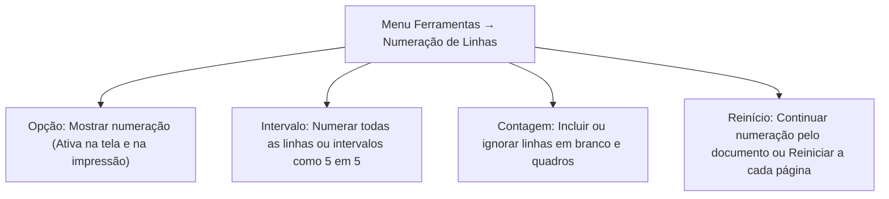
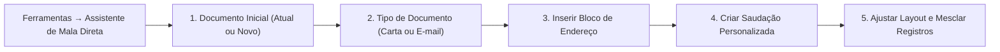
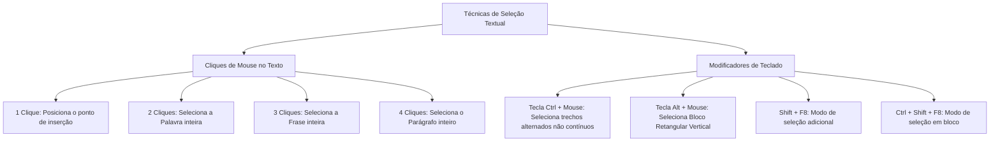
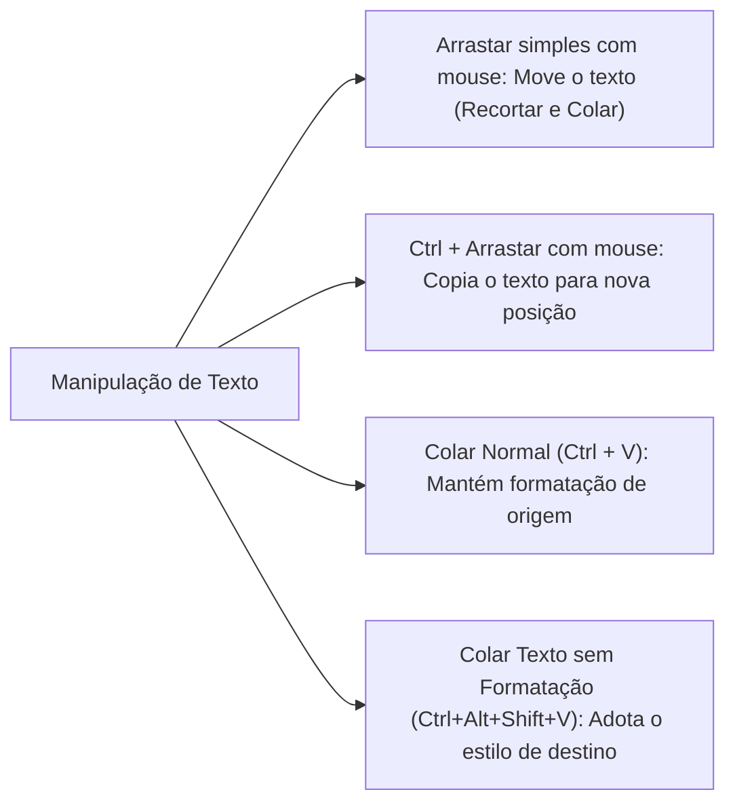
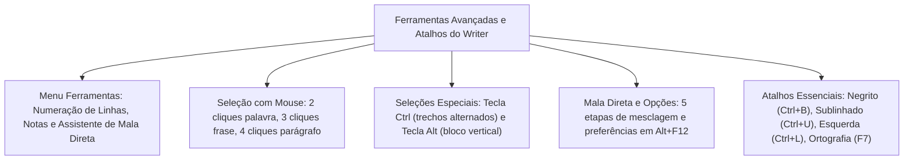

A conclusão do estudo do LibreOffice Writer consolida o domínio sobre recursos administrativos de grande porte e a fixação das teclas de atalho mais incidentes em concursos públicos. Nas corporações militares, como o Corpo de Bombeiros Militar e a Polícia Militar de Pernambuco, a expedição de convocações em massa, a formatação de peças judiciais numeradas linha por linha e a personalização de preferências de segurança do sistema compõem rotinas operacionais indispensáveis.

As bancas dedicam atenção especial aos utilitários avançados alocados no Menu Ferramentas, às regras ergonômicas de seleção de texto por mouse e teclado e às correspondências de atalhos de teclado do Writer em língua portuguesa. A banca formula questões explorando a exata localização de recursos institucionais como a Mala Direta e a Numeração de Linhas, as distinções entre notas de rodapé e de término e os comandos de seleção em bloco. Neste capítulo final, examinaremos a Numeração de Linhas, o Assistente de Mala Direta, as configurações do programa, a manipulação de texto e a compilação exaustiva de atalhos do Writer.

> [!objetivos]
> - Configurar a Numeração de Linhas e diferenciar notas de rodapé de notas de fim no Menu Ferramentas.
> - Compreender o funcionamento e as etapas do Assistente de Mala Direta para expedição de documentos padronizados.
> - Dominar as preferências gerais da aplicação no diálogo Opções e o controle de janelas ativas.
> - Aplicar técnicas avançadas de seleção de texto por cliques de mouse e atalhos funcionais de teclado.
> - Memorizar a tabela exaustiva dos atalhos de teclado mais cobrados no LibreOffice Writer.

## Numeração de Linhas e gestão de notas de rodapé e de fim

Em documentos formais de natureza jurídica, processos administrativos disciplinares militares (PAD) e minutas contratuais, a identificação exata de cada linha de texto é requisito indispensável para permitir citações pontuais em audiências e despachos. No LibreOffice Writer, a numeração automática de linhas é gerenciada exclusivamente pelo caminho `Ferramentas → Numeração de Linhas...`.

Na caixa de diálogo de Numeração de Linhas, o operador configura:
1. *Mostrar numeração:* Ativa a exibição dos números na margem esquerda da página, ficando plenamente visíveis tanto na tela quanto na impressão física.
2. *Estilo de caractere e formato:* Define a fonte dos números e o sistema numeral (arábico, romano ou alfabético).
3. *Intervalo:* Permite estipular a frequência da numeração (por exemplo, numerar todas as linhas ou exibir os números a cada 5 ou 10 linhas).
4. *Linhas em branco:* Possibilita incluir ou desconsiderar linhas vazias na contagem.
5. *Reinício por página:* Define se a contagem é cumulativa até o fim do arquivo ou se é reiniciada no valor 1 a cada nova folha.

A diferenciação entre notas de rodapé e notas de fim constitui outro tópico clássico:
- *Nota de rodapé:* Insere uma chamada numérica sobrescrita no texto e posiciona o texto explicativo na base da própria página onde a chamada foi realizada.
- *Nota de fim:* Posiciona todas as explicações agrupadas no encerramento do documento ou no término da seção ativa.

A inserção de notas é realizada em `Inserir → Nota de Rodapé e Nota de Fim`, enquanto a parametrização de sua numeração e posicionamento global é definida no menu `Ferramentas → Notas de Rodapé e Notas de Fim`.

| Recurso | Localização do comando | Local de exibição no documento |
| :--- | :--- | :--- |
| **Numeração de Linhas** | `Ferramentas → Numeração de Linhas` | Margem esquerda ao lado de cada linha |
| **Nota de Rodapé** | `Inserir → Nota de Rodapé` | Base inferior da página da citação |
| **Nota de Fim** | `Inserir → Nota de Fim` | Última folha do documento ou seção |
| **Configuração de Notas** | `Ferramentas → Notas de Rodapé e Fim` | Parâmetros de contagem e estilos de notas |

> [!pegadinha]
> A pegadinha do menu da Numeração de Linhas: Nas provas, é comum afirmarem que a Numeração de Linhas localiza-se no menu Inserir, no menu Exibir ou no menu Formatar. A Numeração de Linhas fica estritamente no menu **Ferramentas**.

> [!bizu]
> Numeração de Linhas não é lista numerada: Não confunda a Numeração de Linhas (que numera as linhas físicas da folha) com a lista numerada de parágrafos (**F12**). A numeração de linhas não altera os parágrafos nem a estrutura gramatical do texto.

## O Assistente de Mala Direta e opções da suíte

A Mala Direta é o recurso que permite confeccionar documentos padronizados em grande escala (como convocações, certidões e notificações) direcionados a múltiplos destinatários cadastrados em uma base de dados, sem a necessidade de redigir um arquivo individual para cada pessoa.

No LibreOffice Writer, o processo é conduzido pelo caminho `Ferramentas → Assistente de Mala Direta...`. O assistente orienta o militar por meio de cinco etapas lógicas:
1. *Seleção do documento inicial:* Escolhe se a base do modelo será o documento ativo no momento ou um novo arquivo carregado a partir de um modelo.
2. *Tipo de documento:* Define se a saída será gerada na forma de carta impressa física ou mensagem de correio eletrônico.
3. *Bloco de endereços:* Conecta o documento a uma fonte de dados externa (tabela do Calc `.ods`, catálogo de endereços do sistema ou banco de dados `.odb`), mapeando campos como Nome, Cargo e Endereço.
4. *Saudação:* Permite construir saudações personalizadas e dinâmicas que se ajustam automaticamente ao gênero do destinatário (por exemplo, "Prezado Senhor" ou "Prezada Senhora").
5. *Ajuste de layout e conclusão:* Posiciona os campos dinâmicos no corpo do documento e executa a mesclagem, gerando um documento combinado para impressão ou envio.

O diálogo de **Opções** (`Ferramentas → Opções...` ou atalho **Alt + F12**) reúne as configurações estruturais de toda a suíte LibreOffice:
- *Dados do usuário:* Nome, iniciais e corporação, utilizados para identificar o autor de revisões e anotações.
- *Caminhos:* Define as pastas padrão de gravação de arquivos, modelos, imagens e cópias de segurança.
- *Carregar/Salvar:* Configura o salvamento automático de informações de autorrecuperação a cada intervalo de minutos (por padrão, a cada 10 minutos) e o formato padrão de gravação (ODF).
- *Segurança:* Gerencia níveis de execução de macros e proteção por senhas.

| Configuração no Diálogo Opções | Localização interna | Efeito prático no sistema |
| :--- | :--- | :--- |
| **Dados do Usuário** | `LibreOffice → Dados do usuário` | Identifica autoria em comentários e revisões |
| **Autorrecuperação** | `Carregar/Salvar → Geral` | Intervalo de salvamento de segurança |
| **Caminhos Padrão** | `LibreOffice → Caminhos` | Define diretórios padrão de modelos e arquivos |
| **Segurança de Macros** | `LibreOffice → Segurança` | Bloqueia execução de scripts não assinados |

> [!bizu]
> Atalho de Opções da suíte: O atalho oficial para abrir a caixa geral de Opções no LibreOffice é **Alt + F12**.

> [!atencao]
> Autocorreção não substitui por sinônimos: O recurso de Autocorreção (`Ferramentas → Opções da Autocorreção`) substitui automaticamente erros comuns de digitação por formas corretas. Ele não é um dicionário de sinônimos e não substitui vocábulos deliberadamente por termos equivalentes.

## Técnicas de seleção de texto por mouse e teclado

A seleção precisa de caracteres, palavras e parágrafos é um dos tópicos mais frequentes em provas práticas de concurso público. O Writer oferece comportamentos padronizados para cliques repetidos e teclas modificadoras.

Regras de seleção com o mouse:
1. *Um clique:* Posiciona o ponto de inserção no local clicado.
2. *Dois cliques:* Seleciona imediatamente a palavra sobre a qual o ponteiro está posicionado.
3. *Três cliques:* Seleciona a frase inteira (o período gramatical compreendido entre a letra inicial e o ponto final).
4. *Quatro cliques:* Seleciona o parágrafo completo.

Seleções especiais com teclas modificadoras:
- *Trechos intercalados não adjacentes:* Mantendo a tecla **Ctrl** pressionada enquanto se selecionam blocos com o mouse, o operador pode marcar múltiplas palavras ou frases separadas em diferentes páginas do documento.
- *Seleção retangular em bloco:* Mantendo a tecla **Alt** pressionada enquanto se clica e arrasta o mouse, o Writer seleciona uma coluna vertical de caracteres ignorando as linhas adjacentes.
- *Seleção Adicional pelo teclado (Shift + F8):* Ativa o modo de seleção adicional, exibindo o indicador `ADIC` na Barra de Status, permitindo marcar trechos distantes usando as teclas direcionais.
- *Seleção em Bloco pelo teclado (Ctrl + Shift + F8):* Ativa o modo `BLOCO` na Barra de Status para seleções colunares.

| Ação de seleção | Tecla ou clique | Resultado visual no documento |
| :--- | :--- | :--- |
| **Palavra** | 2 cliques com botão esquerdo | Destaca o vocábulo completo |
| **Frase** | 3 cliques com botão esquerdo | Destaca o período delimitado por ponto |
| **Parágrafo** | 4 cliques com botão esquerdo | Destaca o parágrafo inteiro |
| **Trechos Alternados** | Tecla Ctrl + arrastar mouse | Marca múltiplos blocos independentes |
| **Bloco Vertical** | Tecla Alt + arrastar mouse | Marca coluna retangular de texto |
| **Modo Adicional** | Shift + F8 no teclado | Permite múltiplas seleções pelo teclado |
| **Modo em Bloco** | Ctrl + Shift + F8 no teclado | Ativa seleção colunar pelo teclado |

> [!pegadinha]
> Quantidade de cliques no Word e no Writer: No Microsoft Word, três cliques selecionam o parágrafo inteiro. No LibreOffice Writer, **três cliques selecionam a frase**, e são necessários **quatro cliques para selecionar o parágrafo**. Essa distinção numérica é uma das armadilhas prediletas das bancas.

> [!exemplo]
> Para copiar apenas os primeiros dígitos de uma lista de códigos funcionais organizados em linhas verticais sem capturar os nomes dos servidores, o militar mantém a tecla **Alt** pressionada e arrasta o mouse sobre a coluna de números, acionando a seleção em bloco.

## Operações com texto: mover, copiar e colar

A manipulação de blocos de texto no LibreOffice Writer pode ser efetuada via menus, ícones, atalhos de teclado ou pela técnica de arrastar e soltar (drag and drop) diretamente na tela.

Comportamento do arrasto com mouse:
- Selecionar um trecho e simplesmente arrastá-lo com o botão esquerdo para outra área do documento **move** o texto (equivalente a cortar e colar).
- Selecionar o trecho e arrastá-lo mantendo a tecla **Ctrl** pressionada **copia** o texto para a nova posição. Em ambos os casos, a formatação visual é integralmente preservada.

Opções de colagem e formatação de entorno:
- *Colar padrão (Ctrl + V):* Preserva as fontes, cores e tamanhos originais do documento de onde o texto foi extraído.
- *Colar como Texto Não Formatado (Ctrl + Alt + Shift + V):* Elimina tabelas, links e fontes de origem. O texto colado assume automaticamente os atributos tipográficos do parágrafo de destino onde o ponto de inserção está posicionado.

Em parágrafos formatados com alinhamento justificado (**Ctrl + J**), a última linha do bloco fica alinhada à esquerda por padrão de fábrica, mas as propriedades do parágrafo permitem configurá-la para alinhamento centralizado ou justificação expandida total.

| Operação com texto | Método de execução | Efeito sobre o documento |
| :--- | :--- | :--- |
| **Mover por arrasto** | Arrastar seleção com mouse | Corta da origem e cola no destino |
| **Copiar por arrasto** | Tecla Ctrl + arrastar seleção | Duplica o texto mantendo a origem |
| **Colar com formatação** | Ctrl + V | Preserva a estética visual de origem |
| **Colar texto limpo** | Ctrl + Alt + Shift + V | Limpa atributos e adota o estilo de destino |
| **Desfazer transferência** | Ctrl + Z | Reverte o movimento ou colagem efetuada |

> [!bizu]
> Assumir a formatação do destino: Quando a questão indagar como fazer um texto copiado da internet assumir automaticamente a fonte e o tamanho do documento oficial do Writer, a resposta é: colar por meio de **Colar Especial → Texto sem Formatação** (**Ctrl + Alt + Shift + V**).

## Tabela geral de atalhos indispensáveis do LibreOffice Writer

A memorização dos atalhos de teclado do LibreOffice Writer na versão em português do Brasil é um diferencial competitivo decisivo. A tabela a seguir compila os atalhos de mais alta incidência em concursos:

| Tecla de atalho | Comando associado | Função prática do comando |
| :--- | :--- | :--- |
| **Ctrl + A** | Selecionar Tudo | Marca todo o conteúdo do documento (All) |
| **Ctrl + B** | Negrito | Aplica traço encorpado aos caracteres (Bold) |
| **Ctrl + I** | Itálico | Inclina os caracteres para a direita (Italic) |
| **Ctrl + U** | Sublinhado | Insere linha contínua sob o texto (Underline) |
| **Ctrl + D** | Sublinhado Duplo | Insere linha dupla contínua sob as letras |
| **Ctrl + L** | Alinhar à Esquerda | Ajusta o parágrafo na margem esquerda (Left) |
| **Ctrl + E** | Centralizar | Centraliza o parágrafo entre as margens |
| **Ctrl + R** | Alinhar à Direita | Ajusta o parágrafo na margem direita (Right) |
| **Ctrl + J** | Justificar | Alinha uniformemente em ambas as margens |
| **Ctrl + N** | Novo | Cria novo arquivo de texto vazio (New) |
| **Ctrl + O** | Abrir | Carrega arquivo existente em disco (Open) |
| **Ctrl + S** | Salvar | Grava as alterações no arquivo atual (Save) |
| **Ctrl + Shift + S** | Salvar Como | Grava com novo nome ou formato |
| **Ctrl + P** | Imprimir | Abre a caixa de diálogo de impressão |
| **Ctrl + F** | Localizar | Abre a barra rápida de busca no rodapé |
| **Ctrl + H** | Localizar e Substituir | Abre a janela completa com expressões regulares |
| **Ctrl + M** | Limpar Formatação | Remove formatações diretas mantendo o estilo |
| **Ctrl + Shift + P** | Sobrescrito | Eleva caracteres acima da linha de base |
| **Ctrl + Shift + B** | Subscrito | Rebaixa caracteres abaixo da linha de base |
| **Ctrl + Alt + Shift + V**| Colar Texto sem Formatação| Cola o texto limpo assumindo o destino |
| **Ctrl + Enter** | Quebra de Página | Encerra a folha e salta para a próxima |
| **Shift + Enter** | Quebra de Linha | Salta de linha mantendo o mesmo parágrafo |
| **Ctrl + Shift + Enter** | Quebra de Coluna | Salta para a coluna adjacente |
| **Ctrl + F5** | Barra Lateral | Abre ou recolhe a Barra Lateral direita |
| **F5** | Navegador | Abre o catálogo hierárquico de objetos |
| **F7** | Ortografia | Inicia a revisão ortográfica e gramatical |
| **Shift + F7** | Ortografia Automática | Liga ou desliga sublinhados ondulados |
| **Ctrl + F7** | Dicionário de Sinônimos | Sugere palavras de significado equivalente |
| **F11** | Gerenciar Estilos | Abre o painel de estilos na Barra Lateral |
| **Shift + F11** | Novo Estilo da Seleção | Cria novo estilo capturando o texto ativo |
| **F12** | Numeração | Ativa ou desativa listas numeradas ordenadas |
| **Shift + F12** | Marcadores | Ativa ou desativa listas com marcadores gráficos |
| **Ctrl + F12** | Inserir Tabela | Abre o diálogo para criar nova matriz tabular |
| **F2** | Barra de Fórmulas | Abre a barra de cálculo em tabelas |
| **Ctrl + F10** | Marcas de Formatação | Exibe caracteres ocultos não imprimíveis |
| **Alt + F12** | Opções da Suíte | Abre a janela de preferências gerais do programa |

> [!bizu]
> Resumo mnemônico das diferenças críticas Word versus Writer:
> - Negrito: Word é `Ctrl + N` | Writer é `Ctrl + B`
> - Salvar: Word é `Ctrl + B` | Writer é `Ctrl + S`
> - Sublinhado: Word é `Ctrl + S` | Writer é `Ctrl + U`
> - Selecionar Tudo: Word é `Ctrl + T` | Writer é `Ctrl + A`
> - Alinhar à Esquerda: Word é `Ctrl + Q` | Writer é `Ctrl + L`
> - Salvar Como: Word é `F12` | Writer é `Ctrl + Shift + S`

## Resolução guiada de problema

Vejamos a resolução de uma questão focada em atalhos e utilitários do Menu Ferramentas.

> [!resolvido]
> **Questão contextualizada:** Um escrivão da Polícia Militar redige um auto de prisão em flagrante utilizando o processador de textos LibreOffice Writer 7 em língua portuguesa. Considerando as técnicas operacionais de edição, atalhos de teclado e recursos do aplicativo, analise as afirmativas a seguir:
>
> I. O atalho de teclado `Ctrl + B` aplica a formatação em Negrito ao texto selecionado, enquanto a combinação `Ctrl + L` alinha o parágrafo à esquerda.
> II. O recurso Assistente de Mala Direta, que automatiza o envio de cartas ou mensagens padronizadas para múltiplos destinatários, localiza-se no Menu Inserir.
> III. Para selecionar um parágrafo inteiro de forma rápida utilizando o mouse sobre a área de texto, o operador deve executar quatro cliques consecutivos com o botão esquerdo.
> IV. O comando Numeração de Linhas, que insere numerais na margem esquerda para identificar as linhas do documento, encontra-se no Menu Ferramentas.
>
> Estão corretas as afirmativas:
> A) I e II, apenas.
> B) II e III, apenas.
> C) I, III e IV, apenas.
> D) II, III e IV, apenas.
> E) I, II, III e IV.
>
> **Resolução passo a passo:**
> 1. *Análise da afirmativa I:* Correta. No Writer em português, Negrito é `Ctrl + B` (Bold) e Alinhar à Esquerda é `Ctrl + L` (Left).
> 2. *Análise da afirmativa II:* Incorreta. O Assistente de Mala Direta localiza-se no Menu **Ferramentas** (e não no Menu Inserir).
> 3. *Análise da afirmativa III:* Correta. No Writer, dois cliques selecionam a palavra, três a frase e quatro cliques selecionam o parágrafo inteiro.
> 4. *Análise da afirmativa IV:* Correta. A Numeração de Linhas situa-se estritamente em `Ferramentas → Numeração de Linhas`.
>
> Conclusão: As afirmativas I, III e IV estão verdadeiras.
> Resposta correta: Alternativa C.

## Mapa do capítulo

Neste capítulo finalizamos o estudo do LibreOffice Writer analisando a Numeração de Linhas, o Assistente de Mala Direta, as opções da suíte, a manipulação de texto e a matriz de atalhos.

### Para fixar
- A Numeração de Linhas localiza-se em `Ferramentas → Numeração de Linhas`, numerando a margem da página.
- Notas de rodapé situam-se na base da folha citada; notas de fim ficam no encerramento do documento.
- O Assistente de Mala Direta (`Ferramentas → Assistente de Mala Direta`) mescla modelos com bancos de dados em 5 etapas.
- A Autocorreção corrige erros comuns de digitação em tempo real e não substitui por sinônimos.
- Cliques de mouse: 2 selecionam a palavra, 3 a frase e 4 o parágrafo inteiro.
- A tecla `Ctrl` permite selecionar trechos alternados; a tecla `Alt` seleciona blocos retangulares verticais.
- Arrastar com mouse move o texto; segurar `Ctrl` ao arrastar duplica e copia o trecho.
- Colar como Texto Não Formatado (`Ctrl + Alt + Shift + V`) faz o texto adotar a formatação de destino.
- No Writer em português: Negrito é `Ctrl + B`, Itálico é `Ctrl + I`, Sublinhado é `Ctrl + U`, Esquerda é `Ctrl + L` e Centralizar é `Ctrl + E`.
- Teclas funcionais de destaque: `F7` Ortografia, `Ctrl + F7` Sinônimos, `F5` Navegador, `F11` Estilos, `F12` Numeração e `Ctrl + F12` Tabela.
