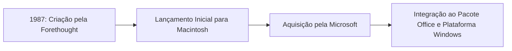
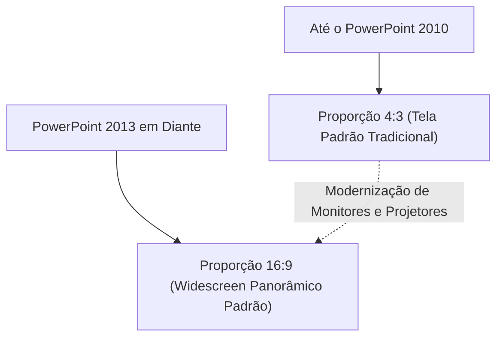
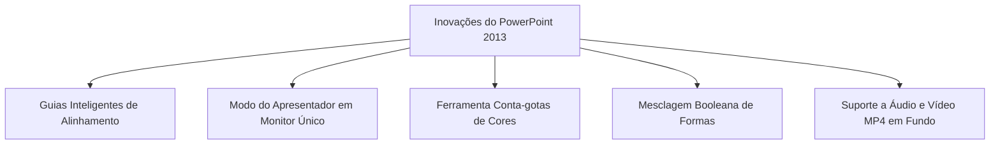
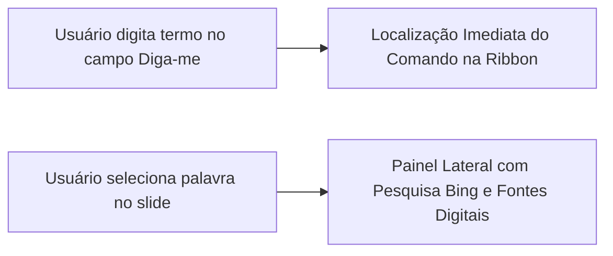
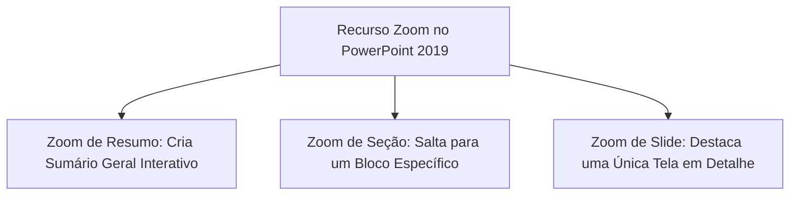
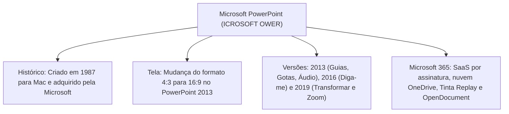

O Microsoft PowerPoint destaca-se como o aplicativo de criação, formatação e exibição de apresentações visuais mais difundido no setor público e corporativo. Para os profissionais do serviço público, a ferramenta é indispensável no alinhamento de planos operacionais e na condução de reuniões de comando.

Nas provas de concurso público, as bancas examinadoras cobram a evolução histórica do programa, a transição de formatos de exibição, os recursos agregados em cada versão recente e o funcionamento do modelo em nuvem do Microsoft 365.

> [!objetivos]
> - Compreender os conceitos estruturais do PowerPoint e seu contexto histórico de criação.
> - Analisar a transição do formato de tela padrão de 4:3 para widescreen 16:9.
> - Identificar as principais inovações introduzidas nas versões 2013, 2016 e 2019.
> - Diferenciar o modelo de licenciamento perpétuo da assinatura contínua do Microsoft 365.
> - Dominar os mecanismos de colaboração, coautoria simultânea e armazenamento em nuvem.

## Visão geral e fundamentos: Microsoft PowerPoint (ICROSOFT OWER)

O Microsoft PowerPoint é um software aplicativo especializado na estruturação de apresentações eletrônicas baseadas em sequências lógicas de telas denominadas slides. Ele integra a consagrada suíte de produtividade de escritório da Microsoft, ao lado de editores de texto como o Word e planilhas eletrônicas como o Excel.

O programa foi idealizado originalmente em 1987 pela empresa Forethought, sob a liderança técnica dos desenvolvedores Robert Gaskins e Dennis Austin. Inicialmente projetado para a plataforma de computadores Apple Macintosh, o aplicativo chamou a atenção da Microsoft. A empresa de Bill Gates adquiriu a empresa desenvolvedora ainda naquele ano. A partir dessa aquisição, o aplicativo passou por profunda expansão, tornando-se um dos pilares centrais do ambiente Windows e consolidando-se em todo o mundo.

O aplicativo opera nativamente em ambientes Microsoft Windows e Apple macOS. Também conta com versões dedicadas para dispositivos móveis com sistemas Android e iOS. No entanto, não há versão instalável nativa para distribuições do sistema operacional Linux. Esse detalhe de compatibilidade é frequentemente explorado pelas bancas organizadoras de concursos.

Como componente de escritório, o software traz um revisor ortográfico completo integrado. O usuário pode conferir termos técnicos e concordâncias em tempo real. Afirmar em itens de prova que o editor de apresentações carece de revisão de texto constitui erro clássico.

> [!atencao]
> **Disponibilidade em Sistemas Operacionais**
> O Microsoft PowerPoint possui versões para Windows, macOS, Android e iOS. Não existe versão nativa instalável para sistemas Linux. Além disso, como componente do Office, ele dispõe de verificador ortográfico nativo, sendo incorreto afirmar em provas que o programa é desprovido de ferramentas linguísticas.

## Padrão visual de referência e a proporção de tela widescreen

A partir da versão do Office 2007, a Microsoft abandonou os menus suspensos clássicos. No lugar deles, implementou a interface Ribbon, conhecida em português como Faixa de Opções. Essa estrutura organiza comandos visualmente em guias temáticas e grupos funcionais. Ela mantém grande estabilidade operacional nas edições 2010, 2013, 2016, 2019 e no Microsoft 365.

Um dos marcos mais relevantes na evolução da ferramenta ocorreu no PowerPoint 2013: a mudança da proporção padrão dos slides. Até então, o padrão de fábrica adotava a proporção clássica de 4:3. Esse arranjo havia sido desenhado para monitores antigos de tubo de raios catódicos. A partir de 2013, o formato padrão passou formalmente para widescreen 16:9. Essa proporção adapta as apresentações às telas planas e aos projetores modernos de alta definição.

O usuário pode alternar manualmente entre 4:3 e 16:9 sempre que desejar. Também pode configurar dimensões personalizadas na guia Design. Contudo, o formato panorâmico permanece como o padrão de inicialização em novos arquivos criados do zero.

Ao projetar uma apresentação em proporção 4:3 em um monitor moderno widescreen, surgem barras pretas verticais nas laterais da tela. Da mesma forma, projetar um slide 16:9 em um monitor clássico 4:3 gera barras horizontais na base e no topo. O ajuste prévio evita essas distorções visuais perante a audiência.

## Inovações funcionais do PowerPoint 2013 e recursos interativos

A versão de 2013 trouxe avanços substanciais na diagramação de objetos e na dinâmica do orador durante palestras:

- **Guias Inteligentes:** linhas auxiliares visuais que surgem na tela de modo automático quando o operador arrasta elementos. Elas mostram quando formas geométricas e caixas de texto estão perfeitamente alinhadas ou com espaçamento equidistante. Isso dispensa o uso cansativo de réguas manuais.
- **Modo do Apresentador Adaptativo:** a interface do orador passou a ser configurada de forma automática pelo software. Na projeção com dois monitores, o público vê apenas o slide em tela cheia. Enquanto isso, o orador visualiza o slide corrente, o próximo slide, o cronômetro e suas anotações particulares de apoio. No PowerPoint 2013, esse modo passou a funcionar inclusive em computadores com monitor único, facilitando ensaios prévios.
- **Mesclagem de Formas:** ferramentas booleanas completas para unir, combinar, fragmentar, interceptar e subtrair formas vetoriais no próprio slide. O desenhista cria figuras complexas sem recorrer a softwares gráficos externos.
- **Ferramenta Conta-gotas:** recurso visual que permite capturar a cor exata de qualquer imagem ou elemento gráfico presente na tela. Com poucas gotas de tinta digital amostrada, o usuário aplica o tom idêntico ao preenchimento de formas ou textos.
- **Suporte Multimídia Avançado:** inclusão de novos formatos de áudio e vídeo, como arquivos MP4 e MOV com codificação H.264 e áudio AAC. Foi introduzida a opção de reproduzir arquivos de áudio no plano de fundo durante toda a sequência de slides.
- **Ferramenta Office Mix e Reuniões Online:** o suplemento gratuito Office Mix possibilitou gravar áudio e vídeo do apresentador sobre os slides. Ele permitiu inserir questionários interativos e carregar apresentações interativas na nuvem. Pelo PowerPoint 2013, o usuário também podia iniciar reuniões online instantâneas através de links diretos com o Lync.

## Recursos do PowerPoint 2016 e aprimoramento de produtividade

A edição de 2016 focou em facilidade de acesso aos comandos e integração de dados analíticos:

- **Recurso Diga-me o que você deseja fazer:** caixa de assistência textual posicionada no topo da Faixa de Opções. O operador digita o nome de um comando ou ação desejada (por exemplo, novo slide ou imprimir). O programa exibe um menu com os botões correspondentes para execução direta. Esse recurso dispensa a navegação manual demorada pelas guias.
- **Pesquisa Inteligente alimentada pelo Bing:** ao selecionar uma palavra ou expressão no slide e acionar o comando com o botão direito, abre-se um painel lateral. O painel carrega definições de dicionário, artigos enciclopédicos de referência e as principais páginas da Web sobre o assunto. O pesquisador consulta fontes sem precisar minimizar a apresentação.
- **Novos Modelos de Gráficos:** introdução de seis novos tipos gráficos para representações estatísticas e hierárquicas. O usuário pode construir gráficos de cascata, histogramas, diagramas de Pareto e mapas de árvore (*treemap*).

## Novidades do PowerPoint 2019: dinâmica visual e navegação não linear

O PowerPoint 2019 trouxe ferramentas modernas que transformaram a experiência visual perante o público:

- **Transição Transformar (Morph):** cria animações fluidas e elegantes entre telas consecutivas. O software identifica elementos comuns em dois slides adjacentes. Ele calcula de maneira autônoma a trajetória, a mudança de escala e a rotação dos objetos ao longo da transição. O resultado lembra animações cinematográficas de alto nível.
- **Recurso de Navegação com Zoom:** possibilita a condução não linear da apresentação. O orador pode criar um Zoom de Resumo com miniaturas clicáveis de todas as seções. Durante a fala, ele clica na miniatura para aproximar o slide desejado e retorna suavemente à visão geral. Existem três modalidades de zoom: Zoom de Resumo, Zoom de Seção e Zoom de Slide.
- **Suporte a Gráficos Vetoriais SVG e Modelos 3D:** aceita a inserção de ícones vetoriais escaláveis no formato SVG. O usuário pode girar esses ícones e convertê-los em formas totalmente editáveis. Também é possível inserir modelos tridimensionais (3D) com suporte a rotação em 360 graus.
- **Caneta Digital e Marca-texto:** ferramentas aprimoradas para desenho livre com caneta óptica ou toque na tela. O comando marca-texto aplica realce em tons variados diretamente sobre as palavras dos slides.

| Versão | Formato Padrão | Principal Inovação de Produtividade | Recurso Visual Característico |
| :--- | :--- | :--- | :--- |
| **PowerPoint 2013** | 16:9 Widescreen | Guias Inteligentes e conta-gotas | Mesclagem de formas e suporte a MP4 |
| **PowerPoint 2016** | 16:9 Widescreen | Assistente Diga-me o que deseja fazer | Pesquisa Inteligente Bing e novos gráficos |
| **PowerPoint 2019** | 16:9 Widescreen | Navegação interativa com Zoom | Transição Transformar e gráficos SVG |

> [!bizu]
> **Diferença entre Transição Transformar e Zoom**
> - **Transição Transformar:** atua entre dois slides vizinhos, criando movimentação contínua de objetos comuns de uma tela para outra.
> - **Recurso Zoom:** atua na estrutura global, criando miniaturas clicáveis que permitem saltar para qualquer parte da apresentação sem seguir a ordem sequencial rígida.

## O ecossistema em nuvem e a suíte Microsoft 365

Durante décadas, a Microsoft comercializou o pacote Office por meio de licenças perpétuas instaláveis em computadores locais. Essas versões clássicas (como 2010, 2013, 2016 e 2019) recebiam apenas correções de segurança. No entanto, o mercado de tecnologia consolidou o modelo de software como serviço (SaaS), culminando no lançamento do Microsoft 365 (antigo Office 365).

O Microsoft 365 baseia-se em um plano de assinatura periódica, mensal ou anual. Esse arranjo transforma os programas em serviços dinâmicos com evolução contínua:

- **Atualizações Contínuas e Mensais:** os assinantes recebem novos recursos de software todo mês. Não é mais necessário aguardar pacotes trienais para ter acesso a inovações de diagramação e ferramentas de inteligência artificial.
- **Armazenamento Integrado no OneDrive:** as apresentações são armazenadas diretamente na nuvem corporativa ou pessoal da Microsoft. Isso viabiliza o salvamento automático a cada digitação e sincroniza o documento entre computadores, celulares e tablets.
- **Coautoria e Colaboração Concorrente:** múltiplos colaboradores podem abrir e alterar o mesmo slide ao mesmo tempo. O programa exibe a presença de cada participante com marcadores e anotações visíveis. As edições aparecem instantaneamente para toda a equipe conectada.
- **Recursos de Tinta Digital e Animação Ink Replay:** com dispositivos sensíveis ao toque, o orador escreve observações livres usando tinta digital. A ferramenta Ink Replay grava e reproduz o traçado da escrita com efeitos de retrocesso ou avanço temporal.
- **Designer de Slides (Ideias de Design):** serviço inteligente baseado em nuvem. Ao inserir imagens e textos, o painel de ideias sugere automaticamente diagramações harmoniosas. O usuário escolhe o arranjo visual com um clique.
- **Interoperabilidade com Padrões Abertos:** além de suportar os formatos clássicos proprietários (.pptx, .potx), o PowerPoint no Microsoft 365 ampliou o suporte ao padrão internacional OpenDocument (ODF 1.3), permitindo ler e salvar arquivos .odp sem perda de formatação.

| Critério Comparativo | Pacotes Tradicionais (2016 / 2019) | Ecossistema Microsoft 365 |
| :--- | :--- | :--- |
| **Modelo de Licenciamento** | Licença perpétua com pagamento único | Assinatura periódica contínua (mensal/anual) |
| **Ciclo de Atualização** | Atualizações estáticas apenas de segurança | Novas ferramentas funcionais adicionadas todo mês |
| **Colaboração e Coautoria** | Compartilhamento manual ou com restrições | Edição simultânea em tempo real multiusuário |
| **Armazenamento Padrão** | Disco local do computador do usuário | Nuvem OneDrive com salvamento automático |

> [!pegadinha]
> **Coautoria em Tempo Real exige Nuvem**
> Para que duas ou mais pessoas trabalhem simultaneamente no mesmo arquivo de apresentação através do PowerPoint, o documento precisa estar obrigatoriamente salvo em um repositório na nuvem (OneDrive ou SharePoint Online). Se o arquivo residir apenas em uma pasta local do disco rígido, a coautoria dinâmica fica inviabilizada.

> [!resolvido]
> **Exercício Resolvido: Identificação de Recursos por Versão**
> Em uma corporação de bombeiros, o comando precisa modernizar suas apresentações institucionais. Um instrutor deseja utilizar um recurso que crie uma transição contínua e suave de elementos gráficos entre telas consecutivas. Outro instrutor precisa de um assistente para digitar o nome de comandos na barra superior sem precisar procurá-los nas guias. Quais recursos nativos do PowerPoint atendem a essas demandas e em quais versões surgiram?
>
> **Resolução passo a passo:**
> 1. *Primeira demanda:* a transição que move e redimensiona objetos comuns entre dois slides adjacentes de maneira fluida chama-se Transição Transformar (Morph), introduzida formalmente no PowerPoint 2019.
> 2. *Segunda demanda:* a caixa de texto assistencial onde o operador digita o comando pretendido para execução direta chama-se Diga-me o que você deseja fazer, novidade marcante do PowerPoint 2016.
>
> **Conclusão:** Os recursos são a Transição Transformar (PowerPoint 2019) e o assistente Diga-me (PowerPoint 2016).

## Mapa do capítulo

Neste capítulo inicial, examinamos as raízes históricas do Microsoft PowerPoint, a evolução da proporção de tela para o padrão widescreen 16:9, os diferenciais técnicos das versões 2013, 2016 e 2019, e a consagração do ecossistema em nuvem do Microsoft 365.

### Para fixar
- O PowerPoint foi concebido pela Forethought em 1987 para Macintosh e logo adquirido pela Microsoft.
- O formato padrão dos slides mudou formalmente de 4:3 para widescreen 16:9 na versão 2013.
- As Guias Inteligentes surgiram no PowerPoint 2013 para facilitar o alinhamento de formas e caixas.
- O recurso Diga-me o que você deseja fazer foi a inovação central de usabilidade do PowerPoint 2016.
- A Pesquisa Inteligente utiliza o mecanismo Bing para exibir dados da web em painel lateral no 2016.
- A Transição Transformar e a ferramenta de Zoom não linear foram introduzidas no PowerPoint 2019.
- O Microsoft 365 opera sob o modelo de assinatura com atualização funcional mensal e contínua.
- A coautoria simultânea em tempo real exige o salvamento da apresentação no OneDrive ou SharePoint.
- O PowerPoint conta com versão para Windows, macOS, Android e iOS, mas não possui versão Linux.
- O software possui corretor ortográfico e gramatical nativo integrado à suíte de aplicativos do Office.
