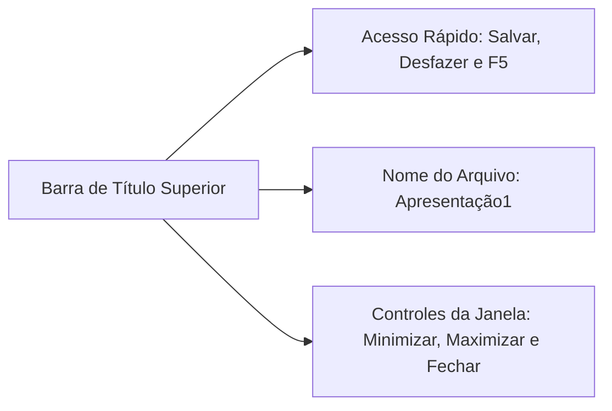
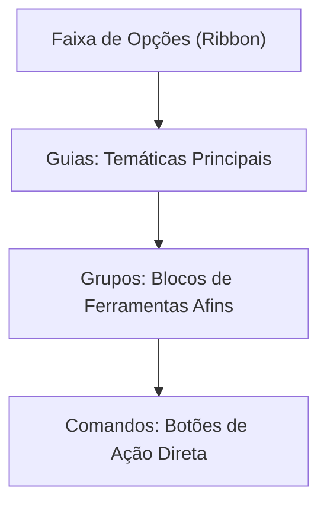
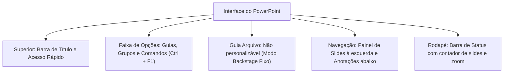

A interface de trabalho do Microsoft PowerPoint organiza o fluxo produtivo por meio de componentes visuais integrados. Para os profissionais do serviço público, compreender essa área de trabalho é fundamental. O domínio prático permite localizar comandos com rapidez durante a elaboração de instruções militares.

Nas provas de concurso público, as bancas cobram as regras de personalização da Faixa de Opções. Também exigem a restrição absoluta da Guia Arquivo e a utilidade dos painéis de apoio.

> [!objetivos]
> - Identificar os componentes primários da interface de usuário do PowerPoint.
> - Compreender a hierarquia estrutural da Faixa de Opções (Ribbon).
> - Dominar as regras e limites de personalização de guias e grupos.
> - Memorizar a restrição imperativa que recai sobre a Guia Arquivo.
> - Distinguir as funções do Painel de Slides, do Painel de Anotações e da Barra de Status.

## Barra de Título e Barra de Ferramentas de Acesso Rápido (NTERFACE)

A interface gráfica do PowerPoint acolhe o usuário com elementos bem delineados em suas bordas e áreas centrais.

Na extremidade superior da janela, localiza-se a **Barra de Título**. Ela desempenha três funções básicas imediatas:
- Exibe o nome do arquivo da apresentação atualmente em edição. Ao abrir um novo arquivo em branco, o programa atribui o nome provisório Apresentação1.
- Identifica o nome do software aplicativo (Microsoft PowerPoint).
- Disponibiliza no canto superior direito os botões clássicos de gerenciamento da janela. São eles: Minimizar, Restaurar/Maximizar e Fechar.

Imediatamente ao lado do ícone do programa, situa-se a **Barra de Ferramentas de Acesso Rápido**:
- Concentra atalhos de uso constante acionáveis por clique simples. Destacam-se os comandos Salvar (`Ctrl + B`), Desfazer (`Ctrl + Z`), Refazer (`Ctrl + Y`) e Iniciar Apresentação do Começo (`F5`).
- É totalmente personalizável pelo operador.
- Permite adicionar qualquer comando do programa para deixá-lo permanentemente visível. Isso pode valer para todas as apresentações ou apenas para o arquivo ativo.

> [!bizu]
> **Posicionamento do Acesso Rápido**
> O usuário pode escolher exibir a Barra de Ferramentas de Acesso Rápido acima ou abaixo da Faixa de Opções. Basta clicar na seta suspensa de personalização ou acionar o botão direito sobre ela.

> [!exemplo]
> **Adicionando Comandos ao Acesso Rápido**
> Para inserir qualquer botão na Barra de Acesso Rápido, basta clicar sobre ele na Ribbon com o botão direito do mouse. Em seguida, selecione a opção Adicionar à Barra de Ferramentas de Acesso Rápido.

## A Faixa de Opções (Ribbon) e a regra imperativa da Guia Arquivo

A **Faixa de Opções** (conhecida internacionalmente como *Ribbon*) concentra a quase totalidade dos comandos operacionais do aplicativo. Ela adota uma divisão hierárquica estrita em três níveis fundamentais:
- **Guias:** abas temáticas principais (Página Inicial, Inserir, Design, Transições, Animações, Apresentação de Slides, Revisão, Exibir).
- **Grupos:** subdivisões lógicas dentro de cada guia que reúnem ferramentas afins. Exemplos claros são o grupo Fonte e o grupo Parágrafo na Página Inicial.
- **Botões de Comando:** ícones e caixas de ação direta que executam as tarefas do operador.

Para expandir a área de desenho do slide, o atalho `Ctrl + F1` alterna a visibilidade da Faixa de Opções. Ele recolhe ou reexibe seus grupos de ferramentas.

### Regras e limites de personalização da Faixa de Opções
O usuário possui ampla liberdade para customizar a Ribbon. Ele pode criar novas guias personalizadas. Também pode renomear guias nativas, criar novos grupos e reordenar a sequência de exibição das abas. Contudo, há regras rigorosas que caem com frequência em provas:

1. **A REGRA IMPERATIVA DA GUIA ARQUIVO:** Diferentemente de todas as outras abas da interface, a Guia Arquivo é bloqueada contra customizações. Não é permitido alterar sua posição inicial, ocultá-la da tela ou reestruturar suas opções internas. Ela serve de portal exclusivo para o modo Backstage. Sua localização no canto esquerdo é imutável.
2. **Escala de fontes e ícones:** Não é viável alterar de modo isolado o tamanho das letras ou dos botões da Faixa de Opções dentro do PowerPoint. Essas dimensões dependem diretamente da escala geral e da resolução de vídeo configuradas no próprio sistema operacional.
3. **Isolamento de programas:** Customizações efetuadas na Faixa de Opções do PowerPoint afetam apenas o próprio PowerPoint. Elas não são transferidas para o Word ou para o Excel.

| Componente da Ribbon | Permite Personalização? | Observações Técnicas de Prova |
| :--- | :--- | :--- |
| **Guias Nativas Comuns** | Sim | Podem ser renomeadas, ocultadas ou reordenadas na tela |
| **Novas Guias do Usuário** | Sim | Criadas livremente para agrupar comandos favoritos |
| **Guia Arquivo (Backstage)** | **NÃO** | Posição fixa à esquerda; não aceita ocultação nem reordenação |
| **Grupos e Comandos** | Sim | É possível adicionar comandos a novos grupos criados |

> [!pegadinha]
> **A Pegadinha da Guia Arquivo**
> A banca examinadora costuma afirmar que o usuário pode ocultar a Guia Arquivo para ganhar espaço em tela. Isso é falso. A Guia Arquivo não pode ser personalizada, movida ou ocultada sob nenhuma hipótese.

> [!atencao]
> **Atalho de Recolhimento da Faixa de Opções**
> O atalho de teclado oficial para recolher ou expandir a Faixa de Opções é `Ctrl + F1`. Um clique duplo sobre qualquer guia também produz esse mesmo efeito de recolhimento.

> [!esquema]
> **Independência entre Aplicativos**
> Criar uma nova guia no PowerPoint não faz essa mesma guia surgir no Microsoft Word. As configurações da Ribbon são salvas de modo estritamente isolado para cada aplicativo da suíte Office.

## Painel de Slides, Painel de Anotações e Barra de Status

Além da grande área central onde o slide é desenhado, a interface do PowerPoint disponibiliza três áreas funcionais decisivas:

### Painel de Slides (Miniaturas)
Localizado na lateral esquerda no modo Normal de exibição, exibe a sequência de telas da apresentação na forma de miniaturas numeradas:
- Permite a navegação rápida entre os slides através de cliques do mouse ou das setas direcionais do teclado.
- Viabiliza reorganizar a ordem de apresentação. O operador simplesmente arrasta uma miniatura para cima ou para baixo.
- Facilita ações de contexto. Clicando com o botão direito sobre uma miniatura, é possível duplicar o slide, excluí-lo, criar seções de agrupamento ou marcá-lo como oculto.

### Painel de Anotações
Localizado logo abaixo da área de edição do slide principal:
- Destina-se ao registro de textos de apoio para o apresentador durante sua fala.
- Na projeção com dois monitores através do *Modo do Apresentador*, essas notas aparecem exclusivamente na tela do orador. O público que assiste à projeção no telão principal visualiza apenas o slide limpo. A plateia não tem acesso aos apontamentos particulares.

### Barra de Status
Situada na base inferior de toda a janela do aplicativo, cumpre papel de monitoramento contínuo:
- **Margem Esquerda:** exibe o contador ordinal de slides (por exemplo, `Slide 3 de 12`), o idioma do verificador ortográfico e indicadores de acessibilidade.
- **Margem Direita:** reúne o botão de ativação do Painel de Anotações. Também contém atalhos diretos para os quatro modos de exibição (Normal, Classificação de Slides, Modo de Leitura e Apresentação de Slides) e o controle deslizante de Zoom percentual.

> [!resolvido]
> **Exercício Resolvido: Gestão de Interface em Instrução Militar**
> Durante uma instrução no auditório do quartel, o oficial instrutor deseja anotar tópicos de suporte que sirvam de lembrete em sua fala. Ele não quer que os alunos visualizem essas anotações no telão de projeção. Ao mesmo tempo, ele precisa recolher temporariamente a barra de botões superior para visualizar melhor uma imagem ampla. Quais recursos e atalhos atendem perfeitamente ao instrutor?
>
> **Resolução passo a passo:**
> 1. *Primeira necessidade:* as anotações particulares do orador devem ser inseridas no Painel de Anotações, localizado abaixo do slide. Na projeção com dois monitores, o Modo do Apresentador exibe essas notas privativamente para o instrutor.
> 2. *Segunda necessidade:* o recolhimento imediato da Faixa de Opções (Ribbon) é executado pelo atalho de teclado `Ctrl + F1` ou pelo clique duplo sobre a guia ativa.
>
> **Conclusão:** O instrutor usará o Painel de Anotações e o atalho `Ctrl + F1` para recolher a Faixa de Opções.

## Mapa do capítulo

Neste capítulo, detalhamos a composição anatômica da interface do PowerPoint, compreendendo a Barra de Título, a Barra de Acesso Rápido, a estrutura hierárquica da Faixa de Opções, o bloqueio absoluto de personalização da Guia Arquivo, os papéis do Painel de Slides e de Anotações, e os mostradores da Barra de Status.

### Para fixar
- A Barra de Título exibe o nome provisório Apresentação1 e o identificador do software no topo.
- A Barra de Ferramentas de Acesso Rápido é totalmente customizável pelo operador.
- A Faixa de Opções organiza-se hierarquicamente em guias, grupos funcionais e comandos.
- O atalho `Ctrl + F1` recolhe ou expande a exibição dos comandos da Faixa de Opções.
- A Guia Arquivo não pode ser personalizada, ocultada ou reordenada pelo usuário.
- Personalizações na Ribbon do PowerPoint aplicam-se exclusivamente a ele, sem afetar o Word ou Excel.
- O Painel de Slides, localizado à esquerda, viabiliza reorganização sequencial e criação de seções.
- O Painel de Anotações serve ao apresentador e fica invisível para a plateia no Modo do Apresentador.
- A Barra de Status, no rodapé, exibe o contador ordinal de slides, modos de exibição e controle de zoom.
- Tamanhos de fontes e ícones da Ribbon dependem da escala do próprio sistema operacional.
