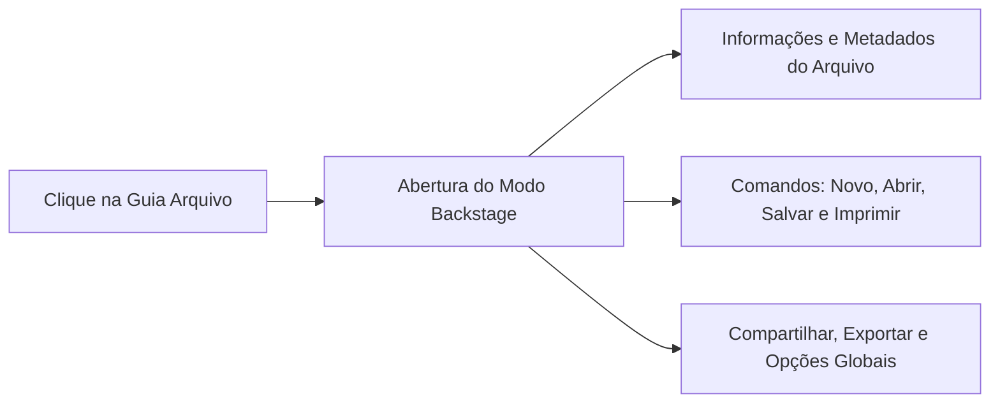
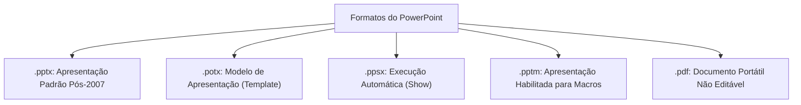
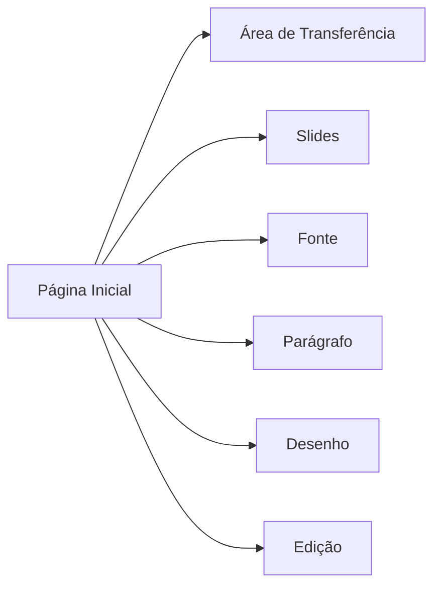
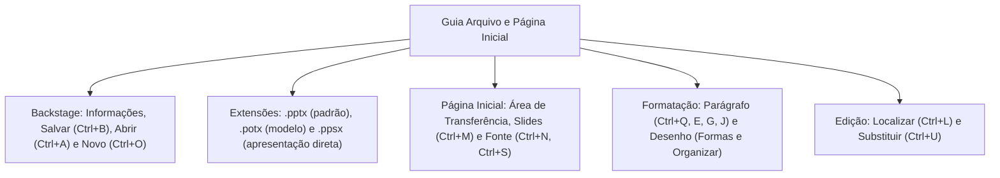

A rotina de produção de apresentações no Microsoft PowerPoint divide-se entre gerenciar o documento como um todo e editar os elementos visuais contidos nos slides. Para o servidor público, dominar essa separação garante segurança no manuseio de arquivos e na aplicação de padrões corporativos.

Nas provas de concurso público, as bancas cobram intensamente a lista de atalhos de teclado do programa em português do Brasil. Exigem também os formatos de exportação no modo Backstage e as ferramentas da Guia Página Inicial.

> [!objetivos]
> - Compreender o papel do modo Backstage acionado pela Guia Arquivo.
> - Dominar os principais atalhos de gerenciamento de arquivos em português.
> - Diferenciar formatos e extensões nativas (.pptx, .potx, .ppsx, .pptm e .pdf).
> - Analisar os grupos de ferramentas da Guia Página Inicial e seus atalhos.
> - Identificar as funcionalidades da Área de Transferência, Slides, Fonte, Parágrafo, Desenho e Edição.

## A Faixa de Opções e o modo Backstage da Guia Arquivo (AIXA DE)

Ao iniciar o PowerPoint, o usuário depara-se com uma tela inicial de boas-vindas. Nela constam as apresentações abertas recentemente e uma galeria ampla com modelos prontos. Se o operador optar por uma tela limpa, selecionará a opção Apresentação em Branco.

A **Guia Arquivo** funciona de maneira diferente de todas as outras guias da Faixa de Opções. Em vez de exibir grupos de botões sobre o slide, ela substitui a área de trabalho pela tela cheia do **modo Backstage**. O Backstage cuida de tudo aquilo que se faz *com* o arquivo em si, e não *dentro* do conteúdo do slide.

No Backstage, destacam-se comandos fundamentais de gestão documental. A lista a seguir reúne os principais recursos do modo:
- **Informações:** exibe os **metadados** da apresentação nas Propriedades do documento. O operador visualiza o tamanho do arquivo, o número total de slides, slides ocultos, autor, datas de criação e última modificação. Esses dados ajudam na auditoria e rastreabilidade documental.
- **Novo (`Ctrl + O`):** permite iniciar uma nova apresentação em branco ou selecionar modelos pré-formatados.
- **Abrir (`Ctrl + A`):** abre arquivos já existentes armazenados no computador ou na nuvem OneDrive. Permite também fixar arquivos frequentes na lista.
- **Salvar (`Ctrl + B`):** grava as modificações efetuadas sobre o arquivo já salvo sem abrir caixas de diálogo adicionais.
- **Salvar Como (`F12`):** possibilita gravar uma nova cópia com outro nome, em outra pasta ou em formato distinto.
- **Imprimir (`Ctrl + P`):** define o intervalo de impressão, número de cópias, escolha de impressora e impressão em formato de folhetos com múltiplos slides por folha de papel.
- **Compartilhar:** envia a apresentação para o armazenamento em nuvem no OneDrive ou anexa diretamente em mensagem de correio eletrônico.
- **Exportar:** converte a apresentação para formatos portáteis fechados, como PDF e XPS, ou cria vídeos MP4 a partir da sequência de telas.
- **Fechar:** encerra a apresentação atualmente aberta sem finalizar a janela global do aplicativo.
- **Conta e Comentários:** revela dados da assinatura do usuário, serviços de nuvem conectados e canal para enviar opiniões sobre o software.
- **Opções:** abre a janela de configurações globais do aplicativo, abrangendo idioma, facilidade de acesso, revisão de texto e salvamento automático.

> [!bizu]
> **Atalhos de Arquivo em Português**
> No PowerPoint configurado em português do Brasil, os atalhos de arquivo não seguem a letra inicial do inglês:
> - Novo arquivo: `Ctrl + O`
> - Abrir arquivo: `Ctrl + A`
> - Salvar alterações: `Ctrl + B`
> - Salvar como: tecla `F12`

> [!pegadinha]
> **Ctrl + A e Ctrl + O em Provas**
> Não confunda esses atalhos com outros sistemas:
> - Em outros programas e no Windows Explorer, `Ctrl + A` costuma significar selecionar tudo. No PowerPoint em português, `Ctrl + A` significa **ABRIR** um arquivo existente.
> - A letra O não é de *Open*, mas sim de **NOVO** arquivo (`Ctrl + O`).

> [!atencao]
> **Metadados em Informações**
> Os dados exibidos no painel Informações (autor, tamanho, data de criação e modificação) são metadados sobre o documento. Eles não aparecem projetados na tela do slide diante da plateia.

## Formatos e extensões de arquivos no PowerPoint

O PowerPoint suporta um amplo leque de formatos de arquivo, tanto para edição quanto para distribuição pública e arquivamento seguro:

| Extensão | Denominação Técnica | Comportamento Operacional |
| :--- | :--- | :--- |
| **.pptx** | Apresentação do PowerPoint | Formato nativo padrão baseado em XML aberto |
| **.potx** | Modelo do PowerPoint | Modelo reutilizável com layout e estilos pré-definidos |
| **.ppsx** | Apresentação de Slides | Abre direto em modo de exibição de tela inteira |
| **.pptm** | Apresentação com Macros | Admite execução de códigos automatizados em VBA |
| **.pdf** | Formato de Documento Portátil | Preserva diagramação fixa para visualização universal |

Além dessas extensões centrais, o programa aceita salvar nos formatos legados de versões antigas (.ppt e .pot do Office 97-2003), temas de apresentação (.thmx), arquivos OpenDocument Presentation (.odp) e formatos de imagem (.png, .jpg, .svg). Também permite exportar como vídeo (.mp4 e .wmv) para reprodução autônoma.

> [!exemplo]
> **Comportamento do Arquivo .ppsx**
> Ao dar duplo clique em um arquivo com extensão `.pptx`, o PowerPoint abre o documento no modo de edição normal. Já ao dar duplo clique em um arquivo `.ppsx`, a apresentação é disparada imediatamente em tela cheia perante a tela, sem passar pela interface de edição.

> [!esquema]
> **Modelos de Apresentação (.potx)**
> Os arquivos de modelo servem de base institucional. Eles já contêm cabeçalhos corporativos, logotipos, fontes e esquemas de cores pré-configurados, poupando tempo na montagem de novos relatórios.

> [!atencao]
> **Apresentações com Macros (.pptm)**
> Arquivos que contenham códigos automatizados em Visual Basic for Applications (VBA) exigem a extensão `.pptm`. Se forem salvos no formato comum `.pptx`, as macros serão automaticamente removidas pelo software por motivos de segurança.

## A Guia Página Inicial e seus grupos funcionais

A **Guia Página Inicial** concentra os comandos mais utilizados no dia a dia da edição dos slides. Ela é dividida em seis grupos funcionais bem delineados.

### Grupo Área de Transferência
Reúne comandos para movimentação rápida de informações no documento.
- **Colar (`Ctrl + V`), Recortar (`Ctrl + X`) e Copiar (`Ctrl + C`):** manipulação usual de elementos textuais e visuais.
- **Pincel de Formatação:** copia a formatação de um trecho e a aplica em outro. Um clique simples permite aplicar o estilo uma única vez; um **duplo clique** mantém o pincel ativo para múltiplas aplicações consecutivas em vários slides distintos.

### Grupo Slides
Cuida da inserção e organização estrutural das telas da apresentação.
- **Novo Slide (`Ctrl + M`):** insere uma nova tela na apresentação. Não confunda com `Ctrl + O`, que cria um arquivo novo inteiro.
- **Layout:** altera a disposição de caixas de texto e títulos do slide ativo (como Slide de Título, Título e Conteúdo ou Duas Partes).
- **Redefinir:** restaura a posição, o tamanho e a formatação originais dos espaços reservados conforme o modelo padrão.
- **Seção:** agrupa conjuntos de slides em blocos lógicos nomeados, facilitando a navegação em apresentações extensas.
- **Reutilizar Slides:** permite importar slides prontos de outras apresentações salvas no computador.

### Grupo Fonte
Gerencia a aparência tipográfica dos textos selecionados no slide.
- **Fonte (`Ctrl + Shift + F`) e Tamanho (`Ctrl + Shift + P`):** seleção tipográfica e dimensão em pontos.
- **Aumentar / Diminuir Fonte:** atalhos `Ctrl + Shift + >` e `Ctrl + Shift + <`.
- **Negrito (`Ctrl + N`), Itálico (`Ctrl + I`) e Sublinhado (`Ctrl + S`):** estilos tipográficos básicos.
- Recursos adicionais: sombra de texto, tachado, espaçamento entre caracteres, cor de realce e maiúsculas/minúsculas.

> [!pegadinha]
> **Negrito e Sublinhado em Português**
> Em programas da Microsoft em português, a letra N é de **Negrito** (`Ctrl + N`), e não de Novo. A letra S é de **Sublinhado** (`Ctrl + S`), e não de Salvar. Salvar é `Ctrl + B`.

### Grupo Parágrafo
Regula o alinhamento e o fluxo textual das caixas de mensagem.
- **Alinhamentos Horizontais:** Esquerda (`Ctrl + Q`), Centralizado (`Ctrl + E`), Direita (`Ctrl + G`) e Justificado (`Ctrl + J`).
- **Listas:** Marcadores e Numeração para criação de listas estruturadas com diferentes níveis de recuo.
- **Recursos Avançados:** direção do texto, colunas e **Converter em SmartArt** (transforma tópicos textuais em diagramas visuais automáticos).

> [!bizu]
> **SmartArt está em Parágrafo e Inserir**
> É possível converter uma lista de texto diretamente em gráfico visual pelo botão Converter em SmartArt, localizado no grupo Parágrafo da Página Inicial. Já a inserção de um SmartArt do zero localiza-se na guia Inserir.

### Grupo Desenho
Oferece ferramentas para criação e diagramação geométrica no slide.
- **Formas:** galeria de linhas, setas, retângulos, estrelas e balões de diálogo.
- **Organizar:** gerencia o empilhamento de objetos na tela (Trazer para a Frente, Enviar para Trás), alinhamento relativo, rotação e **Agrupar Formas**.
- **Estilos Rápidos:** paletas visuais pré-formatadas de cores e bordas.
- **Preenchimento, Contorno e Efeitos da Forma:** ajustes de sombras, reflexos, brilhos e rotação tridimensional.

### Grupo Edição
Facilita buscas e substituições em todo o documento em edição.
- **Localizar (`Ctrl + L`):** busca termos e expressões em todos os slides da apresentação.
- **Substituir (`Ctrl + U`):** localiza palavras específicas e as substitui de forma pontual ou global.
- **Selecionar:** permite selecionar todos os objetos ou abrir o Painel de Seleção para ocultar e nomear camadas.

> [!atencao]
> **Localizar e Substituir**
> Para abrir a caixa de busca de termos, o atalho é `Ctrl + L` (Localizar). Para buscar uma palavra e trocá-la por outra em toda a apresentação, o atalho é `Ctrl + U` (Substituir).

> [!bizu]
> **Painel de Seleção em Edição**
> O comando Selecionar > Painel de Seleção lista todos os objetos contidos no slide atual. Ele permite alterar a ordem de sobreposição e ocultar elementos temporariamente sem apagá-los.

> [!resolvido]
> **Exercício Resolvido: Atalhos de Edição e Criação**
> Durante a elaboração de um relatório de ocorrência no quartel, o militar deseja: (1) inserir um novo slide na apresentação ativa; (2) aplicar estilo negrito ao título selecionado; e (3) salvar as modificações feitas no arquivo. Quais atalhos de teclado devem ser acionados no PowerPoint em português?
>
> **Resolução passo a passo:**
> 1. *Inserir novo slide:* o comando oficial é `Ctrl + M` (pertencente ao grupo Slides da Página Inicial).
> 2. *Aplicar estilo negrito:* o atalho correspondente na versão brasileira é `Ctrl + N` (grupo Fonte).
> 3. *Salvar o arquivo:* a gravação é acionada pelo atalho `Ctrl + B` (modo Backstage ou Acesso Rápido).
>
> **Conclusão:** A sequência exata de atalhos é `Ctrl + M`, `Ctrl + N` e `Ctrl + B`.

## Mapa do capítulo

Neste capítulo, estudamos o modo Backstage da Guia Arquivo e seus metadados, as extensões essenciais (.pptx, .potx, .ppsx, .pptm e .pdf) e a operação detalhada da Guia Página Inicial com seus grupos de ferramentas e atalhos.

### Para fixar
- A Guia Arquivo aciona o modo Backstage para gerenciar propriedades e salvar documentos.
- No painel Informações encontram-se os metadados do arquivo (autor, tamanho e datas).
- Atalhos em português: Novo é `Ctrl + O`, Abrir é `Ctrl + A`, Salvar é `Ctrl + B` e Salvar Como é `F12`.
- A extensão padrão de arquivo é `.pptx` e os modelos utilizam a extensão `.potx`.
- Arquivos `.ppsx` abrem diretamente em modo de execução de apresentação em tela cheia.
- O atalho `Ctrl + M` insere um novo slide dentro da apresentação ativa.
- No grupo Fonte, `Ctrl + N` aplica negrito e `Ctrl + S` aplica sublinhado ao texto.
- Os alinhamentos de parágrafo são `Ctrl + Q` (esquerda), `Ctrl + E` (centro), `Ctrl + G` (direita) e `Ctrl + J` (justificar).
- O Pincel de Formatação aceita duplo clique para aplicação contínua em múltiplos elementos.
- Na edição, localizar termos aciona-se por `Ctrl + L` e substituir por `Ctrl + U`.
