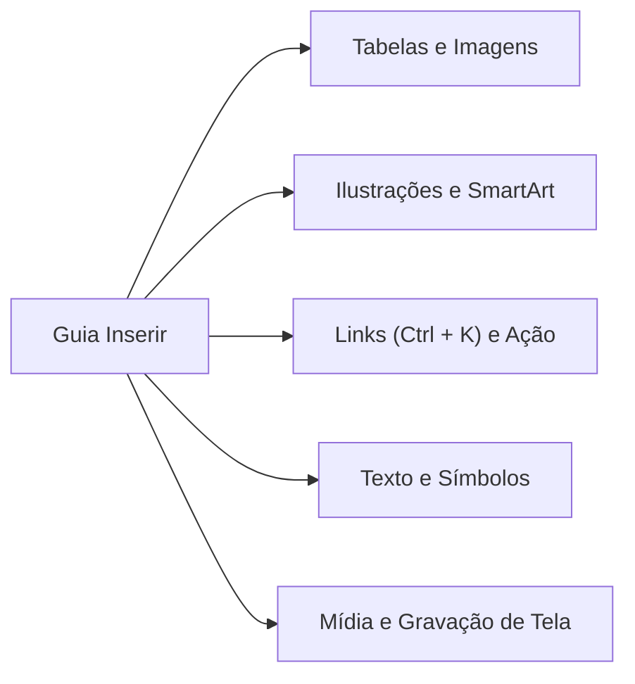
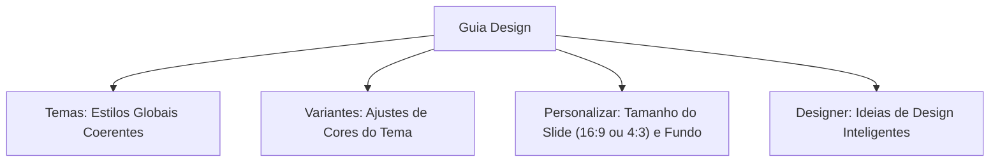
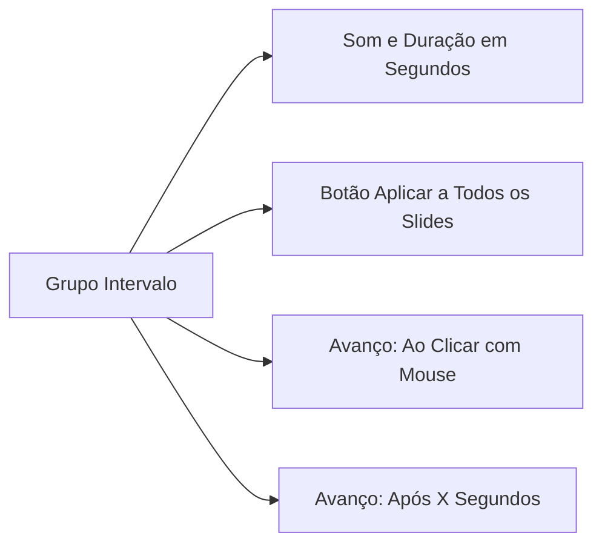
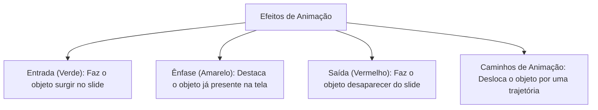
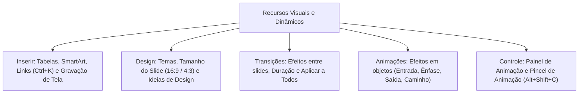

A criação de apresentações dinâmicas e persuasivas exige o domínio dos recursos multimídia e visuais do Microsoft PowerPoint. Para o Oficial e os agentes de segurança pública, saber inserir dados externos, harmonizar temas institucionais e aplicar efeitos de movimento com precisão é indispensável.

Nas provas de concurso público, as bancas cobram com frequência a distinção entre transições de slides e animações de objetos, os caminhos das guias Inserir e Design, e os atalhos operacionais de controle.

> [!objetivos]
> - Mapear os grupos e comandos da Guia Inserir, destacando tabelas, mídias e hiperlinks.
> - Compreender a formatação estética da Guia Design e o dimensionamento de telas.
> - Distinguir o conceito e a aplicação de Transições entre slides consecutivos.
> - Dominar os quatro tipos de Animações aplicadas a objetos internos de um slide.
> - Operar o Painel de Animação, o temporizador de intervalo e o Pincel de Animação.

## A Guia Inserir e a integração multimídia de conteúdos

A **Guia Inserir** reúne comandos destinados a adicionar novos elementos gráficos, textuais e interativos aos slides da apresentação. Os comandos estão organizados em blocos temáticos:

A tabela a seguir resume os grupos funcionais e as principais opções da Guia Inserir:

| Grupo Funcional | Principais Ferramentas | Finalidade Operacional |
| :--- | :--- | :--- |
| **Slides** | Novo Slide (`Ctrl + M`) | Inclui uma nova tela com layout predeterminado |
| **Tabelas** | Tabela | Desenha matrizes bidimensionais de linhas e colunas |
| **Imagens** | Este Dispositivo, Imagens Online, Instantâneo | Insere fotos locais, da web ou captura janelas abertas |
| **Ilustrações** | Formas, Ícones, Modelos 3D, SmartArt, Gráfico | Adiciona elementos vetoriais, diagramas e dados numéricos |
| **Links** | Zoom, Link (`Ctrl + K`), Ação | Estabelece saltos para páginas, arquivos ou slides internos |
| **Comentários** | Novo Comentário | Insere anotações de equipe em trechos do slide |
| **Texto** | Caixa de Texto, Cabeçalho e Rodapé, WordArt | Adiciona blocos textuais livres e identificações marginais |
| **Símbolos** | Equação, Símbolo | Insere fórmulas matemáticas e caracteres especiais |
| **Mídia** | Vídeo, Áudio, Gravação de Tela | Incorpora arquivos audiovisuais e grava a tela do computador |

O recurso **Instantâneo** permite capturar janelas de programas abertos no Windows e colá-las diretamente no slide. O **SmartArt** permite converter ideias conceituais em organogramas, listas hierárquicas e fluxogramas de processos.

No gerenciamento de mídias, o vídeo pode ser **incorporado** ou **vinculado**. O vídeo incorporado aumenta o tamanho do arquivo da apresentação, mas garante que o vídeo seja reproduzido em qualquer computador. Já o vídeo vinculado mantém o arquivo leve, mas depende da presença do arquivo de vídeo externo na mesma pasta.

> [!bizu]
> **Caixa de Texto está em Inserir**
> Não confunda a localização da ferramenta Caixa de Texto. Embora a formatação de texto ocorra na Página Inicial, o botão para desenhar uma Caixa de Texto localiza-se na **Guia Inserir** (grupo Texto).

> [!pegadinha]
> **Link versus Ação**
> - **Link (`Ctrl + K`):** direciona o clique para uma página da internet, um arquivo externo ou outro slide da mesma apresentação.
> - **Ação:** executa um comportamento ao clicar ou ao passar o mouse sobre o objeto, como abrir um aplicativo ou disparar um som específico.

> [!atencao]
> **Gravação de Tela Nativa**
> O PowerPoint possui ferramenta própria para gravar a tela do computador com captação simultânea de áudio do microfone. Esse comando localiza-se em **Inserir > Mídia > Gravação de Tela**.

## A Guia Design e a padronização visual da apresentação

A **Guia Design** cuida da harmonia visual e das proporções geométricas de toda a apresentação:

- **Grupo Temas:** conjuntos pré-formatados de paletas de cores, famílias de fontes tipográficas e efeitos de preenchimento. Aplicar um tema altera simultaneamente o visual de todos os slides da apresentação.
- **Grupo Variantes:** oferece versões com outras combinações cromáticas para o mesmo tema selecionado.
- **Grupo Personalizar:** contém os botões **Tamanho do Slide** e **Formatar Tela de Fundo**. Permite alternar entre a proporção padrão Widescreen (16:9), a proporção clássica Padrão (4:3) ou definir medidas milimétricas em Tamanho do Slide Personalizado.
- **Grupo Designer (Ideias de Design):** serviço de inteligência artificial em nuvem que sugere diagramações automáticas e profissionais com base nas imagens e textos inseridos pelo operador.

> [!exemplo]
> **Caminho para Alterar Dimensões do Slide**
> Para configurar uma proporção sob medida para a tela, o caminho cobrado em certames percorre a Guia Design. Nela, acessa-se o bloco Personalizar, clica-se na opção Tamanho do Slide e escolhe-se o comando para definir dimensões personalizadas do arquivo. Esse comando não fica na guia Exibir.

> [!pegadinha]
> **Vídeo Vinculado versus Vídeo Incorporado**
> Em apresentações levadas para outros computadores em pendrive, o vídeo vinculado pode falhar se o arquivo de mídia não for copiado junto para a mesma pasta. O vídeo incorporado elimina esse risco por estar embutido no próprio documento, embora torne o arquivo final sensivelmente mais pesado.

> [!esquema]
> **Ideias de Design e Conexão**
> O recurso Ideias de Design depende de conexão ativa com a internet e autorização de serviços inteligentes do Office. Na primeira execução, o software solicita a concordância do usuário para processar as sugestões em nuvem.

## A Guia Transições: efeitos entre telas consecutivas

Uma **Transição** consiste no efeito visual e sonoro reproduzido quando a apresentação **passa de um slide para o slide seguinte**. Esse efeito só é visível durante o modo de execução em tela cheia (Apresentação de Slides).

A Guia Transições é estruturada em três grupos principais:
- **Visualização:** botão Visualizar, que executa uma prévia rápida da transição sem sair da área de edição.
- **Transição para este slide:** galeria com efeitos de transição (como Esmaecer, Empurrão, Revelar, Barras, Dividir, Quadriculado e a moderna Transição Transformar). O botão Opções de Efeito permite ajustar a direção do movimento (por exemplo, da esquerda para a direita ou de baixo para cima).
- **Intervalo:** gerencia o tempo e as condições de disparo da troca de tela:
  - *Som:* associa um efeito sonoro à virada de slide.
  - *Duração:* define a velocidade de execução da animação da transição em segundos.
  - *Aplicar a Todos:* replica compulsoriamente a transição selecionada, seu som e intervalo para todos os slides do arquivo.
  - *Avançar Slide:* determina se o slide avança **Ao Clicar com o Mouse** ou de forma autônoma **Após** um determinado número de segundos configurado.

> [!pegadinha]
> **Botão Aplicar a Todos**
> O botão Aplicar a Todos existe exclusivamente na Guia Transições. Não existe um botão correspondente chamado Aplicar a Todos na Guia Animações. As animações exigem configuração objeto por objeto ou cópia pelo Pincel de Animação.

> [!bizu]
> **Transição ocorre Entre Slides**
> Grave a regra mnemônica de prova: Transição ocorre **ENTRE** slides vizinhos. Se a questão de concurso mencionar efeito visual ao passar de uma tela para outra, trata-se inequivocamente de transição.

## A Guia Animações: dinamismo em objetos internos

Diferentemente das transições, uma **Animação** é o efeito visual aplicado a **objetos específicos** (textos, imagens, formas, tabelas ou gráficos) **dentro de um mesmo slide**. Seu objetivo é controlar o fluxo de informação, chamar a atenção do público e destacar tópicos sequenciais.

Os efeitos de animação subdividem-se obrigatoriamente em quatro categorias:

| Categoria do Efeito | Cor Padrão do Ícone | Ação Visual no Slide | Exemplo Prático |
| :--- | :--- | :--- | :--- |
| **Entrada** | Verde | Faz o objeto entrar na tela | Título surge deslizando da margem esquerda |
| **Ênfase** | Amarelo | Modifica tamanho, cor ou gira o elemento | Palavra-chave pisca ou aumenta de escala |
| **Saída** | Vermelho | Retira o objeto da visão do público | Imagem desvanece e some da tela |
| **Caminho da Animação** | Linha tracejada | Desloca o elemento por uma rota definida | Seta percorre uma trajetória circular ou reta |

### Grupos e comandos da Guia Animações
- **Visualização:** reproduz os efeitos cadastrados no slide ativo.
- **Animação:** galeria para escolher o primeiro efeito do objeto e suas Opções de Efeito.
- **Animação Avançada:**
  - *Adicionar Animação:* botão obrigatório para incluir um segundo ou terceiro efeito ao mesmo objeto. Clicar diretamente na galeria principal substitui o efeito existente em vez de empilhar.
  - *Painel de Animação:* abre uma barra lateral com a linha do tempo de todos os efeitos do slide, permitindo reordenar sua ordem e configurar intervalos avançados.
  - *Disparar (Gatilho):* vincula o início da animação ao clique em outro objeto específico do slide ou a uma marca de mídia.
  - *Pincel de Animação (`Alt + Shift + C`):* copia todas as animações e temporizações de um objeto e as aplica diretamente em outro.
- **Intervalo:**
  - *Iniciar:* define a condição de disparo (Ao Clicar, Com a Anterior ou Após a Anterior).
  - *Duração e Atraso:* calibra o tempo de execução do movimento e a espera prévia em segundos.
  - *Reordenar Animação:* botões Mover Antes e Mover Depois para mudar a sequência.

> [!atencao]
> **Adicionar Animação versus Galeria**
> Para aplicar múltiplos efeitos ao mesmo objeto (por exemplo, uma Entrada e depois uma Ênfase), o usuário deve usar o botão **Adicionar Animação**. Se clicar direto na galeria de animações, o PowerPoint substituirá o efeito atual pelo novo.

> [!bizu]
> **Pincel de Animação (`Alt + Shift + C`)**
> Assim como o Pincel de Formatação copia a tipografia de um texto, o Pincel de Animação copia a sequência completa de animações de uma forma para outra com um clique.

> [!esquema]
> **Modos de Disparo de Animação**
> - *Ao Clicar:* aguarda ação manual do apresentador no mouse ou teclado.
> - *Com a Anterior:* inicia no exato instante do efeito anterior, rodando em paralelo.
> - *Após a Anterior:* inicia automaticamente assim que o efeito anterior termina.

> [!resolvido]
> **Exercício Resolvido: Configuração de Animação e Transição**
> Um instrutor dos bombeiros precisa preparar uma instrução com regras estritas: (1) ao passar do slide 2 para o slide 3, deve ocorrer um efeito gradual em tela cheia com duração de dois segundos; (2) no slide 3, uma imagem deve surgir de baixo para cima somente após o instrutor clicar no mouse; e (3) a mesma imagem deve piscar em seguida para chamar a atenção dos alunos. Quais recursos e comandos o instrutor deve configurar?
>
> **Resolução passo a passo:**
> 1. *Efeito entre os slides 2 e 3:* trata-se de uma **Transição**, configurada na Guia Transições, selecionando o efeito desejado e definindo a Duração em 2,00 segundos.
> 2. *Surgimento da imagem ao clicar:* aplica-se um efeito de animação do tipo **Entrada** (verde) com disparo configurado em **Iniciar: Ao Clicar**.
> 3. *Segundo efeito na mesma imagem:* deve-se clicar em **Adicionar Animação** (grupo Animação Avançada) e escolher um efeito de **Ênfase** (amarelo), definindo o disparo como **Após a Anterior** ou **Ao Clicar**.
>
> **Conclusão:** O instrutor configurará uma Transição entre os slides e dois efeitos de Animação (Entrada e Ênfase) através do botão Adicionar Animação.

## Mapa do capítulo

Neste capítulo, estudamos as ferramentas da Guia Inserir, as configurações estéticas da Guia Design, a operação das Transições de slides com intervalos e a aplicação dos quatro tipos de Animações com o Painel de Animação.

### Para fixar
- A Guia Inserir contém ferramentas para tabelas, imagens, formas, SmartArt, links e mídias.
- O atalho oficial para inserir um hiperlink é `Ctrl + K`.
- A ferramenta Caixa de Texto localiza-se na Guia Inserir, no grupo Texto.
- O botão Tamanho do Slide fica em Design > Personalizar, permitindo alternar entre 16:9 e 4:3.
- Transição é o efeito visual aplicado na passagem de um slide para outro.
- O botão Aplicar a Todos na Guia Transições replica tempo, som e efeito para todo o arquivo.
- Animação é o efeito aplicado a objetos individuais dentro do mesmo slide.
- As quatro categorias de animação são Entrada (verde), Ênfase (amarelo), Saída (vermelho) e Caminho.
- O botão Adicionar Animação é obrigatório para empilhar múltiplos efeitos sobre o mesmo objeto.
- O Pincel de Animação (`Alt + Shift + C`) copia a sequência de efeitos para outros elementos.
