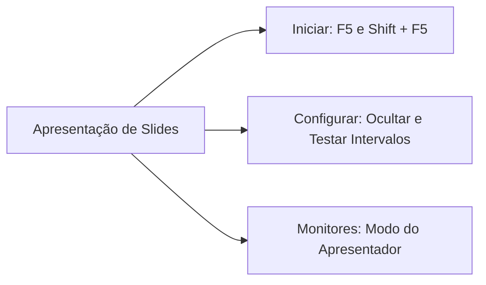
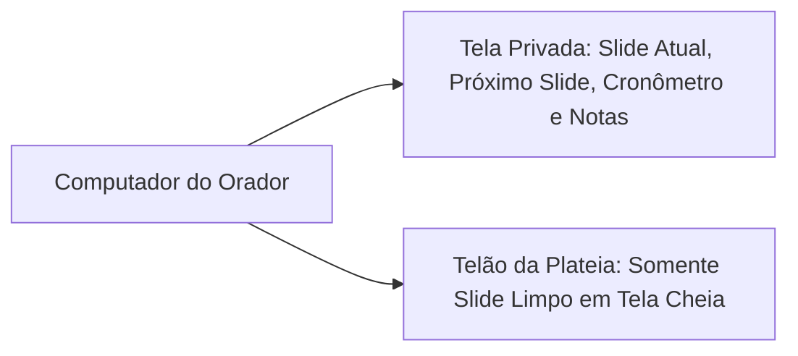
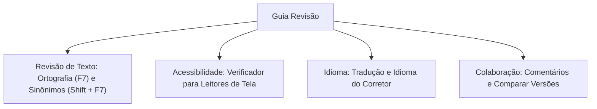
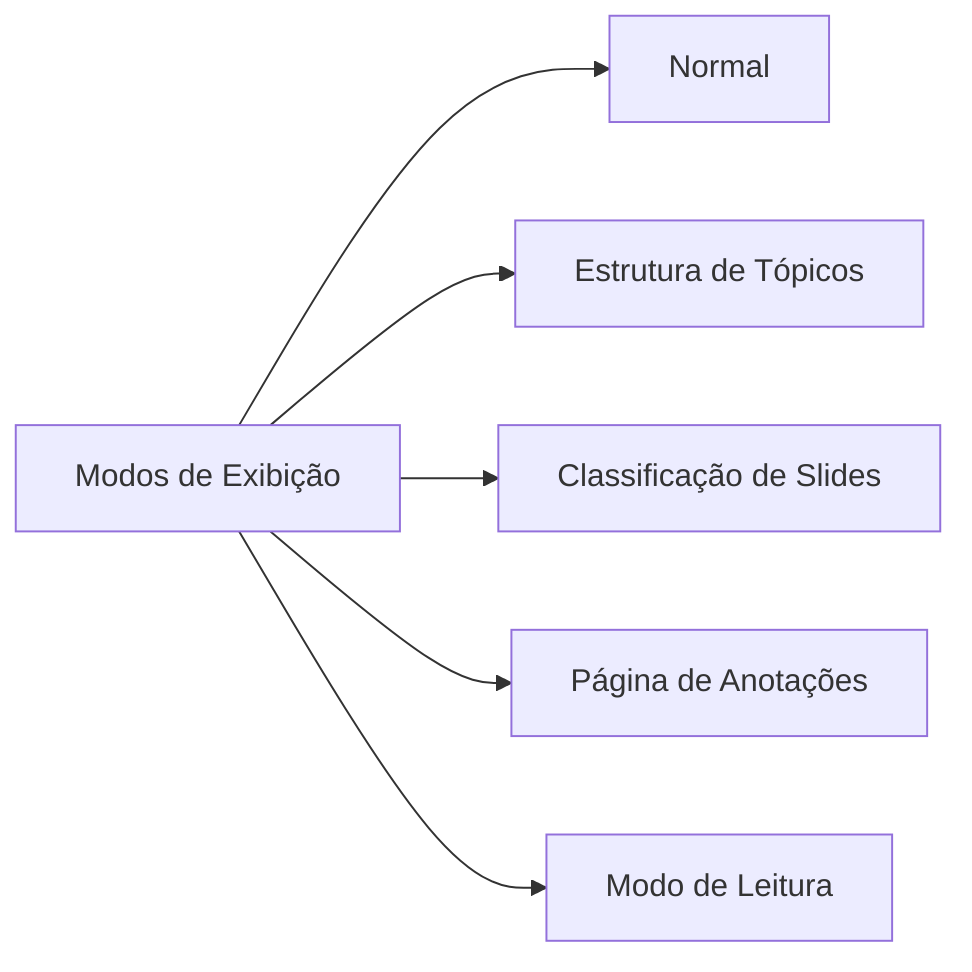
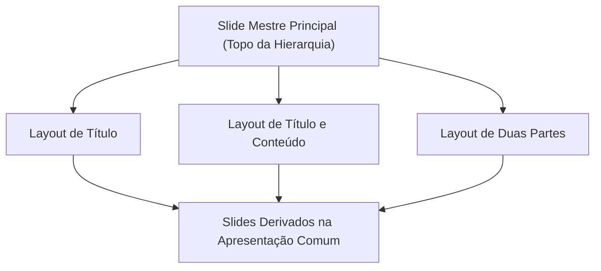
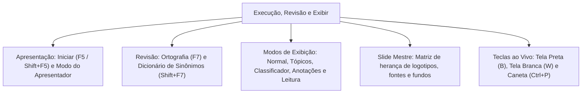

A condução segura de apresentações diante do público exige o domínio das ferramentas de execução, auditoria textual e estruturação mestre do Microsoft PowerPoint. Para o Oficial e os agentes de segurança pública, garantir a integridade dos slides e padronizar relatórios institucionais reflete a seriedade do trabalho operacional.

Nas provas de concurso público, as bancas cobram com frequência as teclas de atalho de execução (`F5` e `Shift + F5`). Exigem também as funções do Modo do Apresentador, a hierarquia propagadora do Slide Mestre e os cinco modos de exibição.

> [!objetivos]
> - Dominar os comandos de condução da Guia Apresentação de Slides.
> - Compreender a dinâmica do Modo de Exibição do Apresentador em um ou dois monitores.
> - Analisar as ferramentas de integridade linguística da Guia Revisão.
> - Diferenciar os cinco modos de exibição de apresentação da Guia Exibir.
> - Aplicar o conceito e a governança visual unificada do Slide Mestre.

## A Guia Apresentação de Slides e o Modo do Apresentador

A **Guia Apresentação de Slides** gerencia o comportamento da exibição perante a plateia ou em transmissões virtuais. Seus comandos dividem-se em grupos funcionais objetivos.

### Comandos de início e configuração
Os botões de início e temporização organizam o disparo das telas:
- **Do Começo (`F5`):** dispara a reprodução dos slides em tela cheia a partir do primeiro slide do arquivo.
- **Do Slide Atual (`Shift + F5`):** inicia a reprodução imediatamente a partir da tela que está selecionada na área de edição.
- **Apresentar Online:** transmite a sessão para visualização remota através de um navegador de internet.
- **Apresentação de Slides Personalizada:** permite criar uma seleção exclusiva de slides para exibição rápida sem apagar as demais telas do arquivo.
- **Ocultar Slide:** suprime telas específicas da reprodução perante o público sem excluí-las do documento.
- **Testar Intervalos:** grava o tempo gasto em cada tela para permitir exibições autônomas temporizadas.
- **Gravar Apresentação:** registra a voz do orador, gestos de ponteiro laser e avanço de telas.

### O Modo de Exibição do Apresentador
Ao conectar o computador a um segundo monitor ou projetor multimídia, o PowerPoint ativa automaticamente o **Modo do Apresentador**. Esse recurso divide a visualização em duas saídas independentes.
- **Telão do Público:** exibe apenas o slide corrente limpo em tela inteira, sem quaisquer menus ou distrações.
- **Tela Privada do Orador:** exibe o slide atual, uma miniatura do próximo slide que entrará em cena, cronômetro de tempo decordo, relógio do sistema, ferramentas de anotação na tela (caneta e ponteiro laser) e o texto completo do Painel de Anotações.

> [!bizu]
> **Atalhos Essenciais de Projeção**
> Memorize para o dia da prova:
> - `F5`: Inicia a apresentação a partir do primeiro slide.
> - `Shift + F5`: Inicia a apresentação a partir do slide ativo em edição.
> - `Alt + F5`: Aciona o Modo do Apresentador mesmo operando em monitor único.
> - Tecla `Esc`: Interrompe a apresentação e retorna à área de edição.

> [!atencao]
> **Navegação Rápida Durante a Apresentação**
> Durante a execução em tela cheia, o apresentador pode digitar o número de um slide e pressionar `Enter`. O programa salta imediatamente para o slide digitado.

## A Guia Revisão e a integridade do documento

A **Guia Revisão** concentra ferramentas voltadas para a correção ortográfica, acessibilidade, tradução e auditoria colaborativa:

- **Grupo Revisão de Texto:**
  - *Verificar Ortografia (`F7`):* varre todos os textos, caixas e notas em busca de falhas ortográficas e gramaticais.
  - *Dicionário de Sinônimos (`Shift + F7`):* oferece alternativas semânticas para enriquecer o vocabulário.
- **Grupo Acessibilidade:** executa o Verificador de Acessibilidade, identificando se imagens contêm texto alternativo para leitores de tela voltados a pessoas com deficiência visual.
- **Grupo Idioma:** permite traduzir termos selecionados pelo serviço Microsoft Translator e definir o idioma oficial do corretor ortográfico.
- **Grupo Comentários e Comparar:** viabiliza inserir anotações de equipe nos slides e comparar duas apresentações distintas, exibindo um painel lateral para aceitar ou rejeitar alterações propostas por revisores.

> [!pegadinha]
> **Atalhos F7 e Shift + F7**
> O atalho `F7` ativa a verificação ortográfica e gramatical em todos os aplicativos do Office. Já a combinação `Shift + F7` abre o Dicionário de Sinônimos. Não confunda com o início da apresentação, que utiliza a tecla `F5`.

## A Guia Exibir e os modos de visualização

A **Guia Exibir** regula a maneira como os slides e os elementos visuais de apoio são dispostos na tela do operador durante a preparação do material.

A tabela a seguir descreve os cinco modos de exibição de apresentação disponíveis no PowerPoint. Cada modo atende a uma fase do trabalho:

| Modo de Exibição | Disposição Visual na Tela | Principal Finalidade Prática |
| :--- | :--- | :--- |
| **Normal** | Miniaturas à esquerda e slide em edição ao centro | Modo padrão para diagramação de conteúdos |
| **Estrutura de Tópicos** | Texto hierárquico à esquerda e slide ao centro | Foco na redação discursiva de títulos e listas |
| **Classificação de Slides** | Grade panorâmica com miniaturas de todos os slides | Reorganizar ordem, excluir ou aplicar transições em lote |
| **Página de Anotações** | Slide reduzido acima e grande campo textual abaixo | Preparar roteiros detalhados para impressão física |
| **Modo de Exibição de Leitura** | Apresentação em tela redimensionável com controles | Testar animações em janela sem ocupar a tela inteira |

No grupo **Mostrar**, o usuário pode habilitar a Régua (`Shift + Alt + F9`), as Linhas de Grade (`Shift + F9`) e as Guias de alinhamento. No grupo **Cor/Escala de Cinza**, é possível simular previamente como os slides serão impressos em preto e branco.

> [!exemplo]
> **Classificação de Slides para Gestão em Bloco**
> Quando o operador precisa mover simultaneamente dez slides para o final da apresentação ou aplicar o mesmo tempo de transição a um grupo de telas, o modo mais eficiente é a **Classificação de Slides**. Nesse modo, os slides aparecem em matriz plana de miniaturas.

## O Slide Mestre e conceitos avançados de padronização (ONCEITOS VANÇADOS)

O **Slide Mestre** é o elemento estrutural mais poderoso para a governança visual corporativa no PowerPoint. Acessado em **Guia Exibir > Modos de Exibição Mestres > Slide Mestre**, ele atua como a matriz genética da apresentação.

Ao realizar alterações no Slide Mestre principal (no topo da hierarquia à esquerda), essas alterações propagam-se compulsoriamente para todos os slides comuns do arquivo. O usuário define nele os seguintes padrões visuais corporativos:
- Posição e dimensões de logotipos institucionais e marcas d'água obrigatórias.
- Família e cores de fontes tipográficas para títulos e corpos de texto.
- Cores de fundo e elementos decorativos de rodapés corporativos.
- Formato automático de numeração de páginas e data.

### Conceitos avançados de condução ao vivo
Durante a execução de apresentações críticas, o orador dispõe de teclas de comando ágeis. Os principais atalhos operacionais são:
- Tecla `B` ou ponto (`.`): projeta imediatamente uma **tela preta**, pausando a atenção visual da plateia para focar na fala do orador.
- Tecla `W` ou vírgula (`,`): projeta imediatamente uma **tela branca**.
- Tecla `Esc`: cancela a exibição a qualquer momento.
- `Ctrl + P`: transforma o cursor do mouse em uma **Caneta** para anotações dinâmicas sobre o slide.
- `Ctrl + A`: retorna o ponteiro para a **Seta** padrão do mouse durante a apresentação.
- `Ctrl + E`: aciona a **Borracha** para apagar desenhos feitos com a caneta.

> [!esquema]
> **Ponteiros Durante a Apresentação**
> Na condução ao vivo em tela cheia:
> - `Ctrl + P`: Ativa a Caneta de desenho livre.
> - `Ctrl + A`: Retorna para a Seta comum do mouse.
> - `Ctrl + E`: Seleciona a Borracha para apagar anotações.
> - `Ctrl + L`: Transforma o cursor em Ponteiro Laser digital.

> [!resolvido]
> **Exercício Resolvido: Padronização Corporativa e Apresentação**
> O comandante de um batalhão exige que todas as apresentações das seções contenham o brasão oficial da corporação no canto superior direito de todos os slides de conteúdo, sem que os operadores precisem colar a imagem manualmente em cada tela. Além disso, na reunião de oficiais, o apresentador precisará pausar a exibição projetando uma tela preta enquanto explica um ponto sigiloso. Como atender a essas exigências técnicas?
>
> **Resolução passo a passo:**
> 1. *Inserção obrigatória do brasão em todas as telas:* deve-se acessar o **Slide Mestre** (na Guia Exibir) e colar o brasão no slide mestre principal. A imagem será herdada automaticamente por todos os slides da apresentação.
> 2. *Projeção de tela preta durante a fala:* com a apresentação em tela cheia, o orador deve pressionar a tecla `B` ou a tecla de ponto (`.`). A tela fica inteiramente preta até que outra tecla seja pressionada.
>
> **Conclusão:** O brasão deve ser incluído no Slide Mestre e a tela preta é disparada pela tecla `B` durante a projeção.

## Mapa do capítulo

Neste capítulo, estudamos as técnicas de condução da Guia Apresentação de Slides, a operação do Modo do Apresentador, a auditoria na Guia Revisão, os cinco modos da Guia Exibir e a padronização centralizada pelo Slide Mestre.

### Para fixar
- O atalho `F5` inicia a apresentação a partir do primeiro slide; `Shift + F5` inicia do slide atual.
- O Modo do Apresentador exibe notas e relógio para o orador e apenas o slide limpo para o público.
- A tecla `F7` verifica a ortografia e gramática; `Shift + F7` abre o Dicionário de Sinônimos.
- O modo Classificação de Slides organiza as telas em grade plana para reorganização em bloco.
- O Slide Mestre propaga automaticamente alterações de layout, logotipos e fontes para todos os slides.
- A tecla `B` projeta tela preta e a tecla `W` projeta tela branca durante a apresentação.
- O atalho `Ctrl + P` transforma o ponteiro em caneta; `Ctrl + A` retorna o ponteiro para a seta.
- O comando Testar Intervalos grava a temporização necessária para exibições autônomas.
- O Modo de Exibição de Leitura executa a apresentação em janela redimensionável do Windows.
- Para cancelar e sair da apresentação em tela cheia a qualquer momento, usa-se a tecla `Esc`.
