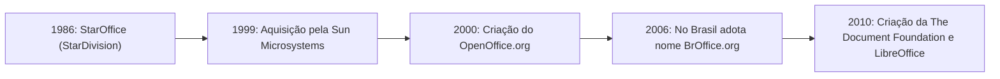
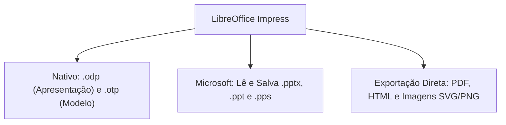
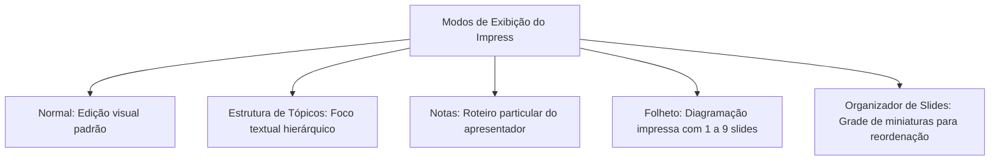
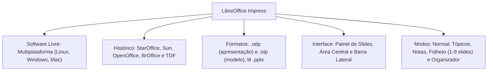

O LibreOffice Impress consolida-se como a principal solução livre e de código aberto para a criação e exibição de apresentações multimídia no serviço público brasileiro. Para o Oficial Bombeiro Militar e os agentes da Polícia Civil, compreender o Impress é vital, visto que muitos órgãos estaduais adotam padrões abertos para evitar custos de licenciamento e dependência de fornecedores.

Nas provas de concurso público, as bancas cobram as origens históricas do pacote, as extensões nativas do padrão OpenDocument, a arquitetura de sua área de trabalho e seus modos característicos de exibição.

> [!objetivos]
> - Compreender a filosofia de software livre e os componentes da suíte LibreOffice.
> - Conhecer a evolução histórica do StarOffice, OpenOffice.org, BrOffice e LibreOffice.
> - Dominar os formatos nativos de apresentação (.odp) e modelo (.otp).
> - Analisar a estrutura da interface gráfica, painel de slides e barras de ferramentas.
> - Diferenciar os cinco modos de exibição da Área de Trabalho do Impress.

## Fundamentos conceituais e a suíte LibreOffice (Conceitos Básicos)

O LibreOffice Impress é um software de autoria de apresentações visuais estruturadas em slides. Ele faz parte da suíte LibreOffice, um conjunto integrado de aplicativos de escritório distribuído sob licenças livres públicas. O software pode ser descarregado gratuitamente pela internet (http://www.libreoffice.org/download) para instalação ilimitada em ambientes corporativos ou governamentais, sem cobrança de taxas de adesão.

Ao contrário de pacotes comerciais que funcionam apenas em sistemas específicos, o LibreOffice é plenamente **multiplataforma**. Ele opera com paridade idêntica de ferramentas em distribuições GNU/Linux, Microsoft Windows e Apple macOS.

Cada aplicativo atende a uma demanda específica. O candidato deve ter atenção para não confundir o Impress com o Draw. O Draw é especializado em desenho técnico vetorial e cartazes, enquanto o Impress é o programa destinado exclusivamente a apresentações de slides dinâmicas.

> [!bizu]
> **Impress versus Draw**
> Em itens de concurso, as bancas costumam trocar as atribuições:
> - **LibreOffice Impress:** é o editor oficial de **apresentações de slides**.
> - **LibreOffice Draw:** é o editor de **desenhos vetoriais** e diagramas.
> - **LibreOffice Writer:** é o processador de **textos**.
> - **LibreOffice Calc:** é a planilha de **cálculos**.

## Contexto histórico: do StarOffice ao LibreOffice e o BrOffice

A trajetória do LibreOffice possui marcos históricos que caem reiteradamente em concursos:

O projeto teve início na década de 1980 na Alemanha, idealizado pelo jovem programador Marco Boerries. Ele fundou a empresa StarDivision em 1986 e desenvolveu o StarOffice. Em 1999, a empresa Sun Microsystems adquiriu os direitos tecnológicos da suíte. No ano 2000, a Sun abriu o código-fonte sob o projeto OpenOffice.org, criando uma alternativa livre à hegemonia do Microsoft Office.

No Brasil, ocorreu um episódio singular em 2006. Uma empresa do Rio de Janeiro alegou deter registro prévio de marca semelhante ao nome Open Office. Por essa razão jurídica, a versão brasileira foi rebatizada oficialmente como **BrOffice.org** com apoio de voluntários nacionais.

Em 2010, após a Oracle comprar a Sun Microsystems, a comunidade global de desenvolvedores temeu o fechamento do projeto e fundou uma entidade independente: a **The Document Foundation (TDF)**. Sob a liderança da TDF, a suíte ganhou o nome definitivo e hegemônico de **LibreOffice**. Em 2011, a associação brasileira BrOffice foi extinta e todo o seu patrimônio foi transferido para a consolidação global do LibreOffice.

| Marco Temporal | Entidade Gestora | Denominação do Software | Observação Relevante |
| :--- | :--- | :--- | :--- |
| **1986** | StarDivision (Marco Boerries) | StarOffice | Criação original na Alemanha |
| **1999 / 2000** | Sun Microsystems | OpenOffice.org | Abertura do código-fonte público |
| **2006** | Comunidade Brasil | BrOffice.org | Nome restrito ao Brasil por disputa marcária |
| **2010 em diante** | The Document Foundation (TDF) | LibreOffice | Entidade independente e nome hegemônico |

> [!atencao]
> **BrOffice e The Document Foundation**
> A expressão BrOffice refere-se ao projeto brasileiro extinto em 2011. Hoje, o pacote oficial é mantido pela The Document Foundation e denomina-se exclusivamente **LibreOffice**.

## O padrão ODF e a interoperabilidade de arquivos (Visão Geral)

O LibreOffice Impress adota como padrão mandatário o formato aberto **OpenDocument Format (ODF)**, padronizado internacionalmente pela norma ISO/IEC.

Os formatos nativos do Impress são:
- **.odp (*OpenDocument Presentation*):** extensão padrão de apresentações de slides comuns.
- **.otp (*OpenDocument Presentation Template*):** extensão padrão de modelos de apresentação pré-formatados.

Além dos formatos abertos ODF, o Impress oferece excelente interoperabilidade:
- Lê, edita e salva arquivos proprietários do Microsoft PowerPoint, incluindo formatos modernos (`.pptx`) e formatos legados (`.ppt` e `.pps`).
- Exporta apresentações diretamente em formato portátil **PDF** sem necessidade de programas adicionais ou impressoras virtuais.
- Converte os slides para páginas da Web em **HTML**, animações em arquivos vetoriais e imagens digitais (.png, .jpg, .svg).

> [!pegadinha]
> **Extensões ODF da Suíte LibreOffice**
> Guarde as extensões oficiais para não errar em prova:
> - Impress: `.odp` (apresentação) e `.otp` (modelo)
> - Writer: `.odt` (texto) e `.ott` (modelo)
> - Calc: `.ods` (planilha) e `.ots` (modelo)
> A letra final indica a função: **P** de *Presentation*, **T** de *Text*, e **S** de *Spreadsheet*.

## Arquitetura da interface e Área de Trabalho

A interface do Impress é dividida em três regiões estruturais principais:

1. **Painel de Slides (Margem Esquerda):** exibe miniaturas verticais de todos os slides da apresentação. Permite navegar com cliques simples, reordenar a sequência de telas por arrasto com o mouse, criar novos slides e marcar slides como ocultos.
2. **Área de Trabalho (Região Central):** espaço de manipulação gráfica dos textos, desenhos e mídias do slide ativo.
3. **Barra Lateral (Margem Direita):** painel sanfonado que reúne propriedades do slide, transições, animações, estilos e o navegador de objetos.

As barras de botões do programa podem ser exibidas ou ocultadas acessando o menu **Exibir > Barras de Ferramentas**. O operador pode fixá-las nas bordas da janela ou mantê-las como janelas flutuantes.

## Modos de exibição da Área de Trabalho

Na parte superior da Área de Trabalho, o operador encontra abas que alternam entre cinco modos de exibição fundamentais:

- **Modo Normal:** ambiente de trabalho padrão focado na diagramação visual, desenho de formas e digitação de textos em cada slide individual.
- **Modo Estrutura de Tópicos:** exibe apenas os textos e títulos dos slides em hierarquia corrida. Ignora imagens e caixas livres para facilitar a redação conceitual.
- **Modo Notas:** divide a tela entre o slide em tamanho menor e um campo de anotações abaixo. Esse campo serve de roteiro para o expositor e não aparece na projeção principal.
- **Modo Folheto (*Handout*):** prepara a impressão em papel para distribuição ao público ouvinte. Permite escolher o número de miniaturas agrupadas por folha física, com opções para **1, 2, 3, 4, 6 ou 9 slides por página**.
- **Modo Organizador de Slides (Classificador):** apresenta todos os slides em matriz plana de miniaturas. Facilita a movimentação de grupos de telas e a aplicação em lote de transições de slides.

> [!esquema]
> **Variações no Modo Folheto**
> Ao preparar folhetos para impressão no Impress, o painel de propriedades permite selecionar as opções de 1, 2, 3, 4, 6 ou 9 slides por folha. O modelo de 3 slides por página inclui linhas pautadas ao lado de cada miniatura para que o ouvinte faça anotações manuais.

> [!resolvido]
> **Exercício Resolvido: Modos de Trabalho e Formatos do Impress**
> Um perito criminal precisa elaborar uma apresentação de laudo pericial utilizando o LibreOffice Impress em sistema operacional Linux. Ele precisa que o arquivo seja salvo no formato aberto internacional padrão e deseja preparar um material impresso para entregar aos juízes, contendo três miniaturas de slides por folha com linhas para anotações. Qual formato nativo ele deve utilizar e qual modo de exibição atende à impressão dos folhetos?
>
> **Resolução passo a passo:**
> 1. *Formato nativo de apresentação:* o padrão aberto do LibreOffice Impress amparado pela norma ODF é a extensão `.odp`.
> 2. *Modo de exibição para impressão de lâminas:* o modo especializado em diagramar múltiplos slides por folha física chama-se **Modo Folheto**. Ele dispõe de layout nativo com 3 slides por folha acompanhados de linhas de apontamento.
>
> **Conclusão:** O perito utilizará o formato `.odp` e o **Modo Folheto**.

## Mapa do capítulo

Neste capítulo, estudamos a natureza de software livre do LibreOffice Impress, seu resgate histórico do StarOffice e BrOffice até a The Document Foundation, as extensões ODF (.odp e .otp), a divisão da interface gráfica e os cinco modos da Área de Trabalho.

### Para fixar
- O LibreOffice Impress é o aplicativo livre multiplataforma especializado em apresentações.
- A suíte é mantida pela entidade independente The Document Foundation desde 2010.
- No Brasil, o projeto chamou-se BrOffice.org entre 2006 e 2011 devido a litígio de marca comercial.
- A extensão nativa padrão de apresentações é `.odp` e a de modelos é `.otp`.
- O Impress lê, edita e salva apresentações nos formatos `.pptx` e `.ppt` do Microsoft PowerPoint.
- O aplicativo permite exportar diretamente em formato PDF sem necessidade de softwares adicionais.
- A interface gráfica organiza-se em Painel de Slides à esquerda, Área de Trabalho e Barra Lateral.
- As barras de ferramentas podem ser ativadas em Exibir > Barras de Ferramentas.
- O Modo Folheto permite diagramar 1, 2, 3, 4, 6 ou 9 slides por folha para impressão física.
- O Modo Organizador de Slides dispõe as miniaturas em grade para reordenação rápida de telas.
