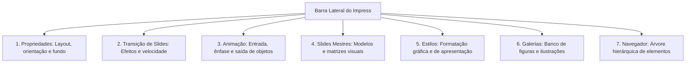
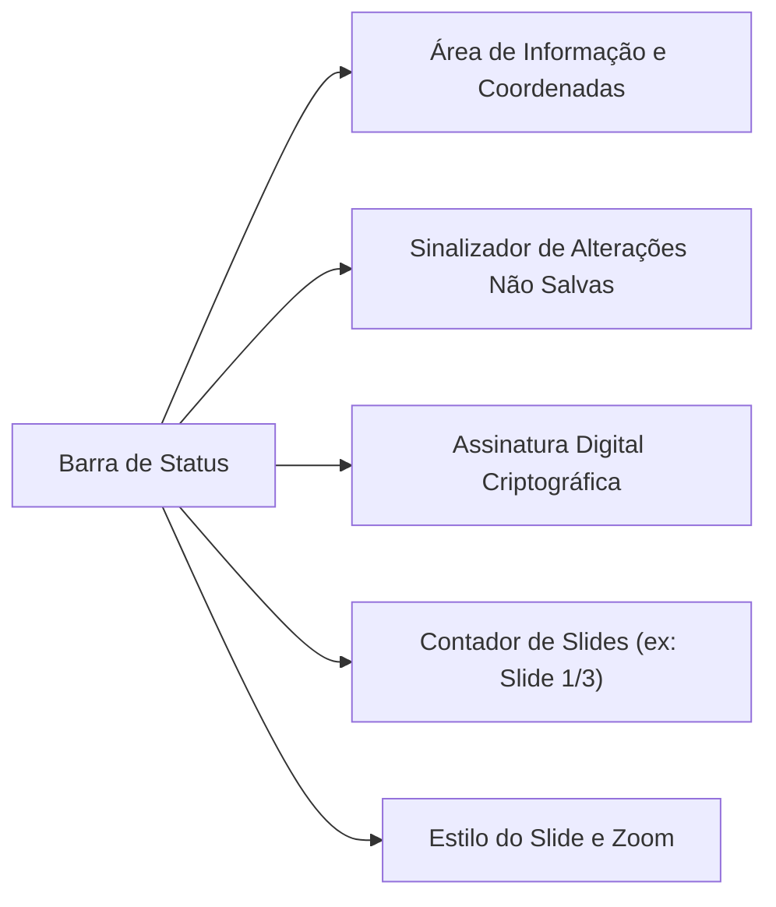
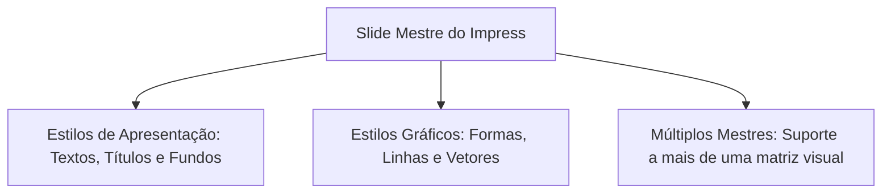
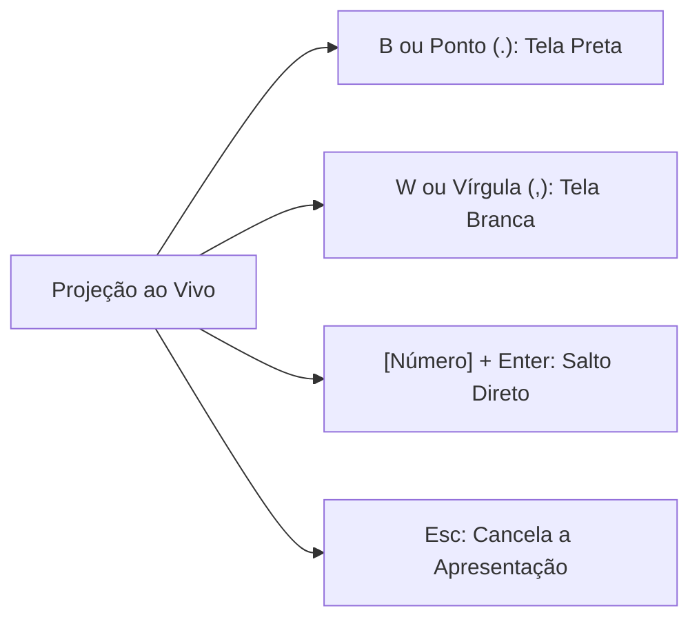
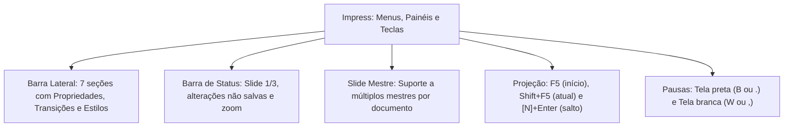

A operação avançada do LibreOffice Impress exige familiaridade com seus componentes de controle lateral, seus menus clássicos e os atalhos operacionais de condução ao vivo. Para quem apresenta no serviço público, dominar esses comandos garante apresentações fluidas e total controle técnico da exibição.

Nas provas de concurso público, as bancas cobram a estrutura das sete seções da Barra Lateral. Exigem também os indicadores da Barra de Status, a possibilidade de múltiplos slides mestres e as teclas de atalho de projeção.

> [!objetivos]
> - Mapear as sete seções temáticas verticais da Barra Lateral do Impress.
> - Interpretar as métricas operacionais e campos da Barra de Status.
> - Compreender a navegação na Barra de Menus clássica, incluindo o Menu Ajuda.
> - Aplicar funcionalidades básicas no gerenciamento de slides ocultos e transições de tela.
> - Memorizar a lista oficial de atalhos de teclado para condução e edição ao vivo.

## A Barra Lateral e o Painel de Slides

Diferente do padrão de Faixa de Opções (Ribbon) do pacote da Microsoft, o LibreOffice Impress preserva a interface clássica. Ele conta com uma poderosa **Barra Lateral** expansível à direita da tela.

A Barra Lateral organiza-se em sete seções temáticas representadas por ícones verticais. Apenas uma seção permanece expandida por vez:

Na margem esquerda, o **Painel de Slides** exibe a sequência de miniaturas em ordem cronológica de exibição. Clicando com o botão direito sobre uma miniatura, o operador executa ações rápidas:
- Inserir Novo Slide, Duplicar Slide ou Excluir Slide.
- Renomear Slide e modificar o Layout do Slide.
- **Ocultar Slide:** suprime a tela da reprodução formal diante do público. A miniatura do slide oculto permanece visível na área de edição do operador, recebendo uma marcação hachurada diagonal característica.

> [!bizu]
> **Slide Oculto no Impress**
> O comando Ocultar Slide não apaga o slide da apresentação. A tela continua no arquivo para edição. Durante a projeção com `F5`, o software pula o slide oculto sem exibi-lo ao público.

## A Barra de Status e seus indicadores operacionais

Situada no rodapé inferior da janela do aplicativo, a **Barra de Status** desempenha papel de monitoramento dinâmico contínuo do documento.

A tabela a seguir descreve os principais campos da Barra de Status do Impress e a reação ao duplo clique do mouse:

| Campo na Barra de Status | Conteúdo e Função Técnica | Comportamento ao Duplo Clique |
| :--- | :--- | :--- |
| **Área de Informação** | Identifica o objeto ou trecho selecionado na tela | Alterna propriedades do elemento |
| **Coordenadas de Posição** | Coordenadas cartesianas a partir do canto superior | Abre painel dimensional de Posição |
| **Alterações Não Salvas** | Ícone que indica modificações pendentes no arquivo | Abre a caixa de diálogo Salvar Arquivo |
| **Assinatura Digital** | Sinalizador de autenticidade criptográfica do documento | Abre a janela de Assinaturas Digitais |
| **Número do Slide** | Posição ordinal e total de páginas (ex.: `Slide 1/3`) | Aciona o Navegador para saltos rápidos |
| **Estilo do Slide** | Nome do modelo gráfico vinculado à tela ativa | Abre o gerenciador de Modelos de Slide |
| **Zoom e Escala** | Controle deslizante e percentual numérico de ampliação | Abre a janela de personalização de Zoom |

> [!atencao]
> **Indicador de Alterações Pendentes**
> Se houver modificações recentes no documento que ainda não foram gravadas em disco, a Barra de Status exibe um pequeno indicador visual em forma de disquete. Um duplo clique nesse ponto aciona imediatamente o salvamento.

## Funcionalidades básicas e menus do sistema

O LibreOffice Impress preserva a tradicional **Barra de Menus** superior para acionamento de comandos operacionais:
- **Menu Arquivo:** criação de novos documentos, abertura de apresentações existentes, salvamento (`Ctrl + S`), exportação direta em formato PDF e propriedades globais.
- **Menu Exibir:** alternância de modos de visualização, ativação da Barra Lateral e acesso ao caminho *Mestre > Slide Mestre*.
- **Menu Inserir:** adição de tabelas, imagens externas, formas geométricas, arquivos de mídia e hiperlinks (`Ctrl + K`).
- **Menu Formatar:** ajustes tipográficos, espaçamento entre linhas, recuos de parágrafo e alinhamento de objetos visuais.
- **Menu Ferramentas:** verificação ortográfica e gramatical (`F7`), gerenciamento de macros e opções personalizadas do usuário.
- **Menu Apresentação de Slides:** comandos de disparo de projeção, temporização de intervalos e configuração geral da exibição.
- **Menu Ajuda:** fornece manuais oficiais de operação, guias de usuário, atalhos de consulta rápida (`F1`) e informações de versão da suíte.

### A governança do Slide Mestre
Acessado pelo caminho **Exibir > Mestre > Slide Mestre**, o Slide Mestre define a matriz estrutural básica de toda a apresentação. Elementos inseridos no slide mestre (como brasões, logomarcas, tipografias e rodapés) propagam-se compulsoriamente a todos os slides dependentes.

Diferentemente de ferramentas mais rígidas, o LibreOffice Impress admite a utilização de **múltiplos slides mestres** em um mesmo arquivo. Isso permite que seções distintas da apresentação adotem identidades visuais próprias com total independência.

Entre as funcionalidades básicas do programa, seus estilos dividem-se em dois grandes grupos:
- *Estilos de Apresentação:* afetam plano de fundo, títulos principais e marcadores textuais da estrutura.
- *Estilos Gráficos:* formatam linhas, formas geométricas e contornos de desenhos vetoriais.

> [!pegadinha]
> **Múltiplos Slides Mestres no Impress**
> Questões de concurso costumam afirmar que o Impress suporta apenas um único slide mestre por arquivo. Essa afirmação é incorreta. O programa aceita a criação de múltiplos slides mestres com total independência entre seções.

## Lista oficial de atalhos e teclas de projeção (Lista de Atalhos)

O conhecimento dos atalhos de teclado é decisivo para a resolução rápida de itens de concurso. No Impress, os comandos operacionais subdividem-se entre controles de projeção e tarefas de edição:

### Controles de projeção durante a apresentação ao vivo
- Tecla `F5`: Dispara a apresentação em tela inteira a partir do **primeiro slide** da sequência.
- Combinação `Shift + F5`: Inicia a apresentação imediatamente a partir do **slide atual**.
- Tecla `Esc`: Finaliza a projeção a qualquer momento e retorna à área de edição.
- `Barra de Espaço`, `Enter` ou `Page Down`: Avança para o próximo efeito de animação ou passa para o próximo slide.
- `Backspace` ou `Page Up`: Retrocede para o efeito anterior ou para o slide precedente.
- `Alt + Page Down` / `Alt + Page Up`: Avança ou retrocede de slide sem executar as animações intermediárias de objetos.
- `[Número] + Enter`: Salta instantaneamente para o slide correspondente ao número digitado no teclado.
- Tecla `B` ou ponto (`.`): Projeta uma **tela preta**, pausando a imagem para concentrar a atenção no orador.
- Tecla `W` ou vírgula (`,`): Projeta uma **tela branca** temporária.

### Principais atalhos de edição no Impress
- Tecla `F2`: Ativa o modo de edição de texto dentro de uma caixa selecionada.
- Combinação `Shift + F3`: Duplica o objeto selecionado no slide.
- Tecla `F4`: Abre a janela de Posição e Tamanho exatos do elemento gráfico.
- Tecla `F7`: Aciona a verificação ortográfica e gramatical do documento.
- Combinação `Ctrl + S`: Grava as modificações no arquivo (`Ctrl + S` de Salvar no padrão LibreOffice).
- Combinação `Ctrl + Q`: Encerra o aplicativo LibreOffice.

> [!bizu]
> **Tela Preta e Tela Branca no Impress**
> Memorize para não errar em provas:
> - Tela preta: tecla `B` (de *Black*) ou a tecla de ponto (`.`).
> - Tela branca: tecla `W` (de *White*) ou a tecla de vírgula (`,`).
> Esse comportamento é idêntico entre o LibreOffice Impress e o Microsoft PowerPoint.

> [!resolvido]
> **Exercício Resolvido: Condução de Palestra no Auditório com Impress**
> Em uma palestra institucional para a comunidade sobre prevenção de incêndios residenciais, o palestrante militar está utilizando o LibreOffice Impress. Durante a explanação no slide 4, ele precisa: (1) pausar temporariamente a projeção escurecendo o telão com uma tela preta enquanto responde à dúvida de um cidadão; e (2) em seguida, saltar diretamente para o slide 12 sem passar pelos slides intermediários. Quais comandos de teclado devem ser utilizados pelo palestrante?
>
> **Resolução passo a passo:**
> 1. *Escurecer a projeção com tela preta:* o palestrante deve pressionar a tecla `B` ou a tecla de ponto (`.`). A tela do telão ficará totalmente preta.
> 2. *Saltar diretamente para o slide 12:* para navegar diretamente para uma tela específica durante a exibição, o comando padrão é digitar o número do slide seguido da tecla de confirmação. Logo, o palestrante deve digitar `12` e pressionar `Enter`.
>
> **Conclusão:** O palestrante utilizará a tecla `B` (ou ponto) e a combinação `12 + Enter`.

## Mapa do capítulo

Neste capítulo final, estudamos a estrutura das sete seções da Barra Lateral do Impress, os indicadores dinâmicos da Barra de Status, a Barra de Menus clássica com o Menu Ajuda, as funcionalidades básicas do Slide Mestre e a lista completa de atalhos de projeção e edição.

### Para fixar
- A Barra Lateral do Impress agrupa sete seções verticais à direita da área de desenho.
- O comando Ocultar Slide mantém a tela no arquivo com marcação hachurada e não a projeta.
- A Barra de Status revela a numeração de páginas (ex.: `Slide 1/3`) e o sinalizador de arquivo pendente.
- A tecla `Ctrl + S` salva a apresentação no padrão clássico da suíte LibreOffice.
- O Slide Mestre padroniza fundos e fontes, admitindo mais de uma matriz mestre por arquivo.
- O atalho `F5` inicia a apresentação do começo; `Shift + F5` inicia a partir do slide atual.
- A tecla `B` ou ponto (`.`) projeta tela preta; a tecla `W` ou vírgula (`,`) projeta tela branca.
- Digitar o número de um slide seguido de `Enter` salta diretamente para a tela desejada na exibição.
- O atalho `F2` ativa a edição de texto dentro de caixas selecionadas no slide.
- O atalho `F7` executa a verificação ortográfica e `Esc` finaliza a apresentação em tela cheia.
