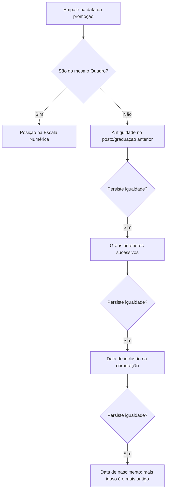
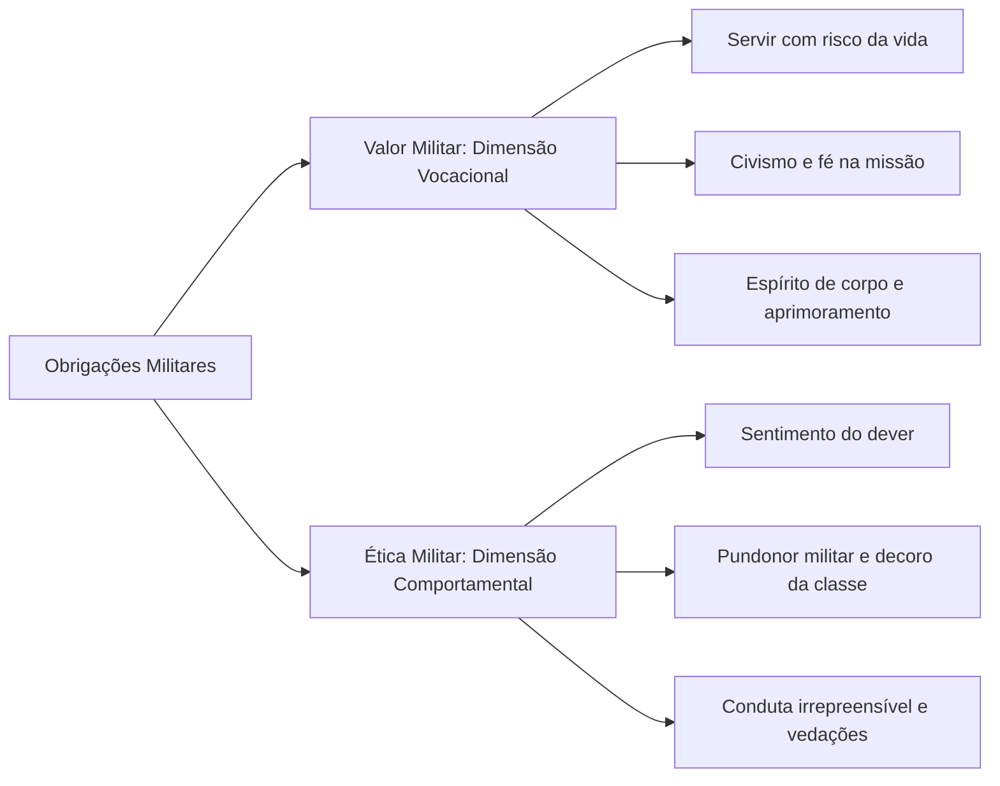

O Estatuto dos Militares do Estado de Pernambuco (Lei Estadual nº 6.783/1974) rege os integrantes da Polícia Militar e do Corpo de Bombeiros Militar de Pernambuco. Este capítulo inaugural examina as bases da carreira militar: a hierarquia e a disciplina, os círculos hierárquicos e seus graus, as regras de precedência e desempate de antiguidade, o regime de cargo e função e os deveres fundamentais de valor e ética militar.

> [!objetivos]
> - Distinguir os conceitos legais de hierarquia e disciplina militar e seu alcance funcional.
> - Classificar os círculos hierárquicos, postos, graduações e competências para outorga.
> - Aplicar a ordem legal de desempate de antiguidade e as regras de precedência.
> - Diferenciar cargo e função militar, reconhecendo as hipóteses de vacância de pleno direito.
> - Diferenciar valor e ética militar, identificando as vedações comerciais e de manifestação.

## Hierarquia e disciplina como pilares institucionais

A **hierarquia** e a **disciplina** constituem a base institucional das corporações militares de Pernambuco. Desse postulado decorre o princípio de que a **autoridade** e a **responsabilidade** crescem com a elevação do grau hierárquico.

A **hierarquia militar** é a ordenação da autoridade em níveis diferentes na corporação, por postos e graduações. Em igualdade de grau, a ordem decorre da **antiguidade**.

A **disciplina militar** é o cumprimento rigoroso e integral das leis, regulamentos e ordens que sustentam a corporação, traduzindo-se no cumprimento do dever por cada integrante.

> [!lei] Lei Estadual nº 6.783/1974, art. 12
> A hierarquia e a disciplina são a base institucional da Polícia Militar. A autoridade e a responsabilidade crescem com o grau hierárquico.
> § 1º A hierarquia policial-militar é a ordenação de autoridade em níveis diferentes, dentro da estrutura da Polícia Militar. A ordenação se faz por postos ou graduações; dentro de um mesmo posto ou de uma mesma graduação se faz pela antiguidade no posto ou na graduação. O respeito à hierarquia é consubstanciado no espírito de acatamento à seqüência de autoridade.
> § 2º Disciplina é a rigorosa observância e o acatamento integral das leis, regulamentos, normas e disposições que fundamentam o organismo policial-militar e coordenam seu funcionamento regular e harmônico, traduzindo-se pelo perfeito cumprimento do dever por parte de todos e de cada um dos componentes desse organismo.
> § 3º A disciplina e o respeito à hierarquia devem ser mantidos em todas as circunstâncias da vida, entre policiais-militares da ativa, da reserva remunerada e reformados.

A disciplina e a hierarquia vinculam os militares em **todas as circunstâncias da vida**, alcançando a ativa, a reserva remunerada e os reformados (art. 12, § 3º).

> [!pegadinha]
> A banca costuma afirmar que os deveres de disciplina e respeito à hierarquia aplicam-se apenas aos militares em serviço operacional ativo. Isso está errado: o art. 12, § 3º, estende esses deveres aos militares da ativa, da reserva remunerada e aos reformados, inclusive na vida privada.

### Círculos hierárquicos e autoridades concedentes

Os **círculos hierárquicos** são âmbitos de convivência para militares de mesma categoria, visando desenvolver a camaradagem, estima e confiança recíproca. O círculo **não serve para hierarquizar**: sua função principal é a integração social interna.

A escala hierárquica divide-se entre o Círculo de Oficiais e o Círculo de Praças, conforme a tabela a seguir:

| Círculo Hierárquico | Componentes da Categoria | Espécie de Grau | Autoridade Competente |
| --- | --- | --- | --- |
| Oficiais Superiores | Coronel, Tenente-Coronel e Major | Posto | Governador do Estado |
| Oficiais Intermediários | Capitão | Posto | Governador do Estado |
| Oficiais Subalternos | Primeiro-Tenente e Segundo-Tenente | Posto | Governador do Estado |
| Subtenentes e Sargentos | Subtenente, Primeiro-Sargento, Segundo-Sargento e Terceiro-Sargento | Graduação | Comandante-Geral |
| Cabos e Soldados | Cabo e Soldado | Graduação | Comandante-Geral |

O **posto** é o grau hierárquico conferido ao oficial por ato privativo do **Governador do Estado**. A **graduação** é o grau privativo da praça, conferido por portaria do **Comandante-Geral**.

### Praças especiais

As **praças especiais** compreendem o **Aspirante-a-Oficial** e o **Aluno-Oficial** (cadete). O Aluno-Oficial é declarado Aspirante por portaria do **Comandante-Geral**, e não do Governador.

O Aspirante-a-Oficial frequenta o Círculo de Oficiais. O Aluno-Oficial só tem acesso a esse círculo em caráter excepcional ou em solenidades e reuniões sociais.

## Precedência hierárquica e contagem de antiguidade

A **precedência** assegura primazia na ordem de autoridade entre militares de mesmo grau hierárquico, sendo determinada pela **antiguidade**, ressalvados os casos de precedência funcional estipulados em lei ou regulamento próprio.

O cômputo da antiguidade no posto ou na graduação tem como marco inicial a **data da assinatura do respectivo ato** de promoção, declaração, nomeação ou inclusão, salvo quando a própria norma designar expressamente outra data de vigência retroativa.

### Critérios legais de desempate de antiguidade

Havendo absoluta igualdade na data do ato de promoção de dois ou mais militares, a precedência resolve-se pela aplicação sucessiva dos seguintes critérios:

1. **Mesmo Quadro**: posição nas escalas numéricas ou almanaques da corporação.
2. **Quadros distintos**: antiguidade comprovada no posto ou na graduação anterior.
3. **Persistência do empate**: antiguidade nos graus hierárquicos anteriores sucessivos.
4. **Persistência histórica**: data da inclusão inicial na corporação militar.
5. **Critério final**: data de nascimento, considerando-se **mais antigo o de maior idade**.

Para os alunos de um mesmo órgão de formação de policiais-militares, a antiguidade é regulada de acordo com o regulamento do respectivo órgão (art. 15, § 2º, c), se não estiverem especificamente enquadrados nos critérios de escalas numéricas ou postos anteriores.

> [!bizu]
> Memorize a sequência de desempate com o mnemônico **E-G-I-N**:
> - **E**scala numérica (mesmo quadro);
> - **G**raus precedentes sucessivos;
> - **I**nclusão original na força;
> - **N**ascimento (o mais velho prevalece).

### Precedência em situações especiais e praças especiais

O Estatuto estabelece regras fixas de precedência entre diferentes situações jurídicas funcionais:

| Situação em Confronto | Regra de Precedência | Previsão Estatutária |
| --- | --- | --- |
| Ativa versus Inatividade | Militares da ativa têm precedência sobre os inativos em igualdade de grau | Art. 15, § 3º |
| Carreira na Ativa versus Reserva Convocada | Em igualdade de grau, define-se pelo tempo de efetivo serviço no grau | Art. 15, § 4º |
| Aspirante-a-Oficial versus Praças | O Aspirante-a-Oficial é superior a todas as demais praças | Art. 16, I |
| Aluno-Oficial versus Praças | O Aluno-Oficial é hierarquicamente superior aos Subtenentes e demais praças | Art. 16, II |

O militar da reserva ou reformado, ao utilizar formalmente seu posto ou graduação em atos públicos autorizados, deve obrigatoriamente apor a menção expressa de sua condição de inatividade.

## Cargo e função militares: provimento, exercício e vacância

O regime de atribuições militares apoia-se na diferenciação precisa entre cargo e função.

O **cargo militar** é a unidade institucional criada por lei e detalhada nos Quadros de Organização, caracterizada por um conjunto determinado de atribuições, deveres e responsabilidades que se constituem em obrigações do titular. Trata-se de posição estática que **somente pode ser ocupada por militar em serviço ativo**. As atribuições do cargo devem guardar estrita compatibilidade com o respectivo grau hierárquico.

A **função militar** consiste no exercício prático das obrigações inerentes ao cargo correspondente. O provimento opera-se por ato de **nomeação**, **designação** ou **determinação expressa** da autoridade competente, fazendo o militar jus aos direitos e vantagens legais.

> [!exemplo]
> O Capitão Eduardo, bombeiro militar da ativa, é designado para o cargo de Comandante da 2ª Seção de Bombeiros em Caruaru. Ao assumir o posto de trabalho, exerce a função de comando de bombeiros, respondendo pelo serviço e pela prontidão operacional de sua guarnição.

### Vacância de cargo militar

O cargo torna-se legalmente vago:
1. Desde a sua criação em lei até a posse regular de seu primeiro titular.
2. Desde o instante em que o ocupante anterior, exonerado, dispensado ou transferido por determinação expressa, deixa fisicamente o cargo, perdurando até a posse do sucessor.

Existem ainda três hipóteses expressas em que a **vacância opera de pleno direito**, independentemente da designação imediata de um substituto:

| Hipótese de Vacância sem Sucessor | Momento da Configuração | Consequência Funcional |
| --- | --- | --- |
| Falecimento | Ocorre no instante comprovado do óbito | Abertura imediata de vaga |
| Extravio | Paradeiro ignorado por mais de trinta dias | Abertura imediata de vaga |
| Deserção | Ausência ilegal e injustificada superior a oito dias | Abertura imediata de vaga |

As tarefas que não justificam a criação de vaga permanente em Quadro de Organização são desempenhadas como **encargo**, **incumbência**, **comissão**, **serviço** ou **atividade**, aplicando-se-lhes o regramento do cargo militar no que couber.

## Obrigações militares: valor, ética e vedações de conduta

As obrigações militares fundamentam-se em dois vetores normativos autônomos previstos no Estatuto: o valor militar e a ética militar.

O **valor militar** (art. 26) traduz a dimensão vocacional, cívica e institucional da carreira das armas, manifestando-se por:
- O sentimento de servir à coletividade, com dedicação integral à manutenção da ordem e segurança pública, mesmo com risco da própria vida.
- O civismo patriótico e o culto reverente às tradições históricas.
- A fé convicta na elevada missão da corporação militar.
- O espírito de corpo e o orgulho institucional pela organização militar.
- O amor e o entusiasmo pelo exercício da profissão militar.
- O aprimoramento técnico e a constante qualificação profissional.

A **ética militar** (art. 27) reflete a dimensão comportamental e deontológica, emanando de três bases fundamentais: o **sentimento do dever**, o **pundonor policial-militar** e o **decoro da classe**. Tais pilares impõem a cada oficial e praça conduta moral e funcional irrepreensível.

Dentre os preceitos éticos enumerados no art. 27, sobressaem: amar a verdade e a retidão, respeitar a dignidade humana, exercer o comando com autoridade e probidade, julgar subordinados com justiça, abster-se de obter facilidades pessoais valendo-se do posto ou da graduação e proceder de modo ilibado tanto na esfera pública quanto na vida privada.

### Abstenção do uso de designações pelo inativo

Para resguardar a respeitabilidade das corporações militares estaduais, o art. 27, inciso XVIII, veda expressamente ao militar inativo o uso de seus postos ou graduações nas seguintes circunstâncias:
- Em atividades político-partidárias de qualquer natureza;
- No desempenho de atividades comerciais;
- No exercício de atividades industriais;
- Para suscitar debates na imprensa sobre assuntos políticos ou militares, ressalvada matéria exclusivamente técnica devidamente autorizada;
- No exercício de funções de natureza civil, ainda que de caráter oficial.

### Vedações negociais e patrimoniais

O art. 28 disciplina as restrições patrimoniais e comerciais aplicáveis aos militares estaduais. Ao **militar da ativa** é expressamente vedado (art. 28, caput):
- Comerciar;
- Tomar parte na administração ou gerência de sociedade;
- Ser sócio ou participar de sociedade, salvo exclusivamente como acionista em sociedade anônima ou quotista em sociedade por quotas de responsabilidade limitada.

A lei não proíbe apenas exercer a gerência: veda ser sócio ou participar de qualquer outra espécie societária. Em sociedades anônimas ou por quotas de responsabilidade limitada, o militar ativo pode figurar unicamente como investidor (acionista ou quotista), sem praticar atos de gestão.

Além disso, os militares da **reserva remunerada, quando convocados**, ficam proibidos de tratar de interesses de organizações ou empresas privadas nas organizações militares e repartições públicas civis (art. 28, § 1º).

É facultada ao militar da ativa a gestão direta de seus bens particulares (art. 28, § 2º), desde que não infrinja as proibições legais. Aos integrantes do Quadro de Saúde é permitido o exercício da atividade técnico-profissional no meio civil (art. 28, § 3º), desde que essa prática não prejudique o serviço militar.

Por fim, o **Comandante-Geral** pode determinar aos militares da ativa que informem sobre a origem e a natureza dos seus bens, sempre que houver razões que recomendem essa salvaguarda da dignidade funcional (**art. 29**).

| Situação Funcional | Permissões Legais | Proibições Expressas |
| --- | --- | --- |
| Militar da Ativa | Ser acionista de S.A. ou quotista de sociedade limitada; gerir o patrimônio próprio; atuar na saúde civil se pertencer ao Quadro de Saúde | Comerciar; gerir ou administrar sociedade; ser sócio ou participar de sociedade fora das exceções legais |
| Reserva Convocada | Exercer as funções para as quais foi convocado; gerir seus bens particulares | Tratar de interesses de empresas privadas nas organizações militares e repartições públicas (art. 28, § 1º) |
| Militar Inativo | Atuar livremente em comércio ou indústria na vida privada civil; usar insígnias em cerimônias com menção à inatividade | Utilizar posto ou graduação em propagandas político-partidárias, atividades mercantis ou debates na imprensa sem autorização |

> [!atencao] Prerrogativa do Quadro de Saúde
> Aos profissionais do Quadro de Saúde da corporação é assegurado o exercício da atividade técnica no meio civil, com a condição indeclinável de que tal prática não cause prejuízo ou incompatibilidade com os serviços de escala da unidade militar.

## Mapa do capítulo

A tabela a seguir consolida as diretrizes fundamentais examinadas sobre hierarquia, disciplina, provimento funcional, vacância e deveres estatutários dos militares estaduais:

| Instituto Jurídico | Base Normativa | Regra Central Cobrada em Prova |
| --- | --- | --- |
| Hierarquia e Disciplina | Art. 12 | Bases institucionais da corporação estadual; subordinam o militar em atividade operacional, o inativo da reserva remunerada e o reformado em qualquer ambiente cotidiano |
| Círculos Hierárquicos | Arts. 13 e 14 | Destinam-se ao convívio e camaradagem em estima e confiança; não têm finalidade de hierarquizar |
| Concessão de Graus | Art. 14, §§ 1º e 2º | Posto é outorgado aos oficiais por ato do Governador; graduação é conferida às praças pelo Comandante-Geral |
| Ordem de Precedência | Art. 15 | Regida pela antiguidade no grau; ativa precede inatividade; no desempate absoluto, o de maior idade é mais antigo |
| Praças Especiais | Arts. 14 e 16 | Aspirante-a-Oficial precede todas as praças; Aluno-Oficial precede Subtenentes e demais praças subalternas |
| Cargo e Função | Arts. 19 e 22 | Cargo é unidade estática exclusiva da ativa; função é a dinâmica do exercício das obrigações do cargo |
| Vacância de Pleno Direito | Art. 21, parágrafo único | Ocorre independentemente de sucessor nas hipóteses de falecimento, extravio e deserção do titular |
| Valor Militar | Art. 26 | Dimensão vocacional e cívica: servir à coletividade com risco da vida, civismo, fé na missão e espírito de corpo |
| Ética Militar | Art. 27 | Dimensão moral da conduta: sentimento do dever, pundonor e decoro da classe, distribuídos em dezenove preceitos |
| Restrições Comerciais | Arts. 28 e 29 | Militar ativo não pode comerciar, gerir nem ser sócio (salvo acionista S.A. ou quotista Ltda.); reserva convocada não trata de interesse privado; bens informáveis (art. 29) |
| Abstenção pelo Inativo | Art. 27, XVIII | Inativo não pode usar designações hierárquicas em comércio, indústria, política partidária ou funções de natureza civil |

### Para fixar

- A hierarquia e a disciplina constituem as bases institucionais das corporações militares, vinculando militares da ativa, da reserva e reformados em todas as circunstâncias da vida.
- O posto é o grau conferido aos oficiais por ato do Governador do Estado; a graduação é conferida às praças pelo Comandante-Geral.
- Os círculos hierárquicos destinam-se a desenvolver o espírito de camaradagem e confiança recíproca, não servindo para escalonar hierarquia.
- O Capitão integra com exclusividade o Círculo de Oficiais Intermediários, enquanto Aspirantes-a-Oficial e Alunos-Oficiais são praças especiais.
- Em igualdade de grau hierárquico, os militares da ativa têm precedência sobre os da inatividade, e no desempate absoluto de antiguidade prevalece o militar mais idoso.
- O cargo militar só pode ser ocupado por militar em serviço ativo, verificando-se vacância automática sem sucessor em caso de falecimento, extravio e deserção.
- A fé na elevada missão da corporação é elemento integrante do valor militar, e não preceito estrito da ética policial-militar.
- O militar da ativa é proibido de comerciar, gerir ou ser sócio de empresas, admitindo-se apenas a condição de acionista de sociedade anônima ou quotista de sociedade limitada.
- O militar inativo é proibido de utilizar suas designações hierárquicas em atividades políticas partidárias, comerciais, industriais ou funções civis.
