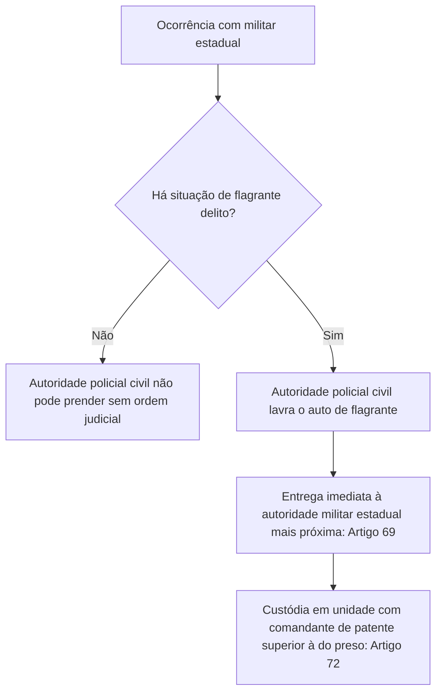
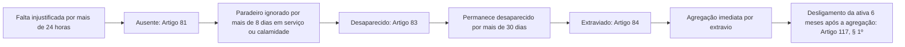

Após o estudo da hierarquia e das obrigações militares, este capítulo analisa as garantias conferidas pela Lei Estadual nº 6.783/1974. Aqui você estuda os direitos estatutários, os recursos administrativos e as licenças funcionais. O texto examina também as prerrogativas da carreira e as situações especiais de agregação, excedente e extravio. Por fim, são analisadas as causas de desligamento da ativa e as regras de tempo de serviço militar.

> [!objetivos]
> - Identificar os direitos estatutários básicos, prazos recursais e regras de elegibilidade.
> - Classificar as licenças e afastamentos temporários, com seus prazos e efeitos funcionais.
> - Compreender as prerrogativas da condição militar, sobretudo o regime de custódia e foro.
> - Distinguir as situações especiais de agregação, reversão, excedente e extravio.
> - Analisar as causas de desligamento definitivo da ativa e as regras do tempo de serviço.

## Direitos estatutários e recursos administrativos

Os **direitos** do militar compreendem as vantagens e garantias funcionais atribuídas por lei. O art. 49 enumera os direitos básicos do militar estadual. Destacam-se a garantia da patente aos oficiais, o uso de títulos e uniformes e a remuneração regular. O dispositivo assegura ainda promoções, férias anuais remuneradas, licenças e transferência para a inatividade. Para as praças, a **estabilidade** é adquirida com **dez anos** de efetivo serviço prestado.

> [!lei] Lei Estadual nº 6.783/1974, art. 49
> São direitos dos policiais-militares:
> I - a garantia da patente em toda a sua plenitude, com as vantagens, prerrogativas e deveres a ela inerentes, quando oficial;
> II - a percepção de remuneração correspondente ao grau hierárquico superior ou melhoria da mesma, quando, ao ser transferido para a inatividade, contar mais de 30 (trinta) anos de serviço;
> III - a remuneração calculada com base no soldo integral do posto ou da graduação, quando, não contando 30 (trinta) anos de serviço, for transferido para a reserva remunerada ex-officio, por ter atingido a idade-limite de permanência em atividade no posto ou na graduação;
> IV - nas condições ou nas limitações impostas na legislação e regulamentação específicas:
> a) a estabilidade, quando praça com 10 (dez) ou mais anos de efetivo serviço.

O militar transferido para a inatividade com **mais de trinta anos de serviço** recebe proventos calculados sobre o soldo do grau superior (art. 49, II). Se já ocupar o último posto da corporação, os proventos correspondem ao soldo do próprio posto **acrescido de 20%**.

### Direito de petição e prazos recursais

O servidor militar inconformado com decisão funcional pode interpor pedido de reconsideração, recurso hierárquico, queixa ou representação perante a autoridade competente (art. 50). O direito de recorrer na esfera administrativa prescreverá nos seguintes prazos legais (art. 50, § 1º):

| Objeto do Recurso Administrativo | Prazo Legal | Efeito Prático |
| --- | --- | --- |
| Ato de quota compulsória ou composição de Quadro de Acesso | 15 dias corridos | Prazo especial e reduzido para tutelar a renovação dos quadros |
| Demais atos administrativos, disciplinares ou funcionais | 120 dias corridos | Prazo geral para impugnação de decisões internas |

São proibidos os recursos, queixas e representações coletivos (art. 50, § 2º). O militar da ativa que recorrer ao Poder Judiciário deve comunicar previamente sua iniciativa ao comandante imediato (art. 50, § 3º).

> [!atencao] Prazos de recurso
> A banca frequentemente inverte os prazos do art. 50. Para quota compulsória e inclusão em Quadro de Acesso, o prazo é de **15 dias corridos**. Para os demais atos administrativos, o prazo é de **120 dias corridos**. A lei estadual define expressamente que esses prazos são de prescrição (art. 50, § 1º).

### Direitos políticos e elegibilidade

A elegibilidade do militar envolve o confronto entre a regra do Estatuto estadual e a norma da Constituição Federal.

Pela **Constituição Federal de 1988 (art. 14, § 8º c/c art. 42, § 1º)**, que **prevalece sobre a lei estadual**:
- **Menos de 10 anos de serviço**: o militar afasta-se definitivamente da atividade ao se candidatar (demissão se oficial ou licenciamento ex officio se praça).
- **Mais de 10 anos de serviço**: o militar é agregado pela autoridade superior. Se eleito, passa automaticamente para a inatividade no ato da diplomação.
- **Alistabilidade**: apenas os conscritos durante o serviço militar obrigatório são inalistáveis (CF, art. 14, § 2º). Todas as praças voluntárias estaduais (inclusive soldados e cabos) podem alistar-se e votar.

Por sua vez, o **art. 51 do Estatuto Estadual (Lei nº 6.783/1974)** traz limites diferentes em seu texto de 1974:
- Restringe o alistamento a oficiais, aspirantes, subtenentes, sargentos e alunos de cursos de oficiais.
- **Menos de 5 anos de serviço**: exclusão do serviço ativo (demissão ou licenciamento ex officio).
- **5 ou mais anos de serviço**: agregação durante a candidatura e transferência para a reserva remunerada na diplomação.

> [!atencao] Constituição Federal × Art. 51 do Estatuto
> A regra da Constituição Federal (critério de **10 anos**) prevalece sobre a lei estadual. Nas provas, contudo, a banca pode exigir a **literalidade do art. 51 do Estatuto** (critério de **5 anos**). Observe atentamente o enunciado: se pedir "segundo o Estatuto dos Militares de PE", a literalidade traz 5 anos; se exigir a regra constitucional vigente, adota-se 10 anos.

## Regime de licenças e afastamentos temporários

A **licença** autoriza o afastamento total e temporário do serviço ativo (art. 64). O Estatuto prevê quatro modalidades de licença funcional.

A **licença especial** concede **seis meses de afastamento remunerado** a cada decênio de serviço (art. 65). Pode ser usufruída de uma só vez ou em parcelas de dois ou três meses no ano. Se não usufruída, conta **em dobro unicamente na inatividade** (art. 65, § 3º). Compete ao Comandante-Geral, Secretário de Defesa Social ou Chefe da Casa Militar para o seu efetivo (art. 65, § 6º, LC nº 300/2015).

A **licença para interesse particular** (LTIP) exige **mais de dez anos** de serviço (art. 66). Não é remunerada, suspende o tempo de serviço e gera agregação se passar de seis meses contínuos (art. 75, § 1º, c, III). Compete privativamente ao **Secretário de Defesa Social**, ouvido o Comandante-Geral (art. 66, § 2º, LC nº 314/2015).

As licenças de saúde exigem laudo pericial. Para saúde própria, gera agregação após um ano ininterrupto (art. 75, § 1º, c, III). Para familiar, gera agregação após seis meses contínuos (art. 75, § 1º, c, V) e deixa de contar tempo se ultrapassar um ano (art. 122, § 3º, a).

| Modalidade de Licença | Requisito de Ingresso | Remuneração | Efeito no Tempo de Serviço | Competência Concessória |
| --- | --- | --- | --- | --- |
| Licença Especial | 10 anos de efetivo serviço | Remunerada | Conta como efetivo serviço; dobro só na inatividade se não gozada | Cmt-Geral, SDS ou Casa Militar (LC 300/15) |
| Licença para Interesse Particular | Mais de 10 anos de efetivo serviço | Sem remuneração | Suspende a contagem; acarreta agregação se ultrapassar 6 meses | Secretário de Defesa Social (LC 314/15) |
| Licença para Saúde Própria | Laudo pericial médico | Remunerada | Conta como tempo; acarreta agregação após 1 ano contínuo | Junta médica oficial |
| Licença para Saúde de Dependente | Laudo pericial médico | Remunerada na lei | Acarreta agregação após 6 meses; não conta tempo após 1 ano | Junta médica oficial |

> [!pegadinha]
> O Estatuto de Pernambuco prevê a licença especial relativa a cada **decênio** (dez anos) de efetivo serviço prestado, e não a cada quinquênio. Cuidado com alternativas que tentam aplicar regras de servidores civis ao militar estadual.

### Afastamentos temporários remunerados

Os militares têm assegurado o direito a afastamentos temporários sem desconto na remuneração (art. 62):

| Modalidade de Afastamento | Duração Máxima Legal | Requisito de Fruição |
| --- | --- | --- |
| Núpcias | 8 dias consecutivos | Requerido previamente ao casamento civil |
| Luto | 8 dias consecutivos | Concedido logo após a comprovação do óbito familiar |
| Instalação | Até 10 dias | Concedido para acomodação em nova sede funcional |
| Trânsito | Até 30 dias | Concedido para deslocamento físico até a nova sede |

O gozo anterior de licença de saúde não prejudica as férias anuais obrigatórias do militar (art. 65, § 4º c/c art. 63).

## Prerrogativas militares e garantias funcionais

As **prerrogativas** constituem garantias da condição militar conferidas em razão do cargo.

Compreendem o uso privativo de títulos, insígnias e fardamentos, além de foro militar especial para crimes militares. Militares da ativa em funções militares são dispensados do Tribunal do Júri e da Justiça Eleitoral (**art. 70**). A custódia processa-se em unidade sob comando hierarquicamente superior ou mais antigo que o custodiado (art. 72).

### Garantias relativas à prisão

O **art. 69** regula a atuação policial perante militares estaduais:
- **Sem flagrante**: autoridade civil não prende militar sem ordem judicial escrita.
- **Em flagrante**: autoridade civil efetua a prisão, mas deve **entregar o militar imediatamente à autoridade militar mais próxima** (art. 69). A retenção na delegacia restringe-se à lavratura do flagrante.

É proibido alojar o militar estadual em celas com presos civis comuns.

### Vedações relativas ao uso de uniformes

Uniformes são privativos de militares da ativa e inativos autorizados (art. 71). É vedado seu uso em eventos político-partidários, em viagens particulares ao exterior sem licença ou por inativos desautorizados. O Comandante-Geral pode cassar o uso da farda do inativo que ferir o decoro da classe (art. 73, parágrafo único).

## Situações especiais da carreira militar

O Estatuto estabelece situações funcionais transitórias que alteram o vínculo do militar com sua unidade:

A **agregação** é a situação em que o militar da ativa deixa de ocupar vaga na escala numérica de seu quadro, ficando sem número (art. 75). O militar agregado fica adido à unidade designada, recebendo a abreviatura oficial **"Ag"** (art. 76). A agregação **não abre vaga para promoção**. O militar agregado **só pode concorrer à promoção pelo princípio de antiguidade** (**art. 76, § 1º**).

A **reversão** é o ato pelo qual o militar agregado retorna ao respectivo quadro assim que cessa o motivo da agregação (art. 78 e 79).

O **excedente** é a situação transitória a que passa automaticamente o militar que (**art. 80**):
1. É promovido por bravura, sem haver vaga (art. 80, I);
2. Sendo o mais moderno da escala, ultrapassa o efetivo de seu quadro pela promoção de outro militar em ressarcimento de preterição (art. 80, III);
3. Retorna ao Quadro após cessar o motivo que determinou sua reforma por incapacidade definitiva, estando o quadro com efetivo completo (art. 80, IV);
4. Ultrapassa o efetivo do quadro em decorrência de desativação parcial desse efetivo (art. 80, V).

> [!atencao] Hipóteses legais de excedente
> O inciso II do art. 80 ("promovido indevidamente") foi expressamente revogado pela Lei nº 12.441/2003. Não existem as hipóteses de "reversão sem vaga" ou "anulação de ato". O militar excedente figura na escala com a sigla "Excd" e preenche a primeira vaga aberta (art. 80, § 1º). Conta tempo de efetivo serviço e concorre a qualquer cargo e à promoção (art. 80, § 2º). O promovido por bravura ocupa a primeira vaga aberta, deslocando o critério da vaga seguinte (art. 80, § 3º).

### Ausência, desaparecimento e extravio

O Estatuto disciplina os prazos sucessivos de afastamento não autorizado:

- **Ausente**: o militar que, por mais de **vinte e quatro horas consecutivas**, deixa de comparecer à sua unidade sem comunicar impedimento, ou dela se ausenta sem licença (**art. 81**).
- **Desaparecido**: o militar da ativa cujo paradeiro for ignorado por mais de **oito dias**, no desempenho de qualquer serviço, em viagem, em operações policiais-militares ou em caso de calamidade pública, **quando não houver indício de deserção** (**art. 83**).
- **Extraviado**: o militar que permanecer desaparecido por mais de **trinta dias** (**art. 84**).

O militar extraviado é agregado imediatamente. O seu **desligamento definitivo do serviço ativo** será feito **seis meses após a agregação por motivo de extravio** (**art. 117, § 1º**). Nesse momento abre-se a habilitação de seus dependentes à pensão militar. Em caso de naufrágio, sinistro aéreo ou calamidade pública, o extravio é considerado falecimento assim que esgotados os prazos máximos de sobrevivência ou salvamento (**art. 117, § 2º**).

> [!bizu]
> Guarde a escala cronológica da ausência com os marcos de corte:
> - **24 horas**: configuração de ausente (art. 81);
> - **8 dias**: configuração de desaparecido em serviço/missão (art. 83);
> - **30 dias**: configuração de extraviado (art. 84);
> - **6 meses após a agregação**: desligamento do serviço ativo (art. 117, § 1º).

## Desligamento do serviço ativo e exclusão

O rompimento do vínculo com o serviço ativo ocorre por **desligamento** ou exclusão (**art. 85**). É formalizado por ato do Governador do Estado ou autoridade delegada. O art. 85 prevê **nove causas taxativas de desligamento da ativa**:
1. Transferência para a reserva remunerada;
2. Reforma;
3. Demissão;
4. Perda de posto e patente;
5. Licenciamento;
6. Exclusão a bem da disciplina;
7. Deserção;
8. Falecimento;
9. Extravio.

### Reserva remunerada e reforma

A **reserva remunerada** dá-se a pedido ou de ofício:
- **A pedido**: para quem ingressou a partir de 2022 (LC nº 460/2021), exige-se **35 anos de serviço**, sendo no mínimo **30 anos** de atividade militar em Pernambuco (art. 89).
- **De ofício por idade**: atinge oficiais aos **67 anos** e praças aos **63 anos** (art. 90).
- **Reforma**: é **sempre de ofício** (art. 93). Aplica-se compulsoriamente aos **70 anos** ou por incapacidade definitiva. Por invalidez decorrente do serviço, os proventos baseiam-se no soldo do **posto imediato** (art. 98).

### Formas específicas de exclusão: oficiais versus praças

O Estatuto estabelece termos e institutos privativos para oficiais e praças:

| Causa de Exclusão | Categoria Alcançada | Procedimento e Competência | Consequência Pecuniária |
| --- | --- | --- | --- |
| Demissão | Exclusiva de oficiais (arts. 104 a 106) | A pedido ou de ofício pelo Governador | Perda do posto acarreta demissão sem remuneração |
| Perda de Posto e Patente | Exclusiva de oficiais (art. 106) | Declarada pelo Tribunal de Justiça de PE | Decorre de condenação superior a 2 anos ou Conselho de Justificação |
| Licenciamento | Exclusivo de praças (art. 109) | A pedido ou de ofício pelo Comandante-Geral | Não gera proventos; ocorre por conveniência, tempo ou disciplina |
| Exclusão a bem da Disciplina | Praças estáveis ou não (art. 112) | Aplicada de ofício pelo Comandante-Geral | Obrigatória para praça condenada à prisão superior a 2 anos |
| Deserção | Oficiais e praças (art. 116) | Decorre de processo penal militar | Demissão do oficial ou exclusão da praça após rito próprio |

> [!pegadinha]
> Atente para a terminologia técnica da lei: **oficial não sofre licenciamento**, nem sofre exclusão a bem da disciplina. O oficial desliga-se por **demissão** ou perda de posto e patente. Por sua vez, **praça não sofre demissão**: a praça submete-se a **licenciamento** (art. 109) ou a **exclusão a bem da disciplina** (art. 112). A troca desses termos é pegadinha frequente das bancas.

## Contagem do tempo de serviço militar

O cômputo do tempo de serviço regula a estabilidade, adicionais e proventos da inatividade.

O termo inicial da contagem é a data de **inclusão na corporação militar**, de **matrícula no órgão de formação** ou de **nomeação para posto ou graduação** (art. 120). O militar reincluído reinicia sua contagem na data do ato de reinclusão.

### Efetivo serviço versus anos de serviço

Diferenciam-se dois conceitos:
1. **Tempo de efetivo serviço**: apurado dia a dia entre o ingresso e o desligamento, aplicando-se o **divisor 365** (art. 121, caput e § 3º).
2. **Anos de serviço**: soma do efetivo serviço com os acréscimos legais autorizados (art. 122).

Constituem acréscimos legais para anos de serviço (art. 122):
- Tempo público anterior civil ou militar (federal, estadual ou municipal);
- 1 ano a cada 5 anos para oficial de Saúde, até o teto da graduação universitária (art. 122, II);
- Licença especial e férias regulamentares não gozadas, **contadas em dobro** (art. 122, III e IV).

Os **dobros de licença especial e de férias não usufruídas são computados unicamente no momento da passagem para a inatividade** (art. 122, § 2º). Não produzem efeitos retroativos na ativa. Para vantagens da inatividade, a fração que **ultrapassar seis meses será arredondada para um ano completo** (art. 122, § 5º).

### Hipóteses não computáveis e limites de desligamento

O **art. 122, § 3º**, do Estatuto estabelece os períodos que **não podem ser computados como tempo de serviço**:
- Período passado como desertor;
- Tempo cumprido em pena privativa de liberdade transitada em julgado (ressalvado sursis);
- Tempo decorrido em cumprimento de pena de suspensão de função;
- Tempo passado em licença para tratar de interesse particular;
- Tempo que ultrapassar um ano contínuo em licença para tratamento de saúde de dependente familiar.

É vedada a acumulação ou superposição simultânea de tempos de serviço público.

A **data-limite** da contagem é a do **desligamento do serviço ativo** (art. 126). O ato deve concretizar-se no prazo de até **quarenta e cinco dias** após sua publicação no Diário Oficial ou Boletim, com permanência máxima de quinze dias no setor de pessoal.

## Mapa do capítulo

A tabela a seguir consolida as principais regras estatutárias sobre direitos, prazos recursais, licenças, prerrogativas, situações especiais e exclusão:

| Instituto da Carreira | Dispositivo Legal | Regra Jurídica e Critério de Aplicação |
| --- | --- | --- |
| Estabilidade da Praça | Art. 49, IV, "a" | Conquistada ao completar dez anos de efetivo serviço prestado |
| Vantagem da Inatividade | Art. 49, II | Mais de 30 anos de serviço: proventos calculados sobre o soldo superior; no último posto, soldo acrescido de 20% |
| Prazos de Recursos | Art. 50, § 1º | Prescrição em 15 dias corridos para quota e Quadro de Acesso; 120 dias corridos nos demais atos |
| Candidatura Eletiva | CF, art. 14, § 8º e Art. 51 | CF fixa 10 anos (prevalece: <10 demite/licencia; ≥10 agrega). Art. 51 da lei traz 5 anos na literalidade |
| Licença Especial | Art. 65 | Seis meses a cada dez anos de efetivo serviço; dobro só na inatividade; concessão por Cmt-Geral, SDS ou Casa Militar |
| Licença Particular | Art. 66 | Exige mais de 10 anos de serviço; não remunerada; suspende tempo; concessão privativa do SDS (LC 314/2015) |
| Prisão do Militar | Art. 69 | Autoridade civil só prende em flagrante; entrega imediata à autoridade militar mais próxima |
| Agregação e Antiguidade | Art. 76, caput e § 1º | Agregado fica adido com sigla "Ag" e só concorre à promoção por antiguidade |
| Excedente | Art. 80 | Situação transitória nas 4 hipóteses da lei (bravura, preterição, reversão de reforma, desativação de quadro) |
| Ausente a Extraviado | Arts. 81, 83 e 84 | Ausente (>24h); desaparecido (>8 dias em serviço/calamidade sem deserção); extraviado (>30 dias) |
| Desligamento por Extravio | Art. 117, § 1º | Desligamento definitivo do serviço ativo processa-se seis meses após a agregação por extravio |
| Causas de Desligamento | Art. 85 | Nove causas taxativas de exclusão e desligamento da ativa |
| Demissão e Licenciamento | Arts. 104 e 109 | Demissão é privativa de oficial; licenciamento e exclusão a bem da disciplina aplicam-se a praças |
| Contagem de Tempo | Arts. 120 a 126 | Divisor 365; não computáveis no art. 122, § 3º; desligamento em até 45 dias da publicação (art. 126) |

### Para fixar

- A estabilidade funcional da praça é conquistada com dez anos de efetivo serviço prestado na corporação.
- O militar com mais de trinta anos de serviço passa para a inatividade com proventos do posto ou graduação superior (art. 49, II).
- O direito de recorrer prescreve em quinze dias corridos para quota compulsória e Quadro de Acesso, e em cento e vinte dias nos demais casos (art. 50, § 1º).
- A elegibilidade pela Constituição Federal adota a regra de dez anos (prevalece); o art. 51 do Estatuto traz cinco anos na literalidade.
- A licença especial consiste em seis meses a cada dez anos de serviço; sua concessão cabe ao Comandante-Geral, SDS ou Casa Militar (LC 300/2015).
- A licença para interesse particular exige mais de dez anos de serviço, não é remunerada e compete privativamente ao SDS (LC 314/2015).
- A autoridade policial comum só pode prender o militar em flagrante delito, devendo entregá-lo imediatamente à autoridade militar (art. 69).
- O militar agregado figura com a sigla "Ag" e apenas pode concorrer à promoção pelo princípio de antiguidade (art. 76, § 1º).
- O excedente passa automaticamente a essa situação nas quatro hipóteses do art. 80, concorrendo normalmente à promoção.
- Demissão é privativa de oficial (art. 104); licenciamento aplica-se a praças (art. 109); ausente, desaparecido e extraviado seguem os arts. 81 a 84 e 117.
