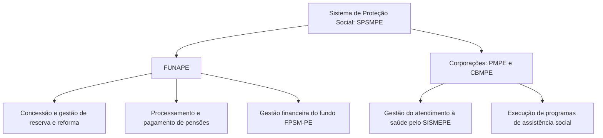

Este capítulo conclui o estudo do Estatuto dos Militares do Estado de Pernambuco (Lei Estadual nº 6.783/1974) e aborda as inovações introduzidas pela Lei Complementar nº 460/2021. O conteúdo deste material cobre os deveres fundamentais e as formalidades do compromisso militar, as diretrizes de comando e subordinação, o regime de apuração disciplinar nos Conselhos de Justificação e de Disciplina, as normas de remuneração e quota compulsória e o funcionamento do Sistema de Proteção Social dos Militares de Pernambuco (SPSMPE).

> [!objetivos]
> - Identificar os deveres estatutários e as formalidades do compromisso de honra.
> - Compreender a autoridade de comando e a divisão de atribuições por grau hierárquico.
> - Distinguir o Conselho de Justificação do Conselho de Disciplina quanto a público e julgamento.
> - Conhecer as regras de remuneração, quota compulsória e modalidades de promoção militar.
> - Explicar a estrutura do SPSMPE, a alíquota contributiva e a ordem de pensão militar.

## Deveres militares, compromisso e cadeia de comando

Os **deveres militares** (art. 30) nascem dos vínculos racionais, jurídicos e éticos que unem o militar à comunidade pernambucana e à sua segurança. Constituem obrigações positivas indispensáveis à ordem pública e à regularidade institucional.

Compreendem expressamente:
- A dedicação integral ao serviço e a fidelidade à corporação, mesmo com o sacrifício da própria vida;
- O culto aos símbolos nacionais;
- A probidade e a lealdade em todas as circunstâncias;
- A disciplina e o respeito à hierarquia;
- O cumprimento rigoroso das ordens de superiores competentes;
- O dever inafastável de tratar os subordinados com dignidade e urbanidade.

> [!lei] Lei Estadual nº 6.783/1974, art. 30
> Os deveres policiais-militares emanam de vínculos racionais e morais que ligam o policial-militar à comunidade estadual e à sua segurança, e compreendem, essencialmente:
> I - a dedicação integral ao serviço policial-militar e a fidelidade à instituição à que pertence, mesmo com o sacrifício da própria vida;
> II - o culto aos símbolos nacionais;
> III - a probidade e a lealdade em todas as circunstâncias;
> IV - a disciplina e o respeito à hierarquia;
> V - o rigoroso cumprimento das obrigações e ordens; e
> VI - a obrigação de tratar o subordinado dignamente e com urbanidade.

### Compromisso de honra

O ingresso na carreira consolida-se mediante o **compromisso de honra**, solenidade na qual o novo servidor militar manifesta a aceitação consciente de suas obrigações funcionais. É ato solene celebrado **perante a tropa**, logo que o ingressante adquire instrução profissional básica suficiente para compreender suas responsabilidades.

O compromisso do Aspirante-a-Oficial realiza-se conforme as normas da academia militar; já o Oficial presta compromisso perante a Bandeira Nacional ao ascender ao primeiro posto da carreira (Segundo-Tenente).

### Comando e subordinação

O **comando** consubstancia a soma de autoridade, prerrogativas, deveres e responsabilidades conferidos legalmente ao militar para conduzir homens ou dirigir uma unidade da corporação. Trata-se de prerrogativa impessoal vinculada ao grau hierárquico do titular.

A **subordinação** decorre da ordenação hierárquica e não compromete a dignidade do militar subordinado. Os papéis funcionais distribuem-se de forma clara:
- **Oficiais**: preparados para o exercício do comando, chefia e direção superior;
- **Subtenentes e sargentos**: auxiliam e complementam os oficiais na instrução, na administração e na condução direta de policiamento e socorro público;
- **Cabos e soldados**: executam diretamente as missões operacionais e os serviços de apoio;
- **Praças especiais**: dedicam-se com exclusividade ao aprendizado acadêmico.

Cada militar tem responsabilidade pessoal e integral pelas decisões adotadas, ordens expedidas e atos praticados no serviço.

## Violação das obrigações e regime de apuração disciplinar

A violação de deveres sujeita o infrator a responsabilidades funcionais, pecuniárias, administrativas e penais.

A conduta ilícita traduz-se em **crime militar** ou em **transgressão disciplinar**. Vige no regime militar a regra de que a gravidade da violação cresce na proporção direta do grau hierárquico: quanto mais elevado o posto ou graduação, mais severo o juízo censório.

Para evitar dupla punição pelo mesmo fato, a legislação estadual prescreve que, havendo concorrência simultânea de **crime militar e transgressão disciplinar**, aplica-se **exclusivamente a sanção criminal militar**.

As manifestações de caráter coletivo a respeito de atos de superiores ou com natureza reivindicatória são terminantemente **proibidas**.

### Afastamento preventivo das funções

Constatada a incapacidade moral ou funcional de militar para exercer o cargo, poderá haver seu **afastamento imediato das funções**. Possuem competência para determinar esse afastamento prévio o **Governador do Estado**, o **Comandante-Geral** e os **comandantes, chefes e diretores de unidades**, na forma dos regulamentos próprios.

### Conselhos disciplinares: Justificação versus Disciplina

Para apurar condutas de extrema gravidade que possam ensejar exclusão definitiva das forças estaduais, a legislação estrutura dois conselhos com público e jurisdição próprios:

| Parâmetro Institucional | Conselho de Justificação (Art. 47) | Conselho de Disciplina (Art. 48) |
| --- | --- | --- |
| Público Atingido | Oficiais da ativa, da reserva e reformados | Aspirantes-a-Oficial e praças estáveis (ativa, reserva e reforma) |
| Fato Apurado | Incapacidade ética ou profissional para o oficialato | Incapacidade moral ou funcional para permanecer na praça |
| Afastamento | Facultativo ou legal, a critério do Comando | Afastamento obrigatório das atividades ordinárias |
| Julgador Final | **Tribunal de Justiça de Pernambuco** (TJPE) | **Comandante-Geral** da respectiva corporação estadual |
| Penalidade Máxima | Perda do posto e patente e demissão ex officio | Exclusão a bem da disciplina ou reforma administrativa |

> [!pegadinha]
> A banca examinadora costuma trocar as competências de julgamento: a apreciação do Conselho de Justificação cabe privativamente ao **Tribunal de Justiça de Pernambuco** (TJPE), enquanto a decisão em última instância no Conselho de Disciplina é do **Comandante-Geral**.

## Normas complementares de remuneração e promoção

O regime pecuniário e a ascensão funcional compreendem diretrizes que preservam o equilíbrio estrutural da tropa:

### Remuneração e vedações de acumulação

A remuneração dos militares em atividade compõe-se de **vencimentos** (soldo básico e gratificações) e indenizações. Na inatividade, consiste em **proventos** e adicionais previstos em lei.

O soldo militar é **irredutível e impenhorável** (salvo para pagamento de pensão alimentícia judicial), sendo rigorosamente uniforme para os servidores do mesmo grau na ativa, reserva e reforma. É proibida a **acumulação de remunerações de inatividade militar**, admitindo-se cumulação exclusivamente nos casos de mandato eletivo, magistério, cargo em comissão ou contratação técnica.

### Modalidades de promoção e quota compulsória

A promoção na carreira é ato administrativo voltado a selecionar militares para prover funções do grau superior:

| Espécie | Modalidade de Promoção | Requisitos Determinantes |
| --- | --- | --- |
| Ordinária | Antiguidade | Fundamenta-se na precedência temporal no grau |
| Ordinária | Merecimento | Avaliação de eficiência, tirocínio e conduta funcional |
| Extraordinária | Bravura | Decorre de ato heroico notável; independe de vaga desimpedida |
| Extraordinária | Post Mortem | Visa homenagear o militar falecido em serviço ativo |
| Extraordinária | Ressarcimento de Preterição | Reparação a militar preterido sem culpa própria |

Para assegurar a renovação dos quadros, o equilíbrio e a regularidade de acesso, o art. 60 estabelece a **quota compulsória**, cálculo que fixa um número obrigatório de vagas para promoção e transferência de oficiais à reserva remunerada. O número de vagas em cada posto é fixado por ato do Comandante-Geral até o dia **15 de janeiro** do ano subsequente ao ano-base considerado (**art. 60, § 2º**, acrescido pela Lei Complementar nº 92/2007).

## Sistema de Proteção Social dos Militares de Pernambuco (LC 460/2021)

A Lei Complementar Estadual nº 460/2021 inseriu os arts. 74-A a 74-AD no Estatuto, estabelecendo o **Sistema de Proteção Social dos Militares do Estado de Pernambuco** (SPSMPE), regime integrado que assegura remuneração, inatividade e pensão militar à PMPE e ao CBMPE.

O modelo gerencial estrutura-se em regime dual de competências:

O SPSMPE tem caráter **contributivo e filiação obrigatória**, com alíquota única de **10,5%** (**art. 74-E, § 3º**) incidente sobre a remuneração de militares ativos, proventos de inativos e pensões. O Tesouro Estadual responde pela cobertura de eventuais déficits financeiros.

As reservas, reformas e pensões são pagas mediante recursos do fundo contábil denominado **FPSM-PE**, sendo **proibido destinar recursos desse fundo para pagar militares da ativa**.

> [!atencao] Contribuição e destinação do FPSM-PE
> A alíquota previdenciária de **10,5%** (art. 74-E, § 3º) atinge indistintamente militares da ativa, da reserva, reformados e pensionistas. Ademais, os recursos do fundo contábil FPSM-PE não podem ser utilizados para arcar com despesas de militares do serviço ativo.

### Pensão militar e dependentes

A **pensão militar** é benefício mensal pago aos dependentes do militar falecido (instituidor), em valor igual à remuneração integral de seu posto ou graduação, com paridade e integralidade. É devida a contar do dia seguinte ao falecimento, desde que requerida em até **trinta dias** (após esse prazo, conta da data do protocolo).

A habilitação dos beneficiários obedece a uma ordem legal excludente (**art. 74-N**):

| Ordem Legal | Beneficiários Contemplados | Efeito da Habilitação |
| --- | --- | --- |
| 1ª Ordem | Cônjuge ou companheiro(a); filhos e enteados até 21 anos (ou 24 anos se universitários; sem limite de idade se inválidos); menor sob guarda | A existência de dependente desta ordem exclui as classes seguintes |
| 2ª Ordem | Pais do militar com comprovada dependência econômica | Habilitam-se apenas na falta de dependentes da 1ª ordem |
| 3ª Ordem | Irmãos órfãos até 21 anos (ou 24 se universitários; sem limite se inválidos) sob dependência econômica | Habilitam-se apenas na falta de beneficiários da 1ª e 2ª ordens |

Havendo ex-cônjuge com alimentos fixados em juízo, este recebe o percentual judicial; da cota remanescente, metade vai ao cônjuge/companheiro e a outra metade reparte-se igualmente entre filhos e menores habilitados.

> [!bizu]
> Guarde as classes de pensionistas com a regra **C-P-I**:
> - **C**ônjuge e filhos (1ª ordem - prioritária e excludente);
> - **P**ais economicamente dependentes (2ª ordem);
> - **I**rmãos órfãos ou dependentes inválidos (3ª ordem).

### Disposições finais da LC nº 460/2021

Das decisões do Diretor-Presidente da FUNAPE que indeferirem pedido de reserva remunerada, reforma ou pensão militar cabe recurso administrativo no prazo de **noventa dias**, contados da publicação oficial (**art. 74-Z, §§ 12 e 13**). Mantida a decisão, o recurso é remetido para decisão final do Secretário de Administração do Estado (**art. 74-Z, § 15**). Fica assegurado o direito adquirido na concessão de inatividade e pensão aos militares que cumpriram todos os requisitos até **31 de dezembro de 2021** (art. 74-AA).

> [!pegadinha]
> O art. 74-AD prevê que o militar inativo demitido ou excluído da corporação em razão de condenação ou ato posterior à inatividade continuará percebendo seus proventos regulares, mas **perderá o direito à paridade remuneratória** com a ativa.

## Mapa do capítulo

A tabela a seguir resume as normas de deveres, conselhos, promoções e proteção social examinadas neste capítulo:

| Tema Central | Dispositivo Legal | Parâmetro Fundamental de Prova |
| --- | --- | --- |
| Deveres Militares | Art. 30 | Vinculam à comunidade; exigem probidade e dedicação com risco da vida |
| Compromisso de Honra | Arts. 31 e 32 | Ato solene prestado perante a tropa com instrução básica consolidada |
| Subsidiariedade Punitiva | Art. 40, § 2º | Conduta que é crime e transgressão recebe apenas sanção penal militar |
| Conselho de Justificação | Art. 47 | Julga oficiais presumivelmente incapazes; julgamento final pelo TJPE |
| Conselho de Disciplina | Art. 48 | Julga aspirantes e praças estáveis; decisão final pelo Comandante-Geral |
| Quota Compulsória | Art. 60, § 2º (LC 92/2007) | Assegura renovação e vagas à promoção; Comandante-Geral fixa até 15 de janeiro |
| Gestão do SPSMPE | Art. 74-A | Dual: FUNAPE cuida de inatividade e pensões; corporações gerenciam SISMEPE |
| Alíquota do SPSMPE | Art. 74-E, § 3º | Alíquota de 10,5% aplicada sobre ativa, reserva, reformados e pensionistas |
| Beneficiários de Pensão | Art. 74-N | Ordem excludente: 1ª cônjuge e filhos; 2ª pais dependentes; 3ª irmãos |
| Recurso Administrativo | Art. 74-Z, §§ 12-15 | Prazo de 90 dias contra indeferimento; decisão final do Secretário de Administração |
| Falta Superveniente | Art. 74-AD | Inativo punido por fato posterior mantém proventos, mas perde a paridade |

### Para fixar

- Os deveres militares impõem dedicação integral e lealdade institucional, mantidas mesmo sob risco de vida.
- O compromisso de honra é prestado perante a tropa após o militar adquirir instrução sobre suas obrigações.
- Se o mesmo fato caracterizar crime militar e falta disciplinar, aplica-se tão somente a penalidade do crime militar.
- O Conselho de Justificação é privativo de oficiais e julgado pelo Tribunal de Justiça de Pernambuco.
- O Conselho de Disciplina aplica-se a praças estáveis e aspirantes, com decisão final do Comandante-Geral.
- A quota compulsória visa renovar quadros de oficiais, com número de vagas fixado até 15 de janeiro (art. 60, § 2º).
- A gestão do SPSMPE divide-se entre a FUNAPE (inatividade/pensões) e as corporações militares (saúde/assistência).
- A contribuição social dos militares é de 10,5% (art. 74-E, § 3º), sendo vedado usar recursos do FPSM-PE para custear a ativa.
- A pensão militar obedece à ordem excludente de dependentes do art. 74-N, com prazo de requerimento de trinta dias da data do óbito.
- Contra indeferimento de benefício previdenciário cabe recurso em noventa dias, decidido pelo Secretário de Administração (art. 74-Z).
