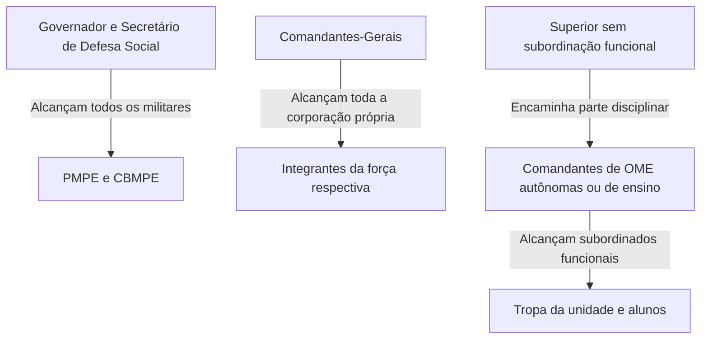

O regime disciplinar militar de Pernambuco orienta a conduta ética, a regularidade funcional e a subordinação hierárquica na Polícia Militar e no Corpo de Bombeiros Militar. Instituído pela Lei Estadual nº 11.817, de 24 de julho de 2000, o Código Disciplinar estabelece as balizas fundamentais para a convivência em tropa e o exercício da autoridade administrativa. As bancas de concurso examinam com rigor os conceitos de hierarquia, disciplina, cumprimento de ordens e os limites da competência sancionadora em cada escalão.

> [!objetivos]
> - Distinguir os conceitos legais de hierarquia militar e disciplina militar.
> - Enumerar as manifestações essenciais da disciplina e as responsabilidades na emissão e cumprimento de ordens.
> - Delimitar o alcance subjetivo do regime disciplinar e as restrições sobre manifestações públicas.
> - Identificar as autoridades competentes para aplicar sanções conforme o cargo ou função exercida.

## Finalidade da lei, valores e civilidade militar

O Código Disciplinar institui o regime disciplinar dos militares do Estado de Pernambuco (Lei Estadual nº 11.817/2000, art. 1º). A norma atende a finalidades expressas: tipificar e classificar transgressões, estabelecer limites de penas, categorizar o comportamento das praças, disciplinar recursos e regulamentar recompensas.

A vida em quartel apoia-se em valores basilares. O companheirismo e o respeito às leis constituem os dois principais valores cultivados na convivência militar (Lei Estadual nº 11.817/2000, art. 2º). Os superiores têm o dever de incentivar a harmonia entre subordinados, respeitada a cadeia de comando.

A civilidade integra a educação militar e atua como interesse prioritário da disciplina consciente (Lei Estadual nº 11.817/2000, art. 3º). O trato cortês e respeitoso vincula todo o pessoal das unidades militares de Pernambuco, tanto na escala de serviço quanto nos períodos de folga. Essa urbanidade estende-se a civis e a militares de outras forças públicas. Todos os titulares de OME, sejam comandantes, chefes de seções ou diretores, são tratados pela lei sob a denominação unificada de Comandantes (Lei Estadual nº 11.817/2000, art. 4º).

> [!exemplo]
> Em atendimento a um desabamento em Olinda, o Capitão Moreira orienta sua guarnição do CBMPE com clareza técnica e ouve o relato do Soldado Vítor sobre a instabilidade de uma marquise. Ambos mantêm postura equilibrada e respeitosa, comprovando que a deferência profissional coexiste com o rigor da subordinação.

## Hierarquia, disciplina e cumprimento de ordens

A hierarquia e a disciplina formam os alicerces mestres das corporações militares. A legislação estadual traça uma nítida distinção entre esses dois institutos:

A **hierarquia militar** estrutura os graus de autoridade em escalões sucessivos, distribuídos entre postos de oficiais e graduações de praças (Lei Estadual nº 11.817/2000, art. 5º). O respeito à hierarquia consubstancia-se no espírito de acatamento às ordens emanadas em sequência pela cadeia de subordinação.

A **disciplina militar** consiste na rigorosa observância e no integral cumprimento das normas legais e disposições regulamentares aplicáveis às corporações (Lei Estadual nº 11.817/2000, art. 6º). Ela se traduz no fiel cumprimento dos deveres funcionais por cada servidor militar.

A tabela a seguir contrasta as linhas mestras de cada conceito:

| Instituto | Conteúdo jurídico | Expressão no cotidiano |
| --- | --- | --- |
| Hierarquia | Ordenamento dos níveis de comando por postos e graduações | Acatamento metódico das ordens que descem pela cadeia funcional |
| Disciplina | Observância fiel e irrestrita das normas e regulamentos | Execução correta e pontual das atribuições cometidas ao militar |

O Código enumera sete manifestações essenciais da disciplina (Lei Estadual nº 11.817/2000, art. 6º, § 1º):

1. A correção de atitudes;
2. A obediência pronta às ordens legais dos superiores hierárquicos;
3. A dedicação integral ao serviço;
4. A colaboração espontânea à disciplina coletiva e à eficiência institucional;
5. A consciência das responsabilidades;
6. A rigorosa observância das prescrições regulamentares;
7. O respeito à continuidade e à essencialidade do serviço à sociedade.

O dever de manter a subordinação e respeitar a hierarquia vigora de modo contínuo por toda a existência funcional, vinculando igualmente o militar em serviço ativo ou transferido para a inatividade (Lei Estadual nº 11.817/2000, art. 6º, § 2º).

> [!lei] Lei Estadual nº 11.817/2000, art. 7º
> Na emissão e no cumprimento de uma ordem, cabe ao militar a inteira responsabilidade pelas consequências que dela advierem.
> § 1º Cabe ao subordinado que receber uma ordem, solicitar os esclarecimentos necessários ao seu total entendimento, cumprindo ao militar que a emitiu atender à solicitação, confirmando-a, se necessário, por escrito.
> § 2º Ao executante, que transgredir no cumprimento de uma ordem recebida, caberá a responsabilidade pelos excessos e omissões que vier a cometer.

A dinâmica das ordens distribui responsabilidades. Quem emite responde pelas consequências de sua determinação. O subordinado tem a prerrogativa de solicitar esclarecimentos e exigir confirmação por escrito em caso de dúvida. Ao executar a missão, o subordinado responde pessoalmente por eventuais excessos e omissões.

> [!pegadinha]
> Questões de concurso costumam sugerir que o subordinado estaria isento de punição se apenas executou ordem superior. Isso é falso: o executante que comete excesso ou omite providência obrigatória responde disciplinarmente pelos seus atos.

## Esfera de ação subjetiva e manifestações públicas

O regime disciplinar submete os militares estaduais da ativa, da reserva remunerada e os reformados (Lei Estadual nº 11.817/2000, art. 8º). A vinculação inicia-se com a inclusão formal e finda somente com o óbito.

Duas situações contam com regras particulares:

- Oficiais nomeados juízes da Justiça Militar submetem-se a legislação específica (Lei Estadual nº 11.817/2000, art. 8º, § 1º).
- Alunos de cursos militares sujeitam-se também aos regulamentos próprios de seus órgãos de ensino (Lei Estadual nº 11.817/2000, art. 8º, § 2º).

Para salvaguardar a estabilidade institucional, a lei veda ao militar da ativa ou da inatividade manifestar-se publicamente pela imprensa sobre temas sigilosos, assuntos funcionais, reivindicações políticas ou corporativas, ou manifestações que firam a hierarquia e o decoro militar (Lei Estadual nº 11.817/2000, art. 9º).

> [!atencao] Exceção para temas técnico-profissionais
> A manifestação pública só é autorizada em assuntos estritamente técnico-profissionais. Para tanto, o militar deve atender a dois requisitos simultâneos: possuir habilitação técnica na matéria e contar com expressa autorização superior.

## Competência para a aplicação das sanções disciplinares

A competência disciplinar decorre do cargo ou função ocupada pelo militar, e nunca do seu posto ou graduação isoladamente (Lei Estadual nº 11.817/2000, art. 10). A precedência hierárquica sem vínculo de comando não autoriza a aplicação de punições.

A tabela a seguir discrimina as autoridades sancionadoras e seus respectivos âmbitos de atuação:

| Posto ou função de comando | Abrangência do poder punitivo |
| --- | --- |
| Chefia do Poder Executivo e titular da Secretaria de Defesa Social | Totalidade do efetivo policial e de bombeiros militares de PE |
| Chefias máximas das corporações militares | Efetivo integral da sua respectiva instituição militar |
| Chefia da Casa Militar estadual | Efetivo mobilizado sob sua direta administração |
| Chefias de Estado-Maior, Subcomandantes e Subchefia da Casa Militar | Pessoal subordinado pela estrutura de organização interna |
| Diretorias setoriais, Ajudâncias-Gerais e Comandos Intermediários | Pessoal lotado nas repartições e comandos subordinados |
| Órgãos correcionais e de assistência dos Comandos-Gerais | Pessoal sob vínculo direto da assessoria ou corregedoria |
| Comandos de unidades operacionais autônomas | Militares em atuação no âmbito do próprio quartel |
| Comandos de escolas e centros de instrução | Militares da unidade e alunos matriculados em cursos de formação |
| Autoridades com delegação específica | Pessoal nos termos e limites fixados no ato de outorga |

O Governador e o titular da pasta de Defesa Social detêm poder disciplinar irrestrito sobre as forças militares do Estado. No âmbito interno, cada Comandante-Geral responde pelo conjunto dos integrantes da própria instituição. Nos escalões subordinados, o poder de aplicar penalidades restringe-se aos militares submetidos à sua direta linha funcional.

> [!bizu]
> Oficial que presencia falta em quartel alheio não pode punir o transgressor diretamente. Deve lavrar uma parte disciplinar e encaminhá-la ao comandante funcional do militar infrator.

## Mapa do capítulo

A tabela abaixo resume os pontos nucleares do regime disciplinar militar segundo a Lei Estadual nº 11.817/2000:

| Eixo disciplinar | Previsão legal | Regra central para a prova |
| --- | --- | --- |
| Valores fundamentais | Art. 2º | Companheirismo e respeito às leis na formação e no convívio |
| Civilidade | Art. 3º | Urbanidade recíproca obrigatória em serviço e na folga |
| Hierarquia militar | Art. 5º | Escalonamento da autoridade por postos e graduações |
| Disciplina militar | Art. 6º | Cumprimento integral das normas legais e regulamentares |
| Continuidade temporal | Art. 6º, § 2º | Deveres vinculam militares da ativa, da reserva e reformados |
| Responsabilidade por ordens | Art. 7º | Emitente responde pelo comando; executante, por excessos |
| Manifestação pública | Art. 9º | Vedada manifestação civil; ressalvado tema técnico autorizado |
| Poder disciplinar | Art. 10 | Decorre do cargo ou função, jamais do grau hierárquico isolado |

### Para fixar

- Companheirismo e respeito às leis representam os valores fundamentais da convivência militar estadual.
- Civilidade e urbanidade são exigidas de todos os integrantes das OME, em serviço ou em período de folga.
- Hierarquia organiza a autoridade por postos e graduações; disciplina exige o acatamento integral das normas.
- As obrigações de hierarquia e disciplina vinculam permanentemente os militares da ativa, da reserva remunerada e os reformados.
- A obediência pronta às ordens legais constitui manifestação essencial da disciplina militar.
- O militar que emite uma ordem responde pelas consequências, e o executor responde por eventuais excessos e omissões.
- O regime disciplinar alcança o militar desde a inclusão oficial na corporação até o seu falecimento.
- Manifestações públicas sobre questões sigilosas, políticas ou reivindicatórias são terminantemente proibidas.
- A divulgação de temas técnico-profissionais exige qualificação prévia e expressa autorização do comando.
- A atribuição para aplicar punições disciplinares vincula-se ao cargo ou função, e não ao posto do militar.
