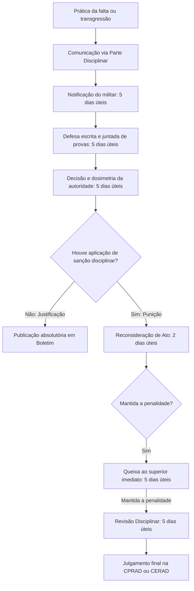

A apuração de infrações disciplinares e a garantia da ampla defesa constituem o núcleo procedimental da Lei Estadual nº 11.817/2000. O militar estadual submete-se a deveres funcionais rígidos, cuja inobservância atrai a instauração de apuração sumária. O Código Disciplinar adota institutos do direito penal para modular a conduta do agente, estruturando prazos defensivos, critérios de dosimetria e instâncias recursais perante comissões administrativas. Dominar os ritos de comunicação, julgamento e impugnação recursal é essencial para responder com segurança às questões de prova.

> [!objetivos]
> - Definir a transgressão disciplinar militar e aplicar as regras de causalidade e comunicação de faltas.
> - Compreender a incidência dos institutos da consumação, tentativa, desistência voluntária e transgressão impossível.
> - Distinguir as causas de justificação, as circunstâncias atenuantes e agravantes no julgamento das condutas.
> - Detalhar as quatro espécies de recursos disciplinares e a composição das comissões recursais administrativas.

## Conceituação, causalidade e procedimento de apuração

A **transgressão disciplinar militar** consiste em toda conduta comissiva ou omissiva praticada por militar de Pernambuco que fira os postulados da ética, os valores institucionais ou os deveres funcionais do cargo (Lei Estadual nº 11.817/2000, art. 13). Trata-se de manifestação de natureza simples e residual: se o fato verificado configurar crime comum, crime militar ou contravenção penal, afasta-se o enquadramento puramente disciplinar para deflagrar a persecução penal cabível.

A norma adota a **teoria da atividade** para definir o tempo da infração: a falta considera-se praticada no exato momento da ação ou da omissão, mesmo que o resultado lesivo ocorra em instante posterior (Lei Estadual nº 11.817/2000, art. 14). A sujeição ao regramento tem início na data da inclusão formal na corporação e cessa exclusivamente com o falecimento do militar, mantendo-se ativa durante a reserva e a reforma (Lei Estadual nº 11.817/2000, art. 15). O regime alcança também os militares agregados ou colocados à disposição de outros entes públicos em funções de interesse militar (Lei Estadual nº 11.817/2000, art. 16).

No plano da imputação subjetiva, o resultado somente é atribuído ao militar que lhe deu causa por ação ou omissão determinante (Lei Estadual nº 11.817/2000, art. 17). A conduta omissiva reveste-se de relevância disciplinar apenas quando o militar devia e simultaneamente podia agir para obstar o evento lesivo. O dever funcional de agir recai sobre quem possui obrigação legal de guarda e vigilância, sobre quem assumiu o encargo de impedir o evento ou sobre aquele cujo comportamento prévio criou o risco da ocorrência.

A deflagração do processo sancionador ocorre por meio da **parte disciplinar**. O militar que constatar transgressão e não possuir competência decisória direta deve comunicar o fato ao superior imediato verbalmente ou por escrito (Lei Estadual nº 11.817/2000, art. 11). A comunicação oral exige formalização escrita em até dois dias úteis. A narrativa deve ser sóbria e objetiva, apontando data, horário, local, identificação dos envolvidos e circunstâncias concretas, abstendo-se de emitir impressões subjetivas.

A tabela abaixo esquematiza a sucessão cronológica dos atos do procedimento apuratório ordinário:

| Providência procedimental | Prazo de realização | Dispositivo legal de referência |
| --- | --- | --- |
| Ratificação escrita da comunicação verbal | Até 2 dias úteis | Art. 11, *caput* |
| Notificação da acusação ao transgressor | Até 5 dias úteis do conhecimento | Art. 11, § 5º |
| Apresentação de defesa e indicação de provas | 5 dias úteis após a notificação | Art. 11, § 5º |
| Solução da parte pelo comandante da unidade | Até 5 dias úteis após a defesa | Art. 11, § 7º |
| Comunicação da solução a signatário de outra OME | Até 15 dias úteis | Art. 11, § 3º |
| Prorrogação excepcional com sindicância ou IPM | Até 15 dias úteis fundamentados | Art. 11, § 6º |

Quando o fato envolver integrantes de diferentes unidades operacionais, a instauração da investigação incumbe ao comandante do escalão hierarquicamente superior comum às OME dos envolvidos (Lei Estadual nº 11.817/2000, art. 12). Se houver inativos entre os infratores, as medidas serão conduzidas em nome da autoridade com jurisdição sobre a inatividade militar. Caso figure militar das Forças Armadas, a autoridade estadual deve cientificar imediatamente o comando federal local da Marinha, Exército ou Aeronáutica.

> [!pegadinha] Pronta intervenção e prisão administrativa
> Em situações urgentes para resguardar a disciplina ou o decoro militar, qualquer militar estadual que presencie a falta, mesmo sem ascendência funcional sobre o transgressor, tem o dever de intervir de imediato. A legislação autoriza inclusive a efetuar a prisão do infrator "em nome da autoridade competente", dando ciência tempestiva ao superior funcional do transgressor (Lei Estadual nº 11.817/2000, art. 11, § 2º). A pegadinha reside em afirmar que a voz de prisão exige subordinação direta do agente captor.

## Consumação, tentativa, desistência voluntária e transgressão impossível

O Código Disciplinar dos Militares de Pernambuco recepcionou conceitos consolidados da teoria geral do delito, adaptando-os à esfera administrativa sancionadora:

A **transgressão consumada** aperfeiçoa-se no instante em que a conduta reúne a integralidade dos elementos descritos no respectivo tipo disciplinar (Lei Estadual nº 11.817/2000, art. 18, I). A consumação pode ser instantânea ou protraída no tempo, conforme a natureza da obrigação violada.

A **tentativa** verifica-se quando o agente inicia os atos de execução da falta, mas a produção do resultado pretendido é obstada por razões inteiramente alheias à sua vontade (Lei Estadual nº 11.817/2000, art. 18, II). Como regra de dosimetria, a tentativa é punida com a sanção mínima cominada à forma consumada ou com a aplicação de penalidade alternativa (art. 18, parágrafo único).

Na **desistência voluntária**, o militar interrompe deliberadamente o iter da conduta executória ou toma medidas eficazes que impedem a consumação do resultado ilícito. Por expressa disposição legal, o infrator que desiste de modo voluntário responde unicamente pelos atos que já houver executado até o momento da cessação (Lei Estadual nº 11.817/2000, art. 19).

Por sua vez, a **transgressão impossível** ocorre quando a consumação torna-se materialmente inviável em razão da ineficácia absoluta dos instrumentos empregados ou em decorrência da impropriedade absoluta do objeto visado (Lei Estadual nº 11.817/2000, art. 20). Nessas circunstâncias de inviabilidade manifesta, a tentativa não recebe punição disciplinar.

A tabela comparativa a seguir consolida os institutos e seus efeitos jurídicos correspondentes:

| Instituto da conduta | Elemento caracterizador no fato | Consequência disciplinar expressa |
| --- | --- | --- |
| Consumação | Conjunção de todos os elementos típicos | Aplicação integral da sanção cominada em lei |
| Tentativa | Execução interrompida por fatores alheios | Pena mínima da falta consumada ou sanção alternativa |
| Desistência voluntária | Abandono voluntário da execução pelo agente | Responsabilidade restrita aos atos precedentemente praticados |
| Transgressão impossível | Meio ineficaz ou objeto absolutamente impróprio | Ausência de punição por atipicidade material da conduta |

> [!exemplo]
> O Soldado Carvalho decide subtrair o livro de registro do posto de guarda da OME para rasgar as folhas de escala. Ele ingressa na sala e retira o documento da gaveta. Antes de rasgá-lo, arrepende-se voluntariamente da conduta e devolve o livro intacto ao local original. O militar não responderá pela tentativa de destruição de documento público militar, mas apenas pela conduta efetivamente praticada de ter manipulado material de serviço sem autorização superior.

## Julgamento das condutas, dosimetria e classificação

O ato decisório disciplinar deve ser precedido de percuciente análise individualizada. A autoridade competente deve valorar os assentamentos funcionais do transgressor, os motivos que determinaram a prática, a natureza dos atos e a gravidade dos reflexos institucionais produzidos (Lei Estadual nº 11.817/2000, art. 21). O procedimento exige observância inarredável do contraditório, da ampla defesa e do devido processo legal.

No julgamento disciplinar, a autoridade afere a incidência de causas de justificação, atenuantes e agravantes (Lei Estadual nº 11.817/2000, art. 22):

As **causas de justificação** eliminam a ilicitude administrativa da conduta. Constatada a justificativa legal, a transgressão deixa de ser punida e a decisão absolutória é publicada em boletim funcional (art. 23). Constituem justificativas:

1. Ação meritória realizada no interesse do serviço público ou da preservação da ordem;
2. Legítima defesa própria ou de terceiros, estado de necessidade, exercício regular de direito e estrito cumprimento do dever legal;
3. Caso fortuito ou força maior, desde que devidamente comprovado e justificado no processo;
4. Falta de esclarecimento oportuno na emissão da ordem ou ausência dos meios materiais indispensáveis ao seu fiel cumprimento, devidamente comprovadas.

As **circunstâncias atenuantes** operam na dosimetria para suavizar a graduação da pena aplicada (Lei Estadual nº 11.817/2000, art. 24). São atenuantes: bons antecedentes funcionais; relevância de serviços outrora prestados à sociedade; falta de prática ou inexperiência no serviço militar; e influência de fatores imprevistos devidamente justificados.

As **circunstâncias agravantes** exasperam o rigor da sanção imposta (Lei Estadual nº 11.817/2000, art. 25). Constituem agravantes: maus antecedentes; concurso ou conexão de infrações; reincidência específica na mesma falta; conluio de duas ou mais pessoas; abuso de autoridade funcional; prática durante a execução de serviço operacional; prática na presença de subordinados funcionais; prática diante de tropa formada ou público civil; e desrespeito à essencialidade e continuidade dos serviços prestados.

Com base na intensidade do desvalor da conduta, e desde que ausente causa justificadora, as faltas classificam-se em **leves**, **médias** e **graves** (Lei Estadual nº 11.817/2000, art. 26).

A tabela a seguir contrasta o papel funcional de cada categoria no julgamento disciplinar:

| Modulador de julgamento | Espécies contempladas no Código Disciplinar | Efeito prático sobre a punição |
| --- | --- | --- |
| Causas de justificação | Ação meritória, excludentes clássicas de ilicitude, força maior comprovada e carência de meios materiais | Isentam o militar de penalidade; a conduta é declarada justificada |
| Circunstâncias atenuantes | Bons antecedentes funcionais, serviços relevantes, inexperiência funcional e fatores externos | Reduzem a intensidade da penalidade disciplinar na dosimetria |
| Circunstâncias agravantes | Maus antecedentes, reincidência específica, conluio, abuso de poder e prática perante público ou tropa | Elevam a severidade e a duração da pena imposta em nota de culpa |

> [!atencao] Justificação afasta a pena; atenuante apenas modula a dosimetria
> Uma distinção vital para provas reside nos efeitos de cada instituto. As causas de justificação impedem a imposição de qualquer sanção disciplinar, extinguindo a pretensão punitiva da administração. Já as atenuantes reconhecem a existência da falta e a necessidade de punição, atuando somente no cálculo do montante da pena a ser cumprida.

## Recursos disciplinares e sistema de impugnação

Os recursos disciplinares corporificam as vias administrativas postas à disposição do militar sancionado para solicitar a revisão, atenuação ou cancelamento da pena que lhe fora imposta (Lei Estadual nº 11.817/2000, art. 50).

O Código disciplina quatro instrumentos recursais nominados (Lei Estadual nº 11.817/2000, art. 51):

- **Reconsideração de Ato** (art. 52): petição dirigida à própria autoridade que aplicou a sanção, pleiteando o reexame do caso. Deve ser interposta no prazo de dois dias úteis após a ciência oficial do ato lesivo e despachada pela autoridade em até quatro dias úteis.
- **Queixa** (art. 53): expediente dirigido ao superior imediato da autoridade que proferiu a decisão impugnada. Só pode ser interposta após a publicação formal do indeferimento do pedido de reconsideração. O prazo de apresentação é de cinco dias úteis a contar da divulgação em boletim. O queixoso é imediatamente desvinculado da ascendência funcional direta do recorrido até o desfecho final do recurso.
- **Representação** (art. 54): expediente formal deduzido por superior funcional em amparo de militar subordinado que esteja sofrendo flagrante injustiça ou prejuízo a prerrogativa legal por decisão de outro oficial.
- **Revisão Disciplinar** (art. 55): via recursal derradeira perante órgão colegiado, viável somente após o esgotamento das vias regimentais anteriores. Deve ser protocolizada em até cinco dias úteis da ciência do último indeferimento.

> [!lei] Lei Estadual nº 11.817/2000, art. 51, § 1º
> Todos os recursos disciplinares têm efeito suspensivo ficando sobrestado o recolhimento do militar até que sejam julgados, em última instância administrativa, todos os recursos ao seu alcance.

Por força do dispositivo legal, nenhum militar ingressará em cumprimento de privação disciplinar antes que ocorra a preclusão administrativa final de seus recursos. Todos os procedimentos recursais tramitam sob rito de urgência, não podendo o julgamento ultrapassar o teto estrito de quinze dias da remessa dos autos instruídos (Lei Estadual nº 11.817/2000, art. 51, § 3º).

A tabela abaixo sintetiza os prazos e particularidades dos recursos disciplinares militares:

| Modalidade recursal | Autoridade competente para julgamento | Prazo de interposição | Efeito característico adicional |
| --- | --- | --- | --- |
| Reconsideração de ato | Própria autoridade prolatora da decisão | 2 dias úteis da ciência oficial | Despacho obrigatório em até 4 dias úteis |
| Queixa disciplinar | Superior imediato da autoridade recorrida | 5 dias úteis da publicação em boletim | Afastamento imediato da subordinação direta |
| Representação | Autoridade superior competente da cadeia de comando | Sem prazo decadencial específico fixado | Manejada por autoridade em favor do subordinado |
| Revisão disciplinar | Comissão Recursal Colegiada específica | 5 dias úteis do último indeferimento | Registro em boletim com suspensão integral da pena |

## Comissões recursais: CPRAD e CERAD

O julgamento da Revisão Disciplinar cabe privativamente às Comissões Recursais (Lei Estadual nº 11.817/2000, art. 56). A ordem legal institui dois órgãos colegiados na estrutura militar:

A **Comissão Permanente de Recursos Administrativos (CPRAD)** é integrada por três Oficiais Superiores da respectiva força estadual, sorteados entre os lotados na área de jurisdição correspondente, para cumprir mandato de seis meses (Lei Estadual nº 11.817/2000, art. 57). Compete à CPRAD julgar revisões contra sanções aplicadas por Comandantes de OME autônomas, dirigentes de órgãos de ensino e instrução e autoridades no exercício de funções delegadas. Podem existir tantas comissões permanentes quantas forem as áreas delimitadas pelo Comandante-Geral.

A **Comissão Especial de Recursos Administrativos (CERAD)** é composta por três Coronéis da corporação militar respectiva (art. 58, com redação dada pela Lei Estadual nº 11.929/2001). Integra o colegiado um Corregedor Auxiliar da Corregedoria Geral, a quem incumbe instalar a sessão, e dois Coronéis sorteados de forma específica para cada recurso distribuído. Compete à CERAD processar e julgar os recursos decorrentes de penalidades infligidas pelas autoridades de cúpula da cadeia disciplinar (Comandantes-Gerais, Subcomandantes e Chefes de Estado-Maior).

As comissões recursais rejeitam liminarmente os requerimentos que descumprirem as formalidades legais, sendo o indeferimento publicado de modo motivado em boletim (Lei Estadual nº 11.817/2000, art. 55, § 4º). As normas de funcionamento e rotina das comissões são disciplinadas por meio de Portaria expedida pelo Comandante-Geral, sendo imperativa a oitiva prévia da Secretaria de Defesa Social (Lei Estadual nº 11.817/2000, art. 59).

A tabela a seguir reúne a estrutura e as atribuições das comissões recursais de Pernambuco:

| Colegiado recursal | Composição dos membros | Período de investidura | Alçada recursal de julgamento |
| --- | --- | --- | --- |
| CPRAD (Permanente) | 3 Oficiais Superiores sorteados | Mandato fixo de 6 meses | Sanções de Comandantes de OME autônomas e de ensino |
| CERAD (Especial) | 3 Coronéis (1 Corregedor Auxiliar e 2 sorteados) | Designação individual por recurso | Sanções expedidas pelas autoridades de maior hierarquia |

> [!bizu] Oitiva obrigatória da Secretaria de Defesa Social
> Lembre-se para a prova: a regulamentação do rito das comissões recursais é feita por Portaria do Comando-Geral após ouvir formalmente a Secretaria de Defesa Social (SDS). As bancas examinadoras adoram substituir a SDS pela Secretaria de Justiça e Direitos Humanos ou pela Procuradoria Geral do Estado para criar alternativas falsas.

## Mapa do capítulo

O diagrama a seguir resume o itinerário procedimental da falta militar, desde a comunicação inicial até o esgotamento recursal nas comissões colegiadas:

### Para fixar

- Transgressão disciplinar é a infração administrativa que não constitui crime nem contravenção penal.
- A comunicação verbal de falta exige ratificação escrita por parte disciplinar no prazo máximo de dois dias úteis.
- O transgressor tem cinco dias úteis para ofertar defesa escrita a partir de sua regular notificação.
- Em urgência, qualquer militar pode efetuar a prisão do infrator em nome da autoridade competente funcional.
- A tentativa é punida com a penalidade mínima cominada à consumação ou com sanção alternativa.
- Na desistência voluntária, o militar responde unicamente pelos atos que já houver executado.
- Meios absolutamente ineficazes configuram transgressão impossível e isentam o militar de punição disciplinar.
- As causas de justificação eliminam a ilicitude da conduta; atenuantes e agravantes operam apenas na dosimetria.
- Todos os recursos disciplinares possuem efeito suspensivo e devem tramitar no teto célere de quinze dias.
- A CPRAD é formada por três Oficiais Superiores com mandato de seis meses; a CERAD conta com três Coronéis por recurso.
