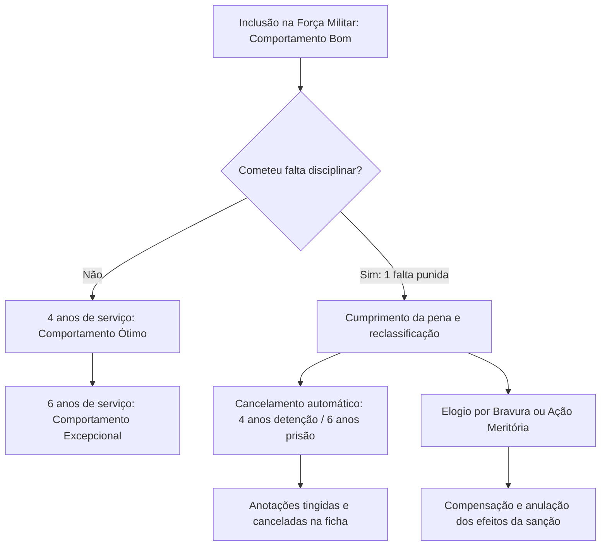

A concretização do regime disciplinar militar exige a previsão de sanções administrativas proporcionais, a aferição contínua da conduta funcional das praças e a tipificação estrita das faltas funcionais. Para definir com precisão o que este material cobre, analisamos o sistema de penas disciplinares, as medidas administrativas acautelatórias, a classificação do comportamento militar, o cancelamento de registros punitivos, as recompensas e as 114 transgressões em espécie da Parte Especial da Lei Estadual nº 11.817, de 24 de julho de 2000. O estudo integrado desses institutos é indispensável para a resolução assertiva das questões de concurso.

> [!objetivos]
> - Compreender o rol, os limites e as peculiaridades das penas disciplinares e medidas administrativas.
> - Analisar as regras de dosimetria, publicação de nota de culpa e formas de modificação da pena aplicada.
> - Dominar a escala móvel de comportamento das praças e as regras de equiparação de punições e sentenças.
> - Identificar os requisitos de cancelamento de penalidades e os reflexos funcionais das recompensas militares.
> - Conhecer a sistemática de distribuição das 114 infrações da Parte Especial entre faltas graves, médias e leves.

## Penas disciplinares e medidas administrativas

A pena disciplinar militar é sanção administrativa aplicada ao militar estadual para fortalecer a disciplina, reeducando o transgressor e prevenindo novas faltas (Lei Estadual nº 11.817/2000, art. 27).

O art. 28 da lei fixa cinco penas disciplinares, em ordem de gravidade:

1. **Repreensão**: sanção formal sem privação de liberdade.
2. **Detenção**: privação relativa de liberdade, com permanência em dependência da OME por até 30 dias (art. 28, § 4º, I). O detido pode participar de instruções e serviços a critério do comando (§ 5º).
3. **Prisão**: privação absoluta de liberdade, em compartimento próprio da OME ou presídio militar, limitada a 30 dias (art. 28, § 4º, II).
4. **Licenciamento a bem da disciplina**: exclusão funcional aplicável a praças sem estabilidade após processo sumário (art. 30, § 1º).
5. **Exclusão a bem da disciplina**: desligamento de Aspirantes e praças com ou sem estabilidade, cabendo ao Poder Judiciário decidir a perda da graduação (art. 30, § 2º).

> [!pegadinha] Advertência não é pena
> A advertência é orientação verbal sem anotação na ficha disciplinar (Lei Estadual nº 11.817/2000, art. 28, § 3º). Não integra o rol de penas. Pode ser usada na primeira falta quando os antecedentes forem favoráveis.

O preso tem direito à imediata comunicação do local de custódia à família (art. 28, § 4º, III). Oficiais, Aspirantes e praças graduadas podem, em casos especiais, cumprir prisão em sua residência (§ 6º). Militares de círculos diferentes não dividem dependência carcerária nem se misturam a presos da Justiça (§ 7º).

> [!lei] Lei Estadual nº 11.817/2000, art. 29
> A aplicação da pena de prisão, sem publicação em boletim, não poderá exceder de 72 (setenta e duas) horas e somente se dará quando configurada a hipótese do § 2º, do art. 11, deste Código e, bem assim, por ordem do Governador do Estado, dos Comandantes Gerais das Corporações Militares Estaduais ou do Chefe da Casa Militar do Governo do Estado, conforme o caso.

As **medidas administrativas** (art. 28, § 1º e art. 38) compreendem: cancelamento de matrícula em curso; afastamento de cargo ou função; movimentação de OME; suspensão de folga para serviço compulsório; e desconto de dias faltados com suspensão do tempo de serviço. Podem ser aplicadas de forma **alternativa** (em faltas leves de militar não reincidente específico no mínimo em comportamento Bom) ou **cumulativa** (em faltas médias ou graves de reincidente específico em comportamento Insuficiente ou Mau).

Em Pernambuco, o Decreto nº 50.014/2020 regulamentou essas penas para afastar o encarceramento físico, mantendo todos os efeitos administrativos e de registro das sanções de detenção e prisão.

A tabela abaixo sintetiza o rol de penalidades disciplinares do art. 28:

| Sanção disciplinar | Característica e forma de cumprimento | Prazo máximo cominado |
| --- | --- | --- |
| Repreensão | Sanção formal sem cerceamento de liberdade | Não tem prazo privativo |
| Detenção | Cerceamento relativo em dependência da unidade | Até 30 dias |
| Prisão disciplinar | Cerceamento absoluto em local próprio da OME | Até 30 dias |
| Prisão sem publicação | Medida excepcional por autoridades de cúpula | Até 72 horas |
| Licenciamento | Afastamento funcional de praças sem estabilidade | Ato administrativo definitivo |
| Exclusão disciplinar | Afastamento de Aspirantes e praças estáveis ou não | Decisão judicial competente |

## Aplicação, cumprimento e modificação das penas disciplinares

A penalidade disciplinar adquire eficácia executiva após publicação em boletim da OME ou Boletim Geral (Lei Estadual nº 11.817/2000, art. 32). A **nota de culpa** descreve os fatos, a classificação da falta, atenuantes e agravantes sopesadas, a pena com início e local, e a nova classificação de comportamento da praça. Penas de oficiais e aspirantes saem em boletim reservado (§ 3º).

A dosimetria obedece aos critérios de proporcionalidade e serenidade (arts. 33 e 34). Cada falta atrai uma única penalidade. Faltas conexas têm as menores como agravantes da principal. Militar sob efeito de álcool ou substâncias tóxicas não pode ser interrogado ou encarcerado, permanecendo detido até a recuperação de sua plena lucidez (art. 35).

Recursos administrativos suspendem o cumprimento da sanção até a decisão final (art. 36). A contagem do tempo de detenção ou prisão inicia-se com o recolhimento efetivo e é suspensa em caso de baixa hospitalar. Se autoridades distintas conhecem a mesma falta, pune a de nível funcional mais elevado (art. 37).

A pena aplicada comporta quatro formas de **modificação** (Lei Estadual nº 11.817/2000, arts. 39 a 44):

- **Anulação** (arts. 40 e 41): torna sem efeito a publicação da pena por ilegalidade ou injustiça, apagando registros e libertando o militar. Cabe a qualquer tempo ao Governador, Secretário de Defesa Social e Comandantes-Gerais, e no prazo de 60 dias às demais autoridades.
- **Relevação** (art. 42): suspende o cumprimento restante da pena quando atingidos os objetivos educativos, ou em passagem de comando, aniversário da OME ou datas cívicas, desde que cumprida pelo menos metade da penalidade.
- **Atenuação** (art. 43): substitui a pena por outra menos rigorosa.
- **Agravação** (art. 44): substitui a pena por modalidade mais rigorosa.

A tabela a seguir compara as quatro modalidades de modificação de penas:

| Forma de modificação | Finalidade e efeito sobre a penalidade | Requisitos temporais ou formais |
| --- | --- | --- |
| Anulação | Torna nula a publicação por ilegalidade ou injustiça | A qualquer tempo para a cúpula; 60 dias para os demais |
| Relevação | Suspende o cumprimento dos dias restantes | Metade da pena cumprida em datas festivas ou metas atingidas |
| Atenuação | Converte a sanção em penalidade mais branda | Motivação fundamentada no interesse disciplinar |
| Agravação | Converte a sanção em penalidade mais severa | Reavaliação justificada da gravidade da conduta |

> [!atencao] Anulação desfaz o ato; relevação suspende a execução
> A anulação invalida a publicação da pena e apaga os registros da ficha funcional. A relevação mantém válida a punição histórica na ficha do militar, apenas perdoando o cumprimento do saldo restante de dias.

## Classificação do comportamento militar das praças

O comportamento militar espelha a conduta civil e funcional da praça sob a ótica disciplinar (Lei Estadual nº 11.817/2000, art. 45). A classificação, reclassificação e melhoria cabem ao Comandante-Geral e aos Comandantes de OME, com publicação obrigatória em boletim (§ 1º).

Ao ingressar na corporação, a praça é classificada no comportamento **Bom** (art. 45, § 2º). A escala móvel de comportamento do art. 46 fixa cinco faixas:

- **Excepcional**: 6 anos de efetivo serviço sem qualquer punição disciplinar.
- **Ótimo**: 4 anos de efetivo serviço com até 1 pena de detenção.
- **Bom**: 2 anos de efetivo serviço com até 1 prisão ou até 2 penalidades menores.
- **Insuficiente**: 2 anos de efetivo serviço com até 2 prisões ou até 4 penalidades menores.
- **Mau**: 1 ano de efetivo serviço com mais de 2 prisões ou até 4 penalidades menores.

A tabela a seguir consolida a escala legal de comportamento das praças:

| Nível de comportamento | Tempo de efetivo serviço exigido | Limite de penalidades sofridas no período |
| --- | --- | --- |
| Excepcional | 6 anos ininterruptos | Nenhuma punição disciplinar |
| Ótimo | 4 anos ininterruptos | Até 1 detenção |
| Bom (nível inicial de inclusão) | 2 anos ininterruptos | 1 prisão ou até 2 sanções menores |
| Insuficiente | 2 anos ininterruptos | Até 2 prisões ou até 4 sanções menores |
| Mau | 1 ano ininterrupto | Mais de 2 prisões ou até 4 sanções menores |

A reclassificação opera automaticamente pela passagem dos prazos legais (art. 47). O tempo começa a contar no dia em que se encerra o cumprimento da pena (art. 48).

A lei estabelece duas regras de conversão:

1. **Equivalência disciplinar** (art. 49): duas detenções equivalem a uma prisão para fins de classificação.
2. **Equiparação judicial** (art. 47, parágrafo único): condenação penal definitiva por crime equivale a uma prisão; condenação por contravenção equivale a uma detenção.

> [!exemplo]
> O Soldado Barbosa, no comportamento Bom, cumpriu 10 dias de detenção até 15 de março de 2024. Se permanecer quatro anos sem sofrer nova sanção, ingressará no comportamento Ótimo em 15 de março de 2028. Mantendo a conduta ilibada por mais dois anos, atingirá o comportamento Excepcional em 15 de março de 2030.

## Cancelamento de registros punitivos e concessão de recompensas

O cancelamento de penalidade é o direito de ter expungida a anotação da sanção em sua ficha disciplinar (Lei Estadual nº 11.817/2000, art. 60).

O cancelamento opera **automaticamente** mediante quatro condições cumulativas (art. 61):

- A falta não pode ter atingido o sentimento do dever, a honra individual, o pundonor militar ou o decoro da classe;
- Bons serviços comprovados na ficha funcional;
- Parecer favorável do comandante da unidade;
- Decurso de **6 anos de efetivo serviço** para cancelar pena de prisão, ou de **4 anos** para pena de detenção (art. 61, IV).

O prazo conta do término do cumprimento da pena (art. 62). As anotações correspondentes devem ser tingidas para tornar a leitura impossível, rubricadas pela autoridade com indicação do boletim concessor (art. 64). O Comandante-Geral pode conceder cancelamento extraordinário a quem prestou relevantes serviços e não foi punido nos últimos dois anos (art. 63).

As **recompensas militares** reconhecem os bons serviços prestados (Lei Estadual nº 11.817/2000, art. 65): compreendem elogio, dispensas do serviço e dispensa de revista do recolher e pernoite para praças e alunos (art. 66).

O **elogio individual** destina-se a militares com atuação destacada (art. 67, § 9º):

- **Bravura**: ação de coragem no cumprimento do dever com risco patente à vida. Anula os efeitos de uma pena de prisão.
- **Ação Meritória**: ato de socorro com exposição da integridade física. Anula os efeitos de uma pena de detenção.
- **Ato de Serviço**: desempenho profissional excepcional na rotina. Anula os efeitos de uma medida administrativa autônoma.

As **dispensas do serviço** (art. 68) dividem-se em parciais e totais. A dispensa total isenta de todos os trabalhos da OME e pode durar até 8 dias por vez e até 16 dias por ano civil, publicada com 24 horas de antecedência (§ 3º).

> [!bizu] Compensação de penas por elogios individuais
> Lembre-se da regra de equivalência: Bravura compensa uma prisão; Ação Meritória compensa uma detenção; Ato de Serviço compensa uma medida administrativa. Duas ações meritórias equivalem a um elogio por bravura.

## Transgressões disciplinares em espécie na Parte Especial

A Parte Especial do Código Disciplinar reúne **114 transgressões** distribuídas entre os arts. 75 e 188. Cada tipo vincula-se a uma sanção e a uma faixa de dias:

A tabela a seguir consolida as três categorias da Parte Especial:

| Natureza da falta | Artigos da lei | Penalidade cominada | Faixas de duração |
| --- | --- | --- | --- |
| Faltas graves | Arts. 75 a 127 | Prisão disciplinar | 5–10, 11–20 ou 21–30 dias |
| Faltas médias | Arts. 128 a 166 | Detenção disciplinar | 11–20 ou 21–30 dias |
| Faltas leves | Arts. 167 a 188 | Detenção disciplinar | 3–5 ou 6–10 dias |

A regra estruturante determina que **todas as faltas graves recebem pena de prisão**, enquanto **todas as faltas médias e leves recebem detenção**. A **repreensão não é aplicada a nenhum tipo da Parte Especial**.

Exemplos de faltas graves cominadas com prisão (arts. 75 a 127):

- Faltar ao serviço para o qual esteja escalado (art. 84: 21 a 30 dias de prisão, com perda de remuneração);
- Abandonar o serviço (art. 85: 21 a 30 dias de prisão);
- Descuidar da guarda de armamento (art. 96: 11 a 20 dias de prisão);
- Espalhar boatos desabonadores da corporação (art. 97: 21 a 30 dias de prisão);
- Travar rixa com igual ou subordinado (art. 110: 21 a 30 dias de prisão);
- Promover manifestação coletiva sobre atos superiores (art. 114: 21 a 30 dias de prisão);
- Ingerir bebida alcoólica em serviço ou introduzi-la em quartel (arts. 121 e 122: 21 a 30 dias de prisão);
- Paralisar serviço militar ou incitar paralisação (arts. 126 e 127: 21 a 30 dias de prisão).

Exemplos de faltas médias punidas com detenção (arts. 128 a 166):

- Faltar com a verdade em apuração funcional (art. 128: 20 a 30 dias de detenção);
- Apresentar tatuagem ofensiva à mostra no uniforme (art. 130: 11 a 20 dias de detenção);
- Apresentar-se com uniforme incompleto (art. 131: 11 a 20 dias de detenção);
- Deixar de prestar continência regulamentar (art. 133: 11 a 20 dias de detenção);
- Chegar atrasado ao serviço (art. 143: 11 a 20 dias de detenção);
- Permutar serviço sem autorização superior (art. 144: 11 a 20 dias de detenção).

Exemplos de faltas leves apenadas com detenção menor (arts. 167 a 188):

- Fumar em dependência de área proibida (art. 172: 3 a 5 dias de detenção);
- Fazer ruído em alojamento durante repouso (art. 173: 3 a 5 dias de detenção);
- Portar barba, bigode ou cabelo fora do padrão (arts. 183 a 185: 3 a 5 dias de detenção);
- Deixar de portar documento de identidade funcional (art. 181: 6 a 10 dias de detenção);
- Deixar de comunicar atualização de residência (art. 188: 6 a 10 dias de detenção).

> [!pegadinha] Classificação de infrações na Parte Especial
> Bancas examinadoras costumam trocar o nível de gravidade das transgressões. É clássico afirmar que faltar com a verdade é infração grave, quando o art. 128 tipifica essa conduta como falta média cominada com detenção de 20 a 30 dias.

## Mapa do capítulo

O esquema abaixo sintetiza a trajetória do comportamento das praças, os prazos de cancelamento de penas e o efeito mitigador das recompensas:

### Para fixar

- O rol de penas do art. 28 compreende: repreensão, detenção, prisão, licenciamento e exclusão a bem da disciplina.
- A advertência é orientação verbal sem registro e não se confunde com pena disciplinar.
- O limite máximo para o cumprimento das penas de detenção e de prisão é de 30 dias.
- A prisão sem prévia publicação em boletim só pode perdurar por até 72 horas em casos excepcionais.
- O licenciamento aplica-se a praças sem estabilidade; a exclusão alcança Aspirantes e praças estáveis ou não.
- A anulação torna sem efeito a publicação da pena; a relevação suspende o cumprimento do restante dos dias.
- A praça ingressa no comportamento Bom; o comportamento Excepcional exige seis anos de efetivo serviço sem punição.
- Duas penalidades de detenção equivalem a uma de prisão para todos os fins de modulação do comportamento.
- O cancelamento automático exige conceito favorável e seis anos de serviço para prisão ou quatro anos para detenção.
- Na Parte Especial, as faltas graves recebem prisão; as faltas médias e leves recebem detenção; nenhuma recebe repreensão.
