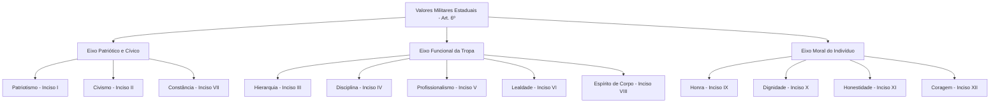

A carreira militar estadual exige padrão irrepreensível de conduta nos quartéis e na vida comunitária. O Decreto Estadual nº 22.114/2000 aprova o Regulamento de Ética Profissional dos Militares do Estado de Pernambuco, conhecido nos editais como Código de Ética da PMPE e do CBMPE. A norma regulamenta os artigos 26 a 29 da Lei Estadual nº 6.783/1974 (Estatuto dos Militares). Para quem disputa o oficialato, dominar seus conceitos, valores, proibições e regras de direitos humanos é decisivo para gabaritar a prova.

> [!objetivos]
> - Diferenciar os conceitos de honra, sentimento do dever, pundonor e decoro da classe militar.
> - Conhecer os doze valores militares estaduais e suas definições legais no decreto.
> - Identificar as proibições funcionais e as regras patrimoniais dos parágrafos do artigo 7º.
> - Compreender a gradação da responsabilidade hierárquica e a vedação absoluta à tortura.

## Disposições preliminares e princípios fundamentais

O Regulamento de Ética norteia a formação da consciência profissional do militar de Pernambuco (art. 1º). Seus preceitos impõem obediência à lei, cumprimento das ordens legítimas e respeito aos direitos fundamentais. A atividade militar lida diretamente com a segurança da sociedade e o socorro público.

A função militar carrega uma parcela do poder estatal (art. 2º). Por essa razão, o militar estadual pode tomar decisões rápidas, expedir ordens e restringir bens ou direitos quando a lei autorizar. Em contrapartida, a sociedade exige atributos morais, técnicos e intelectuais exemplares (art. 3º). O bombeiro e o policial militar devem atuar como modelos de cidadania.

A exigência ética não se limita aos momentos de escala. Ela vigora de modo permanente, em serviço ou fora dele (art. 2º). Suas ações devem fortalecer a hierarquia e valorizar o conceito social das corporações militares.

No exercício de suas funções, o militar segue princípios essenciais (art. 3º). Ele observa legalidade, impessoalidade, moralidade, publicidade e eficiência. Também respeita finalidade, motivação, razoabilidade, proporcionalidade e interesse público.

### Os quatro pilares conceituais do artigo 4º

Ao ingressar na carreira, o militar firma compromisso solene de honra (art. 4º). Nesse ato, ele declara aceitar os valores, deveres e preceitos morais da corporação. As bancas de concurso costumam cobrar a letra exata dos quatro conceitos definidos nos parágrafos do artigo 4º.

A tabela a seguir resume as quatro definições legais do artigo 4º do Decreto Estadual nº 22.114/2000.

| Conceito ético | Base legal | Definição no Decreto Estadual nº 22.114/2000 | Foco principal |
| --- | --- | --- | --- |
| Honra militar | Art. 4º, § 1º | Qualidade íntima do militar que se conduz com integridade, honestidade, honradez e justiça, observando deveres morais próprios e coletivos. | Qualidade íntima individual voltada à integridade e justiça. |
| Sentimento do dever militar | Art. 4º, § 2º | Consciência perante o caso concreto e a realidade, exigindo comportamento militar coerente, justo e equânime. | Consciência perante a realidade fática e conduta justa. |
| Pundonor militar | Art. 4º, § 3º | Sentimento de dignidade própria que leva o militar a honrar a corporação pela beleza e retidão moral de seus atos. | Brio pessoal e dignidade própria do profissional. |
| Decoro da classe militar | Art. 4º, § 4º | Qualidade fundada no respeito próprio dos companheiros e da sociedade, buscando o digno desempenho da profissão. | Conceito social coletivo e reputação perante a comunidade. |

> [!pegadinha] Troca entre pundonor militar e decoro da classe
> A banca costuma inverter estes conceitos em questões de múltipla escolha. Guarde a distinção: **pundonor** é a *dignidade própria individual* do militar. Por sua vez, **decoro da classe** é a *dimensão social coletiva*, baseada no respeito dos colegas e da comunidade.

A deontologia militar estadual abrange o conjunto de valores e deveres éticos que orientam a conduta funcional (art. 5º). Ela visa ao bem comum por meio da preservação da ordem pública e da defesa civil. Suas regras alcançam todos os militares estaduais, sem distinção de posto ou graduação (art. 5º, parágrafo único). Elas vinculam tanto os militares da ativa quanto os inativos na reserva ou reformados.

> [!exemplo] Conduta do militar no ambiente civil
> Um tenente bombeiro de folga se envolve em discussão no estacionamento de um comércio. Ele profere insultos contra populares e afirma que sua palavra tem peso superior por ser oficial. Essa conduta atenta contra o pundonor e o decoro da classe militar. O dever de integridade moral acompanha o militar em qualquer ambiente social.

## Os doze valores militares estaduais

Os valores militares determinam a moral dos integrantes da PMPE e do CBMPE (art. 6º). Eles sustentam o compromisso diário com a proteção da vida e da sociedade pernambucana. O artigo 6º lista doze valores institucionais que aparecem com frequência em enunciados literais.

O esquema a seguir agrupa os doze valores militares estaduais em três eixos de conduta.

A tabela a seguir apresenta os doze valores militares do artigo 6º com sua redação legal.

| Inciso | Valor militar | Conteúdo legal no Decreto Estadual nº 22.114/2000 |
| --- | --- | --- |
| I | Patriotismo | Revelado no amor e dedicação à Pátria. |
| II | Civismo | Culto aos símbolos e tradições da Pátria e das corporações, com dedicação ao interesse público. |
| III | Hierarquia | Respeito e valorização dos postos e graduações da carreira. |
| IV | Disciplina | Exato cumprimento do dever, essencial à manutenção da ordem pública. |
| V | Profissionalismo | Exercício da profissão com entusiasmo e busca constante de perfeição. |
| VI | Lealdade | Fidelidade aos compromissos com a Pátria, as corporações e os superiores. |
| VII | Constância | Firmeza de ânimo e fé nas corporações militares estaduais. |
| VIII | Espírito de corpo | Orgulho pela corporação em que serve, com mútua identificação entre os integrantes. |
| IX | Honra | Busca legítima de reconhecimento interno e externo para as corporações. |
| X | Dignidade | Respeito a si mesmo e a todas as pessoas, sem distinção. |
| XI | Honestidade | Probidade nas funções públicas e na condução da vida privada. |
| XII | Coragem | Destemor perante o perigo e abnegação na defesa de pessoas, bens e meio ambiente. |

> [!bizu] Memorização dos termos legais centrais
> Associe o valor ao seu núcleo legal: **disciplina** é o *exato cumprimento do dever*; **hierarquia** é o *respeito aos postos e graduações*; **constância** representa a *firmeza de ânimo e fé*; e **coragem** consiste no *destemor ante o perigo*.

## Deveres éticos e regras comportamentais

Os deveres éticos derivam dos valores militares e regulam a atividade da tropa. O artigo 7º reúne trinta e sete incisos no caput e onze parágrafos de grande importância. Eles definem comportamentos obrigatórios e limites funcionais estritos.

Entre as regras do caput do artigo 7º, merecem atenção:
1. Amar a verdade e a responsabilidade como fundamentos da dignidade (inciso XXIV);
2. Exercer as atribuições com probidade, eficiência e equilíbrio, sem desvios de conduta (incisos XI e XXXIII);
3. Guardar sigilo sobre assuntos confidenciais obtidos no cargo, salvo por ordem da justiça ou disciplina militar (inciso XXXVI);
4. Conduzir-se com boa educação e discrição nas palavras e atitudes (inciso XXVII);
5. Recusar vantagens indevidas e abster-se de usar o cargo para obter privilégios particulares (incisos XXI e XXXII);
6. Defender a comunidade e o patrimônio com dedicação, mesmo arriscando a própria vida (inciso XXXIV);
7. Agir mesmo fora de serviço para conter desordens ou prestar socorro se faltar tropa de serviço no local (inciso XXXV);
8. Respeitar a integridade de qualquer pessoa sob custódia, sem preconceito de raça, cor, sexo ou credo (incisos XXVI e XXX).

### Vedações funcionais e regras dos parágrafos do artigo 7º

Os parágrafos 1º a 11 do artigo 7º trazem mandamentos que as bancas adoram transformar em pegadinhas. Conheça cada regra com atenção:

1. **Jornada e prontidão (§§ 1º e 2º):** a dedicação integral ao serviço militar (inciso X) obriga o militar a cumprir escalas, patrulhas, exercícios e serviços extraordinários. Ele permanece sujeito a sobreaviso, prontidão e marcha.
2. **Proibição de comércio e segurança privada (§ 3º):** o militar da ativa não pode exercer segurança privada nem administrar empresas comerciais ou industriais.
3. **Exceção para sócio quotista e gestão patrimonial (§§ 3º e 4º):** o militar da ativa pode ser acionista em sociedade anônima ou quotista em sociedade limitada. Ele não pode exercer função de gerência ou direção. O militar pode gerir seus próprios bens e imóveis particulares.
4. **Manifestações políticas dos militares da ativa (§§ 5º e 9º):** são vedadas aos militares da ativa manifestações coletivas ou individuais sobre atos de chefes, reivindicações salariais ou temas sigilosos. É proibido participar fardado de eventos político-partidários, salvo em escala oficial de serviço.
5. **Participação política de inativos (§§ 6º e 7º):** o militar inativo ou agregado para disputar eleição pode atuar em partidos e manifestar opiniões civis. Ele só não pode tratar de assuntos militares sigilosos. Essa liberdade não se aplica ao inativo convocado ou mobilizado para o serviço ativo.
6. **Vedação de desvio de função para órgãos civis (§ 8º):** é proibido ceder militares para atuar em órgãos civis sem autorização legal ou regulamentar expressa, sob pena de responsabilidade da chefia.
7. **Acúmulo de cargos (§ 10):** é vedado acumular cargos públicos, salvo nas hipóteses autorizadas pela Constituição Federal (CF, art. 42, § 3º, e art. 37, XVI, que permite acumulação na área de saúde ou magistério).
8. **Esclarecimento patrimonial (§ 11):** o Comandante Geral pode determinar ao subordinado da ativa que justifique a origem de seus bens quando houver razões legítimas para a apuração.

> [!lei] Decreto Estadual nº 22.114/2000, art. 7º, § 3º
> Ao militar estadual da ativa é vedado exercer atividade de segurança privada, fazer parte de firmas comerciais, de empresas industriais e serviços de qualquer natureza, ou nela exercer função ou emprego remunerado, exceto como acionista, quotista em sociedade anônima ou por quotas de responsabilidade limitada.

> [!atencao] Sócio investidor versus administrador
> O militar da ativa pode possuir cotas ou ações de empresas privadas como investidor passivo. A lei proíbe que ele atue como gerente, administrador ou diretor do negócio. Também veda qualquer vínculo remunerado com segurança privada. A gestão do próprio patrimônio pessoal e familiar continua assegurada pelo parágrafo 4º.

## Violação ética e responsabilidade solidária

A inobservância dos deveres éticos sujeita o militar estadual a sanções rigorosas. O artigo 8º estabelece que a violação desses preceitos constituirá crime, contravenção penal ou transgressão disciplinar. O enquadramento segue a legislação própria de cada área.

O artigo 8º, parágrafo 2º, traz uma regra de dosimetria que orienta os julgamentos disciplinares: **a violação dos preceitos será tão mais grave quanto mais elevado for o grau hierárquico de quem a cometer**. O superior hierárquico deve ser exemplo de retidão moral para os subordinados. Por isso, suas faltas funcionais recebem punições mais duras.

A apuração criminal militar e o processo administrativo disciplinar são instâncias autônomas (art. 8º, § 3º). Quando houver concurso de crime militar e transgressão disciplinar da mesma natureza, o processo penal militar não suspende a apuração disciplinar interna. O comando da corporação pode aplicar a sanção disciplinar sem aguardar a sentença da Justiça Militar.

### Tríplice responsabilidade e solidariedade

O descumprimento dos deveres éticos pode acarretar sanções nas esferas civil, penal e administrativa de modo independente (Decreto Estadual 22.114/2000, art. 8º, § 4º). Se mais de um militar participar da infração, a responsabilidade é solidária (art. 8º, § 5º). Cada agente responde proporcionalmente pelos danos causados ao patrimônio e aos serviços públicos.

A solidariedade abrange duas situações operacionais importantes:
- **Omissão funcional perante infração conhecida:** responde solidariamente o militar que presencia a infração e deixa de impedi-la podendo agir. Também responde quem toma conhecimento do fato e não o comunica formalmente ao comandante competente.
- **Cumprimento de ordem manifestamente ilegal:** quem expede a ordem ilegal responde pelo comando abusivo. O subordinado que executa ordem manifestamente ilegal ou comete excessos desmedidos na execução de ordem legal responde solidariamente pelo ato. O dever de obediência cessa perante determinações contrárias à lei.

> [!exemplo] Responsabilidade por tolerar infração de subordinado
> Em uma operação de combate a incêndio em Paulista, um sargento nota que um soldado guardou equipamentos da vítima na viatura particular. O graduado decide não intervir e não relata a conduta ao oficial de dia. Nos termos do artigo 8º, parágrafo 5º, do Decreto Estadual nº 22.114/2000, o sargento responde solidariamente pela infração disciplinar por sua omissão.

## Direitos humanos e limites ao uso da força

O Capítulo IV do regulamento (artigos 9º a 16) incorpora os padrões internacionais da Organização das Nações Unidas. A norma recepciona as diretrizes da Resolução 34/169 de 1979, referente ao Código de Conduta para os Responsáveis pela Aplicação da Lei (art. 9º).

O militar estadual atua para proteger todas as pessoas contra atos ilegais (art. 10). Sua missão exige respeito permanente à dignidade humana e aos direitos fundamentais (art. 11). Ele serve à comunidade com equilíbrio e senso de justiça.

### Parâmetros para o emprego da força física

O emprego da força pelo militar obedece a limites rígidos (art. 12). A força só pode ser utilizada quando for estritamente necessária e na medida exigida para cumprir a missão legítima. Essa atuação baseia-se em quatro balizas doutrinárias:
- **Legalidade:** a ação do militar deve encontrar fundamento expresso nas leis vigentes;
- **Necessidade:** a força só é aplicada quando os meios persuasivos e a negociação se mostrarem insuficientes;
- **Proporcionalidade:** a energia empregada deve corresponder ao nível de ameaça e resistência oferecido;
- **Moderação:** a força cessa assim que a resistência for contida e o perigo neutralizado.

### Vedação irrestrita da prática de tortura

O artigo 13 do regulamento firma a proibição absoluta de qualquer ato de tortura ou tratamento desumano:

> [!lei] Decreto Estadual nº 22.114/2000, art. 13
> Nenhum militar estadual pode infligir, instigar ou tolerar qualquer ato de tortura ou qualquer outra forma de tratamento cruel, desumano ou degradante, nem invocar ordens superiores ou circunstâncias excepcionais, tais como o estado de guerra ou uma ameaça à segurança nacional, instabilidade política e interna ou qualquer outra emergência pública, como justificação para torturas ou outras formas de tratamentos cruéis, desumanos ou degradantes.

A proibição da tortura não admite ressalvas. O militar não pode invocar:
- Ordens de superiores hierárquicos;
- Estado de guerra ou confronto armado;
- Ameaça à segurança nacional;
- Crise política ou desordem interna;
- Situações de calamidade pública ou emergência coletiva.

> [!atencao] Proibição irrestrita de tortura
> A banca examinadora costuma sugerir que emergências graves autorizam o uso de métodos degradantes para obter dados urgentes. Essa tese é incorreta. O artigo 13 veda a tortura de forma absoluta. Nenhuma justificativa política, militar ou funcional legitima atos cruéis contra qualquer cidadão.

### Deveres especiais de proteção e ensino obrigatório

Os artigos seguintes impõem deveres de preservação de direitos e conduta ilibada:
- **Proteção à saúde dos custodiados (art. 14):** o militar deve garantir a saúde das pessoas sob sua guarda e providenciar assistência médica imediata quando necessário.
- **Combate à corrupção (art. 15):** o militar não comete atos de corrupção e combate com firmeza qualquer desvio de conduta funcional.
- **Vedação à discriminação (art. 16):** deve respeitar todas as pessoas sem distinção de raça, cor, sexo, idade, religião, posição social ou convicção política.

As disposições finais do decreto disciplinam a aplicação do regulamento (arts. 17 a 19). O Código Disciplinar deve refletir suas normas (art. 17). As matérias de Deontologia Militar, Direitos Humanos e Cidadania são obrigatórias nos cursos de formação e aperfeiçoamento da PMPE e do CBMPE (art. 18). Por fim, os Comandantes Gerais podem editar portarias com manuais de conduta e posturas éticas, ouvido o Secretário de Defesa Social (art. 19).

## Mapa do capítulo

A tabela a seguir apresenta os eixos temáticos do Decreto Estadual nº 22.114/2000, suas regras principais e os pontos mais exigidos em provas.

| Eixo temático | Artigos | Principais determinações normativas | Ponto crítico em prova |
| --- | --- | --- | --- |
| Disposições preliminares | Arts. 1º a 5º | Aplicação a ativos e inativos de todos os postos; conduta ética permanente; conceitos de honra, dever, pundonor e decoro. | Pundonor é brio individual; decoro da classe é o conceito social coletivo da corporação. |
| Valores militares | Art. 6º | Doze valores estruturantes da moral militar estadual. | Memorização dos doze valores legais previstos no art. 6º. |
| Deveres e vedações | Art. 7º e §§ 1º a 11 | Trinta e sete deveres; proibição de comércio e segurança privada; permissão para acionista ou quotista. | Militar da ativa pode ser sócio quotista, mas não administrador ou gerente de empresa. |
| Violação ética | Art. 8º | Falta mais grave conforme a hierarquia; esferas independentes; solidariedade por omissão ou ordem ilegal. | A gravidade da transgressão ética cresce com o posto ou graduação do transgressor. |
| Direitos humanos | Arts. 9º a 19 | Adesão às normas da ONU; uso moderado da força; vedação absoluta à tortura; ensino obrigatório em cursos. | A tortura não admite exceções nem justificativas por ordem superior ou emergência pública. |

### Para fixar

- O Código de Ética vincula militares da ativa e da inatividade, sem distinção de postos ou graduações.
- A honra militar é a qualidade íntima voltada à integridade, honestidade e deveres morais.
- O sentimento do dever militar consiste na tomada de consciência perante a realidade do caso concreto.
- O pundonor militar representa a dignidade e a retidão moral do indivíduo perante a corporação.
- O decoro da classe militar traduz a reputação e o respeito social da instituição perante a comunidade.
- O militar da ativa pode ser quotista ou acionista, mas não pode gerenciar empresas comerciais.
- A reprovação disciplinar é mais grave à medida que se eleva o grau hierárquico do militar.
- Responde solidariamente quem presencia infração e se omite, bem como quem cumpre ordem manifestamente ilegal.
- O uso da força física é restrito à estrita necessidade e governado pelo princípio da moderação.
- A proibição à tortura tem caráter absoluto, inexistindo exceção para estado de guerra ou ordem superior.
