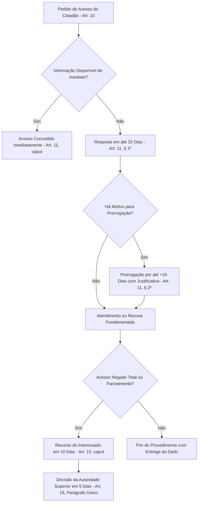

O direito à informação pública é garantia basilar do Estado Democrático de Direito. A Lei Federal nº 12.527/2011, conhecida como Lei de Acesso à Informação (LAI), regulamenta o mandamento constitucional do artigo 5º, inciso XXXIII, da Carta Magna. Ela define regras uniformes para a transparência estatal e estabelece que a publicidade é o preceito geral, enquanto o sigilo é a exceção. Os órgãos públicos, inclusive as corporações militares, gerenciam relatórios técnicos, perícias, autos de vistorias e registros funcionais. Dominar os prazos, procedimentos, graus de sigilo e sanções da LAI é indispensável para a gestão pública e para a prova.

> [!objetivos]
> - Identificar a abrangência subjetiva e as diretrizes fundamentais da Lei Federal nº 12.527/2011.
> - Compreender os conceitos de transparência ativa e passiva, seus prazos e a vedação de exigir motivação.
> - Diferenciar os graus de sigilo da informação e as regras de proteção às informações de caráter pessoal.
> - Reconhecer as condutas ilícitas funcionais e a equiparação das infrações à transgressão militar média ou grave.

## Abrangência, diretrizes e conceitos fundamentais

A Lei Federal nº 12.527/2011 possui natureza de norma nacional e vincula todas as esferas federativas (art. 1º). Suas determinações incidem de forma cogente sobre:
- **Administração direta de todos os Poderes:** órgãos dos Poderes Executivo, Legislativo (incluindo os Tribunais de Contas da União, dos Estados e dos Municípios) e Judiciário, além do Ministério Público da União, dos Estados e do Distrito Federal;
- **Administração indireta:** autarquias, fundações públicas, empresas públicas e sociedades de economia mista;
- **Entidades privadas sem fins lucrativos (art. 2º):** organizações que recebam recursos públicos diretamente do orçamento ou mediante termos de parceria, convênios, contratos de gestão ou subvenções sociais. O parágrafo único do artigo 2º delimita a publicidade dessas entidades estritamente à parcela das verbas públicas recebidas e à sua regular destinação.

O artigo 3º consagra cinco diretrizes que norteiam todo o sistema de acesso aos registros governamentais:
1. Observância da publicidade como preceito geral e do sigilo como exceção;
2. Divulgação de dados de interesse público independentemente de solicitações prévias;
3. Emprego prioritário de tecnologias da informação e da comunicação;
4. Fomento ao desenvolvimento da cultura de transparência pública;
5. Fortalecimento dos instrumentos de controle social sobre a gestão estatal.

### Conceitos estruturantes da informação pública

O artigo 4º define termos operacionais indispensáveis para a aplicação uniforme da lei. As bancas examinadoras cobram frequentemente a redação dessas definições legais.

A tabela a seguir apresenta os nove conceitos fundamentais definidos no artigo 4º da Lei Federal nº 12.527/2011.

| Conceito legal | Base na LAI | Definição expressa no artigo 4º | Núcleo do conceito |
| --- | --- | --- | --- |
| Informação | Art. 4º, inciso I | Dados, processados ou não, que podem ser utilizados para produção e transmissão de conhecimento, contidos em qualquer meio ou suporte. | Dados brutos ou processados em qualquer meio. |
| Documento | Art. 4º, inciso II | Unidade de registro de informações, qualquer que seja o suporte ou formato. | Unidade material ou digital de registro. |
| Informação sigilosa | Art. 4º, inciso III | Aquela submetida temporariamente à restrição de acesso público por sua imprescindibilidade à segurança da sociedade e do Estado. | Restrição de acesso necessariamente temporária. |
| Informação pessoal | Art. 4º, inciso IV | Aquela relacionada à pessoa natural identificada ou identificável. | Vinculação direta a indivíduo pessoa natural. |
| Tratamento da informação | Art. 4º, inciso V | Conjunto de ações referentes a produção, recepção, classificação, utilização, arquivamento e controle da informação. | Ciclo completo de gestão documental. |
| Disponibilidade | Art. 4º, inciso VI | Qualidade da informação que pode ser conhecida e utilizada por indivíduos, equipamentos ou sistemas autorizados. | Acesso garantido a quem tem autorização. |
| Autenticidade | Art. 4º, inciso VII | Qualidade da informação que tenha sido produzida, expedida, recebida ou modificada por determinado indivíduo ou sistema. | Certeza da autoria e da origem do registro. |
| Integridade | Art. 4º, inciso VIII | Qualidade da informação não modificada, inclusive quanto a origem, trânsito e destino. | Informação intacta, preservada e sem adulterações. |
| Primariedade | Art. 4º, inciso IX | Qualidade da informação coletada na fonte, com o máximo de detalhamento possível, sem modificações. | Dado coletado diretamente na fonte de origem. |

> [!pegadinha] Primariedade versus integridade e autenticidade
> Memorize as diferenças: **primariedade** significa coleta *direta na fonte* com máximo detalhamento; **integridade** refere-se à informação *não modificada* ou não corrompida em seu conteúdo; e **autenticidade** assegura a *certeza da autoria* e da expedição do documento por quem declara tê-lo produzido.

## Transparência ativa, passiva e procedimento de acesso

A LAI estrutura o dever de transparência governamental em dois eixos operacionais: a divulgação espontânea pela administração (transparência ativa) e o fornecimento de respostas a solicitações dos cidadãos (transparência passiva).

### Transparência ativa e a regra para pequenos municípios

O artigo 8º estabelece o dever dos órgãos públicos de promover, independentemente de requerimento de qualquer interessado, a divulgação de informações de interesse coletivo em locais de fácil acesso e na internet. Os portais de transparência devem veicular dados institucionais, endereços, telefones, horários de atendimento, repasses financeiros, despesas orçamentárias, procedimentos licitatórios, contratos firmados e respostas a perguntas frequentes da população.

A lei traz uma regra especial de flexibilização para municípios de pequeno porte. De acordo com o artigo 8º, parágrafo 4º, os Municípios com população de até dez mil habitantes ficam dispensados da manutenção obrigatória de portal eletrônico próprio na internet. Contudo, essa dispensa não afasta a obrigação de disponibilizar em tempo real as informações da execução orçamentária e financeira exigidas pela legislação de responsabilidade fiscal.

### Transparência passiva e proibição de exigir justificativa

A transparência passiva disciplina o procedimento formal de requerimento de informações pelos cidadãos (arts. 10 a 12). Qualquer pessoa física ou jurídica pode apresentar pedido de acesso perante órgãos e entidades públicas por qualquer meio legítimo. O requerimento deve conter apenas dois requisitos essenciais: a identificação do solicitante e a especificação clara do dado pretendido (art. 10, caput).

O parágrafo 3º do artigo 10 traz uma das regras de ouro mais repetidas pelas bancas em provas de legislação:

> [!lei] Lei Federal nº 12.527/2011, art. 10, § 3º
> São vedadas quaisquer exigências relativas aos motivos determinantes da solicitação de informações de interesse público.

O cidadão não precisa justificar por que deseja os dados governamentais. O agente público não pode condicionar o fornecimento da informação à apresentação de motivos, finalidades de pesquisa ou demonstração de interesse pessoal. A informação pertence à coletividade.

O serviço de busca e fornecimento de informações é inteiramente gratuito (art. 12). A administração somente pode cobrar o valor estritamente necessário ao ressarcimento dos custos materiais de reprodução reprográfica física. A cobrança é dispensada para o solicitante cuja situação econômica não lhe permita arcar com o custo sem prejuízo do sustento próprio ou da família.

### Prazos procedimentais e recursos cabíveis

O artigo 11 estabelece os prazos legais para resposta aos pedidos formulados pelo cidadão. Se a informação solicitada estiver disponível e acessível, o órgão deve autorizar ou conceder o acesso imediato.

Quando não for possível a entrega imediata, o órgão público dispõe do prazo regular de até vinte dias para atender ao pedido (art. 11, § 1º). Dentro desse prazo, a autoridade deve adotar uma de três posturas formais:
1. Indicar a data, o local e o modo pelo qual o cidadão poderá consultar o documento ou obter cópia;
2. Apresentar as razões fáticas e jurídicas que fundamentam a recusa total ou parcial do acesso pretendido;
3. Informar que não possui o dado e apontar, se souber, o órgão público que o detém, ou remeter o pedido ao órgão competente.

O prazo regular de vinte dias pode ser prorrogado por mais dez dias, mediante justificativa expressa encaminhada ao requerente antes do término do prazo ordinário (art. 11, § 2º). Dessa forma, o prazo total para resposta da administração não ultrapassa trinta dias.

O diagrama a seguir sintetiza o fluxo procedimental de acesso à informação, seus prazos e a fase recursal na LAI.

No caso de negativa de acesso à informação ou de recusa injustificada dos motivos da decisão, o interessado pode interpor recurso administrativo no prazo de dez dias, contados da ciência da decisão (art. 15, caput). O recurso é dirigido à autoridade hierarquicamente superior àquela que proferiu a decisão impugnada, cabendo a esta deliberar no prazo improrrogável de cinco dias (art. 15, parágrafo único).

> [!exemplo] Pedido de relatório pericial ao CBMPE
> Um munícipe formula requerimento formal ao Corpo de Bombeiros Militar solicitando cópia do relatório de vistoria de segurança contra incêndio e pânico de uma casa de eventos vizinha. O oficial encarregado não pode exigir que o requerente comprove a razão da solicitação ou comprove ser vizinho do imóvel. Se o documento estiver pronto, o acesso deve ser concedido imediatamente ou em até vinte dias, conforme preceituam os artigos 10 e 11 da Lei Federal nº 12.527/2011.

## Restrições de acesso, sigilo e proteção de dados pessoais

A publicidade é a regra geral da administração pública, mas o sigilo é admitido de forma excepcional e temporária. A restrição ao acesso público é autorizada exclusivamente quando o conhecimento da informação for imprescindível à segurança da sociedade ou do Estado (art. 23).

A lei estabelece uma blindagem categórica em matéria de garantias fundamentais:

> [!atencao] Vedação absoluta de sigilo em violações de direitos humanos
> De acordo com o artigo 21, parágrafo único, da Lei Federal nº 12.527/2011, as informações ou documentos que versem sobre condutas que impliquem violação dos direitos humanos praticada por agentes públicos ou a mando de autoridades públicas **não poderão ser objeto de restrição de acesso sob nenhum pretexto**. O sigilo não pode acobertar abusos estatais.

### Graus de sigilo e prazos máximos de restrição

O artigo 24 da LAI divide a informação sigilosa em três escalões temporais rigorosos, contados a partir da data de sua produção documental:
- **Ultrassecreta:** prazo máximo de restrição de vinte e cinco anos;
- **Secreta:** prazo máximo de restrição de quinze anos;
- **Reservada:** prazo máximo de restrição de cinco anos.

A regra geral do artigo 24, parágrafo 4º, fixa que, decorrido o prazo legal de classificação ou cumprido o evento previsto, a informação torna-se compulsoriamente de acesso público automático. O grau **ultrassecreto** é o único que admite prorrogação temporal por uma única vez e por igual período (art. 35, § 1º, inciso III). Essa prorrogação excepcional só pode ser determinada privativamente pela Comissão Mista de Reavaliação de Informações (CMRI), no âmbito federal. Os graus secreto e reservado são improrrogáveis.

A tabela a seguir consolida as diferenças fundamentais entre os três graus de sigilo previstos no artigo 24 da LAI.

| Grau de sigilo | Prazo máximo de restrição | Prorrogação de prazo admitida | Termo inicial da contagem | Autoridades com competência para classificar |
| --- | --- | --- | --- | --- |
| Ultrassecreta | Até 25 anos | Prorrogável uma única vez por igual período, privativamente pela CMRI. | Data de produção do documento. | Presidente e Vice da República, Ministros de Estado, Comandantes das Forças e Chefes de Missões Diplomáticas. |
| Secreta | Até 15 anos | Não admite prorrogação de prazo em hipótese alguma. | Data de produção do documento. | Autoridades do grau ultrassecreto, mais dirigentes máximos de autarquias, fundações e estatais. |
| Reservada | Até 5 anos | Não admite prorrogação de prazo em hipótese alguma. | Data de produção do documento. | Autoridades dos graus anteriores, mais ocupantes de funções de direção, chefia e comando equivalentes a DAS 101.5. |

O artigo 24 traz ainda duas regras especiais de contagem:
- **Segurança do Chefe do Executivo Federal (§ 2º):** as informações relativas à segurança do Presidente e do Vice-Presidente da República, bem como de seus cônjuges e filhos, são compulsoriamente classificadas como **reservadas**. O sigilo dessas informações perdura até o término definitivo do mandato em exercício ou do segundo mandato consecutivo, em caso de reeleição;
- **Evento determinado (§ 3º):** a autoridade classificadora pode estipular como termo final de restrição a ocorrência de determinado evento futuro, desde que este aconteça antes do encerramento do prazo temporal máximo.

### Tratamento protetivo das informações de caráter pessoal

A LAI traça uma divisão clara entre informação classificada por sigilo estatal (arts. 23 e 24) e **informações de caráter pessoal** (art. 31). As informações pessoais dizem respeito à intimidade, vida privada, honra e imagem das pessoas naturais.

As regras de tutela dessas informações apresentam grande densidade normativa:
- **Restrição de acesso por até cem anos (art. 31, § 1º, inciso I):** as informações pessoais relativas à vida privada e à honra terão seu acesso restrito a agentes públicos autorizados e à própria pessoa a que se referem pelo **prazo máximo de cem anos a contar da data de sua produção**, independentemente de qualquer ato formal de classificação de sigilo;
- **Dispensa excepcional do consentimento do titular (art. 31, § 3º):** a consulta e a divulgação independem do consentimento prévio da pessoa natural em cinco hipóteses estritas: (I) tratamento e diagnóstico médico emergencial quando a pessoa estiver incapaz; (II) realização de pesquisas estatísticas oficiais com anonimização; (III) cumprimento de determinação judicial; (IV) defesa de direitos humanos; e (V) tutela de interesse público preponderante previsto em lei;
- **Proibição de invocação para obstruir investigações (art. 31, § 4º):** a proteção à intimidade e à imagem não pode ser utilizada com o objetivo de embaraçar apuração de irregularidades funcionais em que o titular estiver envolvido, nem para impedir ações de recuperação de fatos históricos relevantes.

## Responsabilidades dos agentes públicos e das entidades privadas

A preservação da integridade da informação e o respeito aos prazos legais constituem deveres funcionais inescusáveis. O descumprimento dos ditames da LAI acarreta a responsabilização administrativa, civil e criminal dos agentes faltosos.

### Condutas ilícitas funcionais do agente público

O artigo 32 da LAI arrola condutas consideradas ilícitas que ensejam a apuração de falta funcional do agente público civil ou militar. Constituem infrações funcionais expressas:
1. Recusar-se a fornecer informação requerida na forma da lei, atrasar deliberadamente seu envio ou prestá-la conscientemente de forma errônea, parcial ou imprecisa;
2. Utilizar indevidamente, destruir, extraviar, fraudar, ocultar ou corromper papéis e dados mantidos sob custódia estatal;
3. Proceder com dolo ou evidente má-fé na análise das solicitações de acesso;
4. Divulgar ou tolerar a revelação indevida de dados sigilosos ou registros de natureza privada;
5. Atribuir classificação de sigilo injustificada para encobrir ato ilegal ou auferir vantagem particular;
6. Ocultar dados da revisão da chefia competente para beneficiar a si ou a terceiros;
7. Destruir documentos oficiais ligados a possíveis violações de direitos fundamentais.

### Enquadramento disciplinar militar e penalidades civis

O artigo 32, parágrafo 1º, inciso I, da LAI estabelece o enquadramento disciplinar específico aplicável às forças militares:

> [!lei] Lei Federal nº 12.527/2011, art. 32, § 1º, inciso I
> Atendido o princípio do contraditório, da ampla defesa e do devido processo legal, as condutas descritas no caput serão consideradas: para fins dos regulamentos disciplinares das Forças Armadas, transgressões militares médias ou graves, segundo os critérios neles estabelecidos, desde que não tipificadas em lei como crime ou contravenção penal.

Para os servidores públicos civis regidos pelo regime estatutário federal, as infrações ensejam no mínimo a sanção de suspensão disciplinar (art. 32, § 1º, inciso II). Além da esfera disciplinar, as condutas abusivas podem caracterizar ato de improbidade administrativa, sujeitando o infrator às sanções cominadas na Lei Federal nº 8.429/1992 (art. 32, § 2º).

### Sanções a entidades privadas e responsabilidade objetiva do Estado

A pessoa física ou a entidade privada sem fins lucrativos que detenha informações públicas em virtude de vínculo com a administração pública sujeita-se às penalidades do artigo 33 da LAI:
- Advertência formal por escrito;
- Multa administrativa;
- Rescisão unilateral do convênio, ajuste ou contrato de gestão;
- Suspensão temporária de participar em certames licitatórios e impedimento de contratar com o poder público por prazo não superior a dois anos;
- Declaração de inidoneidade para licitar ou contratar com a administração pública, sanção de competência privativa do dirigente máximo do órgão estatal (art. 33, § 1º).

Por fim, o artigo 34 fixa o princípio da responsabilidade civil objetiva da administração pública. O Estado responde diretamente pelos danos morais ou materiais provocados a terceiros pelo uso indevido ou pela divulgação desautorizada de informações sigilosas ou de registros de intimidade pessoal. Uma vez indenizada a vítima, o ente público instaurará ação regressiva contra o agente público causador do dano nas hipóteses de conduta dolosa ou culposa.

## Mapa do capítulo

A tabela a seguir consolida as diretrizes, procedimentos, prazos e penalidades instituídos pela Lei Federal nº 12.527/2011.

| Eixo temático | Artigos | Principais determinações normativas | Ponto crítico em prova |
| --- | --- | --- | --- |
| Abrangência e diretrizes | Arts. 1º a 5º | Norma nacional; alcança administração direta, indireta e entidades privadas conveniadas; publicidade é a regra geral. | Entidades privadas respondem quanto à parcela de recursos públicos recebidos e sua destinação. |
| Transparência ativa e passiva | Arts. 6º a 12 | Transparência ativa obrigatória na internet; pedido sem justificativa de motivos; busca gratuita; municípios até 10.000 hab. dispensados de sítio próprio. | É proibido exigir dos requerentes os motivos determinantes da solicitação de informação pública. |
| Prazos e recursos | Arts. 11 e 15 | Resposta imediata ou em até vinte dias, prorrogável por dez dias; recurso em dez dias com decisão em cinco dias pela chefia superior. | Prazos legais: 20 dias (regular), +10 dias (prorrogação), 10 dias (recurso) e 5 dias (julgamento). |
| Sigilo e dados pessoais | Arts. 21 a 31 | Ultrassecreta (25 anos), secreta (15 anos) e reservada (5 anos); direitos humanos não admitem sigilo; informações pessoais protegidas por até 100 anos. | Apenas a informação ultrassecreta admite prorrogação de prazo (por decisão privativa da CMRI). |
| Responsabilidades | Arts. 32 a 34 | Falta funcional apurada por contraditório; infração militar média ou grave; improbidade; responsabilidade civil objetiva do Estado com regresso. | O militar responde disciplinarmente por falta média ou grave quando violar deveres da LAI. |

### Para fixar

- A publicidade dos atos administrativos constitui preceito geral, sendo o sigilo medida restrita e excepcional.
- A LAI veda de forma absoluta a exigência de motivação ou justificativa nos pedidos de acesso a informações públicas.
- O prazo para resposta do pedido de informação é imediato ou de até vinte dias, prorrogável motivadamente por dez dias.
- Contra indeferimento cabe recurso no prazo de dez dias, devendo a autoridade superior pronunciar-se em cinco dias.
- Os prazos máximos de sigilo estatal são: ultrassecreta (25 anos), secreta (15 anos) e reservada (5 anos).
- Somente a classificação ultrassecreta comporta prorrogação de prazo por igual período pela Comissão Mista.
- Documentos relativos a condutas violadoras de direitos humanos não podem sofrer qualquer restrição de sigilo.
- Informações sobre a intimidade pessoal contam com restrição máxima de até cem anos sem depender de classificação de sigilo.
- As condutas ilícitas violadoras da LAI são tipificadas como transgressões disciplinares militares médias ou graves.
- O Estado responde de modo objetivo por danos oriundos da divulgação desautorizada de dados sob sua guarda.
