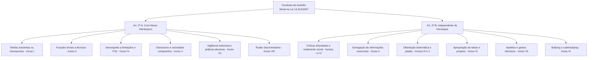

A dignidade da pessoa humana e a salubridade das relações de trabalho constituem garantias fundamentais no serviço público. No âmbito do Estado de Pernambuco, a Lei Estadual nº 13.314/2007 estabelece mecanismos rigorosos de prevenção, apuração e punição da prática de assédio moral e sexual em toda a Administração Pública. O oficial militar estadual desempenha funções de comando e gestão sobre subordinados civis e militares. Por essa razão, conhecer os conceitos legais, as condutas vedadas, as cinco modalidades de assédio e as formalidades do processo apuratório é indispensável para a liderança e para a aprovação no concurso.

> [!objetivos]
> - Compreender a evolução legislativa da Lei Estadual nº 13.314/2007 e sua aplicação na administração direta e indireta.
> - Diferenciar os conceitos de assédio moral e sexual, identificando seus requisitos objetivos.
> - Distinguir as condutas praticadas com abuso de poder hierárquico daquelas que independem de subordinação.
> - Dominar as cinco modalidades legais de assédio e as regras de apuração, prevenção e nulidade dos atos.

## Visão geral, evolução legislativa e abrangência

A Lei Estadual nº 13.314, de 15 de outubro de 2007, representa um marco na proteção funcional do trabalhador público pernambucano. A norma sofreu sucessivas reformas modernizadoras que ampliaram o seu alcance protetivo. O estudante deve evitar apostilas desatualizadas, pois o texto vigente incorpora quatro leis modificadoras cruciais:

1. **Lei Estadual nº 17.065/2020:** reformulou a definição geral de assédio moral (art. 2º), criou o rol de condutas funcionais dos artigos 2º-A e 2º-B e instituiu a classificação em cinco modalidades de assédio (art. 3º).
2. **Lei Estadual nº 17.971/2022:** determinou a disponibilização do inteiro teor da lei em formato acessível a pessoas com deficiência e em destaque nos portais eletrônicos oficiais (art. 6º, § 2º).
3. **Lei Estadual nº 18.379/2023:** expandiu toda a norma para abranger expressamente a prevenção e a punição do **assédio sexual**, acrescentando a definição do artigo 2º-C e ajustando os dispositivos de apuração e nulidade.
4. **Lei Estadual nº 19.086/2025:** incluiu os atos qualificados como *bullying* e *cyberbullying* no rol exemplificativo de condutas caracterizadoras de assédio moral (art. 2º-B, inciso IX).

O artigo 1º consagra a vedação ampla do assédio moral e sexual no setor público estadual. O parágrafo único desse artigo estende expressamente o regime legal às autarquias, fundações públicas, empresas públicas e sociedades de economia mista de Pernambuco. A proteção vincula todos os agentes públicos, alcançando servidores civis, policiais e bombeiros militares, empregados públicos celetistas e ocupantes de cargos em comissão.

## Conceitos de assédio moral e assédio sexual

A legislação pernambucana estruturou com precisão cirúrgica os conceitos operacionais de assédio, fornecendo critérios objetivos para afastar o arbítrio e permitir o enquadramento disciplinar correto.

### As três definições de assédio moral do artigo 2º

Nos termos do artigo 2º da Lei Estadual nº 13.314/2007, o assédio moral manifesta-se por meio de três figuras distintas:

- **Assédio moral interpessoal (art. 2º, inciso I):** abrange condutas abusivas, repetitivas ou sistemáticas que exponham alguém a situações vexatórias, constrangedoras ou humilhantes. Realiza-se mediante gestos, palavras, atitudes ou comportamentos que exprimam rejeição ou discriminação. Esse padrão atenta contra a dignidade, integridade física, saúde mental ou autoestima do indivíduo.
- **Assédio moral por abuso de autoridade funcional (art. 2º, inciso II):** ocorre quando o agente se vale de sua posição hierárquica, cargo ou função pública para constranger, intimidar, restringir ou abusar do poder contra outros agentes. Essa conduta produz danos ao servidor e prejudica a eficiência do serviço público.
- **Assédio moral organizacional ou institucional (art. 2º, inciso III):** envolve práticas abusivas exercidas de forma sistemática durante determinado tempo na relação de trabalho. Sua particularidade reside na finalidade: obter o aumento forçado de produtividade e o engajamento cego do grupo às metas da administração. Caracteriza-se pela gestão por estresse e humilhação coletiva, violando direitos fundamentais dos servidores.

### Conceito legal de assédio sexual

A Lei Estadual nº 18.379/2023 introduziu o artigo 2º-C, fixando o conceito formal de assédio sexual na ordem jurídica administrativa de Pernambuco:

> [!lei] Lei Estadual nº 13.314/2007, art. 2º-C
> Configura assédio sexual o ato de constranger alguém, com o intuito de obter vantagem ou favorecimento sexual, prevalecendo-se o agente da sua condição de superior hierárquico ou ascendência inerentes ao exercício de emprego, cargo ou função.

O tipo administrativo do assédio sexual exige elementos específicos: o constrangimento à vítima, o objetivo especial de auferir vantagem ou favorecimento de natureza sexual e a prevalência de superioridade hierárquica ou ascendência funcional. A conduta afronta a liberdade sexual e a moralidade administrativa.

> [!pegadinha] Exigência de superioridade no assédio sexual
> Observe a redação do artigo 2º-C: para configurar assédio sexual nos termos da Lei Estadual nº 13.314/2007, o agente deve prevalecer-se de sua condição de **superior hierárquico ou ascendência funcional**. Enquanto o assédio moral pode ocorrer de forma horizontal entre colegas do mesmo nível, o assédio sexual exige posição de ascendência do agressor sobre a vítima.

## Condutas caracterizadoras do assédio moral

A reforma promovida pela Lei Estadual nº 17.065/2020 dividiu as condutas vedadas em dois grupos estruturais bem delineados. O artigo 2º-A reúne as hipóteses praticadas com abuso de poder hierárquico. Já o artigo 2º-B lista as condutas que independem de qualquer relação de subordinação.

O diagrama a seguir sintetiza a distinção entre os dois regimes de condutas da lei estadual.

### Assédio moral com abuso de poder hierárquico

O artigo 2º-A disciplina condutas que o superior hierárquico impõe ao subordinado (incisos I a VIII):
1. **Tarefas abusivas ou inexequíveis (inciso I):** exigir atribuições estranhas ao cargo ou impor prazos excessivamente onerosos que inviabilizem a execução do trabalho;
2. **Rebaixamento de tarefas (inciso II):** designar atividades triviais e de baixa complexidade a servidores técnicos especializados ou altamente qualificados;
3. **Desgaste desnecessário (inciso III):** submeter o subordinado a pressões físicas ou mentais prejudiciais à saúde;
4. **Desrespeito à deficiência e limitações (inciso IV):** ignorar limitações de saúde temporárias ou permanentes, especialmente de pessoas com deficiência, conforme os parâmetros da Lei Federal nº 13.146/2015;
5. **Ostracismo e ociosidade compulsória (inciso V):** colocar o servidor na ociosidade proposital ou no isolamento funcional ("colocar na geladeira"), demonstrando desdém por suas capacidades;
6. **Coação para práticas impróprias (inciso VI):** constranger o agente a praticar ou omitir atos funcionais para favorecer interesses escusos do chefe ou de terceiros;
7. **Perseguição disciplinar e vigilância opressiva (inciso VII):** impor serviço humilhante, aplicar medidas disciplinares sem fundamento e exercer vigilância ostensiva diferenciada sobre a vítima;
8. **Rudez discriminatória (inciso VIII):** admoestar o subordinado com aspereza desmedida ou agravar cobranças por motivos discriminatórios de raça, cor, religião, orientação sexual, deficiência ou saúde.

### Assédio moral independente de subordinação hierárquica

O artigo 2º-B lista condutas proibidas contra agentes públicos em geral, aplicáveis inclusive entre colegas do mesmo nível (incisos I a IX):
1. Expô-lo a críticas improcedentes e recusar o reconhecimento justo de seus esforços (inciso I);
2. Ocultar dados indispensáveis ao serviço ou impedir sua participação em treinamentos (inciso II);
3. Desqualificar, desmoralizar e humilhar o colega de maneira repetitiva (inciso III);
4. Induzir o isolamento social da vítima perante os demais integrantes da equipe (inciso IV);
5. Propagar boatos maliciosos ou dirigir comentários jocosos para criar constrangimento (inciso V);
6. Apropriar-se de ideias e projetos do colega ou atribuir-lhe falhas sabidamente não cometidas (inciso VI);
7. Imputar apelidos depreciativos ou gestos ofensivos, punindo-se igualmente quem os difundir (inciso VII);
8. Praticar quaisquer outros atos reconhecidos como assédio por comissão disciplinar (inciso VIII);
9. Praticar atos caracterizados como *bullying* ou *cyberbullying*, conforme definidos na Lei Estadual nº 13.995/2009 (inciso IX, incluído pela Lei Estadual nº 19.086/2025).

> [!exemplo] Ostracismo funcional praticado por chefia
> Um capitão do CBMPE assume a chefia de uma seção administrativa no Recife e passa a hostilizar um tenente que questionou métodos de serviço. O capitão retira todos os processos da mesa do tenente, proíbe os colegas de repassar demandas a ele e determina que permaneça em uma sala isolada sem computadores. Essa imposição de ociosidade forçada configura assédio moral com abuso de poder hierárquico previsto no artigo 2º-A, inciso V, da Lei Estadual nº 13.314/2007.

## Classificação legal em cinco modalidades de assédio

O artigo 3º da Lei Estadual nº 13.314/2007 estabelece uma classificação que costuma definir questões de concurso. A regra divide o assédio moral e sexual em cinco modalidades conforme a direção da conduta e a posição dos envolvidos.

A tabela a seguir apresenta as cinco modalidades legais previstas nos incisos I a V do artigo 3º, acompanhadas de suas definições literais e aplicações práticas.

| Modalidade de assédio | Base legal | Definição no texto da Lei Estadual nº 13.314/2007 | Exemplo típico no ambiente de trabalho |
| --- | --- | --- | --- |
| Vertical descendente | Art. 3º, inciso I | Decorre de um membro hierarquicamente superior e atinge um subordinado. | Chefe que persegue soldado da guarnição com tarefas degradantes e punições sem base legal. |
| Vertical ascendente | Art. 3º, inciso II | Decorre de um subordinado e atinge um membro hierarquicamente superior. | Grupo de praças que se organiza para boicotar e isolar deliberadamente o novo comandante de posto. |
| Horizontal | Art. 3º, inciso III | Decorre de um membro e atinge outro membro situado no mesmo nível hierárquico. | Dois sargentos que zombam e difamam sistematicamente outro colega de mesma graduação. |
| Misto | Art. 3º, inciso IV | Um membro da equipe assedia um de seus pares ou o gestor e seu comportamento passa a ser repetido pelo grupo. | A hostilidade contra um servidor tem início entre colegas e ganha adesão coletiva da chefia e da equipe. |
| Passivo | Art. 3º, inciso V | A pessoa sofre os danos físicos e psicossociais de forma indireta, em razão do assédio contra terceiro próximo. | Servidor que adoece emocionalmente ao testemunhar perseguições diárias contra colega de mesa. |

> [!atencao] Particularidade do assédio passivo
> O **assédio passivo** (art. 3º, inciso V) merece cuidado redobrado. A vítima dessa modalidade é o agente que presencia a violência psicológica cometida contra um colega próximo. O observador adoece ao experimentar profunda sensação de impotência ou de falsa conivência com a injustiça que não consegue evitar.

## Punição, apuração, prevenção e nulidade dos atos

A disciplina das sanções e do procedimento investigatório encontra-se estruturada nos artigos 4º a 6º-C da norma estadual.

### Procedimento de apuração e garantias do denunciante

Conforme dispõe o artigo 4º, o assédio moral ou sexual praticado por servidor ou empregado de qualquer nível hierárquico sujeita o infrator à punição prevista na legislação aplicável aos servidores públicos civis (a Lei Estadual nº 6.123/1968, cujo procedimento também rege a apuração, conforme o art. 6º-B) ou nas leis trabalhistas. O texto da lei não menciona os regulamentos disciplinares militares.

A apuração deve ser promovida de forma imediata mediante sindicância ou processo administrativo disciplinar (art. 5º). A instauração dá-se por iniciativa do servidor ofendido ou por provocação de autoridade que tenha ciência do fato.

As garantias processuais do artigo 5º reúnem regras de alto rigor:
- **Plena defesa sob pena de nulidade (§ 1º):** ao acusado é assegurado o contraditório e a ampla defesa em todas as etapas instrutórias;
- **Anuência expressa do ofendido (§ 2º):** a autoridade que tiver conhecimento da infração deve solicitar a apuração à autoridade competente, desde que haja a **anuência prévia, por escrito, da vítima**;
- **Ofensor detentor de mandato eletivo (§ 3º):** se o assediador for titular de mandato político eletivo, as conclusões dos autos serão remetidas aos órgãos fiscalizadores competentes e ao Poder Judiciário;
- **Denúncia anônima motivada (§ 4º):** denúncias anônimas encaminhadas à repartição devem ser previamente verificadas e, desde que contenham elementos de motivação suficientes, ensejam a abertura formal de processo administrativo;
- **Proteção psicológica e sigilo (§§ 5º e 6º):** a administração deve estimular a denúncia e garantir suporte psicossocial ao denunciante fragilizado, aplicando medidas protetivas e sigilo funcional quando indispensável à investigação.

### Prevenção, cartaz informativo em folha A3 e nulidade de pleno direito

A administração estadual tem o dever indeclinável de adotar medidas preventivas e educativas contra o assédio (artigos 6º e 6º-A). Entre os deveres preventivos sobressaem:
1. **Afixação de cartazes informativos em Folha A3 (art. 6º, § 1º):** os órgãos públicos devem manter cartazes visíveis medindo **297 x 420 mm (dimensão padrão A3)**, preferencialmente com caracteres em negrito, contendo o alerta legal e a definição dos ilícitos;
2. **Acessibilidade e divulgação digital (art. 6º, § 2º):** o teor da lei deve estar disponível a todos os servidores em formato acessível a pessoas com deficiência e em local destacado nos sítios oficiais;
3. **Campanhas de conscientização (art. 6º-A):** o poder público promoverá ações pedagógicas permanentes para orientar agentes públicos e cidadãos;
4. **Dever de colaboração institucional (art. 6º-C):** os órgãos devem fornecer todos os documentos, relatórios e meios probatórios exigidos para esclarecer os fatos no processo administrativo.

Por fim, o parágrafo único do artigo 6º-A consagra a consequência jurídica máxima para a conduta ilícita:

> [!lei] Lei Estadual nº 13.314/2007, art. 6º-A, parágrafo único
> Todo ato praticado com assédio moral ou sexual, na forma desta Lei, é nulo de pleno direito.

Qualquer portaria de transferência punitiva, avaliação forjada ou decisão administrativa motivada por perseguição e assédio perde integralmente seus efeitos jurídicos, garantindo-se o imediato restabelecimento da situação funcional anterior da vítima.

## Mapa do capítulo

A tabela a seguir consolida os principais aspectos da Lei Estadual nº 13.314/2007, auxiliando a revisão rápida dos pontos determinantes.

| Eixo temático | Artigos | Principais determinações normativas | Ponto crítico em prova |
| --- | --- | --- | --- |
| Abrangência e reformas | Art. 1º | Aplica-se à administração direta e indireta (autarquias, fundações, empresas públicas e sociedades de economia mista). | Atualizada pelas Leis 17.065/2020, 17.971/2022, 18.379/2023 e 19.086/2025. |
| Conceitos de assédio | Arts. 2º e 2º-C | Assédio moral (entre indivíduos, por abuso de poder ou organizacional); assédio sexual exige ascendência funcional. | O assédio sexual exige vantagem sexual e ascendência funcional do agressor. |
| Condutas caracterizadoras | Arts. 2º-A e 2º-B | Art. 2º-A exige subordinação hierárquica; art. 2º-B independe de hierarquia e inclui bullying. | Saber diferenciar condutas com abuso hierárquico daquelas sem subordinação. |
| Modalidades de assédio | Art. 3º | Cinco modalidades: vertical descendente, vertical ascendente, horizontal, misto e passivo. | Assédio passivo atinge quem presencia a violência contra colega e adoece. |
| Apuração e prevenção | Arts. 4º a 6º-C | Sindicância e PAD; anuência escrita da vítima; cartaz em folha A3; ato assediador é nulo de pleno direito. | A autoridade conhecedora precisa de anuência por escrito da vítima para pedir apuração. |

### Para fixar

- A Lei Estadual nº 13.314/2007 veda e pune o assédio moral e o assédio sexual em toda a Administração Pública de Pernambuco.
- Suas normas alcançam órgãos da administração direta e entidades da administração indireta, incluindo empresas estatais.
- O assédio sexual exige que o agente se prevaleça de superioridade hierárquica ou ascendência funcional para obter vantagem sexual.
- As condutas do artigo 2º-A pressupõem abuso hierárquico contra o subordinado, como imposição de ociosidade compulsória.
- As condutas do artigo 2º-B independem de hierarquia e contemplam atos de bullying e cyberbullying.
- O assédio classifica-se em cinco modalidades: vertical descendente, vertical ascendente, horizontal, misto e passivo.
- O assédio passivo produz sofrimento psicossocial indireto na testemunha próxima que presencia o assédio contra outrem.
- A autoridade conhecedora que solicita apuração formal da infração necessita da concordância por escrito do ofendido.
- É obrigatória a fixação de cartazes informativos em folha padrão A3 (297 x 420 mm) nas repartições públicas.
- Todo ato administrativo praticado com assédio moral ou sexual é compulsoriamente nulo de pleno direito.
