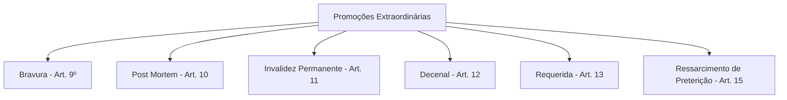
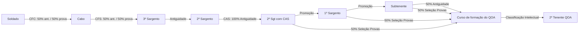
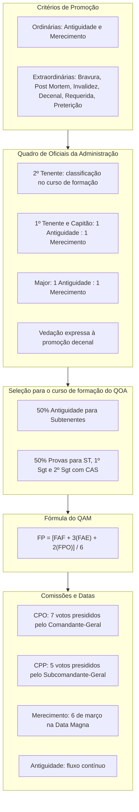

A Lei Complementar Estadual nº 470, de 21 de dezembro de 2021, unificou o Sistema de Promoção de Oficiais e Praças da Polícia Militar de Pernambuco e do Corpo de Bombeiros Militar de Pernambuco. O diploma revogou legislações anteriores e instituiu regras uniformes para disciplinar o fluxo de carreira na ativa. Este capítulo trata das normas nucleares da lei: critérios ordinários e extraordinários, cálculos avaliativos e regras específicas de acesso ao oficialato de administração.

> [!objetivos]
> - Distinguir as promoções ordinárias por antiguidade e merecimento e aplicar as proporções legais do art. 7º, inclusive ao Quadro de Oficiais da Administração.
> - Identificar as seis modalidades de promoção extraordinária e reconhecer a vedação expressa da promoção decenal aos integrantes do QOA.
> - Explicar os requisitos essenciais de acesso, a regra dos 40% mais antigos para o QAM e os critérios de matrícula no curso de formação do QOA.
> - Calcular a pontuação final da Ficha de Promoção por meio da fórmula ponderada oficial e apontar as diferenças entre a CPO e a CPP.

## Finalidade, planejamento da carreira e critérios de promoção

A promoção militar é ato administrativo voltado a suprir as necessidades operacionais da corporação e garantir a ascensão funcional do militar estadual. Conforme o art. 2º da Lei Complementar Estadual nº 470/2021, a finalidade básica da promoção é o preenchimento seletivo dos claros pertinentes aos postos e às graduações superiores, com base nos efetivos fixados em lei para os quadros e qualificações da PMPE e do CBMPE.

O art. 3º fixa que o planejamento da carreira deve assegurar fluxo contínuo, regular e equilibrado na escala hierárquica. O acesso aos postos e graduações iniciais depende do aproveitamento em curso de formação, conforme o art. 16.

A lei estabelece duas categorias de promoção:
1. **Promoções ordinárias:** decorrem da movimentação funcional periódica, pelos critérios de **antiguidade** e **merecimento** (arts. 5º a 7º).
2. **Promoções extraordinárias:** operam em circunstâncias específicas previstas nos arts. 8º a 15 (bravura, *post mortem*, invalidez permanente, decenal, requerida e ressarcimento de preterição).

### Antiguidade e merecimento

A **promoção por antiguidade** (art. 5º) fundamenta-se na precedência hierárquica temporal do militar sobre seus pares de igual posto ou graduação, no mesmo quadro ou qualificação. O militar com maior tempo no grau hierárquico tem preferência objetiva para o claro aberto, desde que atenda aos requisitos essenciais. As promoções por antiguidade ocorrem de modo imediato com o surgimento da vacância.

A **promoção por merecimento** (art. 6º) baseia-se no conjunto de atributos morais, profissionais e intelectuais demonstrados pelo militar ao longo da carreira, com destaque para a atuação no grau atual.

### Proporcionalidade entre critérios

A distribuição de vagas entre antiguidade e merecimento varia por posto ou graduação. A regra está toda no art. 7º, que vale para todos os quadros, inclusive o QOA (§ 3º): o merecimento ganha peso no oficialato superior, e os primeiros degraus de cada carreira seguem só a antiguidade.

> [!lei] LC nº 470/2021, art. 7º
> Art. 7° As promoções pelos critérios de antiguidade e de merecimento obedecerão a seguinte proporcionalidade:
> I - para os postos de coronel e tenente-coronel: **duas por merecimento e uma por antiguidade**;
> II - para os postos de major, capitão e 1° tenente, e para as graduações de subtenente, 1° sargento e 2° sargento: **uma por merecimento e uma por antiguidade**;
> III - para o posto de 2º tenente: **apenas por antiguidade**, que obedecerá a ordem de classificação intelectual (...);
> (...)
> § 2° O preenchimento das vagas do primeiro posto do Quadro de Oficiais da Administração obedecerá, rigorosamente, à ordem de classificação intelectual obtida no curso de formação, independentemente da antiguidade ou graduação que ocupava (...), respeitando-se o limite de vagas existentes.

A classificação do inciso III é a obtida ao final do CFO, da formação de oficiais do QOA ou de curso equivalente. O inciso IV completa o quadro: 3º Sargento e Cabo também são promovidos apenas por antiguidade, pela classificação no respectivo curso de formação. A distribuição das vagas é contínua, em sequência às promoções da data anterior (§ 4º), e, se nunca houve promoção em determinado posto desde a criação do quadro, a primeira se faz por merecimento (§ 5º).

| Posto ou graduação | Proporção (art. 7º) |
| --- | --- |
| Coronel e Tenente-Coronel | 2 por merecimento : 1 por antiguidade |
| Major, Capitão e 1º Tenente | 1 por merecimento : 1 por antiguidade |
| Subtenente, 1º Sargento e 2º Sargento | 1 por merecimento : 1 por antiguidade |
| 2º Tenente | Só antiguidade (classificação no CFO ou no curso de formação do QOA) |
| 3º Sargento e Cabo | Só antiguidade (classificação no curso de formação) |

> [!exemplo]
> No QOA do CBMPE, que vai até o posto de Major, a promoção a 2º Tenente segue a classificação no curso de formação, sem levar em conta a graduação anterior do aluno. Abertos 2 claros de Capitão, aplica-se a proporção do inciso II: 1 vaga por antiguidade e 1 por merecimento.

## As seis promoções extraordinárias em detalhe

As promoções extraordinárias atendem a fatos imprevistos, atos heroicos, falecimentos em serviço ou correções de preterição. O art. 8º fixa seis hipóteses taxativas.

### Promoção por bravura

A promoção por bravura (art. 9º) decorre de atos incomuns de coragem e audácia que, ultrapassando os limites do dever, representem feitos indispensáveis às operações da corporação, pelos resultados ou pelo exemplo emanado.

Regras centrais da bravura:
- **Serviço ou folga:** aplica-se ao ato praticado em serviço ou em período de folga (§ 1º).
- **Sem exigência de vaga ou curso:** independe de claro, vaga aberta, curso ou interstício (§ 2º).
- **Competência:** concedida pelo Governador (oficiais) ou Comandante-Geral (praças).
- **Conselho Especial:** apurada em investigação sumária por Conselho Especial de 3 oficiais superiores (§ 3º).
- **Acesso posterior a curso:** faculta-se curso futuro; sem êxito, permanece no posto atingido (§ 4º).
- **Salto hierárquico inicial:** Aspirante a Oficial ascende a 2º Tenente, e Soldado a Cabo (§ 5º).

> [!atencao] Investigação sumária de bravura
> A promoção por bravura não decorre de ato discricionário puro: exige investigação sumária por Conselho Especial formado por 3 oficiais superiores.

### Promoções *post mortem* e por invalidez permanente

A **promoção *post mortem*** (art. 10) reconhece o militar falecido em serviço ou em consequência dele, ou a quem cabia promoção que não se efetivou devido ao óbito. Apura-se por Inquérito Sanitário de Origem, Sindicância ou IPM. Exclui-se o benefício se o óbito derivou de crime, infração grave, imprudência ou desídia do militar (§ 4º).

A **promoção por invalidez permanente** (art. 11) alcança o militar julgado incapaz definitivamente para o serviço ativo pela Junta Superior de Saúde, em decorrência de ferimento em operação, acidente em serviço ou enfermidade profissional grave, antes de ser reformado.

### Promoção decenal e suas vedações

A **promoção decenal** (art. 12) contempla o militar com 10 anos de efetiva permanência no mesmo posto ou graduação, com tempo mínimo legal para passagem para a reserva remunerada:
- A Tenente-Coronel: 30 anos de serviço como oficial;
- A Major: 20 anos como oficial;
- A Capitão: 10 anos como oficial;
- A 2º Sargento: 30 anos como praça;
- A 3º Sargento: 20 anos como praça;
- A Cabo: 10 anos como praça.

A concessão extingue a vaga originária e cria vaga no novo posto ou graduação, sem gerar vacância. Todavia, a norma veda a concessão a determinadas categorias.

> [!pegadinha] Vedação expressa no QOA
> O art. 12, § 3º, proíbe a promoção decenal aos Coronéis, aos Subtenentes e aos integrantes do Quadro de Oficiais da Administração (QOA), Quadro de Oficiais Músicos (QOMus) e Quadro de Capelães (QCPM). A banca tenta induzir o erro afirmando que oficiais da administração têm direito à promoção decenal após 10 anos no posto.

### Promoção requerida e ressarcimento de preterição

A **promoção requerida** (art. 13) beneficia o militar ingressado até 31 de dezembro de 2021 que possuir tempo para reserva remunerada. O militar deixa de disputar promoções ordinárias e decenais. A vaga extingue-se com a ida para a inatividade, após dois meses percebendo a remuneração do novo grau. Se responder a processo-crime ou conselho, a promoção requer aprovação de 2/3 dos votos da comissão de promoção. Uma vez publicada, a promoção requerida é irrevogável (art. 14).

A **promoção em ressarcimento de preterição** (art. 15) repara o direito preterido do militar por provimento de recurso, cessação de desaparecimento ou extravio, isenção de culpa em conselho, erro administrativo comprovado, impronúncia ou absolvição criminal transitada em julgado. A promoção retroage a data de direito, garantindo a posição hierárquica e a remuneração pretérita, figurando o militar como excedente se não houver vaga imediata (art. 77).

> [!bizu] Mnemônico das extraordinárias
> Memorize **B-P-I-D-R-P**: **B**ravura, **P**ost mortem, **I**nvalidez, **D**ecenal, **R**equerida e **R**essarcimento de **P**reterição. Lembre-se de que a decenal não alcança o QOA.

## Requisitos essenciais de acesso, interstício e seleção para o curso de formação do QOA

Para figurar nos Quadros de Acesso e concorrer à promoção, o militar estadual deve satisfazer exigências legais de natureza funcional, física e moral.

### Requisitos essenciais de acesso

O art. 18 elenca os requisitos essenciais cumulativos:
1. **Compreensão nos 40% mais antigos:** exigência restrita à promoção por merecimento no quadro;
2. **Interstício:** tempo mínimo de serviço fixado para o posto ou graduação;
3. **Aptidão em inspeção de saúde:** atestada por ata médica oficial válida por um ano (art. 29, § 1º);
4. **Cursos exigidos e serviço arregimentado:** habilitação militar e tempo mínimo em funções operacionais ou administrativas (Anexo VII);
5. **Conceito profissional e moral favorável:** pontuações satisfatórias nas fichas e conduta íntegra.

Havendo mais vagas que militares habilitados, o Governador pode reduzir interstício e tempo arregimentado em até a metade, por proposta do Comandante-Geral (art. 26).

### A regra dos 40% mais antigos para merecimento

A promoção por merecimento seleciona os melhores avaliados dentro de um grupo restrito de veteranos.

> [!lei] LC nº 470/2021, art. 18, I
> estar classificado dentre os 40% (quarenta por cento) mais antigos dentro do posto ou da graduação, no respectivo quadro ou qualificação, calculado com base no efetivo fixado em Lei, exclusivamente para a promoção por merecimento;

A regra impede que militares novatos no posto ultrapassem seus pares imediatos apenas por acúmulo temporário de cursos ou medalhas. A base do cálculo é o efetivo fixado em lei.

> [!exemplo]
> Em quadro do CBMPE com 50 vagas de Capitão fixadas em lei, apenas os 20 capitães mais antigos (40% de 50) concorrem à constituição do Quadro de Acesso por Merecimento. Frações decimais são arredondadas para o número inteiro superior.

### Cursos de praças e matrícula no curso de formação do QOA

O art. 23 e o art. 75 disciplinam as seleções internas para cursos da carreira militar:
- **CFC e CFS:** 50% das vagas por antiguidade e 50% por exame intelectual interno (§ 1º);
- **CAS:** 100% das vagas por antiguidade, exclusivo para 2º Sargentos (§ 2º);
- **Curso de formação de oficiais do QOA:** 50% das vagas por antiguidade exclusivas para Subtenentes e 50% por seleção interna de provas intelectuais disputadas entre Subtenentes, 1º Sargentos e 2º Sargentos com CAS (§ 3º).

O art. 75, § 1º, estabelece que a antiguidade no posto inicial de 2º Tenente do QOA resulta exclusivamente da ordem de classificação intelectual obtida ao fim da formação, superando a graduação anterior. Atingindo 25% de claros no quadro, a corporação deve abrir processo seletivo para esse curso (art. 76).

## Documentos essenciais, fichas de avaliação e cálculo da pontuação

A apreciação do mérito militar assenta-se em documentação formal descrita no art. 27, garantindo impessoalidade e objetividade ao processo de escolha.

### As três fichas de avaliação

A avaliação do mérito conjuga três fichas fundamentais:
1. **Ficha de Avaliação Funcional (FAF — art. 30):** caráter reservado; avalia semestralmente o desempenho funcional e a disciplina na OME. Sua nota é a média aritmética dos períodos avaliados no grau atual.
2. **Ficha de Avaliação Estratégica (FAE — art. 31):** emitida reservadamente pela comissão de promoção (CPO ou CPP), reflete competências comportamentais e institucionais com pontuação renovada anualmente.
3. **Ficha de Pontuação Objetiva (FPO — art. 32):** processada conjuntamente pelo órgão de pessoal e pela comissão de promoção. Soma pontos positivos de cursos civis e militares, condecorações e tempo de serviço, descontando punições disciplinares.

| Ficha | Órgão Avaliador | Periodicidade | Foco Avaliativo | Peso |
| --- | --- | --- | --- | --- |
| FAF | Comandante da OME | Anual (média semestral) | Desempenho e disciplina direta | Peso 1 |
| FAE | Comissão de Promoção | Anual | Competências comportamentais | Peso 3 |
| FPO | Gestão de Pessoas e Comissão | Fechamento em 31 de dezembro | Cursos, títulos e deméritos disciplinares | Peso 2 |

### A fórmula matemática da Ficha de Promoção

Os resultados convergem para a **Ficha de Promoção (FP)**, cujo cálculo define a ordem do militar no Quadro de Acesso por Merecimento.

> [!lei] LC nº 470/2021, art. 54
> O grau de conceito no posto ou graduação, com o qual o militar do Estado será classificado no QAM, corresponderá a média ponderada da pontuação obtida pelo somatório da FAF (peso 1), da FAE (peso 3) e da FPO (peso 2), dividido por 6, como resultado da Ficha de Promoção, ou seja: FP = [FAF + 3(FAE) + 2(FPO)] / 6.

A fórmula adota pesos 1 para FAF, 3 para FAE e 2 para FPO, com denominador 6. A nota final é apurada com duas casas decimais, desempatando-se pela antiguidade hierárquica no grau (§ 2º).

A escala de conceitos do art. 37 prevê:
- Até 10,00 pontos: **Insuficiente** (impede ingresso no QAM);
- De 10,01 a 20,00 pontos: **Regular**;
- De 20,01 a 30,00 pontos: **Bom**;
- De 30,01 a 40,00 pontos: **Ótimo**;
- De 40,01 a 50,00 pontos: **Excelente**.

> [!exemplo]
> O Capitão Marcos obteve notas FAF = 42,00, FAE = 46,00 e FPO = 38,00. Aplicando a fórmula do art. 54:
> 
>     FP = [42,00 + 3·(46,00) + 2·(38,00)] / 6
>     FP = [42,00 + 138,00 + 76,00] / 6
>     FP = 256,00 / 6 = 42,67 pontos
> 
> Com pontuação final de 42,67 pontos, o militar obtém conceito Excelente na Ficha de Promoção.

Discordâncias quanto à pontuação ensejam recurso fundamentado à comissão no prazo de 10 dias úteis da publicação da lista.

## Processamento administrativo, órgãos colegiados e quadros de acesso

O processamento das promoções militares desenvolve-se sob a condução de comissões permanentes e culmina na expedição do ato solene pela autoridade competente.

### Competência decisória e Carta Patente

A competência varia conforme o critério e o círculo (arts. 43 a 46):
- **Oficiais por merecimento:** ato do **Governador do Estado** (art. 43);
- **Oficiais por antiguidade ou decenal:** portaria do **Comandante-Geral**, por delegação do Governador (art. 44); o mesmo vale para a promoção requerida e para a promoção por invalidez permanente (art. 45);
- **Praças:** portaria do **Comandante-Geral da Corporação** (art. 46).

A nomeação para o posto inicial da carreira de oficial (2º Tenente) e para o primeiro posto de oficial superior (Major) acarreta a expedição de **Carta Patente** pelo Governador do Estado (art. 45, § 1º). A promoção aos demais postos é apostilada à última carta patente expedida (art. 45, § 2º).

### Datas oficiais de promoção

O calendário das promoções adota duas sistemáticas (arts. 47, 48 e 49):
- **Antiguidade:** fluxo contínuo e imediato com o surgimento da vacância e habilitação do militar;
- **Merecimento:** efetivadas anualmente em **6 de março**, **Data Magna do Estado de Pernambuco**.

### Comparativo entre CPO e CPP

Os trabalhos preparatórios cabem à Comissão de Promoção de Oficiais (CPO) e à Comissão de Promoção de Praças (CPP), sediadas no Comando-Geral (arts. 58 a 61).

| Característica | CPO (Art. 60) | CPP (Art. 61) |
| --- | --- | --- |
| Presidente | Comandante-Geral | Subcomandante-Geral |
| Membros Natos | • Subcomandante-Geral • Chefe do EMG (PMPE) ou Diretor de Pessoal (CBMPE) | • Chefe do EMG (PMPE) ou Diretor de Pessoal (CBMPE) • Diretor de Ensino |
| Membros Efetivos | 4 Coronéis da ativa designados pelo Secretário de Defesa Social | 2 Oficiais Superiores designados pelo Comandante-Geral |
| Total de Votantes | 7 membros | 5 membros |
| Mandato dos Efetivos | 1 ano, permitida recondução | 1 ano, permitida recondução |
| Secretário | Oficial designado sem voto | Oficial designado sem voto |

### Espécies de Quadros de Acesso

A comissão organiza listas prévias dos militares habilitados (art. 62):
- **QAA (Antiguidade):** ordem decrescente de antiguidade, contendo número de nomes igual aos claros abertos (art. 63);
- **QAM (Merecimento):** ordem decrescente da pontuação da FP, até o **triplo de vagas abertas** por merecimento (art. 64);
- **QAD (Decenal):** relação dos contemplados por decênio em ordem decrescente de antiguidade (art. 65). Quem figurar em QAA e QAD é promovido por antiguidade (art. 69).

### Impedimentos de inclusão e causas de exclusão

O art. 71 elenca impedimentos para constar em qualquer Quadro de Acesso:
1. Falta de requisitos essenciais de saúde, curso, interstício ou tempo arregimentado;
2. Inabilitação provisória por incapacidade moral apreciada pela comissão, gerando conselho disciplinar;
3. Prisão provisória, temporária ou flagrante;
4. Condição de réu em processo-crime, ação de improbidade ou conselho de disciplina ou justificação;
5. Julgamento condenatório em conselho homologado pelo Secretário de Defesa Social;
6. Afastamento cautelar das funções;
7. Cumprimento de pena por crime doloso, ainda que sob *sursis*;
8. Gozo de licença para tratar de interesse particular;
9. Situação de desertor, extraviado ou desaparecido;
10. Nota igual ou inferior a 10 pontos na FAE (conceito Insuficiente, exclusivo para QAM).

> [!pegadinha] Exceção do réu em processo criminal
> O militar denunciado em processo penal, ação de improbidade ou conselho disciplinar fica impedido de figurar em Quadro de Acesso. No entanto, o art. 71, IV, estabelece que ele poderá concorrer se obtiver aprovação por voto fundamentado de **2/3 dos membros da comissão de promoção**.

Militares agregados por licença para tratamento de saúde familiar superior a 6 meses ou exercício de cargo civil temporário são excluídos do QAM (art. 72). Para reingressar, devem requerer reversão ao serviço ativo até 60 dias antes da data de promoção.

## Mapa do capítulo

### Para fixar

- A finalidade básica da promoção militar é o preenchimento seletivo dos claros e a garantia do fluxo contínuo e equilibrado da carreira (arts. 2º e 3º).
- No Quadro de Oficiais da Administração, o 2º Tenente é promovido só por antiguidade, pela classificação no curso de formação (art. 7º, III e § 2º); 1º Tenente, Capitão e Major seguem a proporção 1:1 (art. 7º, II).
- A promoção decenal é expressamente vedada aos Coronéis, Subtenentes e oficiais do QOA, QOMus e QCPM (art. 12, § 3º).
- A promoção por bravura decorre de ato incomum de coragem em serviço ou folga, sem exigência de claro, interstício ou curso, e exige apuração por Conselho Especial de 3 oficiais superiores (art. 9º).
- Concorrem à promoção por merecimento apenas os militares posicionados nos 40% mais antigos da respectiva escala (art. 18, I).
- As vagas para a formação de oficiais do QOA dividem-se em 50% por antiguidade para Subtenentes e 50% por seleção interna de provas para Subtenentes, 1º Sargentos e 2º Sargentos com CAS (art. 23, § 3º).
- O grau no Quadro de Acesso por Merecimento resulta da média ponderada `FP = [FAF + 3(FAE) + 2(FPO)] / 6` (art. 54).
- A CPO possui 7 membros votantes sob presidência do Comandante-Geral; a CPP conta com 5 membros votantes sob chefia do Subcomandante-Geral (arts. 60 e 61).
- As promoções ordinárias por merecimento ocorrem em 6 de março (Data Magna de Pernambuco), enquanto as por antiguidade processam-se em fluxo contínuo com a vacância (arts. 47 a 49).
