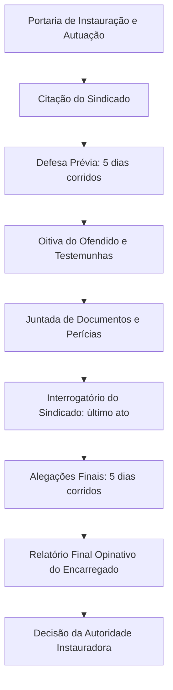
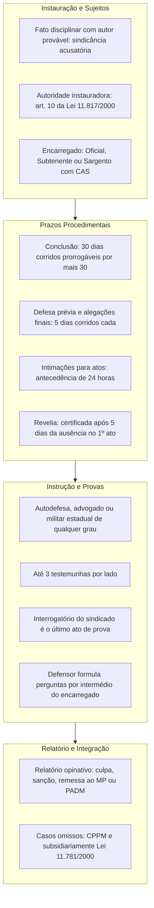

A Portaria nº 395/2015 da Corregedoria Geral da Secretaria de Defesa Social aprovou a instrução normativa que padroniza o processamento das sindicâncias administrativo-disciplinares militares no âmbito da Polícia Militar e do Corpo de Bombeiros Militar de Pernambuco. O diploma estabelece um rito formal, escrito e acusatório para apurar faltas disciplinares imputadas a militares estaduais, garantindo o contraditório e a ampla defesa. Na prova, é preciso dominar os prazos preclusivos, a ordem legal de colheita probatória e os limites de atuação do encarregado e do defensor.

> [!objetivos]
> - Definir a finalidade e as hipóteses de cabimento da sindicância disciplinar militar, distinguindo-a da investigação preliminar.
> - Identificar as autoridades competentes para a instauração e os impedimentos legais do encarregado.
> - Esquematizar o rito procedimental e a contagem dos prazos de conclusão, defesa prévia, alegações finais e revelia.
> - Explicar as regras de instrução probatória, a ordem de oitiva de testemunhas e a estrutura obrigatória do relatório opinativo final.

## Finalidade, cabimento e impedimentos do encarregado

A sindicância administrativo-disciplinar militar é o procedimento formal e escrito destinado a apurar transgressões disciplinares e sua respectiva autoria, sempre que a infração não exigir a instauração de processo disciplinar mais gravoso, como Conselho de Disciplina ou de Justificação (art. 2º da Portaria SDS nº 395/2015).

> [!lei] Portaria SDS nº 395/2015, art. 2º
> A sindicância é o procedimento formal e escrito que tem por objetivo a apuração sumária de fatos que, em tese, configurem transgressão disciplinar, e de sua autoria, quando não for exigido outro procedimento administrativo disciplinar.

A delimitação prévia da autoria define o procedimento cabível:
- **Autoria provável identificada:** instaura-se sindicância formal contra o militar na condição de **sindicado**. O rito possui natureza **acusatória**, assegurando contraditório e ampla defesa (art. 2º, § 2º).
- **Autoria desconhecida ou denúncia anônima:** sem indícios mínimos do autor ou em denúncias apócrifas, não cabe sindicância acusatória imediata. Deve-se instaurar previamente **Investigação Preliminar (IP)**, de caráter sumário e inquisitivo (art. 2º, §§ 1º e 3º).

> [!atencao] Investigação preliminar versus sindicância
> A sindicância da Portaria SDS nº 395/2015 não é inquisitiva: ela possui sindicado certo e natureza formalmente acusatória. Havendo autoria desconhecida ou denúncia anônima, a apuração prévia ocorre por Investigação Preliminar.

A competência para instaurar a sindicância pertence às autoridades do art. 10 da Lei Estadual nº 11.817/2000 (Código Disciplinar dos Militares de Pernambuco), como o Secretário de Defesa Social, Comandantes-Gerais, Chefes de Estado-Maior e Comandantes de OME autônomas (art. 3º).

Para resguardar a imparcialidade, o art. 4º da Portaria SDS nº 395/2015 veda a atuação como encarregado de quem:
1. Tenha comunicado a falta disciplinar;
2. Seja o próprio sindicado, seu cônjuge, companheiro ou parente até o terceiro grau;
3. Seja parte ou interessado direto na apuração;
4. Já tenha emitido juízo formal de valor sobre os mesmos fatos em outro procedimento.

## Instauração, rito processual e marcha dos atos

A instauração da sindicância ocorre por portaria publicada no Boletim Geral da SDS ou no boletim interno da unidade (art. 5º). O ato traz relato conciso dos fatos e qualificação do sindicado. Fatos novos apurados no processo podem ser investigados, desde que assegurada a ampla defesa.

A função de encarregado cabe a **oficial**, **subtenente** ou **sargento possuidor de CAS**, sempre com precedência hierárquica sobre o sindicado. A autoridade remete cópia da portaria à Corregedoria Geral no prazo de 48 horas da publicação (art. 6º, § 2º).

O art. 6º da Portaria SDS nº 395/2015 fixa o encadeamento dos atos procedimentais:
1. **Autuação:** confecção de capa com qualificação das partes, resumo do objeto e registro formal;
2. **Juntada e abertura:** juntada da portaria com respectivo termo e lavratura do termo de abertura;
3. **Escrivão:** designação facultativa de escrivão por termo nos autos;
4. **Citação e defesa prévia:** citação do sindicado com cópia da portaria e rol de testemunhas, concedendo-se prazo de **5 dias corridos** para defesa prévia;
5. **Instrução probatória:** oitiva do ofendido, inquirição de testemunhas e juntada de documentos;
6. **Interrogatório do sindicado:** realizado como o **último ato da instrução**;
7. **Alegações finais:** intimação para apresentação de alegações finais em **5 dias corridos**;
8. **Relatório final:** peça opinativa conclusiva elaborada pelo encarregado;
9. **Termo de encerramento:** remessa dos autos conclusos à autoridade instauradora para decisão.

O fluxograma ilustra a marcha procedimental da sindicância militar:

## Prazos processuais e decretação da revelia

A contagem de prazos na sindicância militar segue a praxe processual (art. 7º): exclui-se o dia do início e inclui-se o do vencimento, fluindo em horário de expediente.

O prazo geral de conclusão e entrega do relatório é de **30 dias corridos**, contados do recebimento da portaria pelo encarregado (art. 8º). Esse prazo pode ser prorrogado uma única vez por igual período (30 dias adicionais), mediante despacho motivado da autoridade instauradora (art. 9º).

| Ato Procedimental | Prazo Previsto | Fundamento Normativo |
| --- | --- | --- |
| Conclusão dos trabalhos pelo encarregado | 30 dias corridos (prorrogável por igual período) | Art. 8º da Portaria SDS nº 395/2015 |
| Notificação de atos ao sindicado | Antecedência mínima de 24 horas | Art. 10 da Portaria SDS nº 395/2015 |
| Apresentação de defesa prévia | 5 dias corridos após a citação | Art. 6º, V, da Portaria SDS nº 395/2015 |
| Apresentação de alegações finais | 5 dias corridos após o interrogatório | Art. 11 da Portaria SDS nº 395/2015 |
| Diligências complementares ordenadas pela autoridade | Até 20 dias corridos | Art. 12 da Portaria SDS nº 395/2015 |
| Alegações complementares | 48 horas após diligências | Art. 12, § 1º, da Portaria SDS nº 395/2015 |
| Comunicação à Corregedoria Geral | 48 horas da publicação ou decisão | Art. 6º, § 2º, da Portaria SDS nº 395/2015 |
| Certificação de revelia | 5 dias após falta ao primeiro ato | Art. 13, § 2º, da Portaria SDS nº 395/2015 |

Não localizado o militar, procede-se à citação por edital no Diário Oficial ou Boletim Geral da SDS (art. 13). Deixando o sindicado de comparecer ao primeiro ato sem justificativa, o encarregado certifica a **revelia** após o transcurso de **5 dias**.

A revelia dispensa novas notificações pessoais e exige a nomeação de **defensor dativo**. Comparecendo depois, o militar reassume a defesa, mas recebe o processo no estado em que se encontrar (§ 5º).

> [!bizu] Regra dos cinco dias na sindicância
> Na Portaria SDS nº 395/2015, o número cinco rege os atos defensivos fundamentais: são **5 dias corridos** para a defesa prévia, **5 dias corridos** para as alegações finais e **5 dias** de espera para certificar a revelia.

## Exercício da defesa e instrução probatória

O exercício da defesa é assegurado durante todo o procedimento (art. 14). Admitem-se todos os meios probatórios lícitos, repelindo-se provas que afrontem a moral, a segurança coletiva, a disciplina ou a hierarquia.

O sindicado pode promover a autodefesa ou constituir defensor:
- O defensor pode ser **advogado** ou **militar estadual** de qualquer posto ou graduação (art. 15, § 3º).
- Faltando defesa prévia ou alegações finais, o encarregado nomeia **defensor dativo** para suprir a omissão (art. 15, § 7º).
- Pedidos impertinentes ou protelatórios podem ser indeferidos motivadamente (§ 1º).

### Ordem de inquirição e testemunhas

O art. 18 estabelece a ordem preferencial dos depoimentos:
1. Declarações do ofendido;
2. Testemunhas do encarregado;
3. Testemunhas da defesa;
4. Esclarecimentos de peritos;
5. Acareações e reconhecimentos;
6. Interrogatório do sindicado.

Cada parte pode arrolar até **3 testemunhas** (art. 25), inquiridas individual e oralmente, sendo vedado trazer depoimento escrito (art. 20).

Militares e servidores civis são requisitados por meio de suas chefias imediatas. Toda pessoa pode depor sob compromisso de dizer a verdade, ressalvadas as hipóteses legais de **dispensa do compromisso** (art. 19):

| Grupo Dispensado de Compromisso | Hipóteses Concretas Previstas no Art. 19 |
| --- | --- |
| Idade e higidez | Menores de 14 anos e pessoas com deficiência mental |
| Parentesco em linha reta | Ascendentes e descendentes do sindicado |
| Parentesco colateral | Irmãos do sindicado |
| Vínculo conjugal | Cônjuge ou companheiro, ainda que separado |
| Afinidade e adoção | Parentes por afinidade em linha reta e laços de adoção |

Profissionais resguardados por segredo funcional (médicos, religiosos, advogados) não são obrigados a depor sobre fatos sigilosos, salvo com autorização expressa do interessado (art. 21).

> [!pegadinha] Interrogatório por último e perguntas filtradas
> O interrogatório do sindicado é o **último ato** da instrução probatória. Além disso, nas oitivas, o defensor **não pergunta diretamente** à testemunha: as perguntas devem ser formuladas **por intermédio do encarregado** (art. 16).

Testemunhas de outras localidades podem ser ouvidas por videoconferência ou precatória (art. 22). Havendo divergência essencial, promove-se acareação pelo rito do art. 300, § 3º, do CPPM (art. 26).

> [!exemplo]
> O Cabo Tiago responde a sindicância por extravio de material. Na audiência, o encarregado ouve o fiscal administrativo e testemunhas arroladas. O defensor dirige suas perguntas ao encarregado, que as repassa aos depoentes. Concluída a colheita, o encarregado realiza o interrogatório formal do sindicado.

## Relatório final, deliberação da autoridade e regras subsidiárias

Apresentadas as alegações finais, o encarregado elabora o **relatório final**, peça opinativa que resume as apurações e subsidia a decisão da autoridade (art. 29).

O relatório estrutura-se em três partes:
1. **Histórico:** síntese das imputações e argumentos defensivos;
2. **Fundamentação:** exame minucioso das provas e fatos apurados;
3. **Conclusão:** parecer opinativo sobre a culpa disciplinar e a sanção cabível, com atenuantes e agravantes.

Identificando indícios de infração penal:
- Remete cópia ao Ministério Público, se os fatos e a autoria delitiva estiverem plenamente delimitados;
- Sugere a instauração de IPM ou inquérito policial comum, caso demande investigação mais aprofundada.

Se a conduta atingir o sentimento do dever, a honra institucional, o pundonor ou o decoro militar, sugerindo exclusão ou perda do posto, o relatório propõe a instauração de Processo Administrativo Disciplinar Militar (PADM), perante Conselho de Disciplina ou Justificação.

A desistência do denunciante não enseja o encerramento da apuração, pelo princípio da indisponibilidade do interesse público (art. 30). Identificado novo militar envolvido, opera-se o aditamento da portaria instauradora (art. 31).

Conforme o art. 33 da Portaria SDS nº 395/2015, os casos omissos são supridos pela legislação processual penal militar e, subsidiariamente, pela Lei Estadual nº 11.781/2000 (Lei de Processo Administrativo de Pernambuco).

## Mapa do capítulo

### Para fixar

- A sindicância militar é procedimento formal, escrito e acusatório, voltado para faltas disciplinares com autoria definida (art. 2º da Portaria SDS nº 395/2015).
- A instauração cabe às autoridades com competência disciplinar listadas no art. 10 da Lei Estadual nº 11.817/2000.
- O encarregado deve ser oficial, subtenente ou sargento possuidor de CAS, com superioridade hierárquica sobre o sindicado (art. 5º).
- O prazo para conclusão dos trabalhos é de 30 dias corridos, prorrogável uma vez por igual período (art. 8º).
- A defesa prévia e as alegações finais têm prazo de 5 dias corridos cada (arts. 6º e 11).
- A ausência injustificada no primeiro ato acarreta revelia após 5 dias, impondo defensor dativo (art. 13).
- O interrogatório do sindicado é impreterivelmente o último ato da instrução probatória (art. 18).
- O defensor não inquirirá diretamente as testemunhas, dirigindo as perguntas por intermédio do encarregado (art. 16).
- Cada parte pode arrolar até 3 testemunhas, com dispensa de compromisso para menores de 14 anos e parentes próximos (arts. 19 e 25).
- A desistência da vítima não encerra a apuração, em face da indisponibilidade do interesse público (art. 30).
