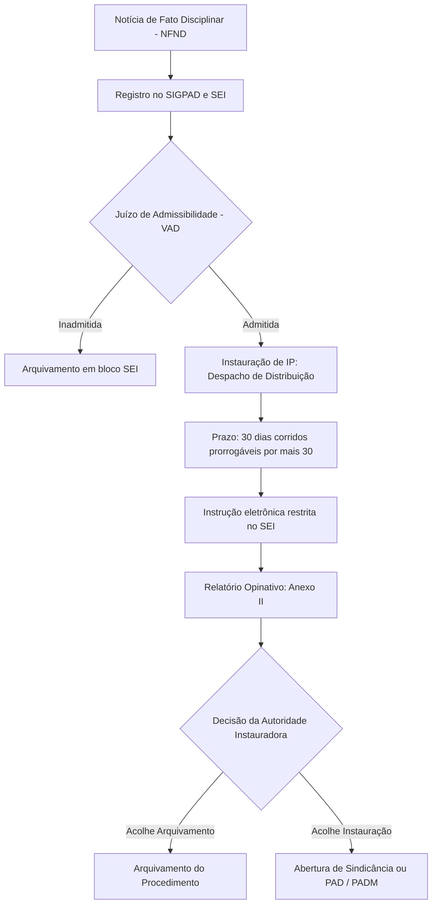

O Provimento Correicional nº 21, de 14 de outubro de 2021, da Corregedoria Geral da Secretaria de Defesa Social, estabeleceu a padronização do procedimento de Investigação Preliminar no serviço público estadual de segurança. Aplicável aos servidores civis e militares submetidos à Lei Estadual nº 11.929/2001, a norma organiza a fase de apuração sumária anterior à deflagração de processos punitivos formais. No âmbito do Corpo de Bombeiros Militar e da Polícia Militar de Pernambuco, o domínio da Investigação Preliminar é indispensável para compreender a triagem das notícias de irregularidades, os prazos de instrução no Sistema Eletrônico de Informações e as hipóteses de arquivamento.

> [!objetivos]
> - Definir a finalidade e a natureza inquisitiva e sigilosa da Investigação Preliminar.
> - Explicar os conceitos de NFND e VAD, bem como as causas de inadmissão da notícia de fato.
> - Identificar as autoridades competentes para a instauração e o prazo de conclusão do procedimento.
> - Detalhar as regras de tramitação eletrônica no SEI e as hipóteses taxativas de arquivamento do relatório final.

## Objetivo, abrangência e conceitos fundamentais

O Provimento Correicional nº 21/2021 fundamenta-se na Lei Estadual nº 11.929/2001, diploma que instituiu a Corregedoria Geral da Secretaria de Defesa Social como órgão superior de controle disciplinar interno dos órgãos operativos da segurança pública. O provimento entrou em vigor na data de sua publicação no Boletim Geral da SDS nº 196, revogando o Provimento nº 15/2019.

Conforme o art. 1º, o objetivo da norma é padronizar o rito da **Investigação Preliminar (IP)**, de natureza estritamente sumária, no âmbito dos órgãos operativos da SDS:
- Polícia Militar de Pernambuco (PMPE);
- Corpo de Bombeiros Militar de Pernambuco (CBMPE);
- Polícia Civil de Pernambuco (PCPE);
- Polícia Científica (GGPOC);
- Servidores da Secretaria de Administração Penitenciária e Ressocialização (SERES), no que couber.

O art. 2º define três conceitos operacionais indispensáveis:
1. **Notícia de Fato de Natureza Disciplinar (NFND):** documento ou conjunto de documentos que noticia, por qualquer meio físico ou eletrônico, fato supostamente irregular ou ilegal atribuído a servidor civil ou militar, ou cuja autoria seja incerta.
2. **Documento:** qualquer elemento dotado de valor probatório, abrangendo relatórios, fotografias, vídeos, gravações de áudio, expedientes e objetos materiais.
3. **Verificação de Admissibilidade Disciplinar (VAD):** análise prévia iniciada com o conhecimento oficial da conduta, voltada a verificar se a irregularidade noticiada possui caráter disciplinar e se existe viabilidade de apuração por meio de ao menos uma linha investigativa de autoria e materialidade.

A Investigação Preliminar (art. 3º) constitui procedimento preparatório, informativo e sumário, deflagrado após a admissão da notícia de fato. Sua destinação exclusiva é a colheita de elementos probatórios que subsidiem a decisão da autoridade competente sobre a instauração de processo disciplinar formal ou arquivamento.

> [!lei] Provimento Correicional nº 21/2021, art. 3º
> A Investigação Preliminar é o procedimento de natureza sumária, inquisitiva e sigilosa, instaurado após a verificação de admissibilidade da Notícia de Fato de Natureza Disciplinar, destinado a coletar elementos de convicção para fundamentar a decisão da autoridade competente quanto à instauração de processo administrativo disciplinar ou outro procedimento cabível.

> [!atencao] Investigação preliminar não é condição de procedibilidade
> O art. 3º, parágrafo único, destaca que a Investigação Preliminar **não constitui condição de procedibilidade** nem pressuposto obrigatório para a instauração de sindicância ou processo administrativo disciplinar. Havendo indícios suficientes de autoria e materialidade desde o início, a autoridade pode determinar de pronto a abertura do processo punitivo competente.

> [!pegadinha] Inquisitoriedade da IP versus contraditório da sindicância
> A Investigação Preliminar é um procedimento **inquisitivo e sigiloso**, no qual inexiste contraditório ou ampla defesa prévia, pois ainda não há acusação formal nem imputação de pena. Em contrapartida, a sindicância disciplinar com sindicado certo possui natureza acusatória obrigatória.

> [!bizu] Tríade da apuração preliminar
> Memorize a sequência cronológica: **NFND** (notícia do fato) gera **VAD** (juízo de admissibilidade), que autoriza a instauração da **IP** (investigação inquisitiva no SEI).

## Registro da notícia de fato e juízo de admissibilidade

Toda Notícia de Fato de Natureza Disciplinar recebida no âmbito dos órgãos operativos da SDS deve ser cadastrada imediatamente no Sistema de Gestão de Processos Administrativos Disciplinares (SIGPAD) e autuada no Sistema Eletrônico de Informações (SEI), conforme preceitua o art. 4º.

A Verificação de Admissibilidade Disciplinar (VAD) é realizada mediante nota técnica sucinta ou despacho direto da autoridade competente (art. 5º). O exame verifica a presença de justa causa para a movimentação da máquina pública.

Conforme o art. 5º, § 1º, a NFND é **inadmitida** liminarmente quando:
- A conduta relatada não contraria normas aplicáveis ao militar ou servidor;
- A irregularidade não possui relevância de natureza administrativo-disciplinar;
- Não houver indícios mínimos de autoria e materialidade, inviabilizando qualquer linha investigativa plausível.

Verificada a falta de indícios mínimos em relato de noticiante identificado, este é formalmente notificado para complementar as informações em **5 dias úteis** (art. 6º). Decorrido o prazo sem resposta, o encarregado certifica o decurso no SEI, encaminha o feito ao bloco interno de "NFND inadmitidas" e conclui o expediente (art. 7º).

O art. 8º consagra o princípio da autotutela administrativa: desde que não consumada a prescrição da pretensão punitiva, o arquivamento da NFND pode ser revisto a qualquer tempo pela autoridade, de ofício ou diante de fatos novos relevantes.

## Instauração, autoridades competentes e prazos

Superada a admissibilidade positiva da NFND, a Investigação Preliminar é instaurada de ofício mediante despacho sucinto de distribuição exarado pela autoridade competente (art. 9º). O ato delimita o objeto básico e designa o encarregado dos trabalhos.

A competência para instaurar e distribuir a Investigação Preliminar varia de acordo com o órgão de lotação do servidor investigado:

| Órgão ou Esfera de Atuação | Autoridades Competentes para Instaurar a IP (Art. 9º) |
| --- | --- |
| Corregedoria Geral da SDS | Corregedor Geral, Corregedor Geral Adjunto e Chefe do Departamento de Inspeção (DEPINSP) |
| PMPE e CBMPE | Autoridades disciplinares com competência fixada no art. 10 da Lei Estadual nº 11.817/2000 |
| Polícia Civil de Pernambuco | Chefe de Polícia Civil e Diretores de Polícia |
| Polícia Científica (GGPOC) | Gerente Geral de Polícia Científica e Diretores |

Qualquer servidor civil ou militar estadual submetido à Lei Estadual nº 11.929/2001 pode ser designado como encarregado da IP (art. 14).

O prazo geral para a realização das diligências e apresentação do relatório final é de até **30 dias corridos**, contados a partir do recebimento do despacho de distribuição pelo encarregado (art. 10). Em situações de comprovada complexidade investigativa, o encarregado pode requerer à autoridade instauradora a **prorrogação por igual período** (30 dias adicionais), mediante exposição motivada.

## Instrução eletrônica no SEI e deveres do encarregado

A instrução da Investigação Preliminar desenvolve-se obrigatoriamente por meio digital no Sistema Eletrônico de Informações (SEI), sob nível de acesso **restrito** sob a fundamentação legal de investigação funcional (art. 11).

Principais deveres do encarregado da IP:
- Cadastrar a IP no SIGPAD em até 2 dias úteis do recebimento dos autos (§ 4º, I);
- Utilizar no SEI o número do SIGPAD como protocolo informado;
- Fazer a capa dos autos conforme o modelo do Anexo I;
- Juntar documentos em ordem cronológica de produção;
- Comunicar-se pelo SEI ou por e-mail institucional funcional;
- Priorizar oitiva por videoconferência com gravação digital, anexando os arquivos como documentos externos (§ 6º).

No curso das apurações, o encarregado deve consultar e juntar certidões de inquéritos policiais militares (IPM), instruções provisórias de deserção (IPD), termos circunstanciados, sindicâncias e ações penais relacionadas (§ 5º).

## Relatório opinativo, hipóteses de arquivamento e decisão final

Concluídas as diligências investigativas, o encarregado elabora o **relatório final da Investigação Preliminar** diretamente no ambiente do SEI, adotando a estrutura do Anexo II do provimento (art. 12).

O relatório tem natureza estritamente **opinativa** e destina-se a subsidiar a deliberação da autoridade instauradora. O documento deve contemplar:
1. Exposição detalhada do fato, com data, horário, local e pessoas envolvidas;
2. Análise fundamentada da prescrição da pretensão disciplinar;
3. Exame da presença de justa causa para a deflagração de processo disciplinar;
4. Conclusão fundamentada propondo o arquivamento ou a instauração de processo disciplinar, inquérito policial ou ação de improbidade;
5. Alerta à autoridade sobre eventuais respostas formais devidas a órgãos externos provocadores (Ministério Público, Ouvidoria ou Poder Judiciário).

O art. 12, § 3º, discrimina as hipóteses taxativas em que o encarregado deve opinar pelo arquivamento da apuração:

| Grupo Justificador | Hipóteses Taxativas de Arquivamento (Art. 12, § 3º) |
| --- | --- |
| Fato Inexistente ou Atípico | • Prova de inexistência do fato • Ausência de prova da existência do fato • Fato que não configura transgressão ético-disciplinar |
| Autoria | • Prova de que o investigado não concorreu para a prática • Ausência de provas de que o investigado tenha concorrido |
| Excludentes de Ilicitude | • Estado de necessidade • Legítima defesa • Estrito cumprimento do dever legal • Exercício regular de direito |
| Insuficiência Probatória | Ausência de provas suficientes para a instauração de processo disciplinar |
| Extinção da Punibilidade | • Morte do agente (mediante juntada de certidão de óbito) • Prescrição da pretensão punitiva disciplinar |
| Duplicidade e Força Maior | • Mesmos fatos já apurados ou em apuração em outro feito • Comprovação de caso fortuito ou força maior |

O art. 13 estabelece que a autoridade instauradora analisa os autos e profere decisão por meio de despacho conclusivo, acolhendo ou rejeitando as proposições do encarregado. Casos omissos na esfera da Corregedoria Geral são decididos pelo Corregedor Geral da SDS (art. 18).

## Mapa do capítulo

### Para fixar

- A Investigação Preliminar é procedimento sumário, inquisitivo e sigiloso, sem contraditório prévio (art. 3º do Provimento nº 21/2021).
- A Investigação Preliminar não constitui condição de procedibilidade para a instauração de processo disciplinar (art. 3º, parágrafo único).
- Toda Notícia de Fato de Natureza Disciplinar é registrada no SIGPAD e autuada no SEI (art. 4º).
- A Verificação de Admissibilidade Disciplinar é formalizada por nota técnica ou despacho sucinto (art. 5º).
- Noticiante identificado tem prazo de 5 dias úteis para complementar informações sem indícios mínimos (art. 6º).
- No CBMPE e na PMPE, instauram a IP as autoridades com poder disciplinar do art. 10 da Lei Estadual nº 11.817/2000 (art. 9º).
- O prazo de conclusão é de até 30 dias corridos, prorrogável uma vez por igual período (art. 10).
- A instrução corre sob nível de acesso restrito no SEI, priorizando videoconferência e gravações audiovisuais (art. 11).
- O relatório final tem caráter opinativo, examina a prescrição e aponta hipóteses de arquivamento ou instauração de PAD (art. 12).
- São causas de arquivamento a inexistência do fato, ausência de prova, atipicidade, excludentes de ilicitude, prescrição e morte do agente (art. 12, § 3º).
