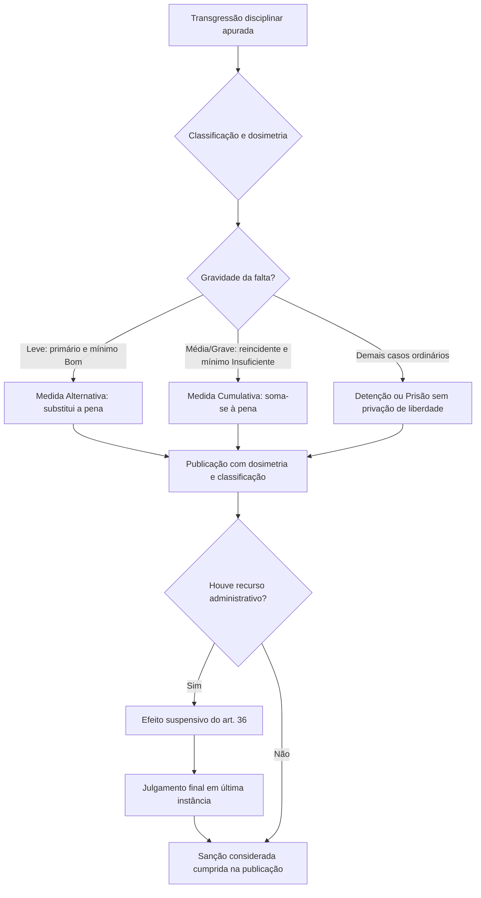

O Decreto Estadual nº 50.014/2020 regulamentou o Código Disciplinar dos Militares de Pernambuco (Lei Estadual nº 11.817/2000) após a vedação federal à privação de liberdade em transgressões disciplinares. Com dez artigos, o decreto estabeleceu as medidas administrativas substitutivas e os critérios de dosimetria e cumprimento de sanções. Este capítulo examina cada um desses dispositivos, oferecendo a base teórica e prática necessária para acertar as questões de prova sobre o regime disciplinar estadual.

> [!objetivos]
> - Compreender a finalidade e a abrangência do Decreto Estadual nº 50.014/2020.
> - Diferenciar a subsistência das penas de detenção e prisão da exclusão da privação de liberdade.
> - Identificar os efeitos secundários e administrativos decorrentes das punições disciplinares.
> - Dominar os critérios para substituição de penas por medidas administrativas alternativas ou cumulativas.
> - Reconhecer as regras de publicação, dosimetria, cumprimento e vigência da norma.

## Origem e finalidade do Decreto Estadual nº 50.014/2020

O Código Disciplinar dos Militares de Pernambuco (Lei Estadual nº 11.817/2000) previa, no art. 28, incisos II e III, as penas de **detenção** e **prisão**. Segundo o § 4º desse artigo, tais penas implicavam privação de liberdade, relativa no caso da detenção e absoluta no caso da prisão, com limite máximo de 30 dias.

Em 2019, a Lei Federal nº 13.967/2019 alterou o art. 18, inciso VII, do Decreto-Lei nº 667/1969, proibindo medidas privativas ou restritivas de liberdade como punição disciplinar a militares estaduais. Para adequar o ordenamento local a essa diretriz sem revogar o Código Disciplinar, o Governador de Pernambuco editou o Decreto Estadual nº 50.014, de 22 de dezembro de 2020.

> [!atencao] Regulamentação sem revogação
> O Decreto Estadual nº 50.014/2020 regulamenta a aplicação da Lei nº 11.817/2000, mas não a revoga. Como ato regulamentador, ele apenas disciplina a execução das sanções disciplinares conforme o ordenamento jurídico vigente.

Em maio de 2022, o Supremo Tribunal Federal julgou a ADI 6595 e declarou inconstitucional a Lei Federal nº 13.967/2019 por vício de iniciativa formal. Além disso, a Lei Federal nº 14.751/2023 ressalvou expressamente as prisões disciplinares militares em seu art. 18, parágrafo único. Não obstante essas alterações federais, o Decreto Estadual nº 50.014/2020 permanece publicado e em vigor em Pernambuco. Nas provas de concurso, adote a literalidade do decreto, salvo quando a questão exigir expressamente a posição do STF.

## O que o decreto regulamenta nos artigos 1º e 2º

O art. 1º do decreto declara seu objeto: regulamentar a Lei Estadual nº 11.817/2000 quanto às penas disciplinares com restrições e privações de liberdade, com fundamento no art. 18, inciso VII, do Decreto-Lei nº 667/1969.

O art. 2º fixa a regra nuclear do diploma: as penas de **detenção** e **prisão** continuam sendo aplicadas e **surtirão todos os efeitos administrativos e secundários inerentes**, **com exceção da privação da liberdade**, absoluta ou relativa, prevista no art. 28, § 4º, da Lei nº 11.817/2000.

> [!lei] Decreto Estadual nº 50.014/2020, art. 2º
> As sanções disciplinares constantes nos incisos II e III do art. 28 da Lei nº 11.817, de 2000, ao serem aplicadas deverão surtir todos os efeitos administrativos e secundários a elas inerentes com exceção da privação da liberdade, absoluta e relativa do transgressor, previstas no § 4º do art. 28 do referido diploma legal.

Assim, o militar sancionado não é recolhido fisicamente à dependência da Organização Militar Estadual (OME) nem confinado em estabelecimento prisional militar. Contudo, a penalidade existe formalmente, constando em seus assentamentos e gerando todos os reflexos de carreira.

A tabela a seguir resume as diferenças no cumprimento das penas disciplinares.

| Sanção disciplinar | Regime da Lei Estadual nº 11.817/2000 | Regime sob o Decreto Estadual nº 50.014/2020 |
| --- | --- | --- |
| **Detenção** (art. 28, II) | Privação relativa da liberdade, com recolhimento em dependência da OME. | Aplicação da pena com todos os efeitos secundários, sem recolhimento físico. |
| **Prisão** (art. 28, III) | Privação absoluta da liberdade, com confinamento na OME ou presídio militar. | Aplicação da pena com todos os efeitos secundários, sem confinamento. |
| **Efeitos funcionais** | Registro na ficha, rebaixamento de comportamento e repercussão recursal. | Manutenção de todos os registros funcionais e rebaixamentos de comportamento. |

## Efeitos secundários e administrativos nos artigos 3º e 7º

O art. 3º do decreto esclarece o alcance dos efeitos secundários e administrativos decorrentes das punições. Esses efeitos abrangem todos os desdobramentos funcionais atribuídos às sanções pelas leis militares estaduais:

1. **Atualização e classificação do comportamento** da praça penalizada;
2. **Registro nos assentamentos funcionais** individuais do militar;
3. **Início da contagem do prazo para recursos** administrativos;
4. **Submissão a processo administrativo**, caso o militar esteja classificado no comportamento mau há no mínimo um ano e continue com conduta irregular ou procedendo incorretamente em suas funções;
5. **Contagem de tempo para reclassificação e melhoria de comportamento**.

As praças ingressam na corporação no comportamento Bom. A escala decresce para Insuficiente e Mau, ou ascende para Ótimo e Excepcional. Permanecer no comportamento Mau por um ano seguido com conduta irregular autoriza a instauração de processo demissório (art. 30 da Lei nº 11.817/2000).

> [!pegadinha] Rol meramente exemplificativo do artigo 3º
> Segundo o art. 7º do decreto, o rol do art. 3º é **meramente exemplificativo**, e não taxativo. Outras medidas previstas em lei, portaria ou regulamento constituem efeitos válidos das sanções disciplinares.

## Publicação e dosimetria no artigo 4º

O art. 4º exige que a sanção disciplinar seja formalmente motivada no ato de sua publicação. A autoridade militar competente deve publicar a pena com a respectiva **dosimetria**, observando com rigor o Capítulo II do Título II da Lei Estadual nº 11.817/2000, onde se situam as causas de justificação, as circunstâncias atenuantes e as circunstâncias agravantes.

Dosimetria é o cálculo e a graduação da sanção disciplinar. A autoridade parte da gravidade abstrata do fato e analisa elementos concretos do caso: o grau de dolo ou culpa do transgressor, os motivos determinantes, a repercussão na tropa, os eventuais danos causados ao serviço e os antecedentes disciplinares registrados na ficha. Esse cálculo fundamentado impede a aplicação de punições arbitrárias ou desproporcionais.

Além da dosimetria, a penalidade deve ser expressamente classificada como **leve, média ou grave**, nos moldes do art. 26 do Código Disciplinar. A motivação expressa dessa classificação atende às exigências da Lei Complementar Estadual nº 351/2017, pois a natureza da falta repercute diretamente na contagem de prazos para progressões e direitos funcionais da carreira. Publica-se não apenas a sanção final, mas a demonstração de como ela foi calculada.

## Penas substituídas por medidas administrativas nos artigos 5º e 6º

O art. 5º do decreto prevê que as penas disciplinares podem ser substituídas pelas **medidas administrativas** descritas no art. 28, § 1º, da Lei nº 11.817/2000:

- Cancelamento de matrícula em curso ou estágio;
- Afastamento do cargo, função, encargo ou comissão;
- Movimentação da OME;
- Suspensão da folga, para prestação compulsória de serviço administrativo ou operacional à OME;
- Suspensão de pagamento, no soldo, dos dias faltados injustificadamente, com interrupção compatível da contagem do tempo de serviço.

O art. 6º estabelece os critérios objetivos para o emprego dessas medidas pela autoridade militar, conforme a gravidade da transgressão e os antecedentes do militar.

A tabela a seguir apresenta os requisitos das modalidades alternativa e cumulativa.

| Modalidade | Natureza da transgressão | Requisito de reincidência | Comportamento exigido | Efeito prático |
| --- | --- | --- | --- | --- |
| **Alternativa** (art. 6º, I) | Transgressão **leve** | Não ser reincidente específico | Pelo menos no comportamento **Bom** | Substitui **totalmente** a pena disciplinar. |
| **Cumulativa** (art. 6º, II) | Transgressão **média ou grave** | Ser reincidente específico | Pelo menos no comportamento **Insuficiente** | Aplica-se **junto** com a pena disciplinar. |

O art. 6º, § 1º, define **reincidência específica**: a prática de ação ou omissão prevista como transgressão disciplinar militar, por mais de uma vez, durante o tempo necessário para o cancelamento da pena aplicada à primeira transgressão.

A expressão legal "pelo menos" significa aquele nível ou superior: "pelo menos Bom" inclui Bom, Ótimo e Excepcional; "pelo menos Insuficiente" abrange Insuficiente, Bom, Ótimo e Excepcional, excluindo apenas o comportamento Mau.

> [!bizu] Regra das medidas administrativas
> Na falta **leve**, a medida **substitui** a pena para quem tem bom comportamento e é primário. Na falta **média ou grave**, a medida **soma-se** à pena como reforço ao reincidente específico.

> [!exemplo] Aplicação da medida administrativa alternativa
> O soldado Henrique, classificado no comportamento Ótimo e sem punições prévias, comete falta leve de atraso à formatura matinal. A autoridade militar aplica de forma alternativa a suspensão de uma folga para serviço interno na OME, afastando a anotação de pena de repreensão ou detenção em seus assentamentos funcionais.

O art. 6º, § 2º, estabelece que, embora Oficiais e Aspirantes-a-Oficial não tenham ficha classificada por comportamentos (pois são avaliados por conceito), as disposições sobre medidas administrativas aplicam-se a eles no que couber.

## Cumprimento e término nos artigos 8º, 9º e 10

Os artigos 8º, 9º e 10 encerram o Decreto nº 50.014/2020 regulando o cumprimento e a vigência das sanções.

O art. 8º dispõe expressamente que a imposição de sanção disciplinar **não impede** o militar de cumprir atos regulares de serviço ou instrução determinados pela autoridade.

O art. 9º define o momento exato do cumprimento: considera-se **cumprida a sanção disciplinar a partir da data de publicação do ato punitivo, após o exaurimento de todos os recursos interpostos**, caso existam.

Essa disposição vincula-se ao art. 36 da Lei nº 11.817/2000, pelo qual a interposição tempestiva de recurso administrativo possui **efeito suspensivo**, sobrestando o início do cumprimento da sanção e a eficácia de seus efeitos até o julgamento final.

O art. 10 define as regras temporais: o decreto entrou em vigor na data de sua publicação oficial, produzindo seus efeitos a partir de **27 de dezembro de 2020**, acompanhando a modulação temporal da legislação federal correlata.

## Mapa do capítulo

Apresentamos o fluxograma do procedimento punitivo e a síntese final como um completo resumo para revisar a disciplina do Decreto Estadual nº 50.014/2020.

### Para fixar

- O Decreto nº 50.014/2020 regulamenta a Lei Estadual nº 11.817/2000 sem jamais revogá-la.
- As penas de detenção e prisão mantêm seus efeitos administrativos e secundários, afastando-se apenas a privação de liberdade.
- O rol de efeitos secundários do art. 3º é meramente exemplificativo, conforme expressamente declarado no art. 7º.
- A publicação da sanção exige a respectiva dosimetria e a classificação em leve, média ou grave (art. 4º).
- A medida alternativa substitui totalmente a pena em transgressão leve praticada por não reincidente específico no comportamento Bom ou superior.
- A medida cumulativa soma-se à pena em transgressão média ou grave cometida por reincidente específico no comportamento Insuficiente ou superior.
- A aplicação da sanção não impede o militar de cumprir atos regulares de serviço ou instrução (art. 8º).
- A sanção disciplinar considera-se cumprida a partir da data de publicação após o exaurimento de todos os recursos (art. 9º).
- O decreto vigora desde a publicação e produz seus efeitos a contar de 27 de dezembro de 2020 (art. 10).
