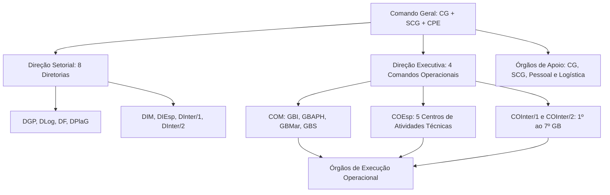

A Lei Estadual nº 15.187, de 12 de dezembro de 2013, define a organização básica do Corpo de Bombeiros Militar de Pernambuco (CBMPE). Trata-se da planta arquitetônica da corporação, regulando sua missão institucional, seus órgãos constitutivos, as atribuições de seus comandantes e o regime jurídico de seu pessoal. Por reunir 104 artigos com extensas relações de órgãos, siglas e competências funcionais, esta lei possui alta incidência nas provas. Este capítulo detalha cada um de seus segmentos de forma lógica e esquematizada.

> [!objetivos]
> - Identificar a natureza jurídica, subordinação e competências institucionais do CBMPE.
> - Compreender a divisão estrutural entre órgãos de direção, apoio e execução.
> - Dominar a composição e atribuições do Comando Geral, das oito diretorias setoriais e dos quatro comandos operacionais.
> - Diferenciar as competências dos órgãos de apoio técnico, disciplinar, de ensino e logístico.
> - Conhecer a distribuição das unidades operacionais, dos Centros de Atividades Técnicas e os prazos legais de relatórios e substituições.

## Como atacar esta lei e sua relevância para o concurso

Para obter alto rendimento no estudo da Lei Estadual nº 15.187/2013, o estudante não deve tentar memorizar os 104 artigos de forma isolada. A abordagem mais eficiente consiste em compreender a lógica hierárquica e funcional que orienta a estrutura do CBMPE. As bancas examinadoras costumam explorar três grupos principais de questões:

1. **Associação de siglas e subordinação:** saber a qual escalão pertence cada diretoria, grupamento ou centro especializado;
2. **Distribuição de atribuições:** identificar quem comanda, quem assessora, quem presta apoio logístico e quem executa as operações de socorro na ponta da linha;
3. **Prazos e regras numéricas:** como o prazo de 30 dias para interinidade plena do Subcomandante Geral, a periodicidade anual ou mensal de relatórios, os requisitos de posto para o Comando Geral e as regras de vigência.

Visualizar o organograma hierárquico permite deduzir as respostas sem depender de mera decoreba mecânica, integrando o texto legal com a rotina operacional bombeiro militar.

## Generalidades da corporação nos artigos 1º a 3º

Os artigos 1º a 3º traçam o perfil institucional e as missões legais do Corpo de Bombeiros Militar de Pernambuco.

O art. 1º estabelece a natureza jurídica da corporação. O CBMPE é uma instituição permanente, força auxiliar e reserva do Exército Brasileiro, organizada com base na hierarquia e na disciplina militares. Sua destinação consiste em realizar serviços específicos de bombeiro militar e atividades de defesa civil em todo o território estadual, por intermédio de suas Organizações Militares Estaduais (OME).

> [!lei] Lei Estadual nº 15.187/2013, art. 1º
> O Corpo de Bombeiros Militar de Pernambuco - CBMPE, instituição permanente, força auxiliar e reserva do Exército Brasileiro, organizado com base na hierarquia e disciplina, destina-se a realizar serviços específicos de bombeiro militar e atividades de defesa civil na área do Estado de Pernambuco, através de suas Organizações Militares Estaduais - OME.

O art. 3º fixa a inserção administrativa da corporação no Poder Executivo Estadual: o CBMPE é órgão integrante da **Secretaria de Defesa Social (SDS)** de Pernambuco.

O art. 2º enumera as **13 competências institucionais** do CBMPE:

1. Serviços de prevenção e extinção de incêndios;
2. Prevenção e extinção de incêndios em florestas e matas, visando à proteção do meio ambiente;
3. Serviços de resgate, busca e salvamento;
4. Análise, exigência e fiscalização de serviços, projetos e instalações de segurança contra incêndio e pânico;
5. Socorro e atendimento emergencial pré-hospitalar em acidentes com vítimas ou pessoas em perigo iminente;
6. Atuação na defesa civil, integrando o Sistema Estadual de Defesa Civil e atendendo às mobilizações da legislação federal;
7. Isolamento, interdição ou embargo de obras, serviços, habitações e locais públicos ou privados sem condições de segurança;
8. Aplicação de penalidades pecuniárias na forma da lei;
9. Monitoramento do transporte de cargas perigosas e especiais, mediante convênio com a autoridade de trânsito competente;
10. Fiscalização, controle, prevenção e restrição da prática de esportes náuticos em áreas de risco;
11. Coordenação, no âmbito estadual, da elaboração de normas técnicas sobre segurança contra incêndio e pânico;
12. Atendimento à convocação e mobilização do Governo Federal, subordinando-se à Força Terrestre;
13. Exercício de outras atribuições estabelecidas em lei.

> [!pegadinha] Convocação federal e subordinação à Força Terrestre
> No caso de convocação e mobilização da União prevista no art. 2º, inciso XII, o CBMPE subordina-se operacionalmente à **Força Terrestre** (Exército Brasileiro). A banca com frequência tenta induzir o candidato ao erro trocando essa subordinação por Marinha, Força Aérea ou Ministério da Justiça.

## Estrutura geral nos artigos 4º a 7º

O art. 4º da lei estabelece que o CBMPE estrutura-se em três tipos fundamentais de órgãos: **órgãos de direção**, **órgãos de apoio** e **órgãos de execução**. Essa divisão reflete a clássica separação das funções administrativas militares.

A tabela a seguir discrimina as funções precípuas e as responsabilidades de cada categoria de órgãos.

| Categoria de órgão | Previsão legal | Finalidade principal | Responsabilidades típicas |
| --- | --- | --- | --- |
| **Órgãos de direção** | Art. 5º | Comando e administração | Planejamento estratégico, coordenação superior, controle e fiscalização institucional; acionamento dos demais órgãos por diretrizes. |
| **Órgãos de apoio** | Art. 6º | Atividades-meio | Gestão de pessoal e ensino, assistência social, finanças, tecnologia, saúde e logística em suporte às ações finalísticas. |
| **Órgãos de execução** | Art. 7º | Atividades-fim | Execução direta das missões operacionais de socorro, combate a incêndio, resgate, vistorias técnicas e resposta a desastres. |

> [!bizu] As três funções básicas da estrutura
> Para memorizar a estrutura tripartida do art. 4º, lembre-se desta síntese direta: os órgãos de direção **mandam** (planejam e comandam); os órgãos de apoio **sustentam** (atividades-meio); e os órgãos de execução **fazem** (atividades-fim operacionais).

## Órgãos de direção nos artigos 8º a 40

Conforme o art. 8º da lei, os órgãos de direção compreendem três níveis hierárquicos: **direção geral**, **direção setorial** e **direção executiva**.

### Direção geral: Comando Geral

A direção geral é exercida pelo **Comando Geral**, composto pelo Comandante Geral, pelo Subcomandante Geral e pelo Conselho de Políticas Estratégicas (CPE), conforme o art. 9º.

O **Comandante Geral** (art. 10) é o responsável máximo pelo comando, administração e emprego operacional da corporação. É nomeado pelo Governador do Estado entre os oficiais da ativa do **último posto do Quadro de Combatentes (QOC)**. A lei prescreve expressamente que, se a escolha do Governador não recair sobre o coronel mais antigo, o nomeado adquire **precedência funcional e hierárquica** sobre todos os demais coronéis da corporação enquanto permanecer no cargo.

O **Subcomandante Geral** (art. 11) é o substituto imediato do Comandante Geral em suas ausências e impedimentos. É nomeado pelo Governador por **indicação do Comandante Geral**, também dentre os coronéis do QOC da ativa, obtendo precedência hierárquica sobre os demais oficiais de seu posto, à exceção do próprio Comandante Geral.

O **Conselho de Políticas Estratégicas (CPE)**, disciplinado nos arts. 12 e 13, é o órgão colegiado superior encarregado de formular a doutrina geral de emprego da corporação. É presidido pelo Comandante Geral e integrado pelo Subcomandante Geral, pelos diretores setoriais e pelos diretores executivos. Sua secretaria executiva é exercida pelo Gabinete do Comandante Geral (GCG). O presidente do conselho pode convocar outros integrantes para prestar assessoria técnica, mas os membros convocados não participam de julgamentos ou votações deliberativas.

> [!atencao] Requisitos e precedência do Comandante Geral
> O Comandante Geral deve obrigatoriamente ser Coronel do Quadro de Combatentes (QOC) da ativa. Caso não seja o mais antigo do almanaque, a lei confere-lhe precedência funcional e hierárquica imediata sobre os demais coronéis. Essa regra impede qualquer embaraço à autoridade do comando.

### Direção setorial: as oito diretorias

As diretorias setoriais (arts. 14 a 30) atuam sob a forma de sistema, incumbindo-se do planejamento, normatização, fiscalização e controle setorial em suas respectivas áreas. São oito diretorias estruturadas:

A tabela a seguir apresenta as oito diretorias setoriais e suas respectivas áreas de atuação.

| Sigla | Diretoria | Âmbito territorial / funcional | Principais incumbências |
| --- | --- | --- | --- |
| **DGP** | Diretoria de Gestão de Pessoal | Todo o Estado | Gestão de pessoal e de ensino, formação, especialização, movimentação e assistência social. |
| **DLog** | Diretoria de Logística | Todo o Estado | Aquisições, suprimentos, frota, obras, arquitetura, patrimônio e material bélico. |
| **DF** | Diretoria de Finanças | Todo o Estado | Planejamento, controle, execução orçamentária e financeira da corporação. |
| **DPlaG** | Diretoria de Planejamento e Gestão | Todo o Estado | Planejamento estratégico, convênios, orçamento e arrecadação de tributos próprios. |
| **DIM** | Diretoria Integrada Metropolitana | Recife e Região Metropolitana | Doutrina, emprego operacional e resposta a desastres na área metropolitana. |
| **DIEsp** | Diretoria Integrada Especializada | Todo o Estado | Atividades técnicas de vistoria, credenciamento e análise de projetos de segurança. |
| **DInter/1** | Diretoria Integrada do Interior 1 | Zona da Mata e Agreste | Doutrina, coordenação e controle operacional na Zona da Mata e Agreste. |
| **DInter/2** | Diretoria Integrada do Interior 2 | Sertão | Doutrina, coordenação e controle operacional na região sertaneja. |

> [!bizu] Divisão das oito diretorias setoriais
> Divida as diretorias em dois grupos de quatro para facilitar a memorização: quatro diretorias de gestão institucional (**DGP, DLog, DF e DPlaG**) e quatro diretorias operacionais integradas (**DIM, DIEsp, DInter/1 e DInter/2**).

### Direção executiva: os quatro comandos operacionais

A direção executiva (arts. 31 a 40) materializa-se nos comandos operacionais intermediários, que exercem o controle, fiscalização e articulação tática sobre as unidades de execução.

A tabela a seguir resume os comandos operacionais e os órgãos que a eles se subordinam.

| Comando Operacional | Sigla | Circunscrição / missão | Unidades subordinadas |
| --- | --- | --- | --- |
| **Comando Operacional Metropolitano** | **COM** | Recife e Região Metropolitana | GBI, GBAPH, GBMar e GBS. |
| **Comando Operacional Especializado** | **COEsp** | Todo o território estadual | CAT/RMR, CAT/ZM, CAT/Agreste, CAT/Sertão I e CAT/Sertão II. |
| **Comando Operacional do Interior 1** | **COInter/1** | Zona da Mata e Agreste | 1º GB, 2º GB, 6º GB e 7º GB. |
| **Comando Operacional do Interior 2** | **COInter/2** | Região do Sertão | 3º GB, 4º GB e 5º GB. |

> [!pegadinha] Erro de redação do artigo 33 e os grupamentos do COM
> O parágrafo único do art. 33 da Lei nº 15.187/2013 contém uma falha material evidente na redação: cita o COEsp ao relacionar os grupamentos operacionais especializados da Capital. Na realidade funcional e sistemática da lei, o **GBI, GBAPH, GBMar e GBS subordinam-se ao COM** (Comando Metropolitano). Já o **COEsp coordena os cinco CAT** distribuídos pelo Estado. Fique atento a essa inconsistência literal em enunciados de prova.

## Órgãos de apoio nos artigos 41 a 81

Os órgãos de apoio realizam as atividades-meio que garantem a infraestrutura administrativa e operacional da corporação. O art. 41 classifica esses órgãos em quatro grupos distintos:

1. **Apoio ao Comando Geral** (art. 42);
2. **Apoio ao Subcomando Geral** (art. 55);
3. **Apoio à gestão de pessoal** (art. 66);
4. **Apoio logístico** (art. 75).

A tabela a seguir esquematiza todos os órgãos de apoio e suas funções primordiais.

| Grupo de apoio | Órgãos integrantes | Atribuição principal |
| --- | --- | --- |
| **Apoio ao Comando Geral** | **GCG** (Gabinete), **AJ** (Assessoria Jurídica), **CCS** (Comunicação Social), **CTIC** (Tecnologia da Informação), **CPO** (Promoção de Oficiais) e **CI** (Inteligência). | Assessoramento direto ao Chefe da corporação em matérias jurídicas, institucionais, tecnológicas, promoção de oficiais e segurança da informação. |
| **Apoio ao Subcomando Geral** | **GSG** (Gabinete), **AjG** (Ajudância Geral), **CJD** (Justiça e Disciplina), **CPP** (Promoção de Praças) e **CCI** (Controladoria Institucional). | Administração do quartel-general, controle da disciplina e processos sumários, processamento de promoções de praças e auditoria administrativa interna. |
| **Apoio à Gestão de Pessoal** | **CEMet II** (Ensino), **CPPA** (Pagamento de Pessoal Ativo), **CEFD** (Educação Física e Desportos) e **CAS** (Assistência Social). | Formação e aperfeiçoamento de praças (integrando a ACIDES), confecção da folha de pagamento, treinamento físico e suporte biopsicossocial ao efetivo. |
| **Apoio Logístico** | **CMan** (Manutenção), **CInt** (Intendência) e **CEAO** (Engenharia, Arquitetura e Obras). | Manutenção preventiva e corretiva de viaturas e embarcações, suprimento de materiais operacionais e gestão de obras e prédios do CBMPE. |

Para não confundir as competências, note a repartição entre os gabinetes: os assuntos de inteligência, jurídicos e promoção de oficiais ligam-se ao Comando Geral; a disciplina, os inquéritos e a promoção de praças ligam-se ao Subcomando Geral.

## Órgãos de execução nos artigos 82 a 90

Os órgãos de execução (art. 82) desenvolvem diretamente as missões de atendimento à sociedade. Subdividem-se em quatro grupos principais:

1. **Unidades Operacionais (UOp):** constituídas pelos **Grupamentos de Bombeiros (GB)** e suas subunidades, as **Seções de Bombeiros (SB)**, que podem desdobrar-se em **Destacamentos de Bombeiros Militares (DBM)**;
2. **Centros de Atividades Técnicas (CAT):** responsáveis pelo licenciamento e análise de segurança contra incêndio e pânico;
3. **Centro de Controle Operacional (CCO):** responsável pelo recebimento de chamadas de emergência (193), triagem e acionamento imediato dos socorros;
4. **Centro de Resposta a Desastres (CRD):** articulação com a defesa civil estadual, monitoramento de áreas de risco e pronta resposta a sinistros de grande escala.

A tabela a seguir apresenta os Grupamentos de Bombeiros e suas respectivas especialidades e áreas geográficas.

| Unidade Operacional | Sigla | Missão operacional precípua | Área territorial |
| --- | --- | --- | --- |
| **Grupamento de Bombeiros de Incêndio** | **GBI** | Prevenção e extinção de incêndios e proteção ao meio ambiente. | Recife e Região Metropolitana. |
| **Grupamento de Atendimento Pré-Hospitalar** | **GBAPH** | Resgate e primeiros socorros em urgências pré-hospitalares. | Recife e Região Metropolitana. |
| **Grupamento de Bombeiros Marítimo** | **GBMar** | Salvamento marítimo, praias e prevenção de afogamentos. | Faixa litorânea metropolitana. |
| **Grupamento de Bombeiros de Salvamento** | **GBS** | Salvamento terrestre, busca em matas, operações em alturas e mergulho. | Recife e Região Metropolitana. |
| **Grupamentos de Bombeiros do Interior** | **1º ao 7º GB** | Combate a incêndio, resgate pré-hospitalar e salvamento em geral. | Municípios da Zona da Mata, Agreste e Sertão. |

Os Centros de Atividades Técnicas (art. 89) somam **cinco unidades** na letra da lei: **CAT/RMR** (Metropolitana), **CAT/ZM** (Zona da Mata), **CAT/Agreste**, **CAT/Sertão I** (Pajeú, Moxotó e Itaparica) e **CAT/Sertão II** (Sertão Central, Araripe e São Francisco).

## Atribuições funcionais e orgânicas nos artigos 91 a 97

Os artigos 91 a 97 disciplinam os deveres de comando e as responsabilidades dos chefes em cada nível hierárquico.

O art. 91 estabelece que todas as OME devem elaborar e atualizar suas **Normas Gerais de Ação (NGA)**, garantindo uniformidade administrativa e doutrinária. As OME com autonomia administrativa (art. 92) devem gerir seus próprios recursos e formular sua previsão orçamentária.

O art. 93 trata das prerrogativas do **Subcomandante Geral**. Além de responder pelo expediente nos impedimentos breves do titular, o Subcomandante assume **interinamente o cargo de Comandante Geral** em três hipóteses taxativas:

1. Impedimento temporário do titular por prazo **superior a 30 dias**;
2. Afastamento do Comandante Geral do **território nacional**;
3. Impedimento definitivo do titular, até a nomeação do novo Comandante Geral.

> [!atencao] Hipóteses de interinidade plena do Subcomandante Geral
> Em ausências rotineiras de até 30 dias dentro do território nacional, o Subcomandante Geral apenas responde pelo expediente regular do Comando Geral. A investidura no exercício interino pleno do cargo restringe-se às três situações expressas do art. 93: impedimento superior a 30 dias, ausência do país e vacância definitiva.

Os diretores setoriais e comandantes de território (arts. 94 e 95) respondem perante o Comandante Geral pelo funcionamento de seus sistemas e devem encaminhar **anualmente ao Subcomandante Geral o relatório circunstanciado** de suas atividades técnicas e administrativas.

Já os comandantes de unidades de execução (art. 97) possuem a obrigação de planejar e comandar pessoalmente ações operacionais de grande vulto, fiscalizar a tropa e encaminhar **mensalmente ao escalão superior o relatório de atividades**.

> [!pegadinha] Periodicidade dos relatórios: diretores versus execução
> Memorize esta distinção cobrada com frequência em concursos: diretores setoriais e comandantes de território enviam relatório **anual** ao **Subcomandante Geral** (art. 95, IX). Comandantes de órgãos de execução enviam relatório **mensal** ao **escalão imediatamente superior** (art. 97, XIII).

## Do pessoal nos artigos 98 a 100

O Título IV da lei disciplina a composição do efetivo e as regras de fixação das vagas do CBMPE.

O art. 98 classifica o pessoal da corporação em três grandes categorias:

- **Pessoal da ativa:** compreende os Oficiais, as Praças Especiais (Aspirantes e Cadetes) e as Praças;
- **Pessoal inativo:** abrange os militares na Reserva Remunerada e os Reformados;
- **Pessoal civil:** constituído pelo Quadro Permanente de Pessoal Civil, regido por estatuto funcional próprio.

Os Oficiais são distribuídos em Quadros e as Praças em Qualificações por meio de **Decreto do Poder Executivo Estadual** (§§ 1º e 2º do art. 98).

O art. 99 e o art. 100 tratam do efetivo e dos Quadros de Organização e Distribuição (QOD). O efetivo total da corporação é fixado em lei estadual específica, de iniciativa do Governador do Estado submetida à Assembleia Legislativa. Essa lei exige **prévia aprovação do Estado-Maior do Exército (EME)**, por força da condição constitucional de força auxiliar e reserva do Exército. Os QOD, que distribuem o efetivo pelas unidades, também são aprovados por decreto estadual após chancela do EME.

## Disposições finais nos artigos 101 a 104

Os artigos finais tratam das regras transitórias, substituições e vigência da norma.

O art. 101 detalha que o QOD define as frações de tropa, localização das unidades e o número mínimo de militares em cada guarnição de socorro.

O art. 102 fixa os critérios de **substituição temporária** nas OME:

- O Comandante Geral é substituído pelo Subcomandante Geral;
- O Subcomandante Geral é substituído pelo oficial de maior grau hierárquico, observada a antiguidade;
- Os Diretores e Comandantes de território são substituídos pelo oficial mais antigo de maior posto na diretoria ou unidades subordinadas;
- Comandantes de Unidades Operacionais e de Ensino são substituídos por seus respectivos Subcomandantes;
- Em caso de empate hierárquico, prevalece a antiguidade, e as substituições devem ocorrer, em princípio, entre oficiais do mesmo quadro.

> [!exemplo] Substituição temporária por antiguidade
> Diante de um afastamento do titular da Diretoria de Finanças, caso existam dois Tenentes-Coronéis no setor, a assunção interina recai sobre o Tenente-Coronel mais antigo no almanaque militar, pertencente ao mesmo quadro do oficial afastado.

O art. 103 estipulou que a lei entrou em vigor na data de publicação (12 de dezembro de 2013), gerando efeitos práticos a partir de **1º de janeiro de 2014**.

O art. 104 expressamente revogou as legislações anteriores que tratavam da matéria, em especial a Lei nº 12.153/2001 e a Lei nº 12.614/2004.

Por fim, cabe registrar que a Lei Estadual nº 16.277/2017 criou posteriormente novas estruturas na corporação (como a DEIP, o CAC e grupamentos do 8º ao 12º GB), mas sem alterar o texto formal da Lei nº 15.187/2013. Em provas objetivas que cobrem especificamente a Lei nº 15.187, prevalece a literalidade de seus 104 artigos originais.

## Mapa do capítulo

Apresentamos o organograma geral da estrutura da corporação e a síntese final como um completo resumo para revisar os principais tópicos da Lei Estadual nº 15.187/2013.

### Para fixar

- O CBMPE é instituição permanente, força auxiliar e reserva do Exército, subordinado administrativamente à Secretaria de Defesa Social.
- A estrutura geral divide-se em órgãos de direção (comando), de apoio (atividades-meio) e de execução (atividades-fim).
- O Comandante Geral é Coronel do Quadro de Combatentes da ativa, com precedência funcional e hierárquica sobre os demais.
- São oito diretorias setoriais: quatro de gestão (DGP, DLog, DF e DPlaG) e quatro integradas operacionais (DIM, DIEsp, DInter/1 e DInter/2).
- Os quatro comandos executivos são COM (Metropolitano), COEsp (Técnico), COInter/1 (Mata/Agreste) e COInter/2 (Sertão).
- O Subcomandante Geral assume interinamente o cargo de Comandante Geral em três casos: ausência maior que 30 dias, saída do país e vacância definitiva.
- Diretores setoriais enviam relatório anual ao Subcomandante Geral; comandantes de execução enviam relatório mensal ao escalão superior.
- O efetivo e os QOD dependem de aprovação prévia do Estado-Maior do Exército antes do ato legislativo estadual.
- A lei foi publicada em 12/12/2013, produzindo efeitos desde 01/01/2014, revogando as Leis 12.153/2001 e 12.614/2004.
