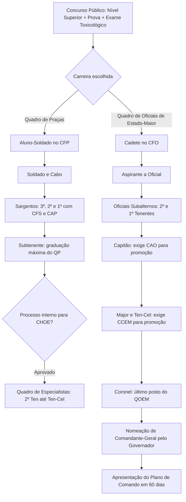

A Lei Federal nº 14.751, promulgada em 12 de dezembro de 2023, institui a Lei Orgânica Nacional das Polícias Militares e dos Corpos de Bombeiros Militares dos Estados, do Distrito Federal e dos Territórios. Trata-se de um marco histórico para a segurança pública brasileira, uniformizando as normas gerais de organização, efetivos, material bélico, garantias, direitos, deveres e mobilização das corporações militares estaduais. O edital exige o domínio integral desse diploma normativo, composto por 44 artigos distribuídos em oito capítulos. Este capítulo oferece uma análise aprofundada de suas disposições, pontuando as diferenças entre normas federais e estaduais e destacando os temas de maior predileção das bancas examinadoras.

> [!objetivos]
> - Compreender o fundamento constitucional e os objetivos nacionais da Lei Federal nº 14.751/2023.
> - Dominar a natureza jurídica, os princípios, as diretrizes e a integração nos sistemas federais de segurança e defesa civil.
> - Diferenciar as competências privativas e prioritárias das Polícias Militares e dos Corpos de Bombeiros Militares.
> - Analisar a estrutura organizacional básica, os requisitos de ingresso, o sistema de ensino e as regras de promoção.
> - Conhecer o rol de garantias, prerrogativas, vedações funcionais, regras de elegibilidade e o regime de convocação extraordinária.

## Visão geral e fundamentos da Lei Orgânica Nacional

A competência para editar normas gerais sobre as Polícias Militares e Corpos de Bombeiros Militares pertence privativamente à União, conforme estabelece o art. 22, inciso XXI, da Constituição Federal. Durante mais de cinco décadas, essas diretrizes gerais permaneceram vinculadas ao antigo Decreto-Lei nº 667/1969, editado durante o regime militar. A promulgação da Lei Federal nº 14.751/2023 preencheu essa lacuna republicana, modernizando os conceitos e conferindo tratamento orgânico e padronizado a todas as corporações estaduais.

A Lei nº 14.751/2023 entrou em vigor na data de sua publicação oficial no Diário Oficial da União (13 de dezembro de 2023). Seu texto alterou o art. 42 da Lei nº 13.675/2018 (Lei do Sistema Único de Segurança Pública - Susp) e revogou expressamente dezenas de dispositivos defasados do Decreto-Lei nº 667/1969 (arts. 1º, 2º, partes do art. 3º, arts. 4º a 17, 21 a 23 e 25 a 28).

A estrutura da lei compõe-se de **44 artigos organizados em 8 capítulos**, conforme detalhado na tabela a seguir.

| Capítulo | Denominação temática | Dispositivos correspondentes | Conteúdo central abordado |
| --- | --- | --- | --- |
| **Capítulo I** | Disposições Gerais | Arts. 1º a 8º | Natureza jurídica, princípios, diretrizes, competências e subordinação. |
| **Capítulo II** | Da Organização | Arts. 9º e 10 | Iniciativa legislativa e órgãos da estrutura básica preferencial. |
| **Capítulo III** | Dos Efetivos | Arts. 11 a 16 | Escalonamento hierárquico, requisitos de ingresso, promoção, quadros e ensino. |
| **Capítulo IV** | Do Material de Segurança Pública | Art. 17 | Prerrogativas de material bélico, dotação e cadastro de armas no Sigma. |
| **Capítulo V** | Das Garantias | Art. 18 | Prerrogativas institucionais e individuais, estabilidade e custódia prisional. |
| **Capítulo VI** | Vedações, Direitos e Inatividade | Arts. 19 a 23 | Atividade empresarial, limites à imagem, direitos políticos e precedência. |
| **Capítulo VII** | Convocação, Mobilização e Emprego | Arts. 24 a 28 | Hipóteses extraordinárias de mobilização federal, tutela da AGU e papel da IGPM/BM. |
| **Capítulo VIII** | Disposições Finais | Arts. 29 a 44 | Plano de comando, símbolos, conselhos de comandantes e regras de transição. |

No plano federativo, a lei estabelece uma importante distinção: para os Estados, a organização pormenorizada e a fixação de vencimentos dependem de **lei estadual de iniciativa privativa do respectivo Governador** (art. 9º). Já para as corporações militares do Distrito Federal e dos Territórios Federais (que são mantidas e organizadas financeiramente pela União por força do art. 21, XIV, da CF), a organização decorre de **lei federal de iniciativa privativa do Presidente da República** (art. 9º, parágrafo único, e art. 32).

## Disposições gerais nos artigos 1º a 8º

O Capítulo I estabelece os alicerces conceituais, filosóficos e funcionais das instituições militares estaduais.

### Natureza institucional no artigo 2º

Conforme o art. 2º da Lei Federal nº 14.751/2023, as Polícias Militares e os Corpos de Bombeiros Militares são **instituições militares permanentes, exclusivas e típicas de Estado**, essenciais à Justiça Militar e indispensáveis à preservação da ordem pública, da segurança pública, da incolumidade das pessoas e do patrimônio e ao regime democrático.

> [!lei] Lei Federal nº 14.751/2023, art. 2º
> As polícias militares e os corpos de bombeiros militares dos Estados, do Distrito Federal e dos Territórios, instituições militares permanentes, exclusivas e típicas de Estado, essenciais à Justiça Militar, forças auxiliares e reserva do Exército, subordinadas aos Governadores dos Estados, do Distrito Federal e dos Territórios, são indispensáveis à preservação da ordem pública, da segurança pública, da incolumidade das pessoas e do patrimônio e ao regime democrático, organizadas com base na hierarquia e na disciplina militares, comandadas por oficial da ativa do último posto, integrante do Quadro de Oficiais de Estado-Maior (QOEM).

O dispositivo consagra a condição constitucional de **forças auxiliares e reserva do Exército Brasileiro** (CF, art. 144, § 6º) e define que o comando da instituição deve ser confiado a **oficial da ativa do último posto, integrante do Quadro de Oficiais de Estado-Maior (QOEM)**.

O § 1º do art. 2º define o núcleo da missão da **Polícia Militar**: instituição integrante do Susp, à qual cabe a proteção dos direitos fundamentais no âmbito da preservação da ordem pública, da **polícia ostensiva** e da **polícia judiciária militar**.

O § 2º do art. 2º define o núcleo da missão do **Corpo de Bombeiros Militar**: instituição integrante do Susp, à qual cabe a proteção dos direitos fundamentais no âmbito da **defesa civil**, da **prevenção e combate a incêndios**, do **atendimento a emergências** (busca, salvamento e resgate), da **perícia administrativa de incêndio e explosão** e da **polícia judiciária militar**.

O § 3º do art. 2º elenca a vinculação das corporações a quatro sistemas e políticas públicas nacionais de enorme relevância:
1. **Sistema Único de Segurança Pública (Susp)**;
2. **Defesa Nacional**;
3. **Sistema Nacional de Proteção e Defesa Civil (Sinpdec)**;
4. **Sistema Nacional do Meio Ambiente (Sisnama)**.

> [!bizu] O quarteto de sistemas: SuDeSiSi
> Grave este quarteto de vinculação obrigatória das corporações: **Susp, Defesa Nacional, Sinpdec e Sisnama** (mote mnemônico: "SuDeSiSi"). Questões costumam tentar introduzir sistemas alheios, como Sistema Único de Saúde (SUS) ou Sistema Nacional de Trânsito, para invalidar a alternativa.

### Princípios básicos no artigo 3º

O art. 3º estabelece **12 princípios basilares** a serem observados pelas corporações militares estaduais:
1. Hierarquia;
2. Disciplina;
3. Proteção, promoção e respeito aos direitos humanos, inclusive compromissos internacionais;
4. Legalidade;
5. Impessoalidade;
6. Publicidade, com transparência e prestação de contas;
7. Moralidade;
8. Eficiência;
9. Efetividade;
10. Razoabilidade e proporcionalidade;
11. Universalidade na prestação do serviço;
12. Participação e interação comunitária.

Note que esse catálogo reúne os cinco princípios clássicos da Administração Pública do art. 37, caput, da CF (Legalidade, Impessoalidade, Moralidade, Publicidade e Eficiência - LIMPE), agregando postulados operacionais militares (hierarquia e disciplina), humanitários (direitos humanos) e republicanos (efetividade, razoabilidade, universalidade e participação comunitária).

### Diretrizes operacionais no artigo 4º

O art. 4º relaciona 20 diretrizes institucionais. Entre as mais cobradas em exames, destacam-se:
- Atendimento permanente e ininterrupto à sociedade;
- Planejamento sistêmico e visão de longo prazo;
- Integração comunitária e articulação com os órgãos do Poder Judiciário, Ministério Público e Defensoria;
- Distribuição do efetivo proporcional ao número de habitantes, considerando indicadores criminais e socioeconômicos regionais;
- Adoção de base técnica e científica nas decisões operacionais;
- Capacitação profissional continuada do efetivo;
- Uso racional e progressivo da força com emprego de meios não letais;
- Livre convencimento técnico-jurídico do oficial presidente de procedimentos de polícia judiciária militar;
- Natureza jurídica essencial e exclusiva de Estado atribuída à polícia judiciária militar.

### Competências das Polícias Militares e Corpos de Bombeiros Militares

Os artigos 5º e 6º detalham minuciosamente as atribuições de cada uma das forças militares estaduais.

O art. 5º (com 25 incisos) disciplina a **Polícia Militar**. Entre suas atribuições centrais figuram o planejamento e a execução da polícia ostensiva de preservação da ordem pública e, **privativamente**, da polícia judiciária militar no âmbito da corporação. Compete-lhe ainda prevenir e reprimir os ilícitos penais militares; cumprir mandados judiciais militares; exercer o policiamento ostensivo de trânsito urbano e rodoviário estadual; atuar na proteção ambiental, inclusive com competência para **lavrar auto de infração ambiental** e aplicar penalidades administrativas; desenvolver atividades de inteligência e contrainteligência; e custodiar militar preso em flagrante, preventivamente ou condenado. Os policiais militares são qualificados legalmente como **autoridades de polícia administrativa, ostensiva, de preservação da ordem pública e de polícia judiciária militar** (§ 2º).

O art. 6º (com 27 incisos) disciplina o **Corpo de Bombeiros Militar**. A lei faz uma criteriosa distinção entre atribuições exercidas de forma privativa e atribuições prioritárias:

A tabela a seguir compara o alcance das competências do CBMPE sob a Lei nº 14.751/2023.

| Espécie de competência | Dispositivo legal | Matérias abrangidas | Natureza jurídica |
| --- | --- | --- | --- |
| **Competências privativas** | Art. 6º, II, alínea *b*, e § 1º | Prevenção, combate e perícia administrativa de incêndios; normas de segurança contra incêndio e pânico; vistorias técnicas em edificações e áreas de risco; polícia judiciária militar. | Exclusividade do CBM, vedada a delegação a órgãos civis ou privados. |
| **Competências prioritárias** | Art. 6º, II, alínea *a* | Ações de busca, salvamento e resgate de pessoas e bens em ambientes aquáticos, terrestres e em alturas. | Titularidade preferencial do CBM, respeitadas atribuições federais e municipais. |
| **Defesa Civil e Meio Ambiente** | Art. 6º, VII e IX | Gestão, coordenação e resposta a desastres no Sinpdec; combate a incêndio florestal e lavratura de auto de infração ambiental florestal. | Atuação integrada em políticas públicas ambientais e de proteção civil. |

Um ponto de atenção especial reside na **perícia administrativa de incêndio e explosão** (art. 6º, § 5º). O dispositivo deixa claro que a perícia administrativa realizada pelos bombeiros militares ocorre **depois de liberado o local pelo perito oficial de natureza criminal**, salvo manifesta impossibilidade fática de sua presença. Essa perícia administrativa visa subsidiar a atualização de normas e prevenção de sinistros futuros, sem substituir o laudo pericial da polícia científica para fins penais comuns.

> [!pegadinha] Distinção crucial: privativo versus prioritário
> Em provas de concurso, atente rigorosamente para estes dois termos no art. 6º: ações de **prevenção, combate e perícia administrativa de incêndios** são competências **privativas** dos bombeiros militares. Por outro lado, ações de **busca, salvamento e resgate** são competências **prioritárias**. Trocar essas expressões é uma das pegadinhas prediletas das bancas examinadoras.

### Subordinação e limites de cooperação nos artigos 7º e 8º

O art. 7º reafirma que as corporações subordinam-se diretamente aos Governadores. A integração e a cooperação federativa são autorizadas mediante convênios e acordos técnicos, sendo expressamente **vedados o esvaziamento e a substituição das atribuições constitucionais** dos órgãos de segurança pública.

O art. 8º autoriza a cooperação na área de formação, inteligência e centros de comunicação compartilhados. Contudo, o parágrafo único desse artigo consagra uma vedação taxativa: é expressamente **proibida a cooperação voltada para treinamento e formação de natureza militar a instituições civis**.

## Organização das corporações nos artigos 9º e 10

O Capítulo II disciplina as diretrizes organizacionais que devem nortear as leis locais dos entes federados.

O art. 9º consagra o princípio da simetria: a organização básica das corporações militares estaduais é fixada em **lei de iniciativa privativa do Governador do Estado**, que deve respeitar as normas gerais federais da Lei nº 14.751/2023 e as bases organizacionais das Forças Armadas.

O art. 10 apresenta o modelo de **estrutura básica preferencial**, constituído por cinco tipos de órgãos:

1. **Órgãos de direção:** subdivididos em direção geral (comando, administração superior e planejamento estratégico) e direção setorial (gestão de pessoal e de ensino, logística, saúde, inteligência, orçamento e gestão ambiental);
2. **Órgãos de assessoramento:** encarregados da consultoria jurídica, comunicação social, assessoria parlamentar e elaboração de notas técnicas de suporte ao comando;
3. **Órgãos de apoio:** voltados para o desempenho das atividades-meio em logística, finanças, ensino e patrimônio;
4. **Órgãos de execução:** responsáveis pela atividade-fim operacional nas diversas circunscrições territoriais;
5. **Órgãos de correição:** constituídos por **corregedorias-gerais** com atuação desconcentrada em todo o território estadual.

A inserção da corregedoria-geral como órgão autônomo na estrutura básica (art. 10, inciso V) visa prevenir e apurar desvios éticos e infrações penais militares, instrumentalizando a atuação da Justiça Militar. A lei ressalta que a atuação da corregedoria não retira nem enfraquece o poder hierárquico e disciplinar próprio dos comandantes de unidades operacionais locais (§ 5º).

## Dos efetivos e carreira nos artigos 11 a 16

O Capítulo III padroniza a pirâmide hierárquica, o ingresso, o sistema de ensino e as modalidades de promoção funcional.

### Efetivo e hierarquia básica nos artigos 11 e 12

O art. 11 determina que o efetivo total das corporações militares seja fixado em **lei do ente federado** (ou lei federal para o DF), levando em conta indicadores objetivos: extensão territorial, densidade demográfica, criminalidade, riscos de desastres naturais, Índice de Desenvolvimento Humano (IDH) e fatores socioeconômicos.

O art. 12 padroniza a escala hierárquica nacional, acrescida da designação funcional "PM" ou "BM" após cada posto ou graduação.

A tabela a seguir apresenta os círculos hierárquicos instituídos pela Lei Orgânica Nacional.

| Categoria militar | Círculo hierárquico | Postos e graduações previstos | Designação funcional |
| --- | --- | --- | --- |
| **Oficiais Superiores** | Círculo de Oficiais Superiores | Coronel, Tenente-Coronel e Major | Cel PM/BM, Ten Cel PM/BM e Maj PM/BM |
| **Oficial Intermediário** | Círculo de Oficiais Intermediários | Capitão | Cap PM/BM |
| **Oficiais Subalternos** | Círculo de Oficiais Subalternos | Primeiro-Tenente e Segundo-Tenente | 1º Ten PM/BM e 2º Ten PM/BM |
| **Praças Especiais** | Círculo de Praças Especiais | Aspirante a Oficial, Cadete e Aluno-Oficial | Asp PM/BM, Cad PM/BM, Al Of PM/BM |
| **Praças Graduadas** | Círculo de Subtenentes e Sargentos | Subtenente, Primeiro-Sargento, Segundo-Sargento, Terceiro-Sargento e Aluno-Sargento | Subten PM/BM, 1º Sgt, 2º Sgt, 3º Sgt |
| **Praças Básicas** | Círculo de Cabos e Soldados | Cabo, Soldado e Aluno-Soldado | Cb PM/BM, Sd PM/BM e Al Sd PM/BM |

### Requisitos de ingresso no artigo 13

O art. 13 fixa os requisitos indispensáveis para o ingresso nas corporações militares:
- Nacionalidade brasileira;
- Quitação com obrigações eleitorais e militares;
- Ausência de antecedentes penais dolosos incompatíveis com o decoro militar;
- Pleno gozo dos direitos políticos;
- Aprovação prévia em concurso público de provas ou de provas e títulos;
- Idoneidade moral e conduta social ilibadas, apuradas em investigação social;
- Aptidão física e psicológica comprovada em exames periciais objetivos;
- Exame de saúde e **exame toxicológico com ampla janela de detecção**;
- **Formação superior de ensino**, comprovada no ato de matrícula ou formatura;
- Não possuir tatuagens que violem valores constitucionais.

> [!atencao] Exame toxicológico e regras sobre tatuagens
> A lei nacional não veda tatuagens de forma genérica. A proibição restringe-se a desenhos visíveis no uniforme que divulguem símbolos nazistas (suásticas), ideologias terroristas, obscenidades ou que façam apologia a drogas ilícitas, violência e discriminações de raça, sexo, credo ou origem. Tatuagens comuns são plenamente permitidas. Quanto ao exame toxicológico, exige-se janela de detecção de longa duração.

O parágrafo único do art. 13 assegura aos militares estaduais tratamento protocolar compatível e equivalente ao dispensado às carreiras civis que possuem idêntico requisito de ingresso (nível superior).

### Promoção na carreira no artigo 14

A progressão hierárquica baseia-se no valor moral e profissional, processando-se de forma **seletiva, gradual e sucessiva** (art. 14). As formas ordinárias de promoção são **antiguidade** e **merecimento** (este, obrigatoriamente pautado em critérios objetivos e transparentes fixados na legislação local).

A lei admite ainda as formas extraordinárias de ascensão funcional:
- **Promoção por bravura:** decorrente de ato heróico praticado com risco da própria vida além do dever comum;
- **Promoção post mortem:** conferida em homenagem póstuma ao militar falecido em serviço ou em razão dele;
- **Promoção por preterição:** reparação de preterição indevida com efeitos retroativos;
- **Promoção por transferência para a inatividade:** concedida quando o militar atinge os requisitos para reserva a pedido ou compulsória, conforme previsto em lei do ente.

### Estrutura de quadros no artigo 15

O art. 15 organiza o efetivo em quadros funcionais específicos:

A tabela a seguir apresenta os quadros e suas respectivas regras de ingresso e progressão.

| Quadro | Sigla | Finalidade institucional | Requisitos de ingresso e teto |
| --- | --- | --- | --- |
| **Quadro de Oficiais de Estado-Maior** | **QOEM** | Comando, chefia, direção e gestão estratégica | Concurso de provas e títulos, exigindo **bacharelado em direito** (no CBM, admite-se outra graduação se prevista em lei estadual) e CFO. Coronel como último posto. |
| **Quadro de Oficiais Especialistas** | **QOE** | Atividades técnicas e complementares | Exclusivo para militares **oriundos do quadro de praças**. Ascensão até o posto de **Tenente-Coronel**. |
| **Quadro de Oficiais de Saúde** | **QOS** | Atendimento médico, odontológico e hospitalar | Concurso de nível superior na área médica. Emprego exclusivo na área da saúde. Coronel como último posto. |
| **Quadro de Praças** | **QP** | Atividades operacionais e de execução | Concurso público de nível superior, iniciando como soldado e progredindo até a graduação de **Subtenente**. |
| **Quadros de Inativos** | **QORR e QPRR** | Militares da reserva remunerada e reformados | Acomoda oficiais e praças transferidos para a inatividade. |
| **Quadros Temporários** | **QOT e QPT** | Funções administrativas e de apoio delimitadas | Contratação temporária por prazo determinado, a critério da legislação local. |

Destaque-se que, após derrubada de veto presidencial pelo Congresso Nacional, o § 2º do art. 15 consagrou que **os integrantes da corporação militar não se sujeitam a limite de idade para o concurso de ingresso no QOEM**. Ademais, o tempo de serviço e os cursos internos realizados contam como títulos nas seleções (§ 3º).

> [!pegadinha] QOEM versus QOC: lei nacional versus lei de Pernambuco
> Não confunda a nomenclatura dos quadros: na Lei Federal nº 14.751/2023, o quadro de comando é denominado **QOEM** (Quadro de Oficiais de Estado-Maior). Na Lei Estadual nº 15.187/2013 do CBMPE, esse quadro é historicamente denominado **QOC** (Quadro de Oficiais Combatentes). Identifique qual diploma o enunciado da questão está cobrando para não errar a sigla.

### Sistema de ensino militar no artigo 16

O art. 16 estrutura o ensino militar com base em colégios militares, academias de formação e centros de altos estudos. Os cursos funcionam como requisitos vinculantes de promoção na carreira:

A tabela a seguir sintetiza os cursos de carreira e as habilitações correspondentes.

| Curso | Sigla | Categoria de destino | Requisito funcional e objetivo |
| --- | --- | --- | --- |
| **Curso de Formação de Oficiais** | **CFO** | Oficiais do QOEM | Cadetes concluintes são declarados **Aspirantes a Oficial**. |
| **Curso de Aperfeiçoamento de Oficiais** | **CAO** | Oficiais Intermediários | Exigido de **Capitães** para habilitação à promoção a **Major**. |
| **Curso Superior de Comando e Estado-Maior** | **CCEM** | Oficiais Superiores | Exigido de **Majores e Tenentes-Coronéis** para promoção a **Coronel**. |
| **Curso de Habilitação de Oficiais** | **CHOE / CHOS** | Especialistas e Saúde | Destinado a concluintes de estágio para acesso a **Segundo-Tenente**. |
| **Curso de Formação de Praças** | **CFP** | Praças Básicas | Alunos-Soldados concluintes são promovidos a **Soldados**. |
| **Curso de Formação de Sargentos** | **CFS** | Praças Graduadas | Alunos-Sargentos concluintes são promovidos a **Terceiro-Sargento**. |
| **Curso de Aperfeiçoamento de Praças** | **CAP** | Praças Graduadas | Exigido de **Segundos-Sargentos** para habilitação a **Primeiro-Sargento**. |

## Do material de segurança pública no artigo 17

O art. 17 equipara juridicamente o material de segurança pública das corporações militares ao **material bélico**, estendendo-lhe as mesmas prerrogativas legais de proteção e imunidade.

Esse acervo compreende viaturas blindadas, aeronaves, embarcações, armamentos de emprego individual e coletivo, munições letais e de menor potencial ofensivo, explosivos, propelentes e sistemas ópticos de uso restrito.

O armamento de uso permitido possui dotação autorizada por ato do Governador do Estado (§ 1º), ao passo que os armamentos e equipamentos de uso restrito são dimensionados no planejamento estratégico da instituição militar (§ 2º).

O § 3º e o § 4º determinam que tanto as armas institucionais da corporação quanto as armas particulares de fogo pertencentes aos militares devem ser cadastradas e mantidas no **Sistema de Gerenciamento Militar de Armas (Sigma)**, do Comando do Exército. A própria corporação militar estadual certifica o preenchimento dos requisitos legais de aquisição e porte, informando diretamente ao Sigma para registro.

## Das garantias institucionais e individuais no artigo 18

O art. 18 consagra um extenso catálogo de direitos e garantias destinados a proteger as corporações e a assegurar independência funcional a seus membros ativos, veteranos da reserva remunerada e reformados.

Entre as principais garantias destacam-se:
1. **Uso privativo dos títulos, postos e graduações hierárquicas**;
2. **Uso privativo de uniformes, insígnias e distintivos**, sendo proibido o emprego de fardamento ou cores semelhantes por empresas privadas de segurança ou órgãos civis;
3. **Identidade militar funcional com fé pública e livre porte de arma de fogo em todo o território nacional**, aplicável a militares da ativa, da reserva remunerada e reformados;
4. **Prisão provisória (civil ou criminal) antes do trânsito em julgado em unidade prisional militar** ou em dependência militar estadual;
5. **Cumprimento de pena definitiva em estabelecimento prisional militar** ou em unidade especial separada de presos comuns quando o militar vier a perder a patente ou a graduação;
6. **Comunicação imediata da prisão de militar à sua chefia superior**, permanecendo em delegacia civil apenas o tempo estritamente indispensável para a lavratura do flagrante;
7. **Livre acesso e trânsito**, em razão do serviço, em todos os locais públicos ou privados sujeitos à fiscalização policial ou bombeiro militar;
8. **Assistência jurídica integral e gratuita**, patrocinada pelo Estado, quando o militar for investigado ou processado por atos decorrentes do cumprimento do dever funcional;
9. **Seguro de vida e de acidentes** ou indenização legal em caso de invalidez ou morte em serviço ou em razão dele (promulgado após derrubada de veto);
10. **Assistência médica, odontológica, psicológica e social** integral ao militar e seus dependentes;
11. **Vitaliedade do posto e patente do oficial**, cuja perda somente pode ocorrer se ele for julgado indigno do oficialato ou incompatível com ele em decisão emanada do **Tribunal de Justiça Militar ou do Tribunal de Justiça Estadual** em tempo de paz (CF, art. 125, § 4º);
12. **Julgamento de crimes militares perante a Justiça Militar estadual**;
13. **Estabilidade no serviço ativo assegurada após 3 anos de efetivo serviço** militar;
14. **Permanência mínima de 1 ano na unidade de lotação**, ressalvada transferência fundamentada a pedido ou no interesse público;
15. **Estruturação de regime disciplinar em código de ética estadual próprio**, garantidos contraditório e ampla defesa;
16. **Fornecimento de equipamentos de proteção individual (EPI)** adequados aos riscos das ocorrências;
17. **Ajuda de custo** nas transferências de sede e **diárias antecipadas** nos deslocamentos operacionais;
18. **Atendimento e acolhimento prioritário** perante órgãos periciais, policiais e judiciários quando o militar for vítima de infrações penais durante o trabalho;
19. **Remuneração estruturada em escalonamento vertical** entre postos e graduações, observando o teto remuneratório constitucional;
20. **Direito de manifestação de pensamento** garantido aos militares inativos, nos termos da Lei Federal nº 7.524/1986.

> [!atencao] Estabilidade em 3 anos versus 10 anos do Estatuto de PE
> O art. 18, inciso XXVI, da Lei Federal nº 14.751/2023 assegura estabilidade aos militares estaduais após **3 anos de efetivo serviço**. O Estatuto dos Militares de Pernambuco (Lei Estadual nº 6.783/1974, art. 49), elaborado sob a ordem constitucional anterior, ainda menciona a estabilidade da praça com 10 anos. A norma geral federal posterior de eficácia nacional prevalece no ordenamento, mas em questões de concurso verifique se o comando da questão pede a resposta "conforme a Lei 14.751/2023" (3 anos) ou "segundo o Estatuto de PE" (10 anos).

O parágrafo único do art. 18 traz uma salvaguarda nuclear: salvo nas hipóteses de **prisões disciplinares militares**, os militares das corporações estaduais somente podem ser presos por **ordem escrita da autoridade judiciária competente ou em flagrante delito**. No flagrante, a autoridade que efetuou a prisão comunica o fato imediatamente ao chefe do órgão de direção superior da instituição, isto é, ao Comandante-Geral.

## Vedações, direitos e inatividade nos artigos 19 a 23

O Capítulo VI trata das restrições e dos direitos políticos inerentes à condição militar.

### Vedações funcionais no artigo 19

O art. 19 veda expressamente aos militares da ativa:
- **Participar de sociedade comercial**, salvo como **cotista, acionista ou comanditário**, sendo-lhes absolutamente vedado o exercício de administração, direção ou gerência societária (salvo no período em que estiver em gozo regular de licença para tratar de interesse particular);
- **Divulgar imagens de pessoas sob sua custódia** sem a expressa e prévia autorização judicial.

A restrição quanto à atividade comercial busca preservar a dedicação exclusiva e a imparcialidade do militar no serviço público. Já a vedação sobre a exposição de presos tutela direitos individuais consagrados na Constituição e na legislação de abuso de autoridade.

### Direitos políticos e elegibilidade no artigo 22

O art. 22 regulamenta o exercício da cidadania passiva e a elegibilidade dos militares alistáveis, reproduzindo e detalhando os mandamentos do art. 14, § 8º, da Constituição Federal.

A tabela a seguir discrimina as consequências funcionais da candidatura de militar conforme seu tempo de serviço.

| Tempo de serviço militar | Situação funcional após registro da candidatura | Remuneração durante o pleito | Efeito em caso de eleição e posse |
| --- | --- | --- | --- |
| **Menos de 10 anos de serviço** | O militar será **afastado do serviço ativo** no dia posterior ao pedido de registro perante a Justiça Eleitoral. | Não remunerado, salvo nos prazos restritos da lei eleitoral. | A lei não prevê retorno: o afastamento é definitivo (CF, art. 14, § 8º, I). |
| **Mais de 10 anos de serviço** | O militar será **agregado** ao respectivo quadro no dia seguinte ao pedido de registro da candidatura. | Remuneração assegurada durante a campanha nos prazos legais. | Se eleito, no ato da diplomação passa automaticamente para a **reserva remunerada**, com proventos proporcionais ao tempo de serviço. |
| **Eleito e empossado como suplente** | O militar permanece **agregado** durante o período em que exercer o mandato temporário. | O militar deve **optar expressamente por uma das remunerações** legais. | Retorna à ativa ao término do mandato temporário da suplência. |

O § 2º do art. 22 (promulgado após derrubada de veto) acrescenta que, ao término do mandato político, o tempo em que o militar exerceu a função eletiva **será computado para o recálculo de seus proventos na inatividade**, caso a remuneração não seja integral.

> [!bizu] A fronteira eleitoral dos dez anos de serviço
> Guarde com precisão o marco temporal dos **dez anos de serviço**: militar com **menos de 10 anos** que se candidata é **afastado**; militar com **mais de 10 anos** de serviço é **agregado** (e, se eleito e diplomado, vai para a reserva remunerada).

Por fim, o art. 23 determina que a precedência hierárquica entre militares observa as normas gerais dos arts. 17, 18 e 19 do Estatuto dos Militares federais (Lei Federal nº 6.880/1980), ressalvadas as hipóteses de precedência funcional estabelecidas em lei.

## Convocação, mobilização e emprego nos artigos 24 a 28

O Capítulo VII regulamenta o emprego operacional das Polícias Militares e Corpos de Bombeiros Militares pela União em circunstâncias excepcionais.

O art. 24 prevê que as corporações, embora subordinadas aos Governadores no cotidiano, podem ser **convocadas ou mobilizadas extraordinariamente pelo Governo Federal** em duas situações principais:
1. **Decreto de intervenção federal, estado de defesa ou estado de sítio**, nos termos da Constituição, operando antes do emprego direto das Forças Armadas;
2. **Apoio a órgãos federais**, mediante convênio formalizado ou com a expressa anuência do Governador do Estado.

O art. 25 estabelece que, em caso de **guerra externa**, as corporações militares serão mobilizadas pelo Governo Federal e **integrarão a força terrestre designada**, subordinando-se à coordenação operacional das Forças Armadas no cumprimento de suas missões específicas e na defesa territorial interna.

O art. 26 traça importantes garantias jurídicas ao militar durante o período de mobilização federal extraordinária:
- O ato de convocação deve fixar expressamente a duração, o local e as condições de emprego;
- O militar que responder a sindicância, inquérito ou processo penal por atos praticados durante o emprego será **representado juridicamente pela Advocacia-Geral da União (AGU)**;
- Atos processuais que exijam a presença do militar serão realizados prioritariamente por videoconferência;
- Os crimes militares imputados ao militar convocado, ainda que cometidos em outra unidade federada, **serão processados e julgados pela Justiça Militar do Estado de origem a que ele pertence**.

> [!exemplo] Julgamento de militar convocado para atuação federal
> Um sargento da Polícia Militar de Pernambuco é convocado pela União para integrar missão de apoio à Força Nacional em Brasília. Durante a operação, envolve-se em ocorrência com disparo de arma de fogo e passa a responder por lesão corporal culposa militar. A defesa técnica do sargento será patrocinada pela Advocacia-Geral da União, e o processo será julgado pela Justiça Militar de Pernambuco, seu Estado de origem.

O art. 27 autoriza a celebração de consórcios e convênios entre Estados limítrofes para atuação conjunta em regiões de divisas, e com Estados não limítrofes por prazo determinado em eventos específicos.

O art. 28 disciplina o papel da **Inspetoria-Geral das Polícias Militares e dos Corpos de Bombeiros Militares (IGPM/BM)**, órgão integrante do Comando do Exército. A IGPM/BM é responsável por coordenar e acompanhar, no plano federal, a condição das corporações como forças auxiliares e reserva do Exército. Realiza visitas de orientação técnica e mantém o registro atualizado dos dados de organização, efetivos e material bélico das instituições (§ 1º). O titular da IGPM/BM é obrigatoriamente um **Oficial-General da ativa do Exército Brasileiro** (§ 2º).

## Disposições finais nos artigos 29 a 44

O Capítulo VIII encerra a Lei Federal nº 14.751/2023 disciplinando prerrogativas dos comandantes, datas festivas e regras de transição.

### O Comandante-Geral e o plano de comando no artigo 29

O art. 29 estabelece que o Comandante-Geral é nomeado pelo Governador entre os **oficiais da ativa do último posto do QOEM**. A legislação recomenda que a escolha recaia preferencialmente sobre oficial com o Curso Superior de Comando e Estado-Maior (CCEM).

A lei introduziu um mecanismo inovador de governança pública: o Comandante-Geral deve elaborar e apresentar, no prazo improrrogável de **até 60 dias após sua posse**, o **Plano de Comando** da corporação. Esse plano deve fixar metas de redução criminal ou de resposta operacional, diretrizes de gestão de recursos humanos e materiais, modernização tecnológica e prestação de contas com participação social (§ 2º).

Ademais, o Comandante-Geral possui a obrigação legal de divulgar anualmente um **relatório público circunstanciado** contendo os atendimentos prestados, representações disciplinares apuradas, dados de **letalidade e vitimização de policiais/bombeiros** e **letalidade e vitimização de civis**, além da execução orçamentária (§ 3º).

Enquanto permanecer no exercício do cargo de comando, o Coronel nomeado Comandante-Geral tem asseguradas as **prerrogativas protocolares de General de Brigada** do Exército Brasileiro para efeito de precedência e continência militar (§ 4º).

### Padrão visual, símbolos e datas festivas nos artigos 33 a 35

Os militares estaduais atuam de forma ostensiva e uniformizada, com identificação visível, ressalvadas operações de inteligência e atividades sigilosas (art. 33). O Governo Federal editará decreto estabelecendo parâmetros mínimos de padronização nacional para insígnias, carteiras de identidade, cores básicas de viaturas e núcleos curriculares de ensino (art. 34), preservando-se as cores históricas e uniformes tradicionais de cada corporação.

O art. 35 assegura a exclusividade das expressões "bombeiros militares" e "corpo de bombeiros" para os CBMs, e "polícia militar", "brigada militar" e "força pública" para as PMs. O mesmo artigo institui as **datas comemorativas nacionais**:
- **21 de abril:** Dia Nacional das Polícias Militares (Dia de Tiradentes, patrono das polícias);
- **2 de julho:** Dia Nacional dos Corpos de Bombeiros Militares (em alusão à criação do Corpo de Bombeiros da Capital da República em 1856).

### Conselhos nacionais e regras de transição nos artigos 37 a 44

O art. 37 cria oficialmente o **Conselho Nacional de Comandantes-Gerais de Polícia Militar (CNCGPM)** e o **Conselho Nacional de Comandantes-Gerais de Bombeiros Militares (CNCGBM)**, órgãos de assessoramento colegiado integrados pelos titulares dos comandos de todas as unidades da Federação.

O art. 39 estipula o prazo de transição para a exigência de formação superior de ensino para o ingresso na carreira: os entes federados dispõem de **até 6 anos** a contar da data de publicação da lei (até dezembro de 2029) para adequar suas legislações estatutárias ao requisito de ensino superior em todos os quadros.

> [!pegadinha] Prazos de comando e transição do ensino superior
> Fique atento aos prazos numéricos do Capítulo VIII: a elaboração do **Plano de Comando** deve ocorrer em até **60 dias** da posse do Comandante-Geral (art. 29, § 2º). Já o prazo de adequação legislativa para exigência de **ensino superior** para ingresso é de **até 6 anos** da vigência da lei (art. 39).

O art. 40 concede aos atuais integrantes da carreira o prazo de 180 dias para exercer opção de permanência ou transição nas hipóteses de reorganização de quadros decorrentes da lei nacional. O art. 41 autoriza a **permuta e cessão de militares entre diferentes Estados da Federação**, a pedido dos interessados, com autorização de ambos os Comandantes-Gerais e sem perda de vantagens remuneratórias.

Por fim, o art. 42 acrescentou o princípio do **uso comedido e proporcional da força** à Lei nº 13.675/2018 (Susp) e o art. 43 revogou os artigos superados do Decreto-Lei nº 667/1969, entrando a lei em vigor em 13/12/2023 (art. 44).

## Mapa do capítulo

Apresentamos o esquema de progressão funcional e a síntese final como um completo resumo para revisar os principais tópicos da Lei Federal nº 14.751/2023.

### Para fixar

- Competência legislativa privativa da União para editar normas gerais de PM e CBM (CF, art. 22, XXI).
- As corporações são instituições permanentes, exclusivas e típicas de Estado, forças auxiliares e reserva do Exército.
- Vinculação obrigatória a quatro sistemas nacionais: Susp, Defesa Nacional, Sinpdec e Sisnama.
- Comandante-Geral é nomeado pelo Governador entre oficiais do último posto do QOEM da ativa, tendo prerrogativas de General de Brigada.
- Competências privativas do CBM: prevenção, combate e perícia administrativa de incêndios; prioritária: busca, salvamento e resgate.
- Estrutura básica preferencial com cinco órgãos: direção, assessoramento, apoio, execução e correição.
- Estabilidade adquirida após 3 anos de efetivo serviço militar.
- Candidato a mandato eletivo: menos de 10 anos de serviço é afastado; mais de 10 anos é agregado.
- Plano de Comando apresentado em até 60 dias da posse; transição para requisito de curso superior em até 6 anos.
