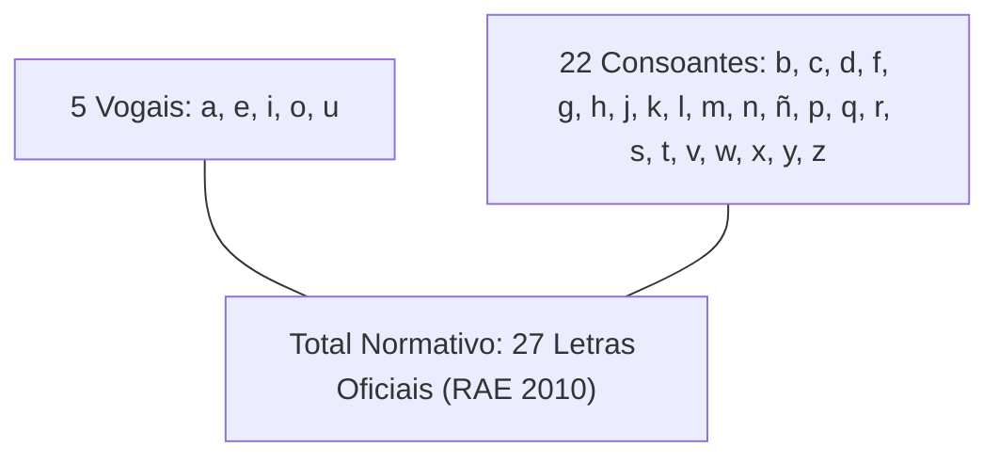
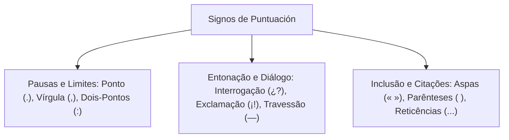

O aprendizado do espanhol para oficiais militares exige olhar técnico. A proximidade estrutural entre espanhol e português ajuda na leitura veloz da prova. Todavia, essa semelhança arma armadilhas perigosas para quem confia só na intuição. Neste capítulo, você estudará o abecedário hispânico e o gênero das letras. Também verá a aplicação rigorosa de todos os sinais de pontuação.

> [!objetivos]
> Ao concluir este capítulo, você será capaz de:
> - Identificar as vinte e sete letras oficiais do abecedário da Real Academia Espanhola.
> - Compreender a condição feminina das letras e a exclusão dos dígrafos clássicos como letras autônomas.
> - Dominar o emprego de marcas de pontuação características, como os pontos invertidos de abertura.
> - Aplicar corretamente vírgulas, pontos, dois-pontos e aspas em construções oracionais formais.
> - Distinguir o uso do hífen, do travessão e das reticências na coesão textual em espanhol.

## Introdução ao Estudo do Espanhol para Concursos

As provas de concurso não exigem conversação oral fluente. Não há cobrança de pronúncia em prova escrita. O foco das bancas é a interpretação de textos autênticos.

Cerca de oitenta e cinco por cento do vocabulário formal é similar ao português culto. Ambos os idiomas vêm do latim. Mesmo assim, a boa interpretação exige método estruturado de leitura.

1. **Primeira Leitura Exploratória**: Localizar o tema global do texto, identificando títulos, subtítulos, fontes e datas de publicação.
2. **Mapeamento de Dados Concretos**: Destacar nomes próprios, cargos, termos numéricos e porcentagens estatísticas que costumam sustentar assertivas de prova.
3. **Identificação de Cognatos e Falsos Amigos**: Reconhecer palavras com grafia semelhante que guardam sentidos totalmente distintos entre os dois idiomas.
4. **Análise dos Conectores Sintáticos**: Observar com precisão as conjunções adversativas, conclusivas e causais que orientam a argumentação do autor.

```mermaid Etapas metodologicas para resolucao de textos em lingua espanhola
flowchart LR
    A["Leitura Exploratória do Tema"] --> B["Mapeamento de Dados e Nomes"]
    B --> C["Identificação de Cognatos e Falsos Amigos"]
    C --> D["Análise dos Conectores Argumentativos"]
    D --> E["Resolução Segura das Assertivas da Prova"]
```

> [!bizu]
> Nunca traduza mentalmente palavra por palavra ao ler um texto em espanhol. Busque apreender o bloco de sentido da oração. A tradução literal palavra a palavra retarda a resolução da prova e induz a erros causados por divergências semânticas sutis.

## Diretrizes Metodológicas e Análise Textual Aplicada

A metodologia aplicada aos concursos enfatiza que a preparação instrumental não exige fluência oral. A prioridade máxima é a decodificação analítica de textos autênticos de geopolítica, história e segurança. 

Um exemplo clássico de prova aborda a disputa histórica pelas Ilhas Malvinas (*Islas Malvinas*). Observe o fragmento típico e sua pontuação:

> *«La controversia sobre las Islas Malvinas enfrenta los reclamos de soberanía argentina y la posición de los diplomáticos británicos. En esta tesitura, los británicos sostienen que se debe respetar el principio de autodeterminación de los pueblos y consultar los deseos de los habitantes de las islas. Por otro lado, la posición argentina recuerda que el derecho internacional no admite que una población implantada altere la integridad territorial de un Estado soberano, en forma similar a los reclamos territoriais apoyados por China en otros foros globales. La resolución final depende del diálogo entre nuestras naciones. La Constitución reformada en 1994 ratifica el pleno derecho sobre las tierras recuperadas frente a Gran Bretaña y la Corona británica, tema analizado por las ciencias jurídicas». En el debate histórico surge la tesis de que los habitantes locales (denominados popularmente isleños o kelpers) son súbditos británicos que optaron por mantener su vínculo colonial con la potencia europea. Por otra parte, la postura hispanoamericana sostiene que la expulsión de las autoridades que residían en las islas en 1833, reemplazándolos por colonos trasplantados, constituye una situación colonial indefendible que no puede ser sancionada por el principio de autodeterminación, ya que no se trata de pueblos sojuzgados que buscan independizarse, sino de un territorio usurpado que busca suscitar respaldo internacional.»*

Na análise deste trecho, a análise linguística destaca como os sinais de pontuação estruturam os argumentos:

- O ponto e a vírgula organizam o confronto de teses diplomáticas.
- A expressão *en esta tesitura* situa o contexto argumentativo da disputa territorial.
- O vocábulo *respetar* introduz a exigência formal invocada pelos negociadores britânicos em relação aos povos e habitantes locais.
- A compreensão de termos como *derecho*, *pueblos*, *autodeterminación* e *similar* decorre diretamente da raiz latina comum compartilhada com o português.

> [!bizu]
> Ao analisar textos opinativos nas provas, o candidato deve mapear quem fala e qual tese defende. Expressões como *en esta tesitura* e *según los expertos* introduzem o ponto de vista do interlocutor, e não necessariamente uma verdade absoluta do narrador.

## O Alfabeto Espanhol (El Abecedario)

O alfabeto da língua espanhola é formalmente denominado **abecedario**. Desde a reforma ortográfica oficial publicada em 2010 pela Real Academia Espanhola (RAE) e pela Associação de Academias da Língua Espanhola (ASALE), o alfabeto espanhol conta com **vinte e sete letras**.



### O Gênero Gramatical das Letras

Na língua portuguesa, as letras do alfabeto são substantivos masculinos (*o a, o be, o cê, o dábliu*).

Na língua espanhola, vigorosamente, **todas as letras do abecedário são substantivos femininos**:

- *la a*, *la be*, *la ce*, *la de*, *la e*, *la efe*, *la ge*, *la hache*.
- *la i*, *la jota*, *la ka*, *la ele*, *la eme*, *la ene*, *la eñe*.
- *la o*, *la pe*, *la cu*, *la erre*, *la ese*, *la te*.
- *la u*, *la uve*, *la uve doble*, *la equis*, *la ye*, *la zeta*.

> [!pegadinha]
> A banca examinadora explora frequentemente o gênero das letras para confundir o candidato lusófono. Lembre-se: em espanhol, diz-se *la be*, *la efe*, *la zeta*, pois todos os nomes das letras pertencem à classe feminina.

### As Modificações Ortográficas da RAE (2010)

As alterações introduzidas pela RAE em 2010 continuam sendo cobradas como pegadinhas conceituais:

1. **Exclusão do *ch* e do *ll* como letras autônomas**: Antes, o *ch* e o *ll* eram contados como letras próprias. Desde 2010, a RAE os considera apenas dígrafos. São combinações de duas letras para um fonema só. Nos dicionários, palavras com *ch* ficam dentro da letra *c*, e palavras com *ll* ficam na letra *l*.
2. **Unificação dos nomes das letras**: A RAE recomendou padronizar nomes que variavam em países hispânicos:
   - A letra *b* deve ser chamada de **be** (evitando termos populares como *be alta* ou *be larga*).
   - A letra *v* deve ser chamada de **uve** (evitando *ve corta* ou *ve baja*).
   - A letra *w* chama-se **uve doble**.
   - A letra *y* deve ser chamada de **ye** (substituindo a antiga denominação *i griega*). A letra *i* convencional passa a chamar-se unicamente **i** (e não mais *i latina*).
3. **A letra *ñ* (eñe)**: É a única letra consonantal do espanhol que não existe no alfabeto básico do português. Ela representa o som palatal aproximado ao nosso dígrafo *nh* (exemplo: *niño, España, señor*). O sinal ondulado sobre ela chama-se *virgulilla* ou *tilde de la eñe*.

| Letra | Nome Oficial (RAE) | Transcrição Fonética / Exemplo em Espanhol | Observação Normativa |
|---|---|---|---|
| **A, a** | *la a* | *agua, alarma* | Substantivo feminino |
| **B, b** | *la be* | *bombero, brigada* | Nome oficial unificado |
| **C, c** | *la ce* | *cuartel, comando* | Som de /k/ ou interdental /θ/ |
| **D, d** | *la de* | *defensa, delito* | Substantivo feminino |
| **E, e** | *la e* | *emergencia, escala* | Substantivo feminino |
| **F, f** | *la efe* | *fuego, fuerza* | Substantivo feminino |
| **G, g** | *la ge* | *guardia, general* | Antes de e/i soa aspirado (/x/) |
| **H, h** | *la hache* | *herido, hospital* | Letra muda em espanhol padrão |
| **I, i** | *la i* | *incendio, informe* | Chamada apenas de *i* |
| **J, j** | *la jota* | *jefe, justicia* | Som aspirado forte raspado na garganta |
| **K, k** | *la ka* | *kilómetro* | Usada em palavras de origem externa |
| **L, l** | *la ele* | *ley, patrulla* | Som alveolar limpo |
| **M, m** | *la eme* | *militar, mando* | Substantivo feminino |
| **N, n** | *la ene* | *novedad, norma* | Substantivo feminino |
| **Ñ, ñ** | *la eñe* | *año, señal* | Letra oficial distinta com virgulilla |
| **O, o** | *la o* | *oficial, orden* | Substantivo feminino |
| **P, p** | *la pe* | *policía, peligro* | Substantivo feminino |
| **Q, q** | *la cu* | *química, queja* | Usada com u mudo (*que, qui*) |
| **R, r** | *la erre* | *rescate, rescate* | Som vibrante simples ou múltiplo |
| **S, s** | *la ese* | *seguridad, sector* | Som sibilante sempre surdo |
| **T, t** | *la te* | *tropa, turno* | Substantivo feminino |
| **U, u** | *la u* | *urgencia, unidad* | Substantivo feminino |
| **V, v** | *la uve* | *víctima, vehículo* | Tem a mesma pronúncia bilabial da letra b |
| **W, w** | *la uve doble* | *web, walkie-talkie* | Nome unificado pela RAE |
| **X, x** | *la equis* | *auxilio, éxito* | Pronúncia /ks/ |
| **Y, y** | *la ye* | *apoyo, trayecto* | Consoante ou semivogal isolada (*y*) |
| **Z, z** | *la zeta* | *zona, zapato* | Pronúncia interdental /θ/ ou /s/ |
*Tabela 1: O abecedário normativo da Real Academia Espanhola.*

> [!atencao]
> Na fonética da língua espanhola padrão, **não existe diferença de som entre o B e o V**. Ambas as letras representam exatamente o mesmo fonema bilabial /b/ (ou sua variante aproximante [β]). As palavras *bastar* e *vasto* soam com o mesmo som inicial. A distinção entre elas é estritamente ortográfica e etimológica.

## Sinais de Pontuação em Espanhol (Signos de Puntuación)

A pontuação organiza a hierarquia sintática das orações e confere clareza ao texto. As bancas de concurso cobram tanto a pontuação comum quanto as marcas gráficas singulares do idioma espanhol.



### Os Sinais Duplos de Interrogação (¿ ?) e Exclamação (¡ !)

Esta é a marca visual mais marcante do espanhol ante o português. As frases interrogativas e exclamativas diretas trazem sinais duplos obrigatórios. Há o sinal invertido no início (¿ e ¡) e o sinal comum no fim (? e !).

Nas orações interrogativas e exclamativas diretas, o espanhol adota **sinais duplos obrigatórios**:

- O sinal de abertura invertido no início: **¿** (interrogação) e **¡** (exclamação).
- O sinal de fechamento convencional ao final: **?** e **!**.

A finalidade didática e funcional desses sinais é avisar previamente o leitor sobre a entonação correta da frase antes mesmo que ele conclua a leitura dos vocábulos.

Regras fundamentais de uso dos sinais duplos:

1. **Posicionamento estrito**: O sinal invertido de abertura não precisa ficar necessariamente no início do parágrafo. Ele deve ser posicionado exatamente no início da pergunta ou da exclamação:
   - Exemplo: *Si los refuerzos llegan a tiempo, ¿cuándo comenzará la operación?*
2. **Combinação de sinais**: Quando uma oração encerra concomitantemente sentimento de surpresa e pergunta, a RAE admite abrir com exclamação e fechar com interrogação, ou utilizar ambos em cada ponta:
   - Exemplo: *¡¿Cómo fue posible semejante descuido?!* ou *¿¡Cómo fue posible semejante descuido!?*
3. **Vedação ao ponto final posterior**: O sinal de fechamento da interrogação ou exclamação **já cumpre o papel de ponto final**. É proibido colocar um ponto final imediatamente após o ponto de interrogação ou exclamação:
   - Errado: *¿Qué hora es?. Salgamos.*
   - Correto: *¿Qué hora es? Salgamos.*

> [!bizu]
> Guarde esta regra para as questões de reescritura: após o ponto de fechamento de interrogação (**?**) ou de exclamação (**!**), a oração seguinte inicia-se com letra maiúscula, exceto se houver uma vírgula ou ponto e vírgula imediatamente acoplado para continuar a sentença.

### O Ponto (El Punto)

O ponto representa a pausa máxima na leitura e encerra um enunciado declarativo:

- **Punto y seguido**: Encerra um enunciado, continuando a escrita na mesma linha do parágrafo.
- **Punto y aparte**: Encerra o parágrafo completo, abrindo nova linha para o tema seguinte.
- **Punto final**: Encerra de forma definitiva o texto ou documento.
- **Punto en abreviaturas**: Marca termos abreviados em correspondências oficiais (*pág.*, *ej.*, *D.*, *Sra.*). O ponto das abreviaturas não impede que se coloque uma vírgula logo após ele, mas se coincidir com o final da frase, o ponto da abreviatura serve como ponto final único.

### A Vírgula (La Coma)

A vírgula assinala pausas breves e estrutura a sintaxe oracional em espanhol de forma muito semelhante ao português:

1. **Separação de vocativos**: Isola o chamamento do interlocutor:
   - *Capitán, las tropas están listas.*
   - *Proceda con cautela, oficial.*
2. **Separação de apostos explicativos**: Isola expressões de esclarecimento:
   - *Recife, capital de Pernambuco, cuenta con modernos centros de seguridad.*
3. **Enumerações de termos da mesma classe**:
   - *El bombero llevó casco, linterna, hacha y cuerda de rescate.*
4. **Deslocamento de adjuntos adverbiais longos**:
   - *Durante la noche de ayer, la patrulla recorrió el sector norte.*
5. **Antes de conjunções adversativas e consecutivas**: Usa-se vírgula antes de *pero*, *mas*, *sino*, *aunque*, *así que*:
   - *Solicitaron apoyo aéreo, pero la niebla impidió el despegue.*

> [!atencao]
> A conjunção adversativa exclusiva **sino** (que equivale ao português *senão* ou *mas sim*) exige vírgula prévia em construções que negam um termo para afirmar outro: *No fue negligencia, sino una falla mecánica imprevista.*

### Os Dois-Pontos (Los Dos Puntos)

Os dois-pontos chamam a atenção do leitor para o elemento subsequente:

- **Citação direta de discursos**: Antecedem a fala textual de alguém:
  - *El coronel declaró: «La misión fue un éxito rotundo».*
- **Enumerações explicativas**:
  - *El equipo de buceo necesita tres instrumentos: máscara, tanque y aletas.*
- **Encabeçamento de ofícios e cartas**: Em documentos oficiais e correspondências em espanhol, após a saudação ao destinatário utilizam-se obrigatoriamente **dois-pontos**, e não vírgula como se faz em inglês:
  - *Estimado Comandante:*
  - *Señor Director General:*

```mermaid Diferenca de pontuacao no cabecalho de documentos institucionais
flowchart LR
    Cabecalho["Saudação de Ofício em Espanhol"] --> Correto["Estimado Señor Comandante: (Dois-Pontos Obrigatórios)"]
    Cabecalho -.-> Incorreto["Estimado Señor Comandante, (Vírgula típica do inglês é proibida)"]
```

### As Aspas (Las Comillas)

Na tradição ortográfica hispânica da RAE, existem três tipos de aspas com hierarquia de uso:

1. **Aspas Angulares ou Espanholas (`« »`)**: São as recomendadas prioritariamente pela Real Academia Espanhola para textos formais e impressos.
2. **Aspas Inglesas (`" "`)**: Devem ser empregadas em segundo nível, quando é necessário abrir aspas no interior de um trecho que já está contido entre aspas angulares.
3. **Aspas Simples (`' '`)**: Empregadas em terceiro nível hierárquico ou para destacar sentidos lexicais de vocábulos isolados.

Hierarquia de encaixe: `«... "..." '...' ...»`.

Exemplo clássico: *El informe oficial afirmó: «Los testigos escucharon la orden de "alto el fuego" antes de la detonación».*

### Reticências (Los Puntos Suspensivos)

As reticências são formadas por **exatamente três pontos contíguos** (`...`). Empregam-se para indicar hesitação de fala, suspense, enumerações incompletas (com valor equivalente a *et cetera*) ou supressão de palavras em citações acadêmicas quando envolvidas entre colchetes (`[...]`, denominados em espanhol corchetes).

> [!exemplo]
> Na leitura de um depoimento pericial: *El testigo vaciló antes de responder: «Creí ver la silueta en el pasillo, pero... no puedo asegurar la identidad».* As reticências marcam com precisão o titubeio e a dúvida do declarante no momento do depoimento.

### O Hífen (El Guion) e o Travessão (La Raya)

A distinção tipográfica entre hífen e travessão é cobrada nas questões sobre estrutura textual:

- **O Hífen (`-`)**: Traço curto de união. Serve para dividir palavras no final de linha (translineação) e unir palavras compostas que mantêm sua autonomia formal (exemplo: *el acuerdo hispano-brasileño*).
- **O Travessão (`—`)**: Traço longo horizontal. É utilizado para abrir falas diretas em diálogos sem necessidade de aspas e para isolar incisos ou comentários explicativos dentro de um parágrafo complexo (desempenhando papel semelhante aos parênteses ou a um par de vírgulas):
  - *Los bomberos militares —entrenados rigurosamente para situaciones extremas— lograron sofocar el fuego en minutos.*

| Sinal de Pontuação | Nome em Espanhol | Uso Fundamental | Exemplo Aplicado à Área de Segurança |
|---|---|---|---|
| **¿ ?** | *Interrogación* | Perguntas diretas (marca invertida no início) | *¿Cuál fue la causa del derrumbe?* |
| **¡ !** | *Exclamación* | Sentimentos de alerta, ordem ou espanto | *¡Evacúen el edificio de inmediato!* |
| **.** | *Punto* | Pausa máxima ao final de períodos | *La zona quedó asegurada por la tropa.* |
| **,** | *Coma* | Pausa breve, vocativo, aposto e enumeração | *Atendieron a los heridos, niños y ancianos.* |
| **:** | *Dos puntos* | Citações, explicações e saudações de cartas | *Estimado Oficial:* |
| **« »** | *Comillas españolas* | Citações textuais de depoimentos e leis | *«Nadie será sometido a tratos inhumanos».* |
| **...** | *Puntos suspensivos* | Hesitação, corte de texto ou suspense | *El rescate parecía imposible, pero...* |
| **—** | *Raya* | Diálogos e orações explicativas inseridas | *El sargento —muy experimentado— lideró el avance.* |
| **-** | *Guion* | Translineação e compostos | *Cooperación técnico-militar.* |
*Tabela 2: Resumo completo dos sinais de pontuação e suas nomenclaturas.*

## Mapa do capítulo

```mermaid Sintese dos sinais e regras do abecedario em lingua espanhola
flowchart TD
    Abecedario["Abecedario RAE (2010)"] --> Qtd["27 Letras Normativas (Todas Femininas)"]
    Abecedario --> Digrafos["ch e ll são Dígrafos (Não mais letras autônomas)"]
    Abecedario --> LetraN["Letra ñ com virgulilla (Som palatal)"]
    
    Pontuacao["Pontuação (Signos)"] --> Duplos["Sinais Duplos Obrigatórios: ¿ ? e ¡ !"]
    Pontuacao --> Pausas["Ponto, Vírgula e Dois-Pontos em Documentos"]
    Pontuacao --> Aspas["Hierarquia de Aspas: «... \"...\" '...' ...»"]
    Pontuacao --> Tracos["Travessão (— para diálogos) vs Hífen (- para divisão)"]
```

### Para fixar

- O abecedário da língua espanhola conta oficialmente com 27 letras normatizadas pela RAE desde 2010.
- Todas as letras do alfabeto espanhol pertencem ao gênero gramatical feminino (*la a, la be, la ce*).
- As combinações *ch* e *ll* deixaram de ser consideradas letras autônomas e são classificadas estritamente como dígrafos.
- As letras B e V possuem rigorosamente a mesma pronúncia bilabial no espanhol padrão, diferenciando-se apenas na escrita.
- As orações interrogativas e exclamativas diretas exigem marcas duplas de pontuação, com o sinal invertido posicionado na abertura.
- O ponto de fechamento de uma interrogação ou exclamação atua como ponto final, sendo proibido anexar ponto final subsequente.
- Em correspondências e ofícios formais em espanhol, a saudação inicial ao destinatário encerra-se com dois-pontos.
- As reticências contam com exatamente três pontos e marcam suspensão de pensamento ou hesitação de fala.
- O travessão longo (*raya*) isola orações explicativas e introduz falas em diálogos, enquanto o hífen curto (*guion*) une palavras compostas.
