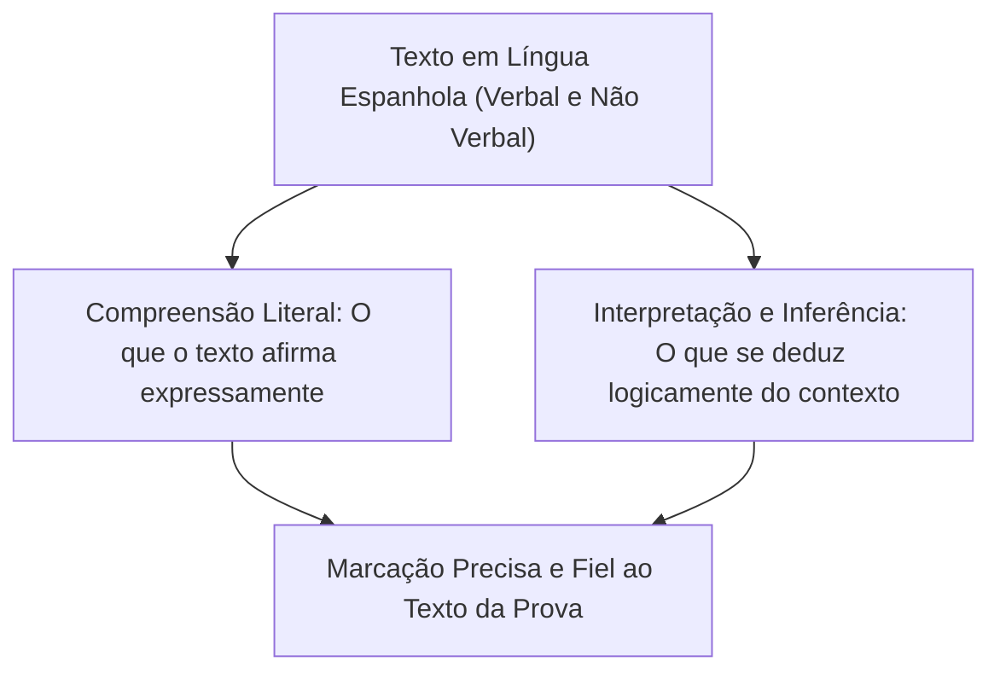
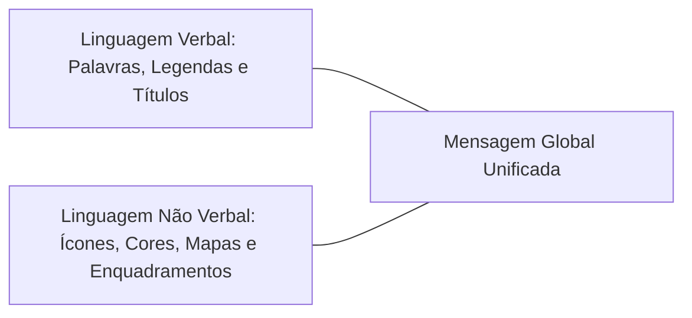
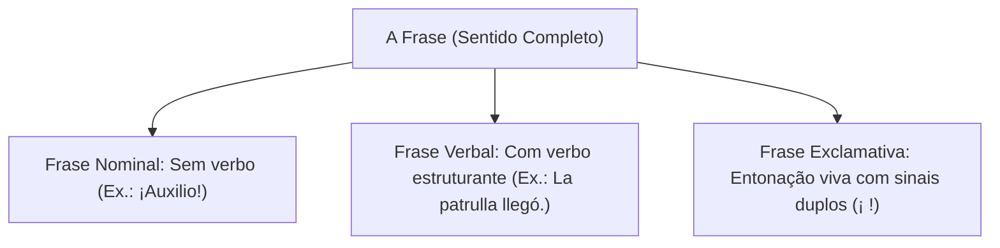
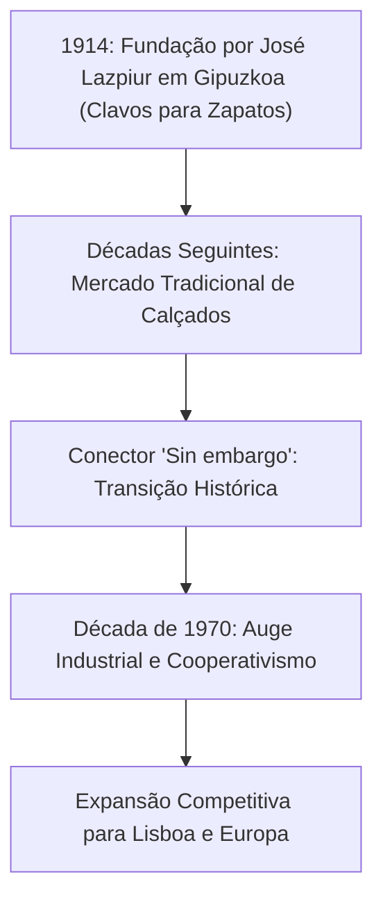
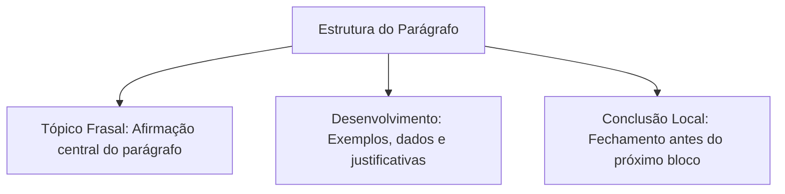
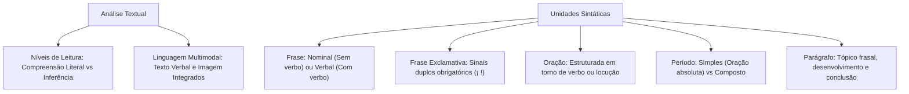

A compreensão de textos em espanhol exige o domínio das unidades formais da escrita. O candidato deve identificar a fronteira entre frases, orações, períodos e parágrafos. Essa clareza permite dissecar enunciados complexos e detectar pegadinhas de prova. Neste capítulo, você estudará a leitura de textos verbais e multimodais e a hierarquia sintática.

> [!objetivos]
> Ao concluir este capítulo, você será capaz de:
> - Aplicar procedimentos de leitura analítica em textos e imagens da prova de espanhol.
> - Definir e diferenciar frase nominal, frase verbal e frase exclamativa com marcas duplas.
> - Identificar orações e classificar períodos simples e compostos.
> - Compreender a organização do parágrafo em torno do tópico frasal e ideias de suporte.

## Palavras Iniciais e Interpretação de Textos

Na prova de espanhol, a interpretação textual define o resultado. A banca não avalia regras teóricas descoladas da realidade. O objetivo é verificar se o candidato lê relatórios e notícias com segurança.

A interpretação eficaz distingue dois níveis complementares de apreensão:

1. **Compreensão (Sentido Explícito)**: Consiste em identificar aquilo que está expresso literalmente na superfície do texto. O candidato localiza dados objetivos, datas, nomes e relações de causa declaradas expressamente pelo autor.
2. **Interpretação (Sentido Implícito / Inferência)**: Consiste em deduzir conclusões lógicas autorizadas pelo texto. O candidato lê nas entrelinhas sem extrapolar o pensamento do autor.

### Leitura de Textos Multimodais: Imagem também é Texto

As bancas examinadoras utilizam com frequência textos multimodais. Cartazes de campanhas, placas de trânsito e infográficos combinam linguagem verbal e não verbal.

Para interpretar imagens nas provas:

- A imagem nunca é mero adorno. Ela é parte indissociável da mensagem.
- Uma placa com a inscrição *«Salida de emergencia»* acompanhada de um pictograma de fuga exige a leitura conjunta do desenho e do texto.
- Detalhes visuais como cores de alerta (vermelho para perigo, amarelo para advertência), setas direcionais e expressões faciais de personagens em tirinhas jornalísticas definem a resposta correta da questão.

> [!bizu]
> Ao se deparar com uma questão que traga charge, tirinha ou cartaz institucional em espanhol, leia a legenda e a fonte antes de responder. A fonte revela com frequência a intenção comunicativa do texto (uma campanha oficial de saúde sobre prevenção de infartos e câncer, ou um aviso de utilidade pública nos diversos gêneros textuais). Na comunicação de emergência, frases nominais como ¡Socorro! exigem socorro imediato.

## A Frase em Língua Espanhola

A frase (*la frase*) é todo enunciado linguístico dotado de sentido completo em uma dada situação comunicativa. Ela pode ser formada por uma única palavra ou por um conjunto encadeado de termos.

Classificação fundamental das frases:

- **Frase Nominal**: Não possui verbo em sua estrutura. A comunicação apoia-se em substantivos, adjetivos ou interjeições:
  - *¡Silencio en la guardia!* (Silêncio na guarda!)
  - *¡Excelente rescate!* (Excelente resgate!)
  - *¡Fuego!* (Fogo!)
- **Frase Verbal**: Estrutura-se em torno de uma ou mais formas verbais, coincidindo com a noção gramatical de oração:
  - *El destacamento avanzó hacia el norte.* (O destacamento avançou em direção ao norte.)
  - *Los bomberos controlaron las llamas.* (Os bombeiros controlaram as chamas.)

### Frases Exclamativas e a Entonação Gráfica

A frase exclamativa expressa emoções vivas, como surpresa, advertência, entusiasmo, medo ou ordem enérgica.

Em espanhol, a frase exclamativa direta traz como traço obrigatório os **sinais duplos de exclamação**:

- O sinal invertido de abertura (**¡**) no início do segmento exclamativo.
- O sinal padrão de fechamento (**!**) no término da sentença.

Exemplos aplicados:

- *¡Atención, pelotón!* (Atenção, pelotão!)
- *¡Cuidado con la zona de derrumbe!* (Cuidado com a área de desabamento!)

> [!pegadinha]
> A banca examinadora costuma omitir o sinal invertido de exclamação (¡) em assertivas de reescrita oracional. Na norma culta espanhola, omitir o sinal de abertura em frases exclamativas diretas configura **erro ortográfico grave**, mesmo que a pontuação final esteja correta.

## A Oração e os Tipos Funcionais de Frases

Na morfossintaxe hispânica, vigora uma máxima fundamental: toda oração é uma frase, mas nem toda frase é uma oração. A oração (*la oración*) exige indispensavelmente a presença de um verbo conjugado ou de uma locução verbal estruturante. Ela estabelece uma relação predicativa formal entre o sujeito da ação e o predicado verbal.

A gramática espanhola classifica também as frases pelo propósito comunicativo do emissor:

- **Declarativas**: Expressam afirmações ou negações objetivas de fatos (*El informe pericial concluyó al amanecer*).
- **Imperativas**: Transmitem ordens firmes, pedidos solenes ou proibições operacionais (*¡Despejen la vía pública inmediatamente!*).
- **Optativas ou Desiderativas**: Expressam desejos ou anseios, normalmente introduzidas pela partícula *que* (*¡Que tengas un buen servicio!*).
- **Imprecativas**: Expressam pragas, imprecações ou votos negativos com entonação enfática (*¡Ojalá te arrepientas del delito!*).
- **Interrogativas e Exclamativas**: Expressam dúvidas e sentimentos com os sinais duplos obrigatórios de pontuação.

A oração organiza-se em torno de um verbo finito. Ela pode funcionar de forma autônoma como oração independente, ou articular-se a outros blocos como oração principal e orações coordenadas ou subordinadas. O conhecimento dessa arquitetura impede que o estudante confunda simples orações intercaladas com o núcleo temático do período.

A oração é a unidade sintática que se organiza obrigatoriamente em torno de um **verbo finito** ou de uma **locução verbal**.

Diferente da frase nominal pura, a oração possui uma estrutura preditiva, estabelecendo uma relação de atribuição entre um sujeito (expresso ou oculto) e um predicado:

- *El comandante **firmó** la orden de operaciones.* (Verbo simples *firmó*).
- *Las brigadas **están realizando** tareas de búsqueda.* (Locução verbal *están realizando*).

Na sintaxe espanhola, a oração pode ser classificada quanto à dependência funcional:

1. **Oração Independente**: Possui autonomia sintática e semântica plena.
2. **Oração Principal**: Comanda uma ou mais orações que dela dependem.
3. **Oração Subordinada**: Depende sintaticamente de outra oração para concluir seu sentido.

## O Período (El Período Sintáctico)

O período é o enunciado construído por uma ou várias orações, iniciando-se com letra maiúscula e encerrando-se com ponto final, ponto de interrogação ou ponto de exclamação.

Conforme a quantidade de núcleos verbais, o período divide-se em:

- **Período Simples**: Formado por apenas uma oração, denominada **oração absoluta**. Possui um único verbo ou uma única locução verbal:
  - *La defensa civil emitió un alerta meteorológico.*
- **Período Composto**: Formado por duas ou mais orações. A relação entre elas pode ocorrer por:
  - **Coordenação**: Orações sintaticamente autônomas ligadas por conjunções coordenativas (*y, pero, o, sino*):
    - *La sirena sonó **y** los camiones salieron del cuartel.*
  - **Subordinação**: Uma oração exerce função sintática em relação à oração principal (*que, cuando, si, porque*):
    - *El oficial ordenó **que** evacuaran el edificio.*

| Unidade | Característica Central | Exemplo em Língua Espanhola |
|---|---|---|
| **Frase Nominal** | Comunicação plena sem núcleo verbal | *¡Peligro inminente!* |
| **Frase Verbal / Oração** | Estruturada em torno de um verbo | *El vehículo patrullaba la carretera.* |
| **Período Simples** | Contém uma única oração absoluta | *El perito analizó las pruebas balísticas.* |
| **Período Composto** | Contém duas ou mais orações articuladas | *Llegó la brigada **y** comenzaron el rescate.* |
*Tabela 1: Síntese das unidades sintáticas em língua espanhola.*

## Estudo de Caso de Prova: Análise Textual e Vocabulário Contextualizado

Para ilustrar como as bancas de concurso extraem questões a partir de textos reais, observe o seguinte fragmento adaptado de provas de vestibulares e concursos públicos hispânicos sobre o desenvolvimento industrial europeu:

> *«La empresa industrial fundada en 1914 por José Lazpiur en la comarca de Gipuzkoa nació inicialmente para producir clavos para zapatos de cuero. Durante décadas, aquel modesto taller artesanal se mantuvo estrechamente ligado a las demandas de la industria del calzado. Sin embargo, a partir de la década de 1970, la compañía experimentó un extraordinario auge productivo al asociarse al modelo de cooperativismo industrial vasco. Al integrarse como socio estratégico de grandes grupos de manufactura avanzada y expandir sus lazos comerciales hacia Lisboa y otros mercados europeos, la firma incrementó su competitividad global mediante maquinaria de alta precisión en la localidad vecina de Bergara. La crisis económica obligó a la firma a reinventarse con valentía, superando los embates políticos del nacionalismo regional y de cualquier simpatizante partidario, con lo cual recuperó su liderazgo sin depender de subsidios de centavos ni de favores estatales».*

Examinando a estrutura textual do fragmento com base nos conceitos estudados:

- O fragmento é composto por um único parágrafo que desenvolve o percurso da empresa Lazpiur desde sua fundação em 1914.
- O primeiro período é composto por subordinação, informando o fundador José Lazpiur e o propósito inicial de produzir cravos (*clavos para zapatos*) em Gipuzkoa.
- O conector adversativo *sin embargo* marca uma inflexão temporal: nos anos 1970, surge o auge ligado ao cooperativismo.
- Cada oração desenvolve a tese da competitividade industrial, com a atuação da empresa como sócio (*socio*) de novos mercados até Lisboa.

> [!bizu]
> Ao resolver questões sobre períodos específicos, a banca costuma enunciar: *«No segundo período do primeiro parágrafo...»*. Conte rigorosamente os pontos finais (*puntos y seguidos*). Não confunda vírgulas com término de período. Um período só se encerra com ponto final, ponto de exclamação ou ponto de interrogação.

## O Parágrafo (El Párrafo)

O parágrafo é a unidade estrutural intermediária do texto em prosa. Visualmente, inicia-se com recuo de margem e encerra-se com ponto e parágrafo (*punto y aparte*).

Do ponto de vista conceitual, cada parágrafo deve desenvolver **uma única ideia central** (tópico frasal), sustentada por ideias secundárias de expansão, exemplificação ou justificativa:

1. **Tópico Frasal (Idea Principal)**: Frase inicial que sintetiza o núcleo temático do parágrafo.
2. **Desenvolvimento (Ideas Secundarias)**: Orações que aprofundam o argumento com fatos, estatísticas ou justificativas.
3. **Conclusão Local (Arremate)**: Enunciado que sintetiza o raciocínio antes da transição para o parágrafo subsequente.

> [!atencao]
> Em provas de concurso, a assertiva que resume a tese de um texto baseia-se frequentemente no tópico frasal do parágrafo introdutório ou nas conclusões do parágrafo final. Ao buscar o tema central, releia com atenção redobrada a abertura e o fechamento do texto.

> [!exemplo]
> Observe o seguinte parágrafo em espanhol:
> *«La modernización de los equipos de rescate es prioritaria para la seguridad ciudadana. La adquisición de drones térmicos permite localizar víctimas en zonas boscosas en pocos minutos. Asimismo, las nuevas embarcaciones mejoran la respuesta ante inundaciones severas. Por ello, la inversión tecnológica salva vidas en situaciones críticas».*
> - Tópico frasal: *La modernización de los equipos de rescate es prioritaria...*
> - Desenvolvimento: Menção aos drones térmicos e novas embarcações.
> - Conclusão local: *Por ello, la inversión tecnológica salva vidas...*

## Mapa do capítulo

### Para fixar

- A interpretação de textos exige distinguir dados expressos literalmente de inferências lógicas autorizadas pelo contexto.
- Em textos multimodais (cartazes e placas), elementos visuais e linguagem escrita devem ser interpretados de forma conjunta.
- A frase é o enunciado de sentido comunicativo completo, dividindo-se em frase nominal (sem verbo) e frase verbal.
- As frases exclamativas diretas em espanhol exigem sinais duplos obrigatórios, iniciando com a marca invertida (¡) e fechando com (!).
- A oração organiza-se em torno de um verbo finito ou locução verbal, estabelecendo relação entre sujeito e predicado.
- O período simples possui apenas uma oração absoluta; o período composto articula duas ou mais orações por coordenação ou subordinação.
- O parágrafo em prosa desenvolve uma ideia central por meio de um tópico frasal amparado por ideias secundárias e conclusão local.
- O sinal de fechamento de interrogação ou exclamação cumpre a função de ponto final, dispensando ponto posterior imediato.
