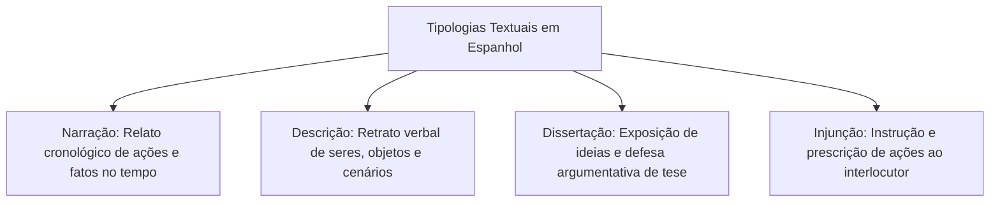
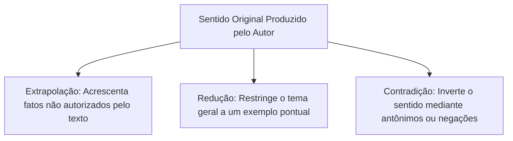
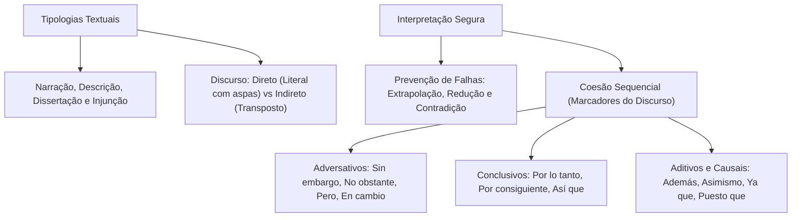

O reconhecimento das formas de discurso é decisivo na prova de espanhol. Cada texto selecionado cumpre uma finalidade comunicativa. Ele pode narrar uma ocorrência, descrever um cenário ou defender uma tese. Também pode prescrever regras de conduta. O leitor deve ler criticamente cada parágrafo para identificar o objetivo central do autor. Neste capítulo, você estudará as quatro tipologias textuais e a coesão sequencial.

> [!objetivos]
> Ao concluir este capítulo, você será capaz de:
> - Identificar as características da descrição, dissertação, injunção e narração em espanhol.
> - Diferenciar o estilo direto do estilo indireto e reconhecer a transposição de tempos verbais.
> - Evitar os erros clássicos de interpretação em concursos: extrapolação, redução e contradição.
> - Compreender a coerência global e o papel dos marcadores discursivos na coesão sequencial.

## As Tipologias Textuais em Língua Espanhola

A tipologia textual refere-se à estrutura da redação. Ela reflete os recursos linguísticos usados pelo autor. A doutrina consagra quatro grandes tipos textuais.



### A Descrição (El Texto Descriptivo)

A descrição representa verbalmente pessoas, objetos e cenários. Ela funciona como uma pintura em palavras. Os detalhes visuais criam a imagem na mente do leitor.

Principais marcas linguísticas da descrição:

1. **Predomínio de Adjetivos e Substantivos Concretos**: O texto é rico em qualificadores que apontam cores, formas, dimensões e texturas (*alto, robusto, metálico, oscuro, tempestuoso*).
2. **Tempo Verbal Estático**: Os verbos de ação ficam em segundo plano. Predominam verbos de ligação e estado (*ser, estar, parecer, permanecer, lucir*), frequentemente conjugados no **pretérito imperfecto de indicativo** (*era, estaba, parecía*) ou no presente.
3. **Pausa na Linha Temporal**: A descrição não faz a narrativa avançar no tempo; ela interrompe o fluxo dos acontecimentos para pintar o cenário aos olhos do leitor.

Exemplo em contexto operacional:

*«El edificio del antiguo cuartel era una construcción maciza de tres niveles, con muros gruesos de piedra caliza y ventanas estrechas protegidas por rejas de hierro forjado. En el patio interior, el pavimento de adoquines lucía húmedo por la llovizna constante».*

### A Dissertação (El Texto Disertativo y Argumentativo)

A dissertação é o tipo textual mais comum em concursos. Nela, o autor analisa temas e defende teses com argumentos lógicos.

A dissertação estrutura-se em três partes interdependentes:

- **Introducción**: Apresentação do tema e explicitação da tese central defendida pelo autor.
- **Desarrollo**: Exposição fundamentada dos argumentos, dados estatísticos, citações de autoridades e contra-argumentos que sustentam a tese.
- **Conclusión**: Síntese do raciocínio e proposta de reflexão final ou encaminhamento do debate.

Marcas da dissertação em espanhol:

- Linguagem imindividual, culta e objetiva. Emprego frequente da voz passiva pronominal (*se considera, se observa, se debate*).
- Presença marcante de operadores argumentativos e conectores lógicos de causa, consequência, conclusão e oposição.

### A Injunção Instrucional (El Texto Instructivo o Inyuntivo)

O texto injuntivo tem como propósito orientar, prescrever ou ditar comandos ao leitor. Ele ensina o destinatário a agir ou impõe normas coercitivas de comportamento.

Aplicações práticas da injunção na segurança pública:

- Manuais de combate a incêndio e de primeiros socorros.
- Procedimentos Operacionais Padrão (POPs) de abordagem policial.
- Editais de convocação militar e regulamentos disciplinares.
- Bulas de medicamentos e receitas técnicas.

Recursos linguísticos dominantes:

- **Modo Imperativo**: Verbos conjugados em ordem direta (*Evacúe la sala, no toque los cables, cierre las válvulas de gas*).
- **Formas Infinitivas**: Muito comuns em avisos de segurança (*No fumar, conservar la calma, usar casco protector*).
- **Perífrases Verbais de Obrigação**: Expressões que denotam dever ou necessidade inegociável: *tener que + infinitivo*, *deber + infinitivo*, *hay que + infinitivo* (*Hay que asegurar el perímetro antes de ingresar*).

### A Narração (El Texto Narrativo)

A narração relata uma sequência de fatos ou acontecimentos reais ou fictícios vivenciados por personagens em determinado espaço e ao longo de uma linha de tempo.

Elementos indispensáveis da narrativa:

- **Personagens (Personajes)**: Protagonistas, antagonistas e coadjuvantes.
- **Narrador (Narrador)**: Em primeira pessoa (personagem ou testemunha) ou em terceira pessoa (observador ou onisciente).
- **Tempo (Tiempo)**: Época e duração dos eventos relatados.
- **Espaço (Espacio)**: Local geográfico onde se desenvolve o enredo.
- **Enredo (Argumento o Trama)**: A sucessão cronológica ou psicológica dos fatos.

Marcas verbais da narração:

- Predomínio absoluto de verbos de ação no **pretérito indefinido** (*llegó, disparó, rescató, saltó*), que fazem a narrativa progredir, combinados com o **pretérito imperfecto** (*vigilaba, llovía*), que ambienta o cenário de fundo.

| Tipologia Textual | Finalidade Comunicativa | Tempos Verbais Predominantes | Exemplos Típicos em Concursos |
|---|---|---|---|
| **Descrição** | Caracterizar seres, objetos e cenários | Presente e Pretérito Imperfeito | Descrição de suspeitos, laudos e locais de crime |
| **Dissertação** | Analisar temas e defender teses lógicas | Presente do Indicativo e Passiva Primitiva | Artigos de opinião, editoriais e ensaios jurídicos |
| **Injunção** | Prescrever comportamentos e dar instruções | Imperativo, Infinitivo e Perífrases | Manuais táticos, POPs, bulas e placas de aviso |
| **Narração** | Contar fatos sucessivos no tempo | Pretérito Indefinido e Imperfeito | Notícias policiais, crônicas e boletins de ocorrência |
*Tabela 1: Confronto direto das quatro tipologias textuais.*

> [!bizu]
> Um mesmo texto pode conter passagens de diferentes tipologias. Um texto prioritariamente dissertativo pode iniciar com um breve relato narrativo para ilustrar um ponto. A identificação do tipo textual da questão deve recair sobre o **propósito comunicativo dominante** da obra.

### Estudo Comparativo de Tipologias: O Conto de Branca de Neve

Para consolidar o contraste entre narração e descrição, as análises de concursos utilizam frequentemente fábulas literárias universais em versão hispânica. Observe o excerto clássico da narrativa de Branca de Neve (*Blancanieves*):

> *«Había una vez una reina que cosía junto a una ventana con marco de ébano negro mientras caían copos de nieve. Al pincharse el dedo con la aguja, tres gotas de sangre tiñeron la nieve blanca. Tiempo después, la soberana dio a luz a una hermosa niña de piel tan blanca como la nieve y cabellos oscuros como el ébano, a quien llamaron Blancanieves. Años más tarde, la madrastra consultaba a diario su espejo encantado exclamando: «¡Espejito, espejito mágico en la pared! ¿Quién es la más hermosa de este reino?». Y el espejo respondía con fidelidade absoluta».*

Examinando a coexistência de tipologias no trecho:

1. **Ação Narrativa (Verbos no Passado)**: A sucessão de eventos cronológicos progride com os verbos no pretérito (*cosía, cayó, dio a luz, llamaron, consultaba*).
2. **Quadro Descritivo (Adjetivação)**: A caracterização física da menina combina substantivos e adjetivos sensoriais: pele branca como a neve (*nieve*), cabelos escuros como o ébano (*ébano*) e a condição da mais formosa (*la más hermosa*) perante o espelho (*espejo*).
3. **Discurso Direto**: A fala ritual da rainha diante do pequeno espelho (*espejito*) é marcada por aspas angulares e pelos sinais duplos de exclamação e interrogação.

> [!exemplo]
> Em textos narrativos de concurso, a descrição serve para ambientar a cena antes da ação decisiva. No trecho de *Blancanieves*, os detalhes do ébano e da neve criam a atmosfera poética que justifica o desenrolar do conflito com a rainha invejosa.

### Análise de Crônicas Cotidianas e Textos de Imprensa

Nas provas de concurso, os textos de apoio são frequentemente retirados de jornais de circulação hispânica ou crônicas contemporâneas. 

Considere um trecho em que personagens populares, como dona Ursolina e o cabo Padilha, conversam em um ambiente festivo temperado com música de salsa. Quando uma das partes tenta alegar inocência diante de uma infração, a crônica transita do relato bem-humorado para a reflexão social. O candidato deve dominar os vocábulos regionais e o jargão jornalístico para não ser surpreendido por termos figurados.

> [!atencao]
> A leitura de crônicas exige atenção redobrada à ironia. O autor pode alegar uma justificativa aparente apenas para ridicularizar o comportamento de um personagem. Sempre avalie o tom global da crônica antes de marcar a assertiva.

## Estilo Direto e Estilo Indireto

Ao relatar falas ou pensamentos de terceiros, o autor pode escolher entre o estilo direto e o estilo indireto:

### O Estilo Direto (Discurso Directo)

O estilo direto reproduz textualmente as palavras do interlocutor. A fala vem precedida de verbos declarativos como decir e afirmar. Graficamente, adota dois-pontos e aspas angulares.

- Dois-pontos seguidos de aspas angulares: *El sargento ordenó: «Avanzad con precaución».*
- Travessões em linhas de diálogo: *—No podemos retroceder ahora —afirmó el comandante.*

### O Estilo Indireto (Discurso Indirecto)

O estilo indireto reconta a fala pela voz do narrador. As aspas e os travessões desaparecem. A oração subordinada conecta-se pela conjunção que.

A transposição do discurso direto para o indireto exige a concordância de tempos verbais (*correlación de tiempos*), além do ajuste de pronomes pessoais, possessivos e advérbios de tempo e lugar.

```mermaid Regras de transposicao temporal entre discurso direto e indireto
flowchart LR
    subgraph Direto["Discurso Direto"]
        D1["Presente: «Tengo la información»"]
        D2["Pretérito Indefinido: «Llegué temprano»"]
        D3["Futuro: «Resolveré el caso»"]
    end
    subgraph Indireto["Discurso Indireto (Verbo Introdutor no Passado)"]
        I1["Pretérito Imperfeito: Dijo que tenía la información"]
        I2["Pretérito Pluscuamperfecto: Dijo que había llegado temprano"]
        I3["Condicional Simples: Dijo que resolvería el caso"]
    end
    D1 ==> I1
    D2 ==> I2
    D3 ==> I3
```

| Discurso Direto | Discurso Indireto (com verbo introdutor no passado) |
|---|---|
| *«**Estoy** listo»* (Presente) | *Dijo que **estaba** listo.* (Pretérito Imperfeito) |
| *«**Fui** al cuartel»* (Pretérito Indefinido) | *Afirmó que **había ido** al cuartel.* (Pretérito Mais-Que-Perfeito) |
| *«**Llegaré** mañana»* (Futuro) | *Aseguró que **llegaría** al día siguiente.* (Condicional) |
| *«**Haz** esto»* (Imperativo) | *Le ordenó que **hiciera** aquello.* (Imperfeito do Subjuntivo) |
| *«**Hoy** aquí»* (Advérbios presentes) | *Aquel día allí.* (Advérbios distanciados) |
*Tabela 2: Tabela de equivalência temporal na transposição de discursos.*

> [!pegadinha]
> Fique atento aos advérbios e demonstrativos na transposição discursiva. No estilo indireto introduzido no passado, *hoy* vira *aquel día*; *aquí* vira *allí*; e *este informe* transforma-se em *aquel informe*. As bancas costumam manter o tempo verbal correto, mas deixam o advérbio no presente para invalidar a assertiva.

> [!bizu]
> Ao converter uma pergunta do discurso direto para o indireto em espanhol, a partícula interrogativa mantém seu valor de subordinação. Se a pergunta direta for fechada (resposta sim/não), usa-se a conjunção *si* (*Me preguntó si conocía el camino*). Se for aberta, preserva-se o pronome interrogativo com acento diacrítico (*Me preguntó cuándo comenzaría la guardia*).

## Interpretação de Textos em Provas de Espanhol

As questões de interpretação elaboradas pelas bancas baseiam-se em erros recorrentes de leitura dos candidatos. Para não cair em ciladas, você deve policiar sua análise contra os três grandes desvios interpretativos:

1. **Extrapolação (Sobrenarrativa)**: Ocorre quando o candidato insere no texto ideias ou conclusões subjetivas que não constam nas linhas originais. Por mais que a assertiva pareça justa ou politicamente correta na vida real, se ela não foi autorizada pelo texto, ela está errada na prova.
2. **Redução (Subleitura)**: Ocorre quando a assertiva escolhe um detalhe minúsculo ou exemplo pontual e afirma falsamente que aquele detalhe representa a ideia central de todo o texto.
3. **Contradição (Inversão)**: Ocorre quando a assertiva afirma exatamente o oposto do que o autor declarou, utilizando frequentemente palavras negativas sutis (*apenas, jamás, raramente, salvo*).



## Coerência Textual e Coesão Sequencial

A construção de um texto inteligível depende de dois conceitos complementares: a coerência e a coesão.

- **Coerência Textual**: Refere-se à unidade de sentido profunda do texto. Um texto é coerente quando suas ideias formam um todo harmônico, sem contradições lógicas internas e sem rupturas de raciocínio.
- **Coesão Textual**: Refere-se à conexão gramatical explícita na superfície do texto. Ela liga palavras, orações e parágrafos por meio de pronomes, elipses e conectores discursivos.

### A Coesão Sequencial e os Conectores em Espanhol (Marcadores del Discurso)

Os conectores sintáticos guiam a linha de raciocínio do autor. O desconhecimento de uma única conjunção pode fazer o candidato interpretar um elogio como crítica ou uma causa como consequência.

Examinemos as principais famílias de conectores em língua espanhola:

### Conectores Adversativos e Concessivos (Oposição e Contraste)

Indicam contraste entre duas ideias ou concessão a um fato que não impede a ação principal:

- **Sin embargo / No obstante**: Equivalem rigorosamente a *no entanto*, *contudo*, *todavia*. São os conectores mais cobrados em provas.
- **Pero**: Equivale ao português *mas*.
- **En cambio / Por el contrario**: Estabelecem contraposição direta entre dois elementos (*por outro lado*, *ao contrário*).
- **Aunque / A pesar de que**: Conectores concessivos que equivalem a *embora*, *ainda que*.
- **Sino / Sino que**: Conjunção adversativa de exclusão (*mas sim*).

### Conectores Consecutivos e Conclusivos (Resultado e Fechamento)

Indicam o resultado lógico da oração anterior ou o arremate do raciocínio:

- **Por lo tanto / Por consiguiente / En consecuencia**: Equivalem a *portanto*, *por conseguinte*, *logo*.
- **Así que / De modo que**: Expressam consequência imediata (*de modo que*, *assim*).

### Conectores Aditivos e Explicativos (Soma e Esclarecimento)

- **Además / Asimismo / Igualmente**: Indicam acréscimo de argumentos (*além disso*, *da mesma forma*).
- **Porque / Puesto que / Ya que**: Introduzem justificativas e causas (*porque*, *já que*, *visto que*).
- **Es decir / O sea / Esto es**: Introduzem esclarecimentos ou paráfrases explicativas (*isto é*, *ou seja*).

| Conector em Espanhol | Significado e Equivalência em Português | Relação Semântico-Discursiva |
|---|---|---|
| **Sin embargo** | No entanto, contudo, todavia | Oposição / Contraste forte |
| **No obstante** | Não obstante, apesar disso | Concessão / Oposição |
| **En cambio** | Por outro lado, em contrapartida | Confronto direto de elementos |
| **Por lo tanto** | Portanto, por conseguinte | Conclusão lógica de raciocínio |
| **Así que** | De maneira que, por isso | Consequência imediata |
| **Asimismo** | Da mesma forma, igualmente | Adição de novos argumentos |
| **Ya que** | Visto que, uma vez que | Causa / Justificativa |
| **Sino** | Mas sim, senão | Adversativa de exclusão |
*Tabela 3: Conectores discursivos essenciais para interpretação.*

> [!exemplo]
> Analise a oração: *«El protocolo de rescate era complejo; **sin embargo**, los bomberos actuaron con serenidad y, **por lo tanto**, evitaron pérdidas humanas».*
> - O conector *sin embargo* introduz uma ressalva positiva frente à dificuldade do protocolo.
> - O conector *por lo tanto* introduz o resultado final inevitável da serenidade das equipes (a ausência de perdas humanas).

## Mapa do capítulo



### Para fixar

- A descrição caracteriza seres e ambientes com predomínio de adjetivos e verbos de estado, pausando a linha do tempo.
- A dissertação estrutura-se em introdução, desenvolvimento e conclusão para debater temas e defender teses de forma impessoal.
- O texto injuntivo prescreve regras de conduta por meio de verbos no imperativo, infinitivo e perífrases de obrigação.
- A narração relata a sucessão de fatos cronológicos praticados por personagens no tempo, com verbos de ação no passado.
- O discurso direto reproduz falas literais com aspas ou travessões; o discurso indireto reconta as falas com adaptação de tempos verbais.
- Os conectores adversativos *sin embargo* e *no obstante* expressam oposição equivalente a *contudo* e *no entanto*.
- Os conectores *por lo tanto* e *por consiguiente* introduzem conclusões e consequências dedutivas do raciocínio anterior.
- A interpretação correta exige fidelidade ao texto original, repudiando a extrapolação de fatos e a contradição de sentido.
