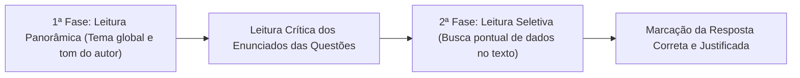
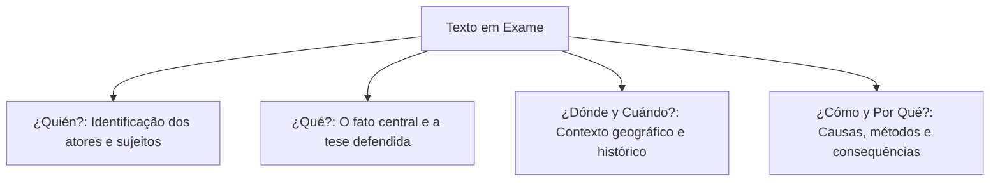
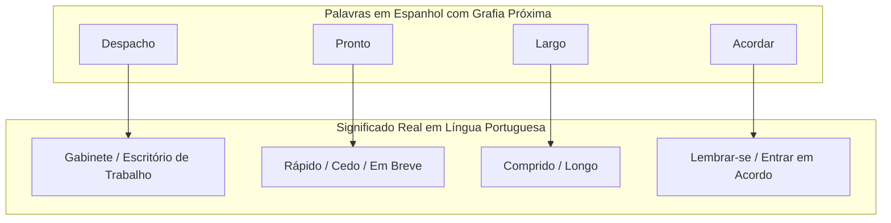

O domínio da leitura instrumental é decisivo em concursos. O tempo de prova é escasso. Os textos costumam ser longos e densos. O candidato preparado aplica métodos dinâmicos de leitura rápida (*lectura comprensiva*). É vital recuperar informações com velocidade para superar os competidores na pontuação final. Ele identifica com facilidade os falsos cognatos da língua e responde com segurança às perguntas da prova. Neste capítulo, você consolidará essas técnicas práticas de interpretação textual.

> [!objetivos]
> Ao concluir este capítulo, você será capaz de:
> - Aplicar as técnicas de leitura dinâmica de varredura geral e busca pontual.
> - Reconhecer os principais falsos cognatos e heterossemânticos na leitura de textos.
> - Identificar marcas linguísticas de generalização indevida nas alternativas da prova.
> - Elaborar resumos mentais de parágrafos para validar assertivas de compreensão e inferência.

## Interpretação de Textos – Leitura Complementar

A leitura instrumental concebe o texto como um sistema de pistas estruturadas. A abordagem eficiente divide-se em duas fases sucessivas.

1. **Leitura Panorâmica (Tema Global)**: É uma leitura veloz da totalidade do texto. O leitor busca apreender o assunto principal e o posicionamento do autor. Não se deve travar em palavras desconhecidas nesta etapa inicial. O objetivo é construir o mapa mental da obra.
2. **Leitura Seletiva (Busca Pontual)**: Ocorre após a leitura atenta das questões. O candidato retorna ao texto para localizar dados objetivos. Ele busca datas, porcentagens, nomes próprios e citações específicas.



> [!bizu]
> Ao ler o enunciado da questão, sublinhe a palavra de comando: a banca pede o item *correto* ou o *incorreto*? Muitas notas são perdidas por pura desatenção visual ao comando da questão, e não por desconhecimento da língua espanhola.

## O Contexto Multidimensional na Leitura Complementar

A interpretação avançada em certames de alto nível exige a compreensão do contexto multidimensional do texto. Ao avaliar textos literários, crônicas históricas ou resenhas críticas (*reseñas*), o leitor deve mobilizar conhecimentos de mundo para não deixar que informações centrais fiquem obscurecidas.

Os eixos fundamentais de contextualização incluem:

1. **Contexto Histórico e Geográfico**: Identificar a época e o espaço geográfico (*marco geográfico e histórico*) em que os fatos foram ambientados. Em fragmentos de novelas ou ensaios hispano-americanos, a data e a localização geográfica explicam escolhas lexicais e tensões sociais.
2. **Dimensão Emocional e Subjetiva**: Distinguir passagens puramente objetivas de trechos em que a carga emocional e subjetiva do narrador sobressai. Em textos literários transcritos para a prova, cada adjetivo deve ser cuidadosamente sopesado pelo leitor para prever a real intenção discursiva.
3. **Gêneros Textuais Diversificados**: Trechos de novelas literárias, reportagens jornalísticas, resenhas acadêmicas e pareceres técnicos, relatos históricos, mitos e contos são submetidos (sometidos) à análise dos candidatos. Ao correlacionar as pistas textuais de artigos de enciclopédia com as teses de estudiosos, o leitor identifica os personagens implicados na trama e antecipa o desenlace da narrativa, permitindo que qualquer opção absurda seja sumariamente descartada. Cada modelo textual possui uma arquitetura própria que orienta a formulação das perguntas a serem respondidas na prova.

Para dissecar textos complexos submetidos à avaliação da banca, formule mentalmente as perguntas clássicas do jornalismo investigativo: quem realiza a ação, o que aconteceu, onde e quando transcorreu o fato, como se desenrolou o episódio e por quais razões a decisão foi tomada.



## Falsos Cognatos Essenciais (Heterosemánticos)

A proximidade ortográfica entre o português e o espanhol é uma faca de dois gumes. Se por um lado facilita a compreensão imediata da maior parte do vocabulário, por outro abriga os temidos **falsos cognatos** (ou vocábulos heterossemânticos).

Os falsos cognatos trazem grafia muito próxima entre os dois idiomas. Contudo, seus sentidos reais são completamente divergentes. As bancas usam esses termos para criar alternativas capciosas.

Examinemos os falsos cognatos mais recorrentes em provas e textos operacionais:

- **Acordar**: Em espanhol, significa **lembrar-se** ou **combinar/entrar em acordo** (*Me acuerdo de la instrucción recibida*). Não significa despertar do sono, que em espanhol é *despertarse*.
- **Despacho**: Significa **gabinete**, **escritório de trabalho** do oficial ou autoridade pública (*El coronel está en su despacho*). Não significa encomenda postal nem cerimônia religiosa.
- **Pronto**: Significa **rápido**, **cedo** ou **em breve** (*Llegaremos pronto al lugar del siniestro*). Quando se deseja dizer "estou pronto/preparado", utiliza-se o vocábulo *listo* (*Estoy listo*).
- **Largo**: Significa **comprido** ou **longo** no espaço ou no tempo (*Un largo camino hasta el cuartel*). O nosso "largo" (amplo) traduz-se em espanhol por *ancho*.
- **Exquisito**: Significa **refinado**, **saboroso** ou **delicioso** (*Una comida exquisita*). O nosso "esquisito" (estranho) traduz-se em espanhol por *raro* ou *extraño*.
- **Embarazada**: Significa exclusivamente **grávida** ou **gestante** (*La mujer embarazada fue rescatada*). O nosso "embaraçada" (envergonhada) é *avergonzada*.
- **Polvo**: Significa **poeira**, **cinzas** ou **pó** (*El polvo de los escombros cubrió la calle*). O molusco marinho polvo chama-se *pulpo*.
- **Borrador**: Significa **rascunho**, **esboço de documento** ou **apagador de lousa**. Não se confunde com borracha escolar comum, que se chama *goma de borrar*.
- **Cena**: Significa a refeição do **jantar** (*Cenaron después de la guardia*). A cena de teatro ou local de ocorrência chama-se *escena*.
- **Vaso**: Significa **copo de vidro para beber** (*Un vaso de agua*). O vaso de flores chama-se *maceta*, e o vaso sanitário é *inodoro*.



| Termo em Espanhol | Significado Real em Português | O que parece mas NÃO é |
|---|---|---|
| *Acordar* | Lembrar-se / Concordar | Despertar do sono (*despertarse*) |
| *Despacho* | Gabinete de trabalho / Escritório | Encomenda / Despacho postal |
| *Pronto* | Rápido / Logo / Em breve | Preparado (*listo*) |
| *Largo* | Comprido / Longo | Amplo / Espaçoso (*ancho*) |
| *Exquisito* | Refinado / Delicioso | Estranho / Esquisito (*raro*) |
| *Embarazada* | Grávida / Gestante | Envergonhada (*avergonzada*) |
| *Polvo* | Poeira / Pó residual | Animal marinho (*pulpo*) |
| *Borrador* | Rascunho / Apagador | Borracha de apagar (*goma*) |
| *Cena* | Jantar / Refeição noturna | Cena teatral (*escena*) |
| *Vaso* | Copo de vidro para água | Vaso de planta (*maceta*) |
*Tabela 1: Glossário indispensável de falsos cognatos em concursos.*

> [!pegadinha]
> A banca examinadora costuma formular assertivas como esta: *«O comandante estava no despacho pronto para a missão, o que indica que ele estava preparado após acordar cedo»*. O candidato que traduz intuitivamente cai na pegadinha. Em espanhol, *despacho* é o gabinete, *pronto* significa rapidamente e *acordar* significa lembrar-se. A assertiva é totalmente incorreta perante o léxico hispânico.

## Técnicas de Validação e Roteiro de Resolução

Ao analisar as opções de uma questão de interpretação, adote o seguinte roteiro sistemático de checagem:

1. **Atenção a Termos Absolutos e Categóricos**: Desconfie imediatamente de alternativas que usem advérbios ou pronomes generalizantes, tais como *siempre* (sempre), *nunca* (nunca), *jamás* (jamais), *todos* (todos), *ninguno* (nenhum) ou *únicamente* (unicamente). Em textos opinativos, os autores costumam relativizar afirmações. Alternativas categóricas costumam configurar extrapolação indevida.
2. **Resumo Mental de Parágrafos**: Ao finalizar a leitura de cada parágrafo, formule uma frase curta em sua mente que resuma a ideia nuclear daquele bloco. Isso consolida a linha de raciocínio do autor e agiliza a localização de tópicos pedidos na prova.
3. **Fidelidade Estrita ao Texto**: Sua opinião sobre o tema debatido é irrelevante para o gabarito. Se o texto afirma que uma determinada política pública de segurança fracassou, marque a opção que reflita essa tese, mesmo que você pessoalmente considere a política exemplar.

> [!exemplo]
> Em um texto jornalístico sobre defesa civil: *«La mayoría de los municipios afectados por la sequía logró implementar pozos artesianos, aunque algunas localidades remotas aún carecen de abastecimiento regular».*
> - Assertiva A da banca: *«Todos los municipios de la región solucionaron el problema del agua».* (Incorreta por generalização abusiva com a palavra *todos*).
> - Assertiva B da banca: *«Hubo avances importantes en la mayor parte de las ciudades, pero persisten desafíos en comunidades aisladas».* (Correta, pois respeita a relativização da expressão *la mayoría* e a ressalva concessiva *aunque*).

## Mapa do capítulo

```mermaid Sintese dos procedimentos de leitura instrumental e falsos cognatos
flowchart TD
    Leitura["Leitura Instrumental"] --> Metodo["Método em Duas Fases: Panorâmica e Seletiva"]
    Leitura --> Atencao["Atenção a Palavras Restritivas: Siempre, Nunca, Todos"]
    
    Vocabulario["Vocabulário Crítico"] --> Falsos["Heterossemânticos (Falsos Amigos)"]
    Falsos --> Exemplos["Acordar (Lembrar), Despacho (Gabinete), Pronto (Rápido)"]
    Falsos --> MaisExemplos["Largo (Comprido), Exquisito (Refinado), Polvo (Poeira)"]
    
    Validacao["Validação de Assertivas"] --> Resumo["Resumo Mental por Parágrafo e Fidelidade ao Texto"]
```

### Para fixar

- A leitura instrumental divide-se em leitura panorâmica (para captar o tema geral) e leitura seletiva (para buscar dados pontuais).
- Os falsos cognatos possuem grafia semelhante ao português, mas guardam significados totalmente divergentes no espanhol.
- O vocábulo *despacho* significa gabinete ou escritório do oficial, enquanto *pronto* significa rápido ou em breve.
- O verbo *acordar* significa lembrar-se ou entrar em acordo, diferindo de despertar do sono (*despertarse*).
- O adjetivo *largo* traduz-se por comprido ou longo, ao passo que *exquisito* define algo saboroso ou de extremo refinamento.
- O substantivo *polvo* significa poeira ou cinzas, e *borrador* refere-se a um rascunho de documento ou apagador.
- Alternativas com termos generalizantes absolutos (*siempre, jamás, todos, únicamente*) costumam ser incorretas em concursos.
- A resolução da prova deve manter fidelidade estrita à mensagem do autor, repudiando extrapolações e opiniões individuais.
