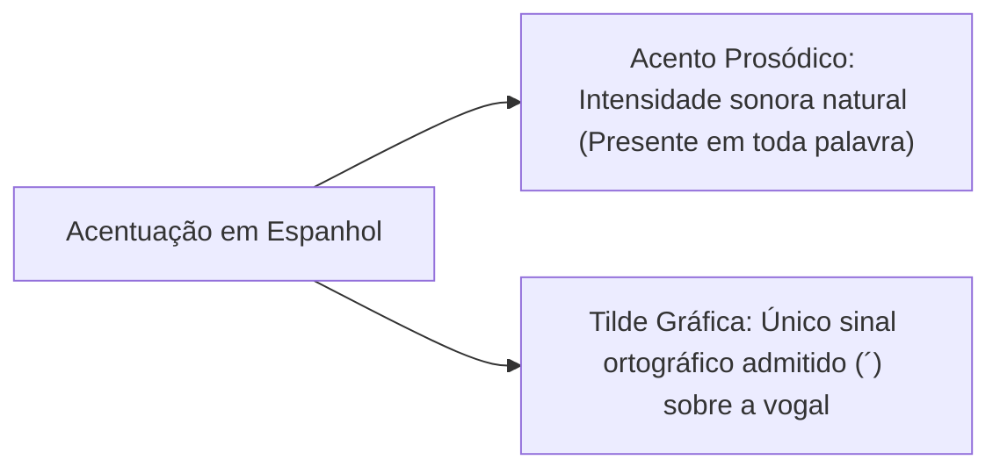
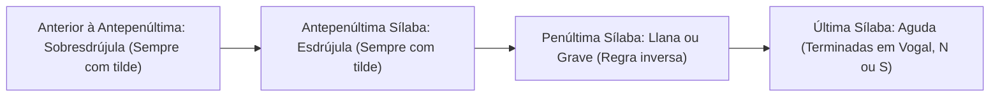
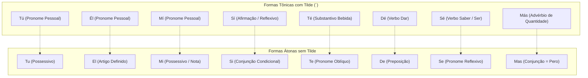
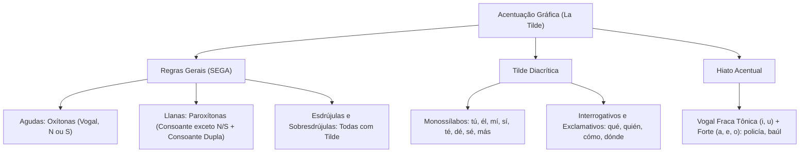

A acentuação gráfica é tema recorrente nas provas de espanhol. Ao contrário do português, o espanhol adota um único sinal gráfico: a tilde. Compreender as regras gerais e a tilde diacrítica é fundamental para diferenciar significados. O candidato deve aplicar as normas da acentuação com absoluta precisão gramatical. Neste capítulo, você estudará a classificação tônica e as normas oficiais da RAE.

> [!objetivos]
> Ao concluir este capítulo, você será capaz de:
> - Distinguir o acento prosódico (tônico) do acento gráfico (*tilde*).
> - Classificar e acentuar palavras agudas, llanas, esdrújulas e sobresdrújulas.
> - Aplicar as regras específicas de palavras llanas terminadas em consoante dupla.
> - Dominar o emprego da tilde diacrítica em monossílabos homônimos e pronomes interrogativos.
> - Acentuar corretamente os hiatos formados por vogal fraca tônica e vogal forte.

## Palavras Iniciais e Conceitos Fundamentais

No estudo da fonologia e da morfossintaxe hispânica, a acentuação gráfica orienta a pronúncia e a interpretação textual. As bancas de concurso elaboram questões minuciosas sobre o tema. Elas exigem discernir a função distintiva de cada marca gráfica na oração. Para dominar a matéria, é indispensável separar dois conceitos elementares:

- **Acento Prosódico (Acento Tónico)**: É o destaque natural de intensidade sonora com que se pronuncia uma sílaba na cadeia fonética. Toda palavra polissilábica em espanhol possui uma sílaba tônica evidente. No entanto, nem toda sílaba forte recebe sinal escrito na ortografia regular.
- **Acento Gráfico (La Tilde)**: É o sinal ortográfico agudo colocado sobre a vogal tônica (*vocal tónica*). Na língua espanhola, a tilde é o **único acento gráfico** admitido pela Real Academia Espanhola. O idioma não adota acento circunflexo, acento grave nem til nasal sobre vogais.

A presença ou ausência da tilde modifica a classe gramatical do vocábulo e altera seu significado contextual. Assim, o candidato deve memorizar as regras com rigor e aplicá-las em tirinhas de humor ou textos de época.

## Classificação Tônica e Regras Gerais de Acentuação

A classificação da palavra depende estritamente da posição ocupada pela sílaba tônica. A contagem silábica para fins de acentuação realiza-se obrigatoriamente do fim para o início da palavra (da direita para a esquerda).

### Palavras Agudas (Oxítonas)

São aquelas cuja sílaba tônica é a **última sílaba** da palavra (*la última sílaba*).

Regra de acentuação gráfica:

As palavras agudas recebem tilde exclusivamente quando terminam em:

1. **Vogal** (*a, e, i, o, u*): *café*, *sofá*, *colibrí*, *tabú*, *panamá*.
2. **Consoante N**: *capitán*, *corazón*, *canción*, *camión*.
3. **Consoante S**: *compás*, *demás*, *interés*, *revés*.

Quando a palavra aguda termina em qualquer outra consoante que não seja N ou S, ela **não recebe tilde**:

- *cuartel*, *oficial*, *pared*, *reloj*, *militar*, *convoy*.

Exceção das agudas terminadas em S precedido de outra consoante:

- Se a palavra aguda terminar em consoante dupla na qual a última letra seja S, ela **não recebe tilde**: *robots*, *tictacs*, *zigzags*.

### Palavras Llanas ou Graves (Paroxítonas)

São aquelas cuja sílaba tônica recai sobre a **penúltima sílaba** da palavra (*la penúltima sílaba*). Constituem a grande maioria do vocabulário da língua espanhola.

Regra de acentuação gráfica:

A regra das llanas é o inverso da regra das agudas. As palavras llanas recebem tilde ao terminarem em consoante diferente de N ou S.

- *árbol*, *lápiz*, *mártir*, *líder*, *cárcel*, *fácil*, *dólar*, *cráter*, *ámbar*. Já o plural de tapiz é *tapices* (sem tilde por ser llana terminada em s). Empréstimos como *western* enquadram-se nas normas gerais.

Portanto, palavras llanas terminadas em vogal, em N ou em S **não recebem tilde**:

- *mesa*, *policia*, *volumen*, *joven*, *crisis*, *tropa*.

Exceção crucial das llanas (ponto de atenção da fonte):

- As palavras llanas que terminam na letra S precedida de outra consoante **recebem tilde obrigatoriamente**:
  - *bíceps*, *tríceps*, *fórceps*, *cómics*, *rékords*.

> [!pegadinha]
> Compare as palavras *volumen* e *volúmenes*, *joven* e *jóvenes*. No singular, *volumen* e *joven* são palavras llanas terminadas na consoante N, logo **não recebem tilde**. Ao passarem para o plural, o acréscimo da sílaba *-es* desloca a posição tônica para a antepenúltima sílaba, tornando-as **esdrújulas** (*volúmenes, jóvenes*), razão pela qual recebem tilde obrigatória.

### Palavras Esdrújulas (Proparoxítonas)

São aquelas cuja sílaba tônica recai sobre a **antepenúltima sílaba** da palavra (*la antepenúltima sílaba*).

Regra de acentuação gráfica:

**Todas as palavras esdrújulas recebem tilde**, sem qualquer exceção de terminação:

- *teléfono*, *helicóptero*, *pájaro*, *médico*, *víctima*, *público*, *célula*, *rápido*, *ejército*.

### Palavras Sobresdrújulas

São aquelas cuja sílaba tônica recai em uma sílaba **anterior à antepenúltima**. Na língua espanhola, as sobresdrújulas não existem como vocábulos primitivos isolados; elas são formadas exclusivamente pela anexação de dois pronomes clíticos à raiz de uma forma verbal no imperativo ou no gerúndio.

Regra de acentuação gráfica:

**Todas as palavras sobresdrújulas recebem tilde obrigatoriamente**:

- *cómpratelo* (*compra + te + lo*)
- *explícaselo* (*explica + se + lo*)
- *entregándomelas* (*entregando + me + las*). Os advérbios terminados em -mente mantêm a acentuação do adjetivo primitivo, como em *útilmente* (de útil).

| Classe Acentual | Sílaba Tônica | Quando Recebe Tilde | Exemplos Típicos em Concursos |
|---|---|---|---|
| **Aguda** | Última sílaba | Terminadas em Vogal, N ou S | *sofá, capitán, compás* (sem tilde: *cuartel*) |
| **Llana / Grave** | Penúltima sílaba | Terminadas em Consoante (exceto N/S) ou Consoante + S | *árbol, lápiz, líder, bíceps* (sem tilde: *joven*) |
| **Esdrújula** | Antepenúltima sílaba | **Todas** são acentuadas | *helicóptero, víctima, ejército, rápido* |
| **Sobresdrújula** | Anterior à antepenúltima | **Todas** são acentuadas | *cómpratelo, explícaselo, tráigamelo* |
*Tabela 1: Síntese definitiva das regras gerais de acentuação da RAE.*

> [!bizu]
> Guarde o mnemônico da posição silábica: **SEGA** (Sobresdrújula, Esdrújula, Grave/Llana, Aguda). A leitura da direita para a esquerda percorre a sequência A (Aguda = última), G (Grave/Llana = penúltima), E (Esdrújula = antepenúltima) e S (Sobresdrújula = anterior).

## A Tilde Diacrítica (El Acento Diacrítico)

Por regra geral, os monossílabos em língua espanhola **não recebem tilde** (*fe, ti, vi, dio, vio, fue, fui, pan, sol*).

A **tilde diacrítica** é a única exceção formal a essa regra. Ela é empregada para diferenciar duas palavras monossílabas homônimas (que possuem a mesma grafia e som), mas pertencem a classes gramaticais e funções sintáticas distintas. Em regra, a forma tônica com maior relevância recebe a tilde, enquanto a forma átona permanece sem acento.

Examinemos os oito pares clássicos de monossílabos com tilde diacrítica:

1. **Tú / Tu**:
   - *Tú* (com tilde): Pronome pessoal reto de segunda pessoa (*Tú eres el comandante*).
   - *Tu* (sem tilde): Adjetivo possessivo átono (*Tu patrulla llegó temprano*).
2. **Él / El**:
   - *Él* (com tilde): Pronome pessoal masculino de terceira pessoa (*Él asumió el mando*).
   - *El* (sem tilde): Artigo definido masculino singular (*El cuartel fue evacuado*).
3. **Mí / Mi**:
   - *Mí* (com tilde): Pronome pessoal oblíquo tônico com preposição (*La orden fue entregada a mí*).
   - *Mi* (sem tilde): Adjetivo possessivo átono (*Mi deber es servir*) ou nota musical.
4. **Sí / Si**:
   - *Sí* (com tilde): Advérbio de afirmação ou pronome reflexivo (*Dijo que sí; volvió en sí*).
   - *Si* (sem tilde): Conjunção condicional (*Si llueve, suspenderemos la marcha*) ou nota musical.
5. **Té / Te**:
   - *Té* (com tilde): Substantivo comum que designa a bebida/infusão (*Bebió una taza de té*).
   - *Te* (sem tilde): Pronome pessoal oblíquo átono (*Te comunicaré la decisión*).
6. **Dé / De**:
   - *Dé* (com tilde): Forma do verbo *dar* no presente do subjuntivo ou imperativo (*Espero que me dé permiso*).
   - *De* (sem tilde): Preposição simples de ligação (*Compañía de rescate*).
7. **Sé / Se**:
   - *Sé* (com tilde): Forma do verbo *saber* ou do verbo *ser* (*Yo sé la verdad; sé valiente*).
   - *Se* (sem tilde): Pronome reflexivo, recíproco ou apassivador (*El sospechoso se entregó*).
8. **Más / Mas**:
   - *Más* (com tilde): Advérbio de quantidade ou intensidade (*Necesitamos más refuerzos*).
   - *Mas* (sem tilde): Conjunção adversativa arcaica equivalente a *pero* (*Quiso avanzar, mas el fuego lo detuvo*).

| Palavra com Tilde | Classe e Função | Palavra sem Tilde | Classe e Função |
|---|---|---|---|
| **tú** | Pronome pessoal (*Tú mandas*) | **tu** | Possessivo (*Tu orden*) |
| **él** | Pronome pessoal (*Él vigila*) | **el** | Artigo (*El escudo*) |
| **mí** | Pronome tônico (*Para mí*) | **mi** | Possessivo (*Mi puesto*) |
| **sí** | Afirmação (*Dijo sí*) | **si** | Condicional (*Si avanzas*) |
| **té** | Planta / Bebida (*Tomó té*) | **te** | Pronome átono (*Te llamé*) |
| **dé** | Verbo dar (*Dé apoyo*) | **de** | Preposição (*De guardia*) |
| **sé** | Verbo saber/ser (*Yo sé*) | **se** | Pronome reflexivo (*Se calló*) |
| **más** | Quantidade (*Más agua*) | **mas** | Adversativa (*Quiso, mas no pudo*) |
*Tabela 2: Quadro comparativo de tilde diacrítica em monossílabos.*

### Tilde Diacrítica em Interrogativos e Exclamativos

Os pronomes e advérbios interrogativos e exclamativos recebem tilde diacrítica obrigatória. Essa regra vale tanto para perguntas diretas quanto para indiretas.

- *¿Qué sucedió?* / *No sé qué sucedió.* (Interrogativa indireta com tilde).
- *¿Quién comanda la tropa?* / *Preguntó quién comandaba la tropa.*
- *¿Cuál es el plan?* / *Ignoraba cuál era el plan.*
- *¿Cómo llegaron tan rápido?* / *Explicó cómo apagaron el fuego.*
- *¿Cuándo partirán los socorristas?* / *Averiguan cuándo partirán.*
- *¿Dónde está el puesto de mando?* / *Dime dónde está.*
- *¿Cuánto combustible queda?* / *Calculan cuánto necesitan.*

Quando esses mesmos vocábulos atuam como meros pronomes relativos, conjunções ou advérbios subordinativos sem valor enfático interrogativo, eles **não recebem tilde**:

- *El informe **que** leí era claro.* (Relativo sem tilde).
- *El oficial **quien** dio la orden fue condecorado.* (Relativo sem tilde).
- *Llegaron **cuando** el fuego ya estaba controlado.* (Temporal sem tilde).
- *El cuartel **donde** prestamos servicio es seguro.* (Locativo sem tilde).

> [!pegadinha]
> A RAE estabeleceu na reforma de 2010 que a palavra **solo** (seja como adjetivo "solitário", seja como advérbio "somente") e os demonstrativos **este, ese, aquel** (e seus femininos e plurais) **não devem levar tilde**, mesmo em casos de ambiguidade potencial. A imposição de tilde em *sólo* ou *éste* é considerada grafia desatualizada em certames modernos.

## Acentuação em Hiatos (Hiato Acentual)

Na língua espanhola, as vogais dividem-se foneticamente em duas categorias:

- **Vogais Fortes ou Abertas**: **A, E, O**.
- **Vogais Fracas ou Fechadas**: **I, U**.

Um **ditongo** ocorre quando se encontram na mesma sílaba uma vogal aberta e uma fechada átona (*cau-sa, viu-do, pai-sa-je*).

O **hiato** ocorre quando duas vogais vizinhas pertencem a sílabas distintas (*te-a-tro, hé-ro-e*).

O caso mais importante em concursos é o **Hiato Acentual (ou Hiato em Vogal Fraca Tônica)**:

Quando uma vogal fraca (**I** ou **U**) é pronunciada com força tônica ao lado de uma vogal forte (**A, E, O**), a intensidade sonora quebra o ditongo. Nesse cenário, a vogal fraca **recebe tilde obrigatoriamente**, independentemente de qualquer regra geral de terminação das agudas ou llanas:

- *po-li-cí-a* (hiato com I tônico; recebe tilde mesmo sendo llana terminada em vogal).
- *Ma-rí-a* (hiato com I tônico).
- *ba-úl* (hiato com U tônico; recebe tilde mesmo sendo aguda terminada em L).
- *ra-íz* (hiato com I tônico; recebe tilde mesmo terminada em Z).
- *grú-a*, *pa-ís*, *o-í-do*, *re-ú-ne*, *flú-or*.

> [!atencao]
> A presença da letra H muda intercalada entre a vogal forte e a fraca não impede a formação do hiato nem anula a obrigatoriedade da tilde: *a-hí*, *ve-hí-cu-lo*, *bú-ho*, *pro-hí-be*.

> [!exemplo]
> Compare as palavras *policía* e *sabiduría*. Ambas são palavras llanas terminadas na vogal A. Pela regra geral das llanas, não deveriam levar acento. Todavia, como a sílaba tônica recai sobre a vogal fraca I contígua à vogal forte A, ocorre a quebra do ditongo e a tilde é exigida por imperativo da regra do hiato acentual.

## Mapa do capítulo

### Para fixar

- O espanhol adota um único acento gráfico sobre as vogais: a tilde aguda (´), dispensando circunflexo, crase ou til sobre vogais.
- Palavras agudas recebem tilde exclusivamente quando terminam em vogal, N ou S (*café, canción, compás*).
- Palavras llanas ou graves recebem tilde quando terminam em consoante diferente de N ou S (*árbol, lápiz*), ou em consoante dupla (*bíceps*).
- Todas as palavras esdrújulas e sobresdrújulas recebem tilde na norma culta hispânica sem exceção.
- Por regra geral, monossílabos não são acentuados; a tilde diacrítica diferencia pares homônimos de classes gramaticais distintas.
- A tilde diacrítica distingue os pronomes pessoais *tú, él, mí* dos adjetivos possessivos e artigos átonos *tu, el, mi*.
- Os pronomes interrogativos e exclamativos diretos e indiretos recebem tilde diacrítica (*qué, quién, cuándo, dónde, cómo*).
- O hiato formado por vogal fraca tônica (I, U) contígua a vogal forte exige tilde obrigatória, sobrepondo-se às regras gerais (*policía, baúl*).
