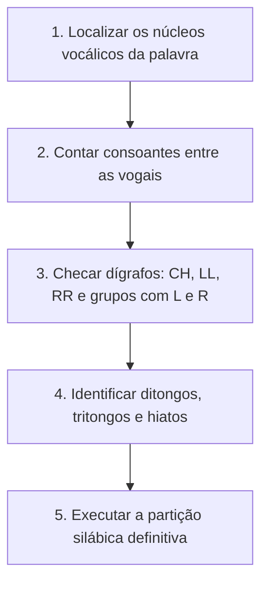
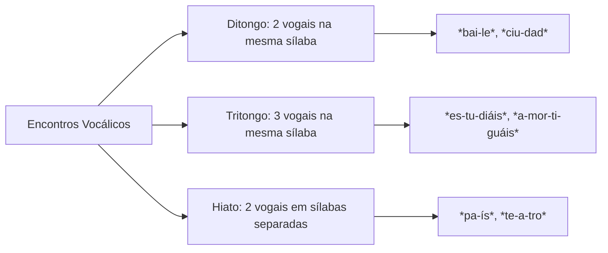
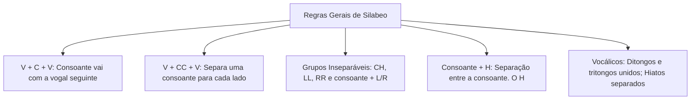

A correta partição silábica, conhecida na tradição gramatical hispânica como silabeo, constitui o alicerce para a compreensão da prosódia, das regras de acentuação gráfica e da translineação de palavras em língua espanhola. Embora a proximidade entre o português. O castelhano favoreça a intuição comunicativa imediata, divergências fonológicas pontuais exigem atenção redobrada do candidato. Este capítulo estabelece as diretrizes normativas para segmentar vocábulos hispânicos de acordo com a Real Academia Española.

> [!objetivos]
> - Compreender o conceito de silabeo. A estrutura fonológica da sílaba em língua espanhola.
> - Aplicar as regras de distribuição de consoantes simples e grupos consonantais entre vogais.
> - Identificar os dígrafos inseparáveis. Os encontros consonantais inseparáveis.
> - Reconhecer o comportamento dos encontros vocálicos: ditongos, tritongos e hiatos.

## Palavras iniciais. A Estrutura da Sílaba

Na emissão das vogais, o ar expelido pelos pulmões passa livremente pela cavidade bucal sem encontrar nenhum obstáculo mecânico ao sair. Nas consoantes, o fluxo de ar sofre obstrução ou atrito. Quando duas vogais se unem na mesma sílaba, o encontro é percebido como ditongo, como no termo *feudo* (*feu-do*) ou no vocábulo *árduo* (*ár-duo*). Cada sílaba segue um ritmo próprio de fonação. No exemplo de *telefone* (*te-lé-fo-no*), cada consoante une-se à vogal seguinte.

O silabeo é a divisão ordenada de uma palavra em suas unidades fônicas elementares, emitidas em um único impulso articulatório. Em língua espanhola, a vogal atua como o núcleo obrigatório e indispensável de qualquer emissão silábica. Não existe sílaba sem vogal, tampouco sílaba constituída exclusivamente por sons consonantais.

O inventário vocálico castelhano compreende cinco vogais fundamentais: as vogais abertas (ou fortes) **A**, **E**, **O**,. As vogais fechadas (ou fracas) **I**, **U**. Por outro lado, as consoantes organizam-se ao redor do núcleo vocálico como margens silábicas anteriores (ataque) ou posteriores (coda).

Para realizar o silabeo metódico, siga estes passos:
1. Localizar todos os núcleos vocálicos existentes no termo analisado.
2. Contabilizar o número de consoantes posicionadas entre os núcleos vocálicos adjacentes.
3. Verificar a presença de dígrafos, encontros inseparáveis ou encontros vocálicos.

## Silabeo: Regras de Distribuição de Consoantes

A partição de consoantes obedece a regras da Real Academia Española.

### Silabeo: Uma Consoante entre Duas Vogais

Quando uma única consoante simples encontra-se posicionada entre duas vogais, ela une-se obrigatoriamente à vogal seguinte para compor a sílaba posterior:

- *mo-ne-da* (a consoante n liga-se ao e; o d liga-se ao a)
- *te-lé-fo-no* (as consoantes l, f e n acompanham as respectivas vogais posteriores)
- *in-te-re-sa-das* (a consoante s entre e. A une-se à vogal a)

### Silabeo: Duas Consoantes entre Duas Vogais

Quando duas consoantes situam-se entre duas vogais, a regra geral determina que a primeira consoante permanece com a vogal precedente, enquanto a segunda consoante desloca-se para a vogal seguinte:

- *al-to* (o l vincula-se à vogal anterior. O t à posterior)
- *can-to* (a consoante n encerra a primeira sílaba. O t inicia a segunda)
- *gim-nas-ta* (o m vincula-se à vogal i. O n à vogal a)

### Silabeo: Três Consoantes entre Duas Vogais

Na presença de três consoantes consecutivas entre duas vogais, as duas primeiras consoantes associam-se à vogal antecedente, enquanto a terceira consoante inicia a sílaba com a vogal seguinte:

- *ins-tar* (as consoantes n e s fecham a primeira sílaba. O t inicia a segunda)
- *pers-pi-caz* (o grupo r e s permanece na primeira sílaba)

Exceção imediata: caso as duas últimas consoantes formem um grupo inseparável com L ou R (como tr, pr, cl), a primeira consoante fica com a vogal anterior. As duas últimas acompanham a vogal seguinte: *en-tra-da*, *des-pre-cio*.

### Silabeo: Quatro Consoantes entre Duas Vogais

Quando quatro consoantes encontram-se agrupadas no interior da palavra, as duas primeiras consoantes permanecem ligadas à vogal anterior. As duas últimas passam para a sílaba subsequente:

- *ins-truir* (o grupo ns encerra a primeira sílaba e tr inicia a segunda)
- *cons-truc-ción* (as consoantes ns ficam na primeira sílaba e tr na segunda)

| Padrão Estrutural | Regra de Separação | Exemplos em Espanhol | Observação Articulatória |
|---|---|---|---|
| V + C + V | A consoante vai com a vogal seguinte | *pa-na-de-ro*, *ca-sa* | Divisão canônica universal |
| V + CC + V | Divide-se: uma consoante para cada lado | *ár-bol*, *car-ta* | Regra geral sem grupo inseparável |
| V + CCC + V | Duas consoantes atrás e uma à frente | *ins-pi-rar*, *cons-tan-te* | Exceção se houver dígrafo com L/R |
| V + CCCC + V | Duas consoantes atrás e duas à frente | *ins-truc-ción*, *mons-truo* | Grupo inseparável na segunda metade |

## Dígrafos e Grupos Consonantais Inseparáveis

Certos grupos consonantais são indivisíveis na escrita e na fala.

### Silabeo: Dígrafos CH, LL e RR

Os dígrafos representam grafemas duplos que simbolizam um único fonema consonantal na pronúncia. Em espanhol, **CH**, **LL** e **RR** são rigorosamente indivisíveis:

- *co-che* (e não *coc-he*)
- *pe-rro* (e não *per-ro*)
- *ca-lle* (e não *cal-le*)
- *a-ve-lla-na* (e não *a-vel-la-na*)
- *no-che* (e não *noc-he*)

> [!pegadinha]
> No português, o dígrafo 'rr' é obrigatoriamente separado (*car-ro*). No espanhol, o dígrafo 'rr' é estritamente **inseparável** (*pe-rro*, *tie-rra*). Essa divergência entre os dois idiomas é uma das armadilhas mais exploradas em questões de prova!

### Silabeo: Grupos Consonantais Fixos com L e R

Os grupos formados por uma consoante oclusiva ou fricativa (B, C, D, F, G, P, T) seguida das consoantes líquidas L ou R jamais se separam, unindo-se em bloco à vogal posterior:

- Grupos com R: **BR**, **CR**, **DR**, **FR**, **GR**, **PR**, **TR** (*a-bru-mar*, *re-cri-mi-nar*, *cua-dra*, *co-fre*, *re-gre-so*, *ca-pri-no*, *re-tra-so*).
- Grupos com L: **BL**, **CL**, **FL**, **GL**, **PL**, **TL** (*a-blan-dar*, *a-cla-mar*, *a-flo-rar*, *a-glu-ti-nar*, *ré-pli-ca*, *A-tlán-ti-co*).

### Silabeo: Letra H mais uma Consoante

A letra H é desprovida de valor fonético em espanhol (consoante muda). Quando o H surge associado a outra consoante no interior do vocábulo, a separação silábica ocorre rigorosamente entre a consoante precedente. A letra H:

- *in-hu-ma-no* (a consoante n encerra a primeira sílaba. O h inicia a seguinte)
- *des-hi-dra-tar* (o s fica na primeira sílaba. O h na segunda)
- *clor-hi-dra-to* (o r permanece com a primeira sílaba. O h na posterior)

> [!bizu]
> A presença da letra H intercalada entre duas vogais não impede a formação de ditongos nem afeta a tonicidade natural da palavra: *a-hi-ja-do*, *prohi-bi-do*, *rehu-sar*. Nesses casos, o H desloca-se acompanhando a vogal ou encontro correspondente.

## Silabeo: Ditongos, Tritongos e Hiatos

Os encontros vocálicos definem a união ou a separação das vogais.

- **Ditongo**: fusão de duas vogais em uma única sílaba. Ocorre pela união de uma vogal aberta (A, E, O) com uma vogal fechada átona (I, U), ou pela união de duas vogais fechadas distintas: *bai-le*, *pau-sa*, *ciu-dad*, *cui-da-do*. Os componentes do ditongo jamais se separam.
- **Tritongo**: agrupamento articulatório de três vogais pronunciadas na mesma sílaba, formado obrigatoriamente pela sequência: vogal fechada átona + vogal aberta tônica + vogal fechada átona: *es-tu-diáis*, *a-mor-ti-guáis*, *pa-ra-guay*.
- **Hiato**: encontro de duas vogais pronunciadas em impulsos fônicos sucessivos, pertencentes a sílabas distintas. Ocorre no encontro de duas vogais abertas (*te-a-tro*, *po-e-ma*) ou na combinação de vogal aberta com vogal fechada tônica graficamente acentuada: *pa-ís*, *ba-úl*, *to-da-ví-a*, *o-í-do*, *flú-or*, *cer-ca-ní-a*.

> [!exemplo]
> No vocábulo *instar*, as consoantes 'n' e 's' unem-se à vogal anterior, formando *ins-tar*. No vocábulo *baile*, as vogais unem-se em ditongo decrescente formando *bai-le*. O candidato deve observar atentamente se há obstáculo fonético antes de separar os encontros.

## Mapa do capítulo

### Para fixar

- Toda sílaba em língua espanhola contém obrigatoriamente ao menos uma vogal em seu núcleo.
- Uma consoante simples posicionada entre duas vogais junta-se à vogal subsequente (*mo-ne-da*).
- Duas consoantes simples entre vogais separam-se, ficando uma em cada sílaba (*al-to*).
- Os dígrafos CH, LL e RR são indivisíveis e formam sílaba com a vogal posterior (*pe-rro*, *ca-lle*).
- O dígrafo RR separa-se no português, mas permanece estritamente unido no espanhol.
- Os grupos consonantais com L e R (como bl, br, cl, cr, dr, tr) jamais se separam (*cua-dra*).
- O encontro de consoante com a letra H exige a separação entre ambas (*in-hu-ma-no*).
- Ditongos e tritongos permanecem unidos na mesma sílaba (*bai-le*, *es-tu-diáis*).
- O hiato separa as vogais em sílabas distintas, especialmente na presença de vogal fechada acentuada (*pa-ís*).
