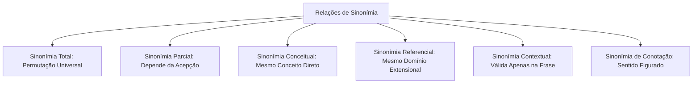
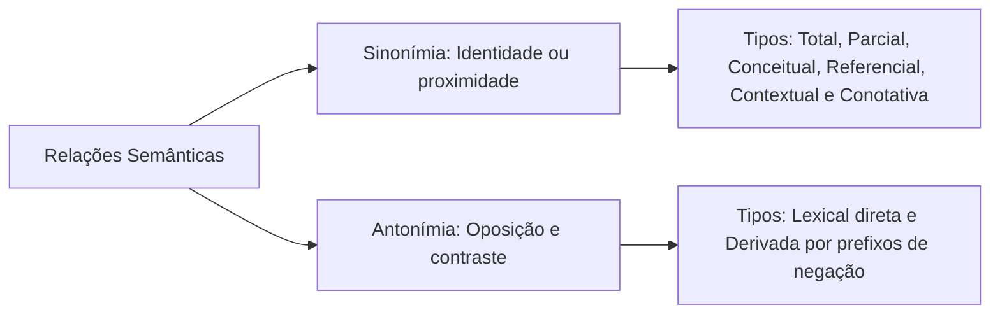

A compreensão textual em concursos públicos exige domínio das relações semânticas entre os vocábulos. No espanhol, a identificação precisa de sinônimos e antônimos permite captar nuances argumentativas e solucionar questões de reescritura. Palavras aparentemente idênticas nem sempre podem ser intercambiadas livremente. O contexto oracional determina a pertinência da substituição lexical. Este capítulo analisa a taxonomia da sinonímia e as matrizes de oposição antonímica.

> [!objetivos]
> - Compreender a sinonímia e suas divisões: total, parcial, conceitual, referencial, contextual e de conotação.
> - Diferenciar a equivalência absoluta da adequação contextual de termos.
> - Dominar a formação de antônimos e os contrastes semânticos mais cobrados em prova.

## Conceito e Fundamentos da Sinonímia

A sinonímia é a relação semântica estabelecida entre dois ou mais termos pertencentes à mesma classe gramatical. Esses termos compartilham significados idênticos ou muito próximos no interior do sistema linguístico. A sinonímia absoluta é fenômeno raro na língua viva. O contexto comunicativo seleciona a acepção adequada do vocábulo e determina o tom da mensagem. 

Na produção textual formal, o recurso aos sinônimos desempenha papel crucial para a coesão referencial. O emprego consciente de variantes lexicais evita repetições cansativas de palavras e enriquece a exposição de ideias em peças técnicas e relatórios periciais. Contudo, o analista deve atentar para o fato de que pequenas variações de registro, intensidade e matiz afetivo distinguem termos aparentemente equivalentes nos dicionários gerais.

Nas provas de concurso público, as questões frequentemente exploram a substituição de vocábulos em textos literários ou jornalísticos. O candidato deve avaliar se o sinônimo proposto mantém a coerência argumentativa do autor original, sem introduzir distorções conceituais ou anacronismos no trecho.

## Modalidades e Classificações da Sinonímia

A literatura hispânica categoriza as manifestações sinonímicas em seis modalidades estruturais. Compreender cada uma delas previne interpretações precipitadas na leitura de textos.

### Sinonímia Total

A sinonímia total ocorre quando dois vocábulos podem ser mutuamente substituídos em qualquer contexto sem alterar o sentido referencial. Os pares que atendem a essa exigência são escassos:

- *esposo* e *marido*: *Mi esposo es talentoso* equivale exatamente a *Mi marido es talentoso*.
- *alberca* e *piscina*: ambas designam a mesma estrutura aquática de recreação.
- *odontólogo* e *dentista*: identificam rigorosamente a mesma especialidade da saúde bucal.

### Sinonímia Parcial

A sinonímia parcial manifesta-se quando um termo admite múltiplos substitutos conforme o contexto. Esses substitutos não são equivalentes entre si:

- O adjetivo *alterado* pode equivaler a *nervioso* em: *Pedro ha venido alterado del trabajo*.
- O mesmo adjetivo *alterado* equivale a *modificado* em: *Hemos alterado el orden de las pruebas*.
- Trocar *nervioso* por *modificado* na primeira oração geraria incoerência semântica.

### Sinonímia Conceitual

A sinonímia conceitual vincula vocábulos que apontam diretamente para o mesmo significado denotativo básico:

- *asno* e *borrico* (designação zoológica do animal).
- *iniciar* e *comenzar* (ação verbal de dar princípio).

### Sinonímia Referencial

A sinonímia referencial surge quando os termos remetem ao mesmo objeto de referência no texto. Contudo, suas extensões semânticas são hierarquicamente desiguais:

- O termo *limonada* remete a *bebida*, configurando relação de inclusão hiperonímica.
- O vocábulo *mesa* remete ao campo genérico de *mueble*.

### Sinonímia Contextual

Na sinonímia contextual, a troca de palavras só é possível dentro de uma estrutura frasal específica. O adjetivo *pesado* exemplifica essa dinâmica:

- Referindo-se a alimentos: *pesado* equivale a *indigesto*.
- Qualificando uma pessoa monótona: *pesado* equivale a *cansativo* ou *aburrido*.
- Descrevendo uma tarefa operacional difícil: *pesado* equivale a *duro* ou *árduo*.

### Sinonímia de Conotação

A sinonímia de conotação ocorre quando os termos adquirem valores subjetivos ou metafóricos. O sentido literal cede espaço à expressividade:

- Chamar um analista de *monstruo de la informática* significa que ele é um gênio ou perito formidável.
- Dizer que um indivíduo é *burro en Matemáticas* expressa inaptidão ou ignorância na matéria.

> [!pegadinha]
> Tenha cuidado ao interpretar sinônimos em textos de concurso. As bancas apresentam alternativas com sinônimos de dicionário fora de contexto. Uma palavra pode ser sinônima em acepção isolada, mas imprópria para a oração sob análise pericial.

| Categoria de Sinonímia | Mecanismo Central | Exemplo Canônico | Observação Crítica |
|---|---|---|---|
| Total | Permutação irrestrita | *marido* / *esposo* | Rara na língua natural |
| Parcial | Depende da acepção polissêmica | *alterado* (*nervoso* ou *modificado*) | Substitutos não se equivalem entre si |
| Conceitual | Identidade de conceito denotativo | *dentista* / *odontólogo* | Termos técnicos e equivalentes diretos |
| Referencial | Inclusão de hiperônimo | *limonada* / *bebida* | O hiperônimo é mais amplo que o termo |
| Contextual | Exclusiva da oração | *trabajo pesado* (*duro*) | O contexto dita o equivalente |
| Conotação | Sentido figurado e afetivo | *monstruo* (*gênio*, perito) | Requer leitura do tom do texto |

## Antonímia: As Relações de Oposição

A antonímia expressa a oposição semântica entre vocábulos de mesma categoria gramatical. Reconhecer pares antônimos auxilia na identificação de contrastes lógicos em artigos de opinião e enunciados probatórios.

A oposição pode ocorrer por raízes lexicais distintas ou pela adição de prefixos de negação:

- Pares lexicais clássicos: *alegría* / *tristeza*, *pequeño* / *grande*, *seco* / *mojado*, *amor* / *odio*, *claro* / *oscuro*, *verdad* / *mentira*, *largo* / *corto*.
- Formação por prefixação: *activo* / *inactivo*, *fácil* / *difícil*, *legal* / *ilegal*, *posible* / *imposible*.

> [!bizu]
> Na leitura de textos militares e jurídicos, antônimos contextuais enfatizam dilemas operacionais. A oposição estabelece balizas entre o agir lícito e o desvio de conduta. Sempre confira se o par oposto mantém o mesmo registro formal da mensagem.

| Vocábulo Positivo | Antônimo Direto | Frase Ilustrativa de Contraste |
|---|---|---|
| *seco* | *mojado* | *La habitación está mojada* contra *La habitación está seca* |
| *fácil* | *difícil* | *Esta cuestión es fácil* contra *Esta cuestión es difícil* |
| *eliminar* | *añadir* | *Debemos eliminar los riesgos* contra *Debemos añadir controles* |
| *gordo* | *flaco* | Oposição descritiva física em relatórios de ocorrência |

## Mapa do capítulo

### Para fixar

- Sinonímia vincula palavras de mesma classe com sentidos próximos ou idênticos.
- A sinonímia total permite a troca em qualquer ambiente sem alterar a mensagem (*esposo/marido*).
- A sinonímia parcial depende da acepção selecionada na oração (*alterado* como nervoso ou modificado).
- A sinonímia conceitual expressa identidade direta de conceito (*odontólogo/dentista*).
- A sinonímia referencial decorre de inclusão em mesmo domínio com extensões desiguais (*limonada/bebida*).
- A sinonímia contextual restringe a substituição a uma frase específica (*trabajo pesado/árduo*).
- A sinonímia de conotação baseia-se em metáforas e sentidos figurados (*monstruo/gênio*).
- Antonímia expressa contraste semântico direto (*seco/mojado*, *eliminar/añadir*).
