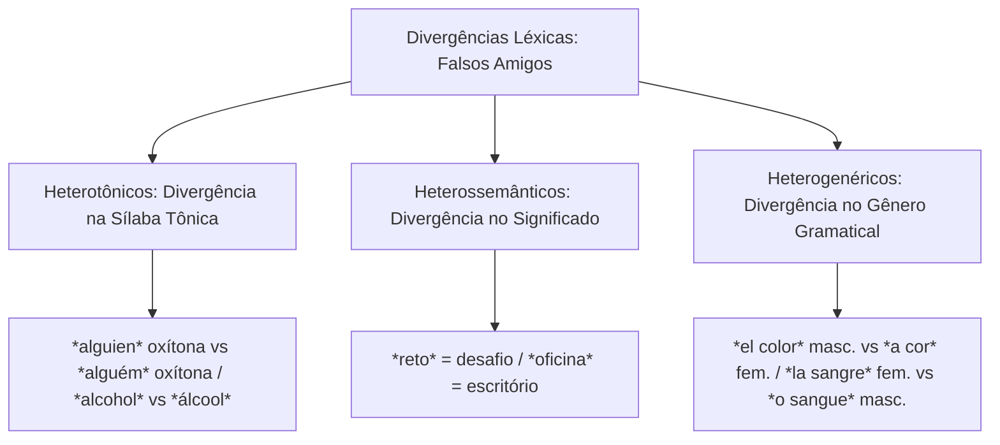
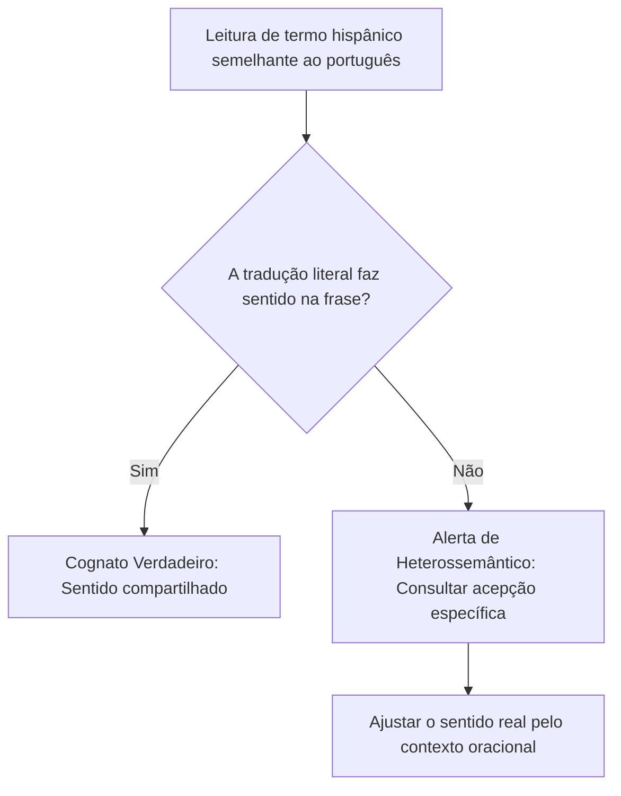
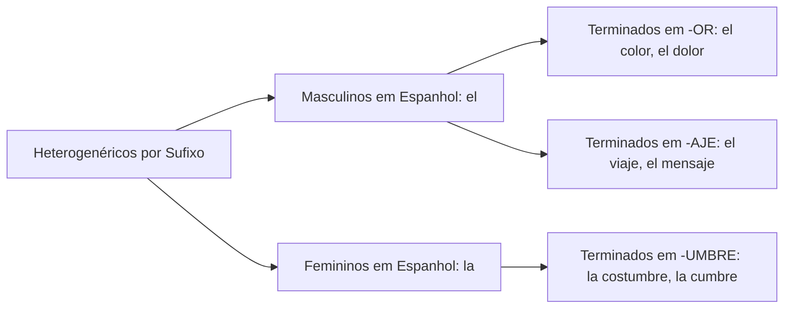
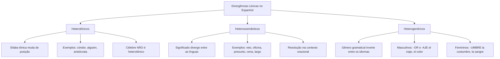

A aparente transparência entre o português e o espanhol oculta armadilhas sistemáticas que costumam comprometer o desempenho de candidatos nas provas. Por compartilharem uma base lexical latina, os dois idiomas apresentam inúmeras palavras de grafia idêntica ou semelhante. Contudo, muitas dessas palavras divergem na pronúncia, no significado ou no gênero gramatical. Este capítulo analisa com rigor sistemático as três grandes modalidades de divergências léxicas: os heterotônicos, os heterossemânticos e os heterogenéricos.

> [!objetivos]
> - Compreender a natureza linguística das divergências léxicas formadas com o prefixo grego hetero-.
> - Identificar as palavras heterotônicas e reconhecer a posição da sílaba tônica em espanhol.
> - Dominar o vocabulário dos heterossemânticos mais cobrados nos concursos.
> - Aplicar as regras morfológicas e terminativas que regem as palavras heterogenéricas.

## Divergências Léxicas no Confronto Espanhol e Português

O léxico representa o conjunto integral de palavras que compõem o acervo vocabular de uma língua. Quando comparamos o espanhol e o português, observamos fenômenos de interferência recíproca decorrentes da proximidade filogenética. As divergências léxicas, consagradas no meio pedagógico como falsos amigos (ou falsos cognatos), classificam-se a partir do prefixo grego *hetero-*, que denota alteridade ou diferença.

A assimilação das divergências exige superar a leitura mecânica por analogia. Em contextos de segurança pública e defesa social, a incompreensão de termos técnicos pode distorcer relatórios de inteligência e laudos criminais.

Antes de começarmos a estudar as extensas listas de vocábulos, convém analisar a metodologia de fixação recomendada pelos filólogos. Muitos alunos acham que memorizar listas isoladas resolve a prova. Não pensem que esse método mecânico traz segurança na hora do certame. O estudante deve observar o uso vivo da língua em frases completas e notícias atuais. A semelhança formal entre os dois idiomas induz à falsa sensação de domínio imediato. Por isso, a análise contrastiva precisa focar no contexto real de emprego. O confronto analítico do léxico revela diferenças profundas que passam despercebidas em leituras superficiais de artigos estrangeiros.

## Heterotônicos: A Divergência na Sílaba Tônica

As palavras heterotônicas (também denominadas na tradição filológica como heteroprosódicas ou heterofônicas) apresentam grafia idêntica ou muito parecida nos dois idiomas, mas **a sílaba tônica ocupa posições diferentes**.

A classificação da tonicidade em espanhol divide os vocábulos em quatro categorias acentuais fundamentais:
- **Agudas (oxítonas)**: sílaba tônica na última posição (*al-guien*, *re-loj*).
- **Llanas ou graves (paroxítonas)**: sílaba tônica na penúltima posição (*con-dor*, *o-ce-a-no*).
- **Esdrújulas (proparoxítonas)**: sílaba tônica na antepenúltima posição (*a-ris-tó-cra-ta*, *te-lé-fo-no*).
- **Sobreesdrújulas**: sílaba tônica antes da antepenúltima sílaba (*en-tré-ga-me-lo*).

Quando a palavra recebe acento gráfico em uma das línguas, a divergência prosódica torna-se imediatamente visível na escrita. Por outro lado, quando o termo não ostenta acento diacrítico, a distinção depende do conhecimento prévio da norma padrão oral.

| Vocábulo em Espanhol | Posição Tônica no Espanhol | Vocábulo em Português | Posição Tônica no Português |
|---|---|---|---|
| *al-co-hol* | Aguda / Oxítona (última sílaba) | *ál-co-ol* | Proparoxítona (antepenúltima) |
| *al-guien* | Llana / Paroxítona (penúltima) | *al-guém* | Oxítona (última sílaba) |
| *a-ris-tó-cra-ta* | Esdrújula / Proparoxítona | *a-ris-to-cra-ta* | Paroxítona (penúltima) |
| *a-cró-ba-ta* | Esdrújula / Proparoxítona | *a-cro-ba-ta* | Paroxítona (penúltima) |
| *a-néc-do-ta* | Esdrújula / Proparoxítona | *a-ne-do-ta* | Paroxítona (penúltima) |
| *cón-dor* | Llana / Paroxítona (penúltima) | *con-dor* | Oxítona (última sílaba) |
| *de-mó-cra-ta* | Esdrújula / Proparoxítona | *de-mo-cra-ta* | Paroxítona (penúltima) |
| *e-dén* | Aguda / Oxítona (última sílaba) | *é-den* | Paroxítona (penúltima) |
| *im-bé-cil* | Llana / Paroxítona (penúltima) | *im-be-cil* | Oxítona (última sílaba) |
| *ni-tró-ge-no* | Esdrújula / Proparoxítona | *ni-tro-gê-nio* | Paroxítona (penúltima) |
| *o-ce-a-no* | Llana / Paroxítona (penúltima) | *o-ce-a-no* | Paroxítona (penúltima) |
| *te-lé-fo-no* | Esdrújula / Proparoxítona | *te-le-fo-ne* | Paroxítona (penúltima) |

> [!pegadinha]
> Cuidado com a falsa heterotonia! Dizer que o vocábulo *célebre* é heterotônico constitui erro recorrente em provas de concurso. A palavra *célebre* possui grafia idêntica e a sílaba tônica ocupa exatamente a antepenúltima posição (proparoxítona/esdrújula) tanto no espanhol quanto no português (*cé-le-bre*). Para ser heterotônica, a posição do acento tônico deve ser **obrigatoriamente distinta** entre os dois idiomas.

## Heterossemânticos: Os Falsos Amigos de Significado

Os vocábulos heterossemânticos constituem o grupo mais perigoso para a interpretação textual. Trata-se de palavras que possuem grafia e pronúncia semelhantes ou idênticas nas duas línguas, mas ostentam **significados completamente divergentes**.

Ao realizar a leitura analítica de um artigo de jornal ou texto doutrinário, o candidato que aplica a tradução literal imediata depara-se com incongruências evidentes. Diante de uma sentença sem sentido aparente, deve-se desconfiar da presença de um falso cognato.

O caso do vocábulo *reto* ilustra perfeitamente essa dinâmica. Na oração *China ofrece serios retos lingüísticos y culturales*, o termo *reto* traduz-se como **desafio** (derivado do verbo *retar*, que significa desafiar). Já a palavra portuguesa "reto", no sentido de ausência de curva ou postura ética, verte-se para o espanhol sob a forma gráfica *recto*.

### Quadro Sistemático de Heterossemânticos de Alto Rendimento

Para fixação consolidada, os principais falsos cognatos dividem-se em núcleos temáticos recorrentes:

**1. Rotina de Trabalho e Ambiente Administrativo**
- *oficina*: significa **escritório**, gabinete de trabalho. O termo português "oficina mecânica" traduz-se em espanhol como *taller*.
- *escritorio*: designa o móvel de estudo, a **escrivaninha**. O local físico de trabalho institucional é a *oficina*.
- *asignatura*: significa **disciplina escolar**, matéria curricular de um curso de formação.
- *aula*: designa a **sala de aula física**, o espaço arquitetônico. A aula propriamente dita ministrada pelo instrutor é denominada *clase*.
- *taller*: oficina mecânica ou ateliê de arte.
- *vaga*: mulher preguiçosa, desocupada ou folgada. A vaga de emprego ou posto funcional disponível traduz-se como *vacante*.
- *despacho*: gabinete de trabalho de uma autoridade governamental ou policial.

**2. Alimentação e Hospitalidade**
- *cena*: significa a refeição noturna, o **jantar**. A encenação artística no teatro é denominada *escena*.
- *copa*: designa a **taça** de cristal ou vidro para vinho e brindes. O armário ou aposento residencial é a *despensa*.
- *presunto*: adjetivo que significa **suposto**, presumido ou suspeito perante a lei (*el presunto autor del crimen*). O embutido alimentício suíno é denominado *jamón*.
- *salada*: adjetivo que significa **salgada** (*la comida está salada*). A salada de legumes e verduras frescas traduz-se como *ensalada*.
- *exquisito*: adjetivo altamente elogioso que significa **delicioso**, saboroso ou refinado. Aquilo que é bizarro ou esquisito traduz-se como *raro* ou *extraño*.
- *cubierto*: talher de mesa (garfo, faca e colher).

**3. Descrições Humanas e Físicas**
- *embarazada*: adjetivo que significa mulher **grávida**, gestante. Uma pessoa tímida, encabulada ou embaraçada traduz-se como *avergonzada* ou *apenada*.
- *experto*: especialista técnico, perito em determinada matéria. A pessoa esperta ou ardilosa traduz-se como *astuto* ou *listo*.
- *zurdo*: adjetivo que identifica a pessoa **canhota** (que usa a mão esquerda). O indivíduo desprovido de audição é denominado *sordo*.
- *rojo*: cor **vermelha**. A tonalidade roxa do português traduz-se em espanhol como *morado*.
- *rubio*: adjetivo que significa indivíduo **loiro** de cabelos claros. Aquilo que possui tom ruivo é *pelirrojo*.
- *largo*: adjetivo dimensional que significa **comprido**, extenso no comprimento. O termo português "largo", no sentido de espaçoso em largura, traduz-se como *ancho*.
- *pelo*: cabelo humano ou pelo animal.

**4. Expressões Temporais e Objetos Gerais**
- *rato*: espaço breve de tempo, um **instante** ou momento (*espere un rato*). O roedor zoológico traduz-se como *ratón*.
- *luego*: advérbio que significa **depois**, mais tarde (*hasta luego*). O sentido de prontidão imediata expressa-se por *enseguida*.
- *todavía*: advérbio de tempo que significa **ainda** (*todavía no ha llegado*). A conjunção adversativa portuguesa "todavia" traduz-se por *sin embargo*.
- *apellido*: significa **sobrenome** familiar de registro civil. O apelido carinhoso ou alcunha de infância traduz-se como *apodo*.
- *balcón*: sacada de edifício ou **varanda** aberta. O balcão de atendimento comercial é denominado *mostrador*.
- *billete*: nota de papel-moeda ou passagem/ingresso de viagem.
- *cola*: fila de pessoas esperando atendimento ou cauda de animais.
- *polvo*: substância pulverizada em pó ou poeira acumulada. O molusco marinho de oito tentáculos é o *pulpo*.
- *sótano*: pavimento subterrâneo de um edifício, o **porão**. O sótão no topo do telhado é o *desván*.
- *ronda*: rodada de bebidas ou patrulha motorizada militar.

> [!bizu]
> Memorize os pares de oposição semântica cruzada:
> - *Oficina* em espanhol é escritório; *Oficina* em português vira *taller*.
> - *Presunto* em espanhol é suposto; *Presunto* em português vira *jamón*.
> - *Rojo* em espanhol é vermelho; *Roxo* em português vira *morado*.
> - *Largo* em espanhol é comprido; *Largo* em português vira *ancho*.

### Tabela Complementar de Falsos Cognatos Frequentes

| Vocábulo Espanhol | Significado Real no Espanhol | Falso Amigo em Português | Termo Equivalente em Espanhol |
|---|---|---|---|
| *trampa* | Armadilha, golpe ardiloso | Trampolim de salto | *trampolín* |
| *sobremesa* | Conversa amigável após o almoço | Doce ou sobremesa de refeição | *postre* |
| *seta* | Cogumelo comestível da floresta | Flecha de trânsito ou seta indicativa | *flecha* |
| *prestar* | Emprestar objetos a terceiros | Prestar atenção ou socorrer | *prestar atención* |
| *hinchada* | Torcida entusiasmada de estádio | Parte do corpo inflamada ou inchada | *hinchada* / *inflamada* |
| *faro* | Farol costeiro ou lanterna de viatura | Faro olfativo de cão farejador | *olfato* |
| *tuerto* | Indivíduo cego de um dos olhos | Linha curva ou caminho torto | *torcido* / *chueco* |
| *disfraz* | Fantasia de teatro e carnaval | Fantasia imaginária e devaneio | *fantasía* |
| *edén* | Paraíso bíblico (oxítona: e-dén) | Éden (paroxítona no português) | *edén* |
| *acordar* | Entrar em harmonia e combinar | Despertar do sono matinal | *despertarse* |
| *gratificación*| Bônus salarial ou gratificação | Agradecimento verbal pessoal | *agradecimiento* |
| *acostar* | Deitar-se na cama para repousar | Encostar em objeto ou acostamento | *apoyar* / *arrimar* |
| *firma* | Assinatura formal de documento | Empresa comercial ou firma jurídica | *empresa* / *compañía* |
| *mala* | Mulher má, perversa ou nociva | Mala de viagem para roupas | *maleta* / *valija* |
| *albornoz* | Roupão felpudo de banho | Peça de vestuário comum | *bata* / *albornoz* |
| *chulo* | Bonito, elegante ou simpático | Linguagem vulgar e chula | *grosero* / *vulgar* |
| *temperar* | Regular temperatura ou aderezar | Temperar alimento na culinária | *aderezar* / *condimentar* |

## Heterogenéricos: A Mudança de Gênero Gramatical

Os vocábulos heterogenéricos são palavras que mantêm significado equivalente nos dois idiomas, mas **mudam de gênero gramatical ao cruzar a fronteira linguística**. Um substantivo masculino em espanhol torna-se feminino em português, e vice-versa.

Ao redigir ou traduzir orações com heterogenéricos, o candidato deve ajustar obrigatoriamente todos os artigos, pronomes demonstrativos e adjetivos concordantes ao gênero da língua de chegada.

### Substantivos Masculinos em Espanhol e Femininos em Português

A Real Academia Española identifica padrões morfológicos claros que determinam o gênero masculino em espanhol para palavras que o português consagrou como femininas:

1. **Substantivos terminados em -OR**: com raras exceções (como *la flor* e *la labor*), os vocábulos terminados em -or são masculinos em espanhol:
   - *el color* (a cor)
   - *el dolor* (a dor)
   - *el valor* (a coragem / a bravura)
   - *el sabor* (o sabor)
   - *el olor* (o odor / o cheiro)
2. **Substantivos terminados em -AJE**: todos os substantivos derivados que encerram com o sufixo -aje são invariavelmente masculinos em espanhol:
   - *el viaje* (a viagem)
   - *el coraje* (a coragem)
   - *el equipaje* (a bagagem)
   - *el mensaje* (a mensagem)
   - *el lenguaje* (a linguagem)
   - *el aterrizaje* (a aterrissagem)
3. **Outros substantivos de uso frequente**:
   - *el puente* (a ponte)
   - *el énfasis* (a ênfase)
   - *el estreno* (a estreia)
   - *el aguardiente* (a aguardente)
   - *el lapicero* (a lapiseira)
   - *el cutis* (a cútis)
   - *el árbol* (a árvore)
   - *el fraude* (a fraude)
   - *el origen* (a origem)

### Substantivos Femininos em Espanhol e Masculinos em Português

Em sentido inverso, diversas palavras que o português trata no gênero masculino são categoricamente femininas no castelhano:

1. **Substantivos terminados em -UMBRE**: todas as palavras terminadas no sufixo derivacional -umbre são femininas:
   - *la costumbre* (o costume)
   - *la cumbre* (o cume / o topo da montanha)
   - *la legumbre* (o legume)
   - *la certidumbre* (a certeza / a convicção)
2. **Substantivos femininos essenciais de prova**:
   - *la leche* (o leite)
   - *la sangre* (o sangue)
   - *la miel* (o mel)
   - *la sonrisa* (o sorriso)
   - *la nariz* (o nariz)
   - *la baraja* (o baralho de cartas)
   - *la cárcel* (o cárcere / a prisão)
   - *la señal* (o sinal / a placa)
   - *la alarma* (o alarme)
   - *la sal* (o sal de cozinha)
   - *la paradoja* (o paradoxo)

> [!atencao]
> Observe a análise da frase clássica de concurso:
> *"Los orígenes de la hamburguesa son inciertos."*
> - *orígenes*: é masculino em espanhol (*los orígenes*), mas feminino em português (*as origens*).
> - *hamburguesa*: é feminino em espanhol (*la hamburguesa*), mas masculino em português (*o hambúrguer*).
> Ao traduzir a oração para o português, a concordância exige: *"As origens do hambúrguer são incertas."*

| Vocábulo em Espanhol | Gênero Espanhol | Vocábulo em Português | Gênero Português | Regra Aplicável |
|---|---|---|---|---|
| *el color* | Masculino | *a cor* | Feminino | Sufixo -OR é masculino em espanhol |
| *el viaje* | Masculino | *a viagem* | Feminino | Sufixo -AJE é masculino em espanhol |
| *el puente* | Masculino | *a ponte* | Feminino | Substantivo heterogenérico direto |
| *la sangre* | Feminino | *o sangue* | Masculino | Substantivo vital feminino em espanhol |
| *la leche* | Feminino | *o leite* | Masculino | Substantivo alimentar feminino em espanhol |
| *la costumbre* | Feminino | *o costume* | Masculino | Sufixo -UMBRE é feminino em espanhol |
| *la nariz* | Feminino | *o nariz* | Masculino | Anatomia facial feminina em espanhol |

> [!resolvido]
> Questão Prática de Vocabulário: Ao ler o trecho *El agricultor decidió abonar la tierra con abono natural y llevar abrigo para protegerse del frío*, o candidato que estuda decorando listas sem contexto pode hesitar. Como se traduzem os termos destacados?
> **Resolução Passo a Passo**:
> 1. O verbo *abonar* significa adubar ou fertilizar a lavoura, e o substantivo *abono* traduz-se como adubo orgânico.
> 2. O vocábulo *abrigo* refere-se a um casaco ou agasalho térmico.
> 3. Outros contrastes fundamentais da rotina incluem: *apagar* a luz (desligar interruptor) versus *borrar* anotações com borracha; *bolso* (bolsa feminina) versus *bolsillo* (bolso de roupa); *esposas* (algemas policiais ou cônjuges); *berro* (agrião) versus grito; e *barata* (preço módico de itens de feira, como a batata ou a cana) versus a praga doméstica *cucaracha*.
> **Conclusão**: O sentido real de cada termo decorre da análise semântica estrutural da oração.

## Mapa do capítulo

### Para fixar

- Divergência léxica designa contrastes de tonicidade, significado ou gênero entre termos parecidos de ambas as línguas.
- Palavras heterotônicas possuem tonicidade em sílabas distintas (*cóndor* paroxítona contra *condor* oxítona).
- O termo *célebre* não é heterotônico, pois mantém a tonicidade esdrújula proparoxítona nos dois idiomas.
- Heterossemânticos são falsos amigos: *reto* (desafio), *oficina* (escritório), *presunto* (suposto) e *cena* (jantar).
- O adjetivo *exquisito* expressa algo refinado ou saboroso, enquanto *esquisito* traduz-se como *raro*.
- O vocábulo *largo* significa comprido; a largura ampla expressa-se pelo adjetivo *ancho*.
- Substantivos terminados em -OR (*el color*) e -AJE (*el viaje*) são invariavelmente masculinos em espanhol.
- Substantivos terminados em -UMBRE (*la costumbre*) e palavras corporais como *la sangre* e *la nariz* são femininos em espanhol.
