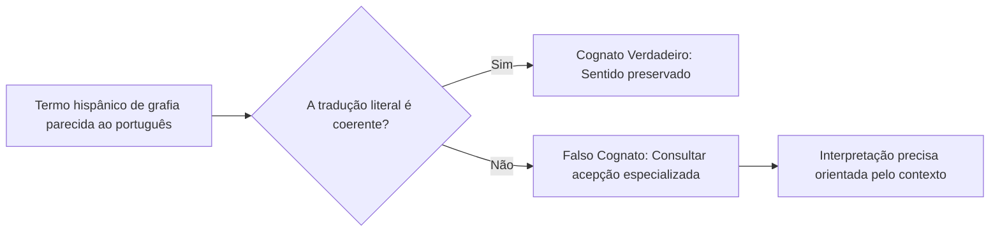
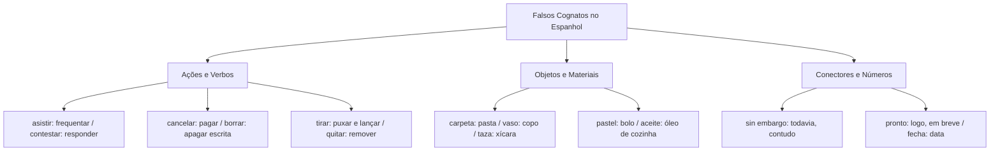

O léxico espanhol compartilha matriz latina com o português, gerando falsa impressão de inteligibilidade plena. Os chamados falsos cognatos (ou falsos amigos) apresentam significantes muito próximos aos do português, mas veiculam significados totalmente divergentes. Em provas de línguas estrangeiras, a banca examinadora explora esses termos em questões de interpretação e equivalência semântica. Este capítulo sistematiza o inventário dos falsos amigos mais recorrentes em certames públicos.

> [!objetivos]
> - Compreender a distinção entre cognatos legítimos e falsos cognatos interlinguísticos.
> - Dominar os verbos de ação hispânicos cujo significado difere do correspondente em português.
> - Mapear os falsos amigos recorrentes em textos operacionais, alimentação e conectores discursivos.

## Falsos Cognatos e o Fenômeno da Paronímia Interlinguística

Os falsos cognatos decorrem de caminhos evolutivos autônomos que vocábulos de mesma matriz etimológica trilharam ao longo dos séculos. Enquanto certas palavras preservaram seus sentidos originais em ambas as línguas (cognatos verdadeiros), outras especializaram seus significados em direções divergentes.

A leitura acrítica de um texto em língua espanhola induz o candidato a traduzir automaticamente os termos pela paronímia mais próxima. Essa tradução mecânica deturpa o teor da mensagem e inviabiliza a resolução correta dos itens. 

Para neutralizar essa armadilha, o método analítico recomenda isolar o termo na oração e conferir sua compatibilidade lógica com o predicado. Caso a tradução espontânea gere incoerência com o tema central do parágrafo, deve-se acionar o repertório dos falsos amigos.

A paronímia produz efeitos enganosos. O leitor supõe identidade em termos como extraordinário, mas sutilezas mudam o juízo. Um evento qualificado como *espantoso* em espanhol não expressa algo grandioso ou extraordinário no sentido positivo, mas algo medonho, horrível ou assustador. Da mesma forma, insultar ou desrespeitar autoridades estrangeiras pode decorrer do emprego inadvertido de termos de tom vulgar. Na leitura de laudos e vídeos periciais, o oficial militar deve discernir com precisão a intenção do emissor.

## Falsos Cognatos em Verbos, Ações e Procedimentos

Os verbos concentram divergências que afetam a descrição de ordens e ocorrências. A tradução equivocada altera o sentido:

- *asistir*: não significa apenas prestar socorro; seu emprego mais frequente traduz-se como **frequentar** ou comparecer a eventos (*asistir a clase* significa frequentar a aula).
- *apresar*: significa prender, capturar ou apreender pessoas ou embarcações sob custódia legal.
- *cancelar*: na esfera financeira e comercial, significa **pagar** ou liquidar uma dívida pendente (*cancelar la cuenta*).
- *contestar*: significa **responder** a uma pergunta ou interrogatório (*el testigo contestó con calma*). A contestação jurídica expressa-se por *impugnar*.
- *prender*: significa **acender** a luz ou o fogo (*prender la luz*), além de poder significar agarrar fisicamente.

> [!pegadinha]
> Fique muito atento aos verbos de grafia semelhante:
> - *calar*: significa cortar fatias, penetrar ou calar no sentido figurado.
> - *callar*: grafado com dígrafo ll, significa **calar a boca**, fazer silêncio.
> - *concertar*: grafado com c, significa combinar ou pactuar acordos formais. O ato de reparar peças mecânicas escreve-se *reparar*.

| Verbo em Espanhol | Significado Real no Português | Verbo Parecido em Português | Tradução do Verbo Português |
|---|---|---|---|
| *asistir* | Frequentar, comparecer | Assistir (ver filme) | *ver*, *mirar* |
| *cancelar* | Pagar, liquidar débitos | Cancelar (anular) | *anular*, *revocar* |
| *contestar* | Responder | Contestar (impugnar) | *impugnar*, *reclamar* |
| *borrar* | Apagar escrita ou dados | Borrar (manchar) | *manchar* |
| *quitar* | Tirar, remover | Quitar (pagar dívida) | *pagar*, *liquidar* |
| *tirar* | Arremessar ou puxar | Tirar (remover) | *quitar*, *sacar* |

## Falsos Cognatos em Objetos, Alimentação e Conectores Textuais

- *brincar*: significa pular, saltar sobre obstáculos (*el niño brincaba en el parque*). A ação lúdica de brincar traduz-se pelo verbo *jugar*.
- *aceitar*: significa untar com azeite ou lubrificar com óleo. O ato de concordar e aceitar propostas expressa-se por *aceptar*.
- *guitarra*: designa o violão acústico clássico de madeira. A guitarra elétrica é identificada como *guitarra eléctrica*.
- *cigarro*: significa charuto de fumo espesso. O cigarro comum com filtro de papel é denominado *cigarrillo*.
- *edificio*: construção vertical urbana, o prédio residencial ou comercial. O termo *predio* remete a terreno rústico ou imóvel de campo.
- *polvo*: poeira em suspensão ou substância em pó, enquanto o molusco marinho com tentáculos é o *pulpo*.

No cotidiano, termos de vestuário e alimentação divergem expressivamente:

- *carpeta*: pasta para papéis, documentos e processos administrativos.
- *aceite*: óleo alimentar de cozinha ou lubrificante industrial.
- *pastel*: bolo doce de aniversário. O salgado frito do Brasil não possui equivalente direto, chamando-se *empanada frita*.
- *vaso*: copo de vidro para água ou bebidas. O vaso de flores decorativo é denominado *florero* ou *maceta*.
- *taza*: xícara para café ou chá. A taça de vinho com pé é denominada *copa*.
- *cubiertos*: talheres de refeição (garfos, facas e colheres).

Nos conectores e expressões temporais, a atenção deve ser redobrada para manter a linha lógica do texto:
- *sin embargo*: locução conjuntiva que significa **no entanto**, contudo ou todavia.
- *en cuanto*: locução temporal que significa **assim que** ou logo que.
- *en cambio*: locução adversativa que significa **ao contrário** ou por outro lado.
- *fecha*: substantivo que significa **data** de calendário.
- *pronto*: advérbio que significa **logo**, em breve (*nos vemos pronto*). O estado de preparado traduz-se pelo adjetivo *listo*.

> [!bizu]
> Guarde as correspondências numéricas:
> - *mil millones* em espanhol equivale a **um bilhão** no padrão brasileiro.
> - *un billón* em espanhol equivale a **um trilhão** (escala longa internacional).
> Esse detalhe quantitativo aparece com frequência em textos sobre finanças e economia pública.

- *estufa*: aquecedor doméstico de ambiente. A estufa de plantas traduz-se como *invernadero*.
- *olla*: panela de cozinha. O forno de assar é o *horno*.
- *batata*: batata-doce, enquanto a batata comum inglesa é a *patata*.
- *cometa*: corpo celeste com cauda (o cometa é masculino; a pipa de empinar é *la cometa* feminina).

- *tarjeta*: cartão de crédito comercial.
- *pendiente*: brinco de orelha ou pendência.
- *acera*: calçada de trânsito de pedestres.
- *azar*: sorte casual e destino.
- *aborrecer*: odiar intensamente algo.
- *agasajar*: acolher hóspedes com carinho.
- *vídeo*: gravação audiovisual.
- *pegar*: significa colar com adesivo.
- *toalla*: toalha de banho.
- *garrafa*: garrafão ou jarro de água.
- *salsa*: molho culinário.

## Mapa do capítulo

### Para fixar

- Falsos cognatos possuem grafia semelhante, mas significados diferentes entre espanhol e português.
- O verbo *asistir* significa frequentar ou presenciar eventos; ver televisão expressa-se por *ver*.
- O verbo *cancelar* traduz-se na economia como pagar ou liquidar débitos.
- O verbo *contestar* expressa a ação de responder a questionamentos.
- *Carpeta* é pasta de arquivos; *vaso* é copo; e *taza* é xícara de café.
- *Pastel* significa bolo confeitado; e *aceite* significa azeite ou óleo culinário.
- A locução *sin embargo* traduz-se como contudo ou no entanto.
- O advérbio *pronto* expressa rapidez futura (logo, em breve); estar pronto expressa-se por *estar listo*.
- No sistema numérico, *mil millones* equivale a um bilhão; e *un billón* equivale a um trilhão.
