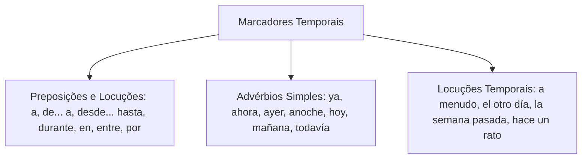
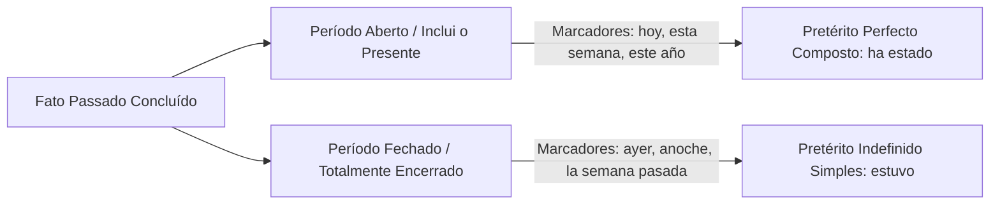
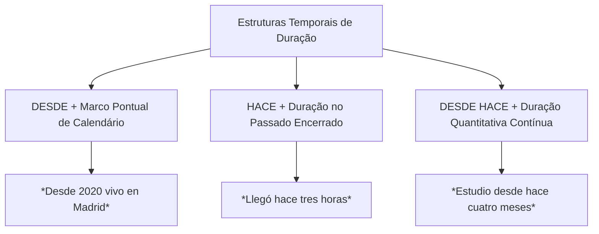
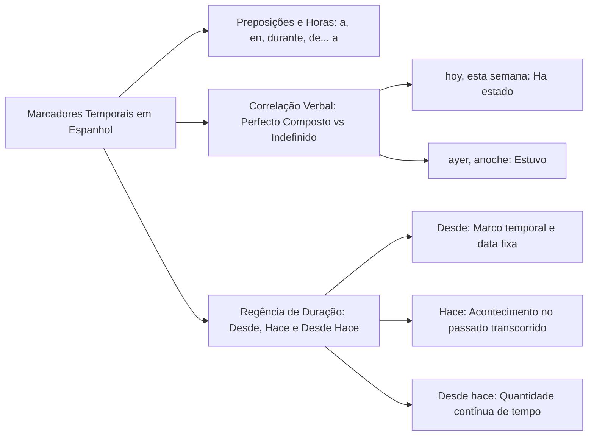

A localização temporal de fatos e a caracterização da duração de eventos são elementos decisivos na interpretação de textos jornalísticos e jurídicos em língua espanhola. Os marcadores temporais atuam como balizas que orientam a correta escolha dos tempos verbais do indicativo. Na prova de concurso, bancas examinadoras cobram intensamente a distinção entre expressões que indicam intervalos abertos e períodos concluídos. Este capítulo analisa os advérbios temporais, estabelece sua correlação com as formas verbais e disseca o emprego canônico de *desde*, *hace* e *desde hace*.

> [!objetivos]
> - Reconhecer as preposições, advérbios e locuções adverbiais que atuam como marcadores temporais em espanhol.
> - Compreender a correlação estrita entre os marcadores temporais e a oposição entre pretérito perfeito e pretérito indefinido.
> - Dominar a sintaxe e a semântica comparada das estruturas com *desde*, *hace* e *desde hace*.

## Marcadores Temporais: Preposições e Advérbios Fundamentais

Os marcadores temporais são unidades gramaticais (preposições simples, locuções prepositivas, advérbios ou expressões nominais) cuja função reside em situar os acontecimentos no eixo do presente, do passado ou do futuro. Eles delimitam o ponto de início, a extensão do intervalo ou a periodicidade de uma ação verbal.

A análise dessas expressões afasta ambiguidades descritivas em ocorrências policiais e comunicações de serviço. A precisão do marco cronológico informa se um incidente já foi definitivamente encerrado ou se desdobra efeitos na atualidade.

### O Uso das Preposições Temporais

As preposições assumem papéis sintáticos definidos na indicação de tempo:

- **A**: emprega-se obrigatoriamente para assinalar a hora exata de um evento (*El turno comenzó a las ocho de la mañana*).
- **De... a...**: estabelece os limites extremos de um intervalo temporal delimitado (*Trabajó de enero a mayo en la frontera*).
- **Desde... hasta...**: apresenta os marcos de início e de término com ênfase no percurso transcorrido (*Patrulló desde las nueve hasta las once*).
- **Durante**: expressa a duração contínua de um fenômeno ou processo (*La lluvia persistió durante dos horas*).
- **En**: combina-se sistematicamente com anos, meses e estações climáticas (*Ocurrió en 1969*, *Viajó en junio*, *Llegó en otoño*).
- **Entre**: localiza uma ocorrência no espaço compreendido entre dois pontos temporais determinados (*El rescate se ejecutó entre abril y julio*).
- **Por**: delimita as partes ou períodos constitutivos do dia (*Patrullan por la mañana*, *por la tarde*, *por la noche*).

### Inventário de Advérbios e Locuções de Tempo

No repertório adverbial, certos vocábulos merecem memorização atenta pelas particularidades de tradução:

- *ya*: expressa a ideia de **já** (*Ya hemos concluido el informe*).
- *ahora*: expressa a atualidade imediata, **agora**.
- *ayer*: designa o dia imediatamente anterior, **ontem**.
- *anoche*: locução concentrada que significa **ontem à noite** ou na noite passada.
- *anteayer*: indica o dia que antecedeu ontem, **anteontem**.
- *hoy*: localiza o dia corrente, **hoje**.
- *mañana*: refere-se ao dia seguinte, **amanhã**.
- *pasado mañana*: expressa o tempo de **depois de amanhã**.
- *todavía* / *aún*: expressam a continuidade de um estado que perdura, **ainda**.
- *pronto*: expressa proximidade cronológica rápida, significando **logo** ou em breve.
- *a menudo*: locução que significa **frequentemente** ou a miúdo.
- *a veces*: locução que significa **às vezes** ou ocasionalmente.
- *el otro día*: locução que remete a um dia recente não determinado no passado.

> [!bizu]
> Na leitura rápida, não confunda *anoche* com a expressão de início de noite. *Anoche* significa rigorosamente a noite passada (ontem à noite). Caso o texto queira indicar a noite de hoje, empregará a locução *esta noche*.

| Preposição / Advérbio | Função Temporal Central | Exemplo Canônico em Espanhol | Tradução Equivalente em Português |
|---|---|---|---|
| *a* | Marcação de horário | *Llegó a las ocho* | Chegou às oito horas |
| *en* | Mês, ano ou estação | *Nació en octubre de 1995* | Nasceu em outubro de 1995 |
| *durante* | Extensão de tempo | *Vigiló durante la noche* | Vigiou durante a noite |
| *anoche* | Noite anterior | *Anoche sonó la alarma* | Ontem à noite soou o alarme |
| *anteayer* | Dois dias antes | *Anteayer hubo reunión* | Anteontem houve reunião |
| *a menudo* | Repetição frequente | *Revisa el motor a menudo* | Revisa o motor frequentemente |

## Marcadores Temporais e a Escolha dos Tempos Verbais

Em língua espanhola, a coexistência de dois pretéritos perfeitos no modo indicativo representa um dos temas mais recorrentes em concursos públicos. A escolha entre o pretérito perfecto composto e o pretérito indefinido simples é determinada diretamente pela presença do marcador temporal.

### Pretérito Perfecto Composto versus Pretérito Indefinido

A oposição entre essas duas formas verbais assenta-se na conexão psicológica e temporal com o momento presente:

1. **Pretérito Perfecto Composto (*he cantado*)**: expressa uma ação concluída no passado, mas situada dentro de uma unidade de tempo que **ainda não terminou** para o falante, mantendo vínculo com o presente. Os marcadores canônicos que exigem o pretérito perfeito composto são:
   - *hoy* (hoje)
   - *esta mañana* (esta manhã)
   - *esta semana* (esta semana)
   - *este mes* / *este año* (este mês / este ano)
   - *últimamente* (ultimamente)
   - *alguna vez* / *nunca* (em experiências de vida)
   - Exemplo: *Este mes el cuartel ha recibido dos camiones nuevos*. Como o mês corrente ainda não terminou, a forma composta *ha recibido* é obrigatória.
2. **Pretérito Indefinido Simples (*canté*)**: relata uma ação pontual e consumada em um período de tempo **completamente encerrado**, sem ligação com a atualidade. Os marcadores típicos do pretérito indefinido compreendem:
   - *ayer* (ontem)
   - *anoche* (ontem à noite)
   - *anteayer* (anteontem)
   - *el otro día* (outro dia)
   - *la semana pasada* (na semana passada)
   - *el año pasado* (no ano passado)
   - *en 1990* (data histórica fechada)
   - Exemplo: *Ayer el cuartel recibió dos camiones nuevos*. Sendo *ayer* um dia totalmente acabado, impõe-se a forma simples *recibió*.

### Marcadores do Imperfeito, Mais-que-perfeito e Futuro

Outros tempos verbais do indicativo possuem marcadores associados:
- **Pretérito Imperfeito (*cantaba*)**: expressa ações habituais, rotineiras ou descrições continuadas no passado. Associa-se a marcadores como *habitualmente*, *normalmente*, *todos los días*, *en aquella época* e *cuando era joven*.
- **Pretérito Pluscuamperfecto (*había cantado*)**: indica uma ação pretérita ocorrida com anterioridade a outro fato também passado. Relaciona-se com advérbios de conclusão como *ya* e *todavía no* (*Cuando llegó la policía, el ladrón ya había huido*).
- **Futuro Simples (*cantaré*)**: projeta fatos posteriores ao presente, articulando-se com *mañana*, *el próximo mes*, *la semana que viene* e *dentro de unos días*.
- **Futuro Composto (*habré cantado*)**: antecipa uma ação que estará concluída antes de um momento futuro determinado (*Para las ocho ya habré terminado la guardia*).

> [!pegadinha]
> No português do Brasil, é comum dizer "esta semana eu estudei muito", empregando o pretérito perfeito simples. Em espanhol normativo, essa construção constitui desvio gramatical severo! Se o marcador for *esta semana*, a norma culta exige imperativamente o pretérito perfeito composto: *Esta semana he estudiado mucho*.

## A Tríade Essencial: Desde, Hace e Desde Hace

A distinção sintática e semântica entre as partículas temporais *desde*, *hace* e *desde hace* representa uma das maiores fontes de dúvidas em provas de língua espanhola.

### O Emprego de Desde

A preposição *desde* assinala o **ponto de partida cronológico** (o marco inicial) de uma ação que teve início no passado e se estende até o momento em que se fala:

- Exige como complemento um **marco temporal específico**: uma data de calendário, um ano determinado, um mês ou um evento pontual.
  - Exemplo: *Desde marzo de 2024 trabajo en el cuartel*.
  - Exemplo: *Trabaja como bombero desde 2018*.
- Admite a combinação com a conjunção *que* seguida de oração verbal (*desde que* + verbo conjugado):
  - Exemplo: *Desde que me mudé a Recife trabajo en el cuartel*.
  - Exemplo: *No nos vemos desde que terminó el curso*.

### O Emprego de Hace

O vocábulo *hace* decorre da fossilização impessoal do verbo *hacer* empregado em construções temporais. Ele indica o **tempo transcorrido** retroativamente no passado:

1. **Com verbo no pretérito**: situa um acontecimento consumado no passado, indicando quanto tempo atrás ele ocorreu (equivale ao "há" impessoal do português):
   - Exemplo: *Conocí a mi novia hace tres años*.
   - Exemplo: *Hace dos años trabajé en esa comisaría*.
   - O fato está integralmente encerrado no passado.
2. **Na estrutura contínua *hace... que* + presente**: expressa que uma ação teve início no passado e prossegue na atualidade:
   - Exemplo: *Hace dos años que trabajo en este cuerpo de bomberos*.

### O Emprego de Desde Hace

A locução prepositiva *desde hace* expressa a **duração temporal acumulada** de uma ação que começou no passado e continua ocorrendo no presente:

- Exige obrigatoriamente como complemento uma **quantidade ou extensão de tempo** (minutos, horas, dias, meses ou anos).
  - Exemplo: *Desde hace tres años trabajo en el cuartel*.
  - Exemplo: *Vivo en Recife desde hace cinco meses*.
- **Regra de ouro de concurso**: jamais se utiliza uma data fixa ou ano de calendário após a locução *desde hace*!
  - Construção incorreta: *Desde hace 2016 vivo aquí*.
  - Construções corretas: *Desde 2016 vivo aquí* (marco pontual com *desde*) OU *Desde hace diez años vivo aquí* (duração quantitativa com *desde hace*).

> [!atencao]
> Memorize este quadro resumo para gabaritar questões sobre regência temporal:
> - *Desde* + **Ponto no tempo / Data** (*desde mayo*, *desde 2019*, *desde el lunes*).
> - *Desde que* + **Oração com verbo** (*desde que era niño*, *desde que ingresé*).
> - *Hace* + **Duração no passado** (*hace tres años me licencié*).
> - *Desde hace* + **Quantidade de tempo** (*desde hace cinco años soy oficial*).

| Estrutura Temporal | Complemento Exigido | Sentido Transmitido | Exemplo Correto | Exemplo Agramatical / Incorreto |
|---|---|---|---|---|
| *desde* | Ponto exato / Data fixa | Marco inicial com continuidade | *desde el año 2020* | *desde dos años* (errado) |
| *desde que* | Oração subordinada | Evento marco inicial | *desde que salí de casa* | *desde que 2020* (errado) |
| *hace* | Extensão temporal | Tempo decorrido no passado | *llegó hace dos días* | *hace el año 2020* (errado) |
| *desde hace* | Quantidade numérica de tempo | Duração contínua acumulada | *desde hace tres meses* | *desde hace 2015* (errado) |

> [!exemplo]
> Dentre as particularidades de prova, destacamos que a língua espanhola não admite o acento indicativo de crase diante da indicação de horas (*a las ocho* e nunca à craseado). Analise os seguintes enunciados cotidianos e suas correlações verbais:
> - *Comemos en aquel restaurante típico el mes pasado*: pretérito indefinido delimitado pelo tempo passado.
> - *Vendemos nuestra propiedad en Londres hace trinta años*: tempo transcorrido no passado fechado.
> - *En aquella época las temperaturas del invierno bajaban drásticamente*: pretérito imperfeito descritivo.
> - *Decidió viajar al exterior para enseñar idiomas a los jóvenes*: oração final associada ao verbo de movimento.
> - *El dicho popular afirma que nadie es profeta en su tierra*: oração no presente atemporal.

## Mapa do capítulo

### Para fixar

- A preposição *a* marca as horas exatas (*a las ocho*); e a preposição *en* acompanha meses e anos.
- As correlações *de... a...* e *desde... hasta...* estabelecem os limites extremos de um intervalo temporal.
- O advérbio *anoche* expressa especificamente a noite anterior (ontem à noite).
- O pretérito perfeito composto é exigido por marcadores de tempo aberto que incluem o presente (*hoy*, *esta semana*).
- O pretérito indefinido simples é exigido por marcadores de tempo totalmente concluído (*ayer*, *anoche*, *el año pasado*).
- A preposição *desde* exige como complemento uma data fixa, ano ou marco pontual (*desde 2021*).
- A locução *desde que* articula-se com uma oração subordinada que indica o início do processo (*desde que ingresé*).
- A partícula *hace* quantifica o tempo decorrido para trás a partir do presente em fatos consumados (*hace tres años*).
- A locução *desde hace* exige quantidade de tempo cumulativa (*desde hace dos años*), repelindo datas de calendário.
