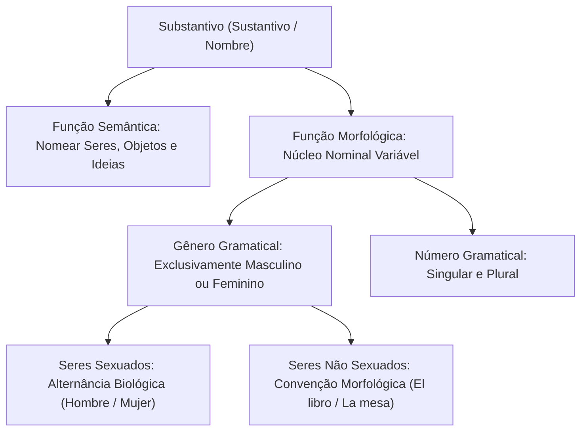
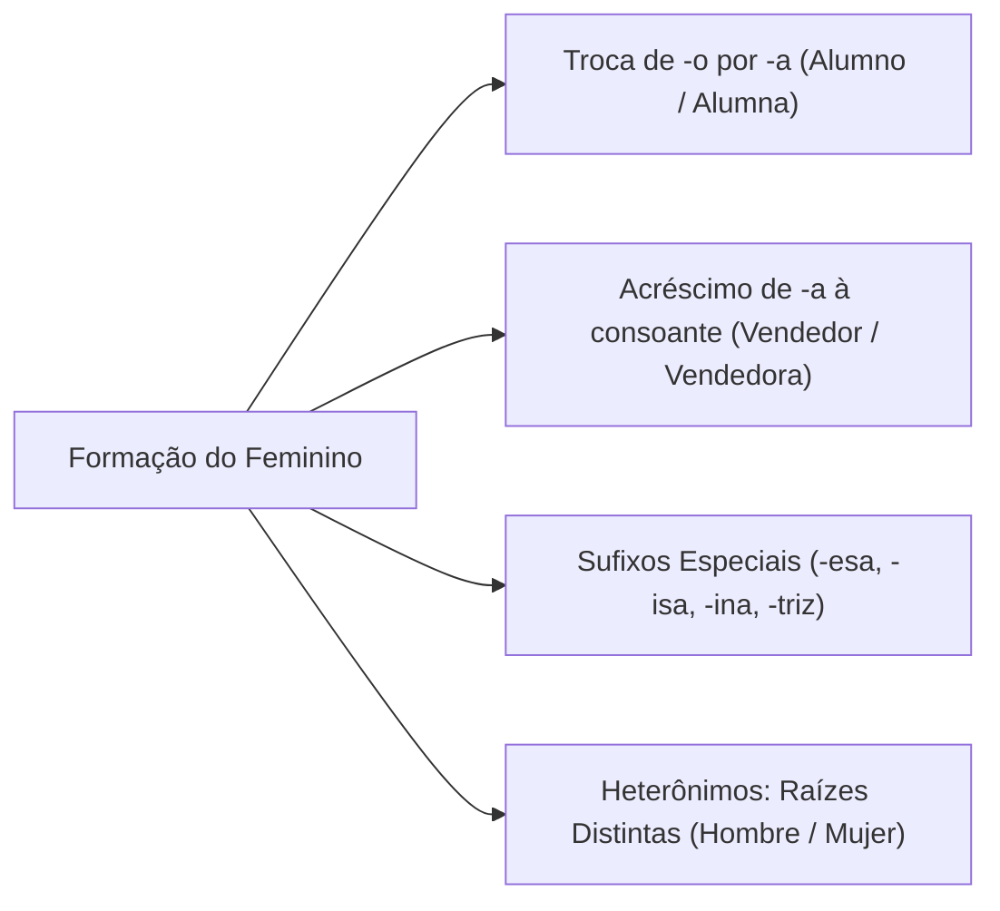
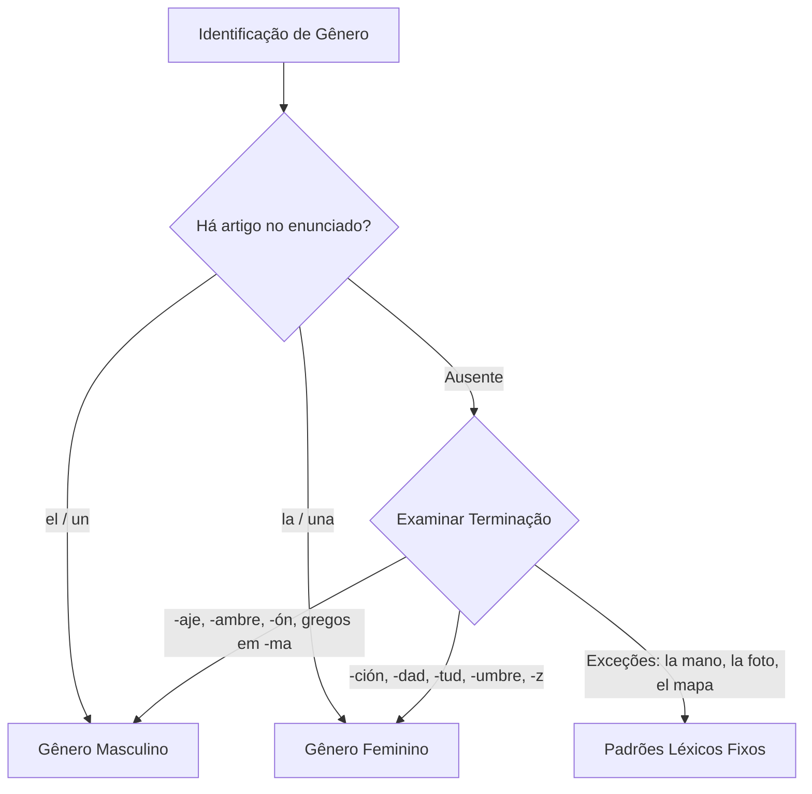
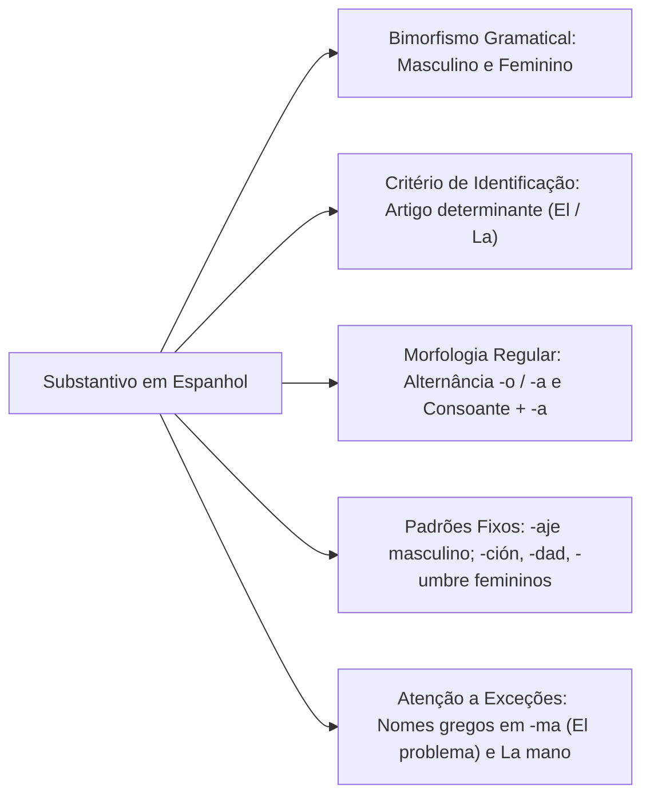

O domínio das classes de palavras em língua espanhola constitui a base fundamental para a interpretação de textos jornalísticos e documentos institucionais cobrados nos concursos. Ao iniciar os estudos desta disciplina, esperamos capacitar o estudante a aprender a estrutura morfossintática do idioma de forma analítica e objetiva.

Entre as categorias gramaticais, o substantivo assume papel preponderante como núcleo das funções sintáticas de sujeito e complementos verbais. Compreender como os termos variam em gênero permite identificar nuances semânticas e evitar erros comuns decorrentes de semelhanças superficiais com o português.

> [!objetivos]
> - Compreender a função morfossintática e semântica do substantivo em língua espanhola.
> - Dominar as regras fundamentais de flexão de gênero e identificação de desinências nominais.
> - Reconhecer os padrões morfológicos típicos que determinam o gênero masculino e feminino.
> - Identificar exceções morfológicas frequentes cobradas em provas de concursos públicos.

## Palavras Iniciais e o Papel do Substantivo na Leitura

O substantivo constitui a classe gramatical central de qualquer enunciado. Em língua espanhola, essa classe recebe o nome de *sustantivo* ou *nombre*. Sua função primária consiste em nomear seres vivos, entidades inanimadas, lugares, conceitos abstratos, sensações e ideias.

Nas provas de concurso, o examinador avalia a habilidade de compreender textos jornalísticos e legislações aplicadas. Por exemplo, notícias internacionais mencionando figuras políticas como Donald Trump ou relatórios policiais com orações como "el perro atacó al sospechoso" exigem identificar o agente da ação verbal. Identificar com agilidade a classe dos substantivos e suas relações de dependência nominal assegura interpretação precisa.

A tradição gramatical espanhola reconhece como classes de palavras os artigos (*artículos*), substantivos (*sustantivos* ou *nombres*), adjetivos (*adjetivos*), pronomes (*pronombres*), verbos (*verbos*), advérbios (*adverbios*), preposições (*preposiciones*) e conjunções (*conjunciones*). Categorias tratadas como classes autônomas no português, a exemplo de numerais e interjeições (*interjecciones*), são integradas em outras classes pela Real Academia Española.

A língua espanhola organiza seus substantivos exclusivamente em dois gêneros gramaticais: masculino e feminino. Não existe substantivo neutro na morfologia espanhola. O elemento neutro no idioma restringe-se a pronomes demonstrativos invariáveis (*esto, eso, aquello*) e ao artigo neutro *lo*. Portanto, todo substantivo pertence ao domínio masculino ou ao feminino.

## Identificação pelo Artigo e Estrutura Nominal

Quando o substantivo apresenta terminação ambígua ou idêntica em ambos os gêneros, o determinante que o acompanha torna-se o indicador definitivo do gênero gramatical. Se há um artigo diante de uma palavra, ela funciona como núcleo nominal, pois o artigo existe para determinar ou indeterminar o substantivo.

Os artigos definidos espanhóis são:
- *El* para o masculino singular (*el contenido, el dispositivo, el origen*).
- *Los* para o masculino plural (*los contenidos, los dispositivos*).
- *La* para o feminino singular (*la velocidad, la versión, la hamburguesa*).
- *Las* para o feminino plural (*las velocidades, las versiones*).

Os artigos indefinidos complementam essa marcação:
- *Un* para o masculino singular (*un dispositivo moderno*).
- *Unos* para o masculino plural (*unos libros*).
- *Una* para o feminino singular (*una versión actualizada*).
- *Unas* para o feminino plural (*unas casas*).

> [!bizu]
> Ao encontrar um termo desconhecido na frase, observe imediatamente o artigo ou pronome que o antecede. Se a palavra for acompanhada por *el* ou *un*, trata-se de termo masculino. Se vier precedida de *la* ou *una*, trata-se de termo feminino. Esse critério prático desfaz dúvidas imediatas de leitura.

Para além dos artigos, pronomes demonstrativos (*este, ese, aquel*) e adjetivos fornecem pistas lexicais complementares. A concordância sintática em espanhol exige harmonia estrita em gênero e número entre o substantivo e seus satélites imediatos.

## Regras Gerais de Formação do Feminino

A oposição entre masculino e feminino opera por meio de mecanismos morfológicos regulares que abrangem a modificação de vogais finais, o acréscimo de desinências consonantais e a inserção de sufixos derivacionais.

### Substantivos Terminados em -o no Masculino

A regra mais produtiva na língua converte a desinência *-o* do masculino na desinência *-a* no feminino. Essa alteração é padrão para a grande maioria dos nomes referentes a seres humanos e animais:

- *El niño* → *La niña*
- *El hermano* → *La hermana*
- *El perro* → *La perra*
- *El gato* → *La gata*
- *El cocinero* → *La cocinera* (o cozinheiro / a cozinheira)
- *El enfermero* → *La enfermera*
- *El ingeniero* → *La ingeniera*
- *El alumno* → *La alumna*

Essa alternância direta ocorre com alta previsibilidade. O candidato falante de português reconhece facilmente essa regra pelo paralelismo funcional com o idioma materno.

### Substantivos Terminados em Consoante no Masculino

Quando o substantivo masculino termina em consoante, a regra geral determina o acréscimo da desinência *-a* para construir a forma feminina:

- *El profesor* → *La profesora*
- *El escritor* → *La escritora*
- *El león* → *La leona*
- *El jugador* → *La jugadora*
- *El doctor* → *La doctora*
- *El vendedor* → *La vendedora*
- *El español* → *La española*
- *El inglés* → *La inglesa*

Note que, na palavra *el león*, o acento gráfico desaparece na forma feminina *la leona*. Essa mudança decorre da regra fonética de acentuação: *león* é oxítona terminada em -n, enquanto *leona* passa a ser paroxítona terminada em vogal.

### Substantivos com Sufixos Especiais

Determinados substantivos femininos formam-se por meio de sufixos derivacionais característicos (*-esa, -isa, -ina, -triz*):

| Sufixo Feminino | Exemplo Masculino | Exemplo Feminino | Tradução |
| :--- | :--- | :--- | :--- |
| **-esa** | *el príncipe* | *la princesa* | o príncipe / a princesa |
| **-esa** | *el conde* | *la condesa* | o conde / a condessa |
| **-esa** | *el duque* | *la duquesa* | o duque / a duquesa |
| **-isa** | *el poeta* | *la poetisa* | o poeta / a poetisa |
| **-isa** | *el sacerdote* | *la sacerdotisa* | o sacerdote / a sacerdotisa |
| **-ina** | *el héroe* | *la heroína* | o herói / a heroína |
| **-ina** | *el rey* | *la reina* | o rei / a rainha |
| **-triz** | *el actor* | *la actriz* | o ator / a atriz |
| **-triz** | *el emperador* | *la emperatriz* | o imperador / a imperatriz |

> [!atencao]
> Embora a forma tradicional feminina de *poeta* seja *poetisa*, a Real Academia Española aceita atualmente a construção *la poeta*. Em provas formais, ambas as formas são consideradas corretas, prevalecendo a forma sufixada *poetisa* quando a questão aborda regras históricas de derivação.

## Substantivos Heterônimos

Denominam-se heterônimos os substantivos que empregam vocábulos com raízes lexicais totalmente distintas para distinguir seres masculinos e femininos. Nesses vocábulos, a distinção não é morfológica, mas lexical:

- *El hombre* (o homem) / *La mujer* (a mulher)
- *El padre* (o pai) / *La madre* (a mãe)
- *El yerno* (o genro) / *La nuera* (a nora)
- *El padrastro* (o padrasto) / *La madrastra* (a madrasta)
- *El caballo* (o cavalo) / *La yegua* (a égua)
- *El toro* (o touro) / *La vaca* (a vaca)
- *El carnero* (o carneiro) / *La oveja* (a ovelha)
- *El macho* (o macho) / *La hembra* (a fêmea)

O reconhecimento dos heterônimos é imediato para o leitor brasileiro devido à proximidade de origem latina. O destaque principal fica para o termo *yerno*, equivalente ao português genro.

## Padrões Morfológicos e Tendências de Gênero

A identificação do gênero em substantivos referentes a seres inanimados e conceitos abstratos obedece a tendências morfológicas claras. Conhecer essas terminações assegura velocidade na resolução das questões.

### Padrões Típicos do Gênero Masculino

Pertencem ao gênero masculino em espanhol a maioria dos vocábulos enquadrados nas seguintes categorias:

- **Substantivos terminados em -aje:** Todos os substantivos abstratos ou coletivos com essa terminação são masculinos: *el viaje, el pasaje, el equipaje, el paisaje, el coraje, el mensaje, el garaje, el chantaje, el aprendizaje*.
- **Substantivos terminados em -ambre:** *el enjambre, el alambre, el calambre*.
- **Substantivos terminados em consoantes -l, -n, -r, -ón:** *el canal, el nivel, el jardín, el tren, el trabajo, el ordenador, el balón, el ratón, el buzón*.
- **Dias da semana:** *el lunes, el martes, el miércoles, el jueves, el viernes, el sábado, el domingo*.
- **Meses do ano:** *el enero, el febrero, el marzo, el abril*, etc.
- **Pontos cardeais:** *el norte, el sur, el este, el oeste*.
- **Rios, lagos, mares e montanhas:** *el Amazonas, el Ebro, el Plata, el Titicaca, el Atlántico, los Andes*.
- **Números e cores substantivadas:** *el uno, el dos, el diez, el azul, el rojo, el verde*.
- **Nomes de árvores frutíferas:** *el manzano, el naranjo, el cerezo*.

> [!esquema]
> **Padrões Masculinos Fundamentais:**
> - Terminação em **-AJE** → SEMPRE MASCULINO (*el viaje, el coraje, el mensaje*).
> - Terminação em **-AMBRE** → SEMPRE MASCULINO (*el enjambre, el alambre*).
> - Terminação em **-ÓN** → MASCULINO (*el balón, el ratón*).
> - Geografia e Calendário → MASCULINO (*el Titicaca, el martes, el norte*).

### Padrões Típicos do Gênero Feminino

Pertencem habitualmente ao gênero feminino em língua espanhola os substantivos que atendem aos seguintes critérios:

- **Substantivos terminados em -ción e -sión:** *la nación, la canción, la educación, la información, la tradición, la missão, la decisión, la televisión, la conexión*.
- **Substantivos terminados em -dad e -tad:** *la verdad, la ciudad, la realidad, la bondad, la libertad, la facultad, la lealtad*.
- **Substantivos terminados em -tud:** *la juventud, la virtud, la actitud, la gratitud, la quietud*.
- **Substantivos terminados em -umbre:** *la costumbre, la cumbre, la incertidumbre, la muchedumbre*.
- **Substantivos terminados em -z:** *la luz, la paz, la cruz, la voz, la vejez*.
- **Nomes de frutas:** A maioria das frutas é feminina (*la manzana, la naranja, la cereza, la pera, la uva*), contrastando com as árvores masculinas (*el manzano, el naranjo*).
- **Nomes das letras do alfabeto:** *la a, la be, la ce, la de, la efe, la hache, la jota, la zeta*.
- **Nomes de ilhas e cidades em -a:** *las Baleares, Mallorca, Sevilla, Málaga*.
- **Vocabulário de tecnologia moderna:** vocábulos femininos como *la versión digital* e masculinos como *el dispositivo móvil* (*los móviles*).

| Terminação | Gênero | Exemplos em Espanhol | Significado em Português |
| :--- | :--- | :--- | :--- |
| **-aje** | Masculino | *el viaje, el mensaje, el garaje* | a viagem, a mensagem, a garagem |
| **-ambre** | Masculino | *el alambre, el enjambre* | o arame, o enxame |
| **-ón** | Masculino | *el balón, el buzón, el ratón* | a bola, a caixa de correio, o rato |
| **-ción / -sión** | Feminino | *la función, la educación, la misión* | a função, a educação, a missão |
| **-dad / -tad** | Feminino | *la ciudad, la verdad, la libertad* | a cidade, a verdade, a liberdade |
| **-tud** | Feminino | *la actitud, la juventud, la virtud* | a atitude, a juventude, a virtude |
| **-umbre** | Feminino | *la costumbre, la cumbre, la muchedumbre* | o costume, o cume, a multidão |
| **-z** | Feminino | *la luz, la paz, la voz, la nariz* | a luz, a paz, a voz, o nariz |

## Exceções Relevantes e Heterogenéricos Iniciais

O estudante precisa atentar para palavras cujas terminações contrariam a regra aparente. O examinador explora sistematicamente termos masculinos em *-a* e femininos em *-o*.

### Palavras de Origem Grega em -ma, -pa e -ta

Diversos substantivos procedentes do grego clássico que terminam em *-ma*, *-pa* ou *-ta* possuem gênero masculino. O falante nativo de português tende a classificá-los como femininos pela terminação vocal:

- *El problema* (o problema)
- *El tema* (o tema)
- *El sistema* (o sistema)
- *El programa* (o programa)
- *El drama* (o drama)
- *El clima* (o clima)
- *El idioma* (o idioma)
- *El poema* (o poema)
- *El dilema* (o dilema)
- *El esquema* (o esquema)
- *El síntoma* (o sintoma)
- *El planeta* (o planeta)
- *El cometa* (o cometa)
- *El mapa* (o mapa)
- *El día* (o dia)

> [!pegadinha]
> A palavra *mapa* termina em *-a*, mas é masculina: dizemos *el mapa topográfico*. O mesmo ocorre com *el planeta Tierra* e *el clima templado*. Nunca use artigos femininos diante desses substantivos.

### Palavras Femininas Terminadas em -o

Um grupo reduzido de substantivos femininos termina na vogal *-o*. Muitas dessas palavras constituem abreviações consolidadas:

- *La mano* (a mão): termo feminino herdado do étimo latino.
- *La foto* (redução de *la fotografía*).
- *La moto* (redução de *la motocicleta*).
- *La radio* (redução de *la radiodifusión* ou *la radioemisora*).
- *La dinamo* (a dínamo).

### Noção Preliminar de Heterogenéricos

Substantivos heterogenéricos possuem gêneros gramaticais opostos entre o espanhol e o português. Vocábulos cotidianos evidenciam essa disparidade:

- *El origen* (masculino em espanhol) corresponde a *a origem* (feminino em português).
- *La hamburguesa* (feminino em espanhol) traduz-se com frequência por *o hambúrguer* (masculino em português).
- *El puente* (masculino) equivale a *a ponte* (feminino).
- *La sangre* (feminino) traduz-se por *o sangue* (masculino).

Ao redigir ou traduzir enunciados, o candidato deve manter a concordância coerente com as regras internas de cada idioma.

## O Substantivo nas Provas de Concurso

Nas provas, as questões sobre substantivos e flexão de gênero exploram frequentemente artigos jornalísticos contemporâneos. Ao analisar trechos de publicações de circulação global, como reportagens originadas em Nova York (*The New York Times*), o candidato depara-se com vocabulário moderno que inclui termos técnicos como *diseño responsive* e referências ao *despliegue* de forças de segurança.

Quando você lê com atenção cada frase (*cuando lees el texto*), a identificação imediata das classes de palavras impede que você tenha dúvidas conceituais (*para que no tengas dudas*). O domínio morfológico assegura que a estrutura sintática facilite a compreensão global da mensagem. Esse conhecimento evita que os candidatos parem diante de estruturas complexas ou troquem os gêneros de palavras usuais como *la jugadora*, *la vendedora* ou vocábulos invariáveis como *el imbécil* e *la imbécil*.

As questões de concurso costumam estruturar-se em torno de três dinâmicas centrais:

1. **Substituição de vocábulos e concordância:** O enunciado propõe a troca de um substantivo por outro termo sinônimo, exigindo o ajuste obrigatório dos artigos e adjetivos adjacentes para preservar a correção gramatical.
2. **Identificação de discrepâncias morfológicas:** Apresentam-se fragmentos adaptados de notícias em que o gênero do substantivo e seus determinantes entram em aparente contradição (*el mapa hidrográfico*, *el problema social*).
3. **Análise contrastiva com o português:** O examinador seleciona vocábulos heterogenéricos para induzir o candidato desatento a aplicar as regras de gênero do português em enunciados da língua espanhola.

Dominar as desinências regulares, os padrões morfológicos consolidados e as exceções garante agilidade na prova. Esse preparo técnico converte o bloco de língua estrangeira em pontuação decisiva na classificação final.

## Mapa do capítulo

### Para fixar

- O substantivo em língua espanhola organiza-se estritamente nos gêneros masculino e feminino, sem categoria neutra nominal.
- A formação regular do feminino converte o *-o* em *-a* ou adiciona *-a* às palavras terminadas em consoante.
- Sufixos femininos especiais como *-esa*, *-isa*, *-ina* e *-triz* formam vocábulos como *princesa, heroína* e *actriz*.
- Heterônimos distinguem o sexo por meio de radicais distintos, a exemplo de *hombre/mujer, toro/vaca, yerno/nuera*.
- Vocábulos terminados no sufixo *-aje* são sistematicamente masculinos (*el viaje, el coraje, el mensaje*).
- Substantivos terminados em *-ción, -sión, -dad, -tad, -tud, -umbre* e *-z* pertencem ao gênero feminino.
- Palavras de raiz grega terminadas em *-ma, -pa* e *-ta* são masculinas (*el problema, el planeta, el mapa*).
- O artigo que acompanha o substantivo funciona como o critério mais seguro para identificar o gênero em textos de provas.
