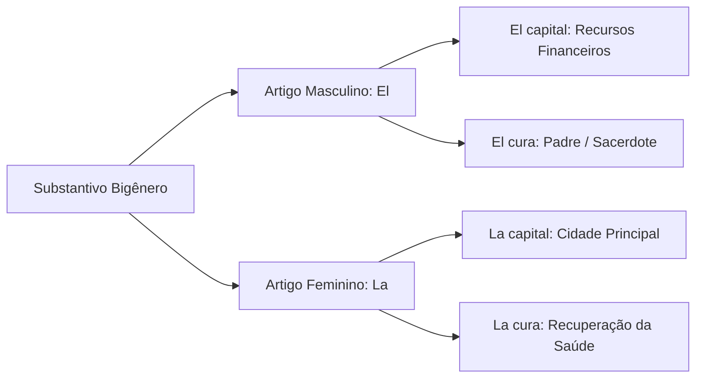
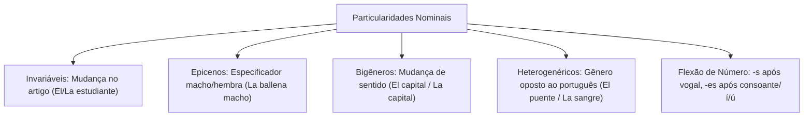

O estudo das particularidades de gênero e número em língua espanhola revela aspectos contrastivos essenciais para a interpretação textual. As divergências gramaticais em relação ao português costumam constituir o foco predileto das bancas de concurso.

Identificar a variação de significado provocada pela alternância de artigos e compreender a morfologia do plural evitam equívocos em questões interpretativas. Este capítulo sistematiza os substantivos invariáveis, epicenos, bigêneros, heterogenéricos e as regras de flexão de número.

> [!objetivos]
> - Diferenciar substantivos invariáveis, epicenos e bigêneros quanto à forma e ao significado.
> - Dominar a lista dos principais substantivos heterogenéricos e suas equivalências no português.
> - Aplicar com precisão as regras de formação do número singular e plural em espanhol.
> - Classificar os substantivos segundo seus critérios semânticos, derivacionais e estruturais.

## Substantivos Invariáveis, Epicenos e Bigêneros

A flexão de gênero apresenta comportamentos sintáticos específicos segundo a relação entre a palavra e o referente real.

### Substantivos Invariáveis

Substantivos invariáveis mantêm uma única forma para ambos os sexos. A marcação de gênero ocorre pelo artigo determinante:

- *El artista* / *La artista*
- *El cónyuge* / *La cónyuge*
- *El dentista* / *La dentista*
- *El estudiante* / *La estudiante*
- *El socialista* / *La socialista*
- *El policía* / *La policía*

### Substantivos Epicenos

Os substantivos epicenos possuem gênero fixo para nomear animais de ambos os sexos. Para explicitar se o animal é macho ou fêmea, acrescentam-se os termos *macho* ou *hembra*:

- *El cocodrilo macho* / *El cocodrilo hembra* (o crocodilo macho / fêmea)
- *El mosquito macho* / *El mosquito hembra* (o mosquito macho / fêmea)
- *La ballena macho* / *La ballena hembra* (a baleia macho / fêmea)
- *La tortuga macho* / *La tortuga hembra* (a tartaruga macho / fêmea)
- *La perdiz macho* / *La perdiz hembra* (a perdiz macho / fêmea)

O artigo permanece inalterado: usa-se *la ballena macho*, preservando o gênero gramatical feminino do substantivo.

### Substantivos Bigêneros

Denominam-se bigêneros os substantivos que mudam de significado conforme o gênero do artigo:

| Vocábulo | Masculino (*El*) | Feminino (*La*) |
| :--- | :--- | :--- |
| **capital** | *El capital* (dinheiro, patrimônio) | *La capital* (cidade sede administrativa) |
| **cometa** | *El cometa* (corpo celeste) | *La cometa* (brinquedo voador, pipa) |
| **cura** | *El cura* (sacerdote, padre) | *La cura* (ato de sarar, remédio) |
| **orden** | *El orden* (organização, sequência) | *La orden* (mandato, preceito) |
| **frente** | *El frente* (linha de combate militar) | *La frente* (testa anatômica) |
| **corte** | *El corte* (incisão física, golpe) | *La corte* (tribunal, corte real) |
| **margen** | *El margen* (espaço em branco) | *La margen* (orla de rio) |
| **parte** | *El parte* (comunicado oficial) | *La parte* (fração, pedaço) |
| **barba** | *El barba* (ator de ancião) | *La barba* (pelos faciais) |

## Substantivos Heterogenéricos

Os heterogenéricos constituem um dos temas mais recorrentes nas provas de concurso. Trata-se de vocábulos que possuem gêneros gramaticais divergentes entre o espanhol e o português.

> [!atencao]
> Nos substantivos heterogenéricos, o gênero não se deduz pela terminação em português. Ao traduzir mentalmente, o candidato desatento erra a concordância dos adjetivos e pronomes no texto em espanhol.

Principais substantivos masculinos em espanhol que são femininos em português:
- *El aguardiente* (a aguardente)
- *El color* (a cor)
- *El dolor* (a dor)
- *El puente* (a ponte)
- *El árbol* (a árvore)
- *El origen* (a origem)
- *El viaje* (a viagem)
- *El mensaje* (a mensagem)
- *El desorden* (a desordem)

Principais substantivos femininos em espanhol que são masculinos em português:
- *La baraja* (o baralho)
- *La cárcel* (o cárcere / a prisão)
- *La leche* (o leite)
- *La miel* (o mel)
- *La sangre* (o sangue)
- *La sonrisa* (o sorriso)
- *La señal* (o sinal)
- *La sal* (o sal)
- *La nariz* (o nariz)
- *La costumbre* (o costume)

## Número dos Substantivos

A flexão de número distingue o singular e o plural. O exame das regras morfológicas estabelecidas na gramática oficial evidencia critérios estritos de formação:

1. **Acréscimo de -s:** Emprega-se quando o substantivo termina em vogal átona ou em vogais tônicas *-á*, *-é*, *-ó*:
   - *Café* → *Cafés*
   - *Coche* → *Coches*
   - *Hombre* → *Hombres*
   - *Mesa* → *Mesas*
   - *Policía* → *Policías*

2. **Acréscimo de -es:** Aplica-se quando o substantivo termina em consoante ou nas vogais tônicas *-í* e *-ú*:
   - *Azul* → *Azules*
   - *Mes* → *Meses*
   - *Mujer* → *Mujeres*
   - *Televisión* → *Televisiones*
   - *Verdad* → *Verdades*
   - *Jabalí* → *Jabalíes* (admite-se também *jabalís*)
   - *Bambú* → *Bambúes* (admite-se também *bambús*)

3. **Substantivos terminados em -z:** Troca-se a consoante *-z* por *-ces* no plural:
   - *Pez* → *Peces*
   - *Lápiz* → *Lápices*
   - *Voz* → *Voces*
   - *Luz* → *Luces*

4. **Substantivos invariáveis no plural:** Palavras paroxítonas ou proparoxítonas terminadas na consoante *-s* não alteram sua forma gráfica no plural. A distinção de número é feita exclusivamente pelos artigos ou determinantes acompanhantes:
   - *El martes* → *Los martes*
   - *La crisis* → *Las crisis*
   - *La hipótesis* → *Las hipótesis*
   - *El ómnibus* → *Los ómnibus*

> [!bizu]
> Observe a regra do plural para palavras terminadas em *-s*: vocábulos oxítonos recebem *-es* (*el mes / los meses*, *el compás / los compases*). Já os termos não oxítonos permanecem invariáveis (*la crisis / las crisis*).

## Classificações Semânticas e Estruturais

A gramática normativa organiza os substantivos segundo o significado, a estrutura dos radicais e os processos de derivação:

- **Próprios e comuns:** Próprios individualizam seres ou lugares específicos (*Barcelona, España, Pablo, Perú*). Comuns designam seres da mesma espécie de forma genérica (*mujer, perro, coche, estante*).
- **Concretos e abstratos:** Concretos nomeiam seres de existência autônoma real ou imaginária (*gato, árbol, fantasma*). Abstratos indicam sensações, qualidades, noções morais ou ações dependentes (*amistad, belleza, nostalgia, verdad*).
- **Simples e compostos:** Simples apresentam um único radical morfológico (*luna, ojo, coche*). Compostos reúnem dois ou mais radicais (*abrelatas, pararrayos, salvoconducto*).
- **Primitivos e derivados:** Primitivos não provêm de outra palavra espanhola (*pan, sal, tinta, carta*). Derivados surgem por mecanismos de afixação (*panadero, salero, tintero, cartero*).
- **Individuais e coletivos:** Individuais designam um único ser no singular. Coletivos designam conjuntos no singular: *enjambre* (abelhas), *jauría* (matilha), *muchedumbre* (multidão) e *rebaño* (rebanho de ovelhas).

## Mapa do capítulo

### Para fixar

- Substantivos invariáveis conservam a mesma terminação para ambos os sexos, alterando apenas o artigo (*el/la dentista*).
- Epicenos nomeiam animais com gênero gramatical fixo e exigem os termos *macho* ou *hembra* para distinguir o sexo.
- Bigêneros mudam de sentido conforme o artigo antecedente, a exemplo de *el capital* (dinheiro) e *la capital* (cidade).
- Substantivos terminados em *-a* de raiz grega como *el clima, el planeta, el mapa* conservam gênero masculino.
- Heterogenéricos apresentam gênero inverso ao português: *el dolor, el puente* (masculinos) e *la sangre, la leche, la miel* (femininos).
- O plural regular acrescenta *-s* após vogais átonas e *-es* após consoantes ou vogais tônicas *-í* e *-ú*.
- Substantivos terminados em *-z* convertem a terminação em *-ces* no plural (*el lápiz / los lápices*).
- Palavras não oxítonas terminadas em *-s* mantêm a mesma forma no plural, distinguindo-se pelo artigo (*la crisis / las crisis*).
