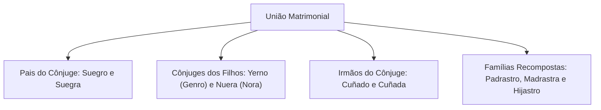
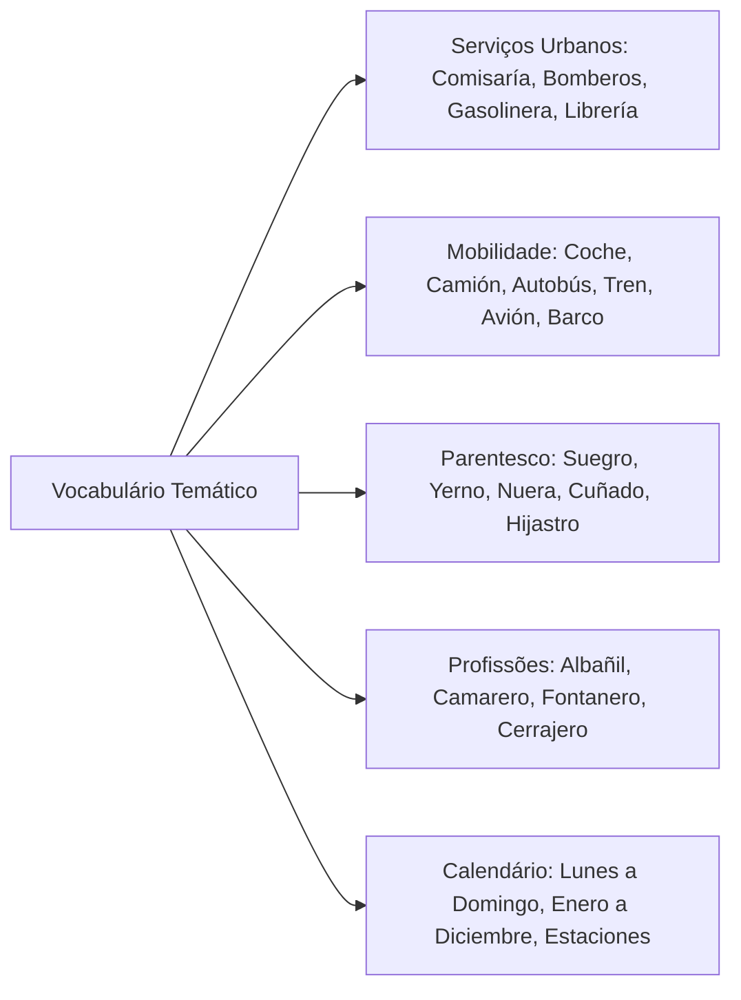

O conhecimento do vocabulário temático em língua espanhola constitui instrumento decisivo para a compreensão global de textos em provas de concurso. As bancas examinadoras formulam questões interpretativas baseadas em crônicas, reportagens e narrativas do cotidiano social.

Dominar os campos lexicais de serviços públicos, mobilidade urbana, relações de parentesco e marcadores cronológicos assegura fluidez na leitura. Este capítulo consolida os substantivos mais frequentes nesses domínios, destacando termos que exigem atenção dos candidatos falantes de português.

> [!objetivos]
> - Reconhecer os substantivos relativos a estabelecimentos comerciais, serviços públicos e segurança.
> - Dominar a terminologia dos meios de transporte e mobilidade urbana em língua espanhola.
> - Identificar as designações de parentesco, profissões e tonalidades cromáticas.
> - Empregar os marcadores cronológicos referentes a dias da semana, meses e estações do ano.

## Estabelecimentos de Comércio, Serviços e Transportes

O repertório lexical de cidades e serviços reúne vocábulos transparentes e termos específicos que demandam distinção precisa. Cognatos diretos incluem termos como *banco, bar, cine, escola, estádio, fábrica, hotel, museo, restaurante, supermercado, teatro* e *universidad*.

Outros vocábulos designam órgãos públicos essenciais e estabelecimentos comerciais urbanos. No âmbito da segurança pública e do atendimento comunitário, destacam-se *comisaría* (delegacia de polícia), *bomberos* (corpo de bombeiros) e *policía* (corporação policial). No setor de serviços privados e utilidades cotidianas, figuram *aeropuerto* (aeroporto), *carnicería* (açougue), *peluquería* (salão de cabeleireiro), *cementerio* (cemitério), *correo* (agência postal), *bufete de abogados* (escritório de advocacia), *floristería* (floricultura), *panadería* (padaria), *gasolinera* (posto de combustíveis) e *zapatería* (sapataria).

> [!atencao]
> Observe o par contrastivo entre *librería* e *biblioteca*. Em língua espanhola, *librería* designa a loja comercial de livros, enquanto *biblioteca* refere-se à instituição pública ou privada destinada à consulta e empréstimo de acervos.

No segmento de mobilidade e logística, os meios de transporte dividem-se conforme o modal de locomoção:

| Modal de Transporte | Termos em Espanhol | Equivalente em Português |
| :--- | :--- | :--- |
| **Rodoviário Urbano** | *autobús, coche, camión, furgoneta, taxi, moto* | ônibus, carro, caminhão, furgão, táxi, moto |
| **Ferroviário** | *tren, tranvía, metro* | trem, bonde, metrô |
| **Aéreo** | *avión, avioneta, helicóptero, globo, cohete* | avião, monomotor, helicóptero, balão, foguete |
| **Marítimo e Fluvial** | *barco, buque, barca, crucero, velero, yate, submarino* | navio, embarcação militar, barco, cruzeiro, veleiro, iate, submarino |

## Relações Familiares, Cores e Ocupações Profissionais

A designação de pessoas em contextos narrativos organiza-se em torno das estruturas de parentesco, características visuais e funções profissionais.

O núcleo familiar divide-se em linhas consanguíneas diretas e laços de afinidade. Na linha direta dos antepassados (*antepasados*), figuram *padre/madre* (pais), *hijo/hija* (filho e filha) e *hermano/hermana* (irmãos). Incluem-se ainda *abuelo/abuela* (avós), *bisabuelo/bisabuela* (bisavós) e *tatarabuelo/tatarabuela* (tataravô e tataravó). Para a descendência, usam-se *nieto/nieta* (netos). 

O parentesco por casamento compreende termos fundamentais para provas: *suegro/suegra* (sogro e sogra), *yerno* (genro), *nuera* (nora) e *cuñado/cuñada* (cunhado e cunhada). Em famílias recompostas, utilizam-se *padrastro/madrastra* (padrasto/madrasta) e *hijastro/hijastra* (enteado/enteada).

O campo das cores reúne termos como *amarillo* (amarelo), *azul*, *azul marino* (marinho), *blanco* (branco), *dorado* (dourado), *gris* (cinza), *marrón* (marrom/castanho), *negro* (preto), *rojo* (vermelho) e *verde*. 

No domínio das profissões mais comuns exigidas em editais de concurso, o vocabulário abrange ofícios variados: *médico*, *pediatra*, *chofer*, *mecánico*, *pintor*, *abogado* (advogado), *albañil* (pedreiro), *camarero* (garçom), *cerrajero* (chaveiro), *plomero* ou *fontanero* (encanador), *basurero* (gari), *limpiabotas* (engraxate), *pasante* (estagiário), *asistenta* (faxineira) e *salvavidas* (guarda-vidas). Note a existência de sinônimos regionais como *plomero* na América e *fontanero* na Espanha.

## Referências Cronológicas: Dias, Meses e Estações

A localização temporal de fatos narrados e dados estatísticos requer domínio dos nomes do calendário hispânico. Todos os dias da semana e meses do ano pertencem ao gênero gramatical masculino.

Os dias da semana procedem de antigas referências a divindades e astros planetários:
- *El lunes* (segunda-feira)
- *El martes* (terça-feira)
- *El miércoles* (quarta-feira)
- *El jueves* (quinta-feira)
- *El viernes* (sexta-feira)
- *El sábado* (sábado)
- *El domingo* (domingo)

Os meses do ano mantêm proximidade evidente com o português: *enero, febrero, marzo, abril, mayo, junio, julio, agosto, septiembre, octubre, noviembre, diciembre*. As quatro estações climáticas (*las estaciones del año*) dividem-se em: *el verano* (verão), *el otoño* (outono), *el invierno* (inverno) e *la primavera* (primavera). Observe que, enquanto a primavera é feminina, o verão, o outono e o inverno são substantivos masculinos em espanhol.

> [!bizu]
> Ao contrário do português, em língua espanhola os dias da semana e os meses do ano grafam-se com letra inicial minúscula, salvo no início absoluto de frases ou títulos (*el próximo lunes visitaremos el museo en mayo*).

## Mapa do capítulo

### Para fixar

- O termo *librería* designa o estabelecimento comercial de venda de livros, ao passo que *biblioteca* indica acervo público.
- No serviço público de emergência, destacam-se os termos *comisaría* (delegacia) e *bomberos* (bombeiros).
- Nos meios de transporte, diferenciam-se veículos terrestres (*coche, camión*), ferroviários (*tren, tranvía*) e fluviais (*buque, velero*).
- O parentesco por casamento apresenta termos específicos como *yerno* (genro), *nuera* (nora) e *suegro* (sogro).
- Nas profissões, termos como *albañil* (pedreiro), *camarero* (garçom) e *fontanero* (encanador) são frequentemente exigidos.
- Os dias da semana em espanhol são todos masculinos e iniciam-se no *lunes* (segunda-feira).
- As estações do ano incluem *el verano, el otoño, el invierno* (masculinos) e *la primavera* (feminina).
- Dias e meses grafam-se habitualmente com iniciais minúsculas no padrão ortográfico culto do espanhol.
