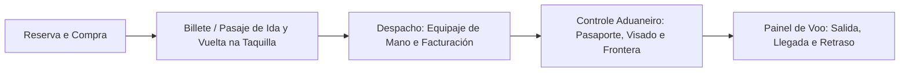
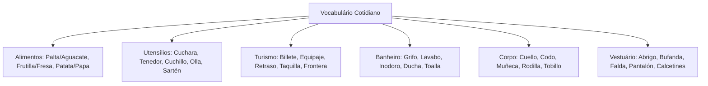

O conhecimento lexical de objetos concretos, alimentos, viagens e corpo humano é decisivo para a compreensão de textos narrativos e descritivos em provas de concurso. A banca examinadora costuma selecionar passagens literárias ou crônicas jornalísticas ricas em vocabulário cotidiano e expressões regionais.

Compreender as variações geográficas de vocábulos hispânicos e os falsos amigos lexicais confere segurança ao candidato. Este capítulo sistematiza o vocabulário temático essencial de alimentos, culinária, turismo, ambiente doméstico, anatomia e vestuário, destacando as variantes mais cobradas em provas.

> [!objetivos]
> - Identificar o vocabulário essencial de frutas, verduras, leguminosas e condimentos.
> - Dominar os termos de utensílios culinários e o léxico aplicado a viagens e hospedagem.
> - Conhecer as designações de objetos domésticos de higiene e partes do corpo humano.
> - Reconhecer as peças de vestuário e suas variantes lexicais na Espanha e na América Hispânica.

## Frutas, Verduras, Legumes e Utensílios de Cozinha

O vocabulário da alimentação apresenta ampla riqueza sinonímica e marcada variação diatópica entre a Espanha e os países latino-americanos. No campo das frutas, destacam-se termos com duplas denominações correntes: *aguacate* ou *palta* (abacate), *piña* ou *ananás* (abacaxi), *plátano* ou *banana* (banana), *papaya* ou *mamón* (mamão), *fresa* ou *frutilla* (morango) e *melocotón* ou *durazno* (pêssego). O repertório das frutas inclui ainda *sandía* (melancia), *melón* (melão), *pera* (pera), *ciruela* (ameixa), *cereza* (cereja), *limón* (limão), *manzana* (maçã) e *uva*.

Entre as verduras, hortaliças e leguminosas, figuram *pepino*, *soja* (soja), *berenjena* (berinjela), *calabaza* ou *zapallo* (abóbora), *cebolla* (cebola), *espinaca* (espinafre), *lechuga* (alface), *zanahoria* (cenoura), *remolacha* (beterraba) e *yuca* (mandioca). A batata denomina-se *patata* na Espanha e *papa* na América. As ervilhas chamam-se *guisantes* ou *arvejas*, enquanto os feijões recebem os nomes de *judías, alubias, porotos* ou *frijoles*. Os condimentos habituais compreendem *ajo* (alho), *perejil* (salsinha), *cilantro* (coentro) e *pimienta* (pimenta).

Na cozinha e à mesa, o candidato deve dominar os utensílios, recipientes e pratos (*plato hondo* para sopa e *plato llano* ou *plato raso* para refeição seca):

| Categoria de Utensílio | Termo em Espanhol | Tradução ao Português |
| :--- | :--- | :--- |
| **Talheres (*cubiertos*)** | *cuchara, tenedor, cuchillo, cucharón* | colher, garfo, faca, concha de sopa |
| **Recipientes de Cozimento** | *olla, sartén, cazuela* | panela, frigideira, caçarola |
| **Acessórios de Mesa** | *plato, vaso, copa, servilleta, cuenco* | prato, copo, taça, guardanapo, tigela |
| **Acessórios de Abertura** | *abrelatas, sacacorchos, salero, tapa* | abridor de latas, saca-rolhas, saleiro, tampa |

> [!pegadinha]
> Cuidado com falsos cognatos à mesa: *vaso* em espanhol significa copo de vidro. A taça com haste para vinho chama-se *copa*. A xícara de café ou chá é *taza*. Já o vaso ornamental de plantas denomina-se *maceta*. Trocar esses termos é pegadinha frequente da banca!

## Turismo, Deslocamentos e Ambiente Doméstico

As situações de viagem e turismo (*turismo y viajes*) exigem domínio de expressões técnicas associadas a aeroportos, estações e hotéis. Todo turista ou viajante (*viajante*) depara-se com procedimentos padronizados em sua estadia fora de sua residência habitual (*lugar de residencia*). A passagem denomina-se *billete* na Espanha e *boleto* ou *pasaje* na América. A passagem de ida e volta recebe o nome de *billete de ida y vuelta*.

A bagagem é indicada por *equipaje*, distinguindo-se o *equipaje de mano* (bagagem de mão). O controle aduaneiro envolve *pasaporte* (passaporte), *visado* (visto consular) e *frontera* (fronteira). No painel de tráfego, identificam-se *llegada* (chegada), *salida* (partida), *retraso* (atraso) e *sala de espera*. Os guichês de atendimento e venda de ingressos chamam-se *taquilla* ou *ventanilla*. Em caso de extravio de malas, procura-se a *oficina de objetos perdidos*. Na rede hoteleira, distinguem-se *habitación individual*, *habitación doble* e a diária com regime de pensão completa (*pensión completa*). Em deslocamentos corporativos, fala-se em *viaje de negocios*.

No ambiente doméstico, o banheiro (*cuarto de baño*) reúne objetos de higiene pessoal frequentes em narrativas: *bañera* (banheira), *ducha* (chuveiro), *grifo* (torneira), *lavabo* (pia do banheiro), *inodoro* (vaso sanitário), *toalla* (toalha de banho), *jabón* (sabonete), *champú* (xampu) e *peine* (pente).

## Anatomia Humana e Peças de Vestuário

A descrição física de pessoas e a caracterização indumentária figuram com grande frequência em textos de concursos.

No corpo humano (*cuerpo humano*), a cabeça (*cabeza*) reúne *cabello* ou *pelo* (cabelo), *frente* (testa), *cejas* (sobrancelhas), *pestañas* (cílios), *mejillas* (bochechas), *nariz* (nariz), *boca* (boca), *dientes* (dentes) e *barbilla* (queixo). No tronco e membros, identificam-se *cuello* (pescoço), *hombro* (ombro), *pecho* (peito), *espalda* (costas), *codo* (cotovelo), *muñeca* (pulso), *rodilla* (joelho) e *tobillo* (tornozelo). As extremidades contêm a *mano* com os dedos da mão (*dedos*) e do pé: *pulgar* (polegar), *índice* (indicador) e *meñique* (mínimo). 

> [!atencao]
> Cuidado com a palavra *muñeca*. Ela pode significar tanto a articulação anatômica do pulso quanto o brinquedo infantil feminino (boneca). O sentido é determinado pelo contexto da oração. Da mesma forma, diferencie *oreja* (órgão externo) de *oído* (sentido da audição ou canal auditivo interno).

No vestuário (*ropas* ou *prendas de vestir*), destacam-se as peças cotidianas:

| Peça de Roupa | Espanhol | Tradução ao Português |
| :--- | :--- | :--- |
| **Tronco Superior** | *camisa, camiseta, blusa, abrigo, chaleco, chaqueta* | camisa social, camiseta, blusa, casaco, colete, jaqueta |
| **Membros Inferiores** | *pantalón / pantalones, falda / pollera, vestido* | calça comprida, saia feminina, vestido |
| **Acessórios** | *bufanda, guantes, cinturón, gorra, sombrero* | cachecol, luvas, cinto, boné, chapéu |
| **Calçados** | *zapatos, zapatillas / tenis, sandalias, botas* | sapatos sociais, tênis esportivo, sandálias, botas |
| **Roupa Íntima e Dormir** | *calcetines, ropa interior, pijama / piyama* | meias, roupa íntima, pijama |

## Mapa do capítulo

### Para fixar

- Frutas possuem variantes marcadas: *aguacate/palta* (abacate) e *fresa/frutilla* (morango).
- Legumes fundamentais incluem *patata/papa* (batata) e *arvejas/guisantes* (ervilhas).
- Utensílios de mesa abrangem *cubiertos* (talheres), *cuchara* (colher) e *sartén* (frigideira).
- No turismo, a passagem chama-se *billete* ou *pasaje*, e a bilheteria é a *taquilla*.
- No banheiro, *grifo* é torneira, *lavabo* é a pia e *inodoro* é o vaso sanitário.
- Na anatomia, *muñeca* designa o pulso, *rodilla* o joelho e *tobillo* o tornozelo.
- Em vestuário, *abrigo* é o casaco, *bufanda* o cachecol e *falda* a saia.
- As meias denominam-se *calcetines* no padrão da língua espanhola.
